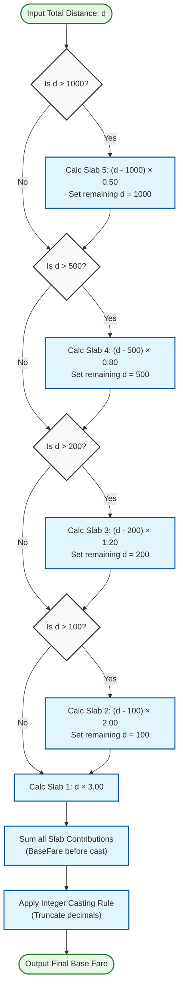

# Domain Rules: Fare Calculation

*SRIS — Sarathi Railway Information System*

*A Unified Railway Management Platform*

*Inspired by CRIS and IRCTC · Independent project*

> **Version:** 1.0 | **Date:** 2026-10-22 | **Document ID:** SRIS-P1-REQ-007

| Field              | Value                                                             |
| ------------------ | ----------------------------------------------------------------- |
| Title              | Domain Rules: Fare Calculation                                    |
| Software           | SRIS                                                              |
| Software Full Form | Sarathi Railway Information System                                |
| Team Codename      | Project Sarathi                                                   |
| Document ID        | SRIS-P1-REQ-007                                                   |
| Task               | Define the deterministic fare calculation rules for Phase 1       |
| Document Type      | Domain Rules Document                                             |
| Milestone          | Phase 1 Foundation                                                |
| Classification     | Internal                                                          |
| Version            | 1.0                                                               |
| Date               | 2026-10-22                                                        |
| Author             | Koushal Jha, Lead Architect                                       |
| Approved By        | Koushal Jha, Lead Architect                                       |
| Approval Date      | 2026-10-22                                                        |
| Supersedes         | None (first version)                                              |
| Related Documents  | See Appendix B                                                    |
| Affiliation        | Independent · Not affiliated with CRIS, IRCTC, or Indian Railways |

---

## Table of Contents

1. [Introduction](#1-introduction)
   - [1.1 Purpose](#11-purpose)
   - [1.2 Scope](#12-scope)
   - [1.3 Audience](#13-audience)
2. [Normative References and Terminology](#2-normative-references-and-terminology)
   - [2.1 Normative References](#21-normative-references)
   - [2.2 Terminology](#22-terminology)
3. [Core Fare Architecture: Incremental Slab Structure](#3-core-fare-architecture-incremental-slab-structure)
   - [3.1 Slab Definitions](#31-slab-definitions)
   - [3.2 Mathematical Formula](#32-mathematical-formula)
   - [3.3 Calculation Flow (Algorithm Logic)](#33-calculation-flow-algorithm-logic)
   - [3.4 Integer Casting Rule](#34-integer-casting-rule)
   - [3.5 Worked Slab Calculation](#35-worked-slab-calculation)
4. [Fixed Category Charges (Express Train Class)](#4-fixed-category-charges-express-train-class)
5. [Tax and Fee Rules (GST Compliance)](#5-tax-and-fee-rules-gst-compliance)
6. [Canonical Test Vectors](#6-canonical-test-vectors)
7. [System Operational Parameters](#7-system-operational-parameters)
8. [Phase 1 Boundary Demarcation](#8-phase-1-boundary-demarcation)
9. [Approval](#9-approval)

- [Revision History](#revision-history)
- [Appendix A: Not Applicable](#appendix-a-not-applicable)
- [Appendix B: Related Documents](#appendix-b-related-documents)

---

## 1. Introduction

### 1.1 Purpose

This document defines the deterministic, mathematical business logic for calculating Express Train passenger fares in SRIS Phase 1. It specifies the progressive distance-based slab structure, fixed category charges, convenience fees, GST rules, and the operational parameters that govern when a fare may be calculated.

The rules in this document are the authoritative reference for the Pricing module within S2 Master Data and Pricing Service, as identified in [SRIS-P1-ARCH-001](../wave-2-architecture/SRIS-P1-ARCH-001_MicroservicesIdentification.md) — Microservices Identification. They ensure that every fare calculation produces the same result for the same inputs, and that QA and developers can implement unit tests directly from the canonical test vectors in [Section 6](#6-canonical-test-vectors).

### 1.2 Scope

**In scope**

- Progressive distance-based slab calculations for Express Train passenger fares.
- Fixed surcharges applicable to every valid Express booking.
- Convenience fees covering payment gateway and server processing infrastructure.
- GST rules applicable to the fare and fees.
- Rolling booking windows and booking cutoffs.
- Maintenance windows during which fare calculation is restricted.
- Rounding standards for base calculations and final currency summaries.
- Canonical worked examples for QA and development unit tests.

**Out of scope**

- Concessions of any kind, including senior citizen concessions and special quota concessions. These are deferred to Phase 2.
- Dynamic surge pricing. This is deferred to Phase 2.
- Multi-class seating multipliers, including AC, Sleeper, and General class multipliers. These are deferred to Phase 2.
- Cancellation refund matrices and cancellation penalties. These are deferred to Phase 2.

### 1.3 Audience

- **Lead Architect:** maintains this document and is the authority for any change to the fare rules.
- **Backend developers:** implement the fare calculation logic in the Pricing module of S2 Master Data and Pricing Service.
- **QA engineers:** write unit and service tests against the canonical test vectors in [Section 6](#6-canonical-test-vectors).
- **Frontend developers:** display fare quotes and fare re-quotes consistent with these rules.
- **Project supervisor and evaluator:** verify that the fare calculation is deterministic and that Phase 1 boundaries are respected.

---

## 2. Normative References and Terminology

### 2.1 Normative References

The following documents are indispensable for the application of this document. For dated references, only the edition cited applies. For undated references, the latest edition of the referenced document applies.

| Document ID | Title | Relevance |
|-------------|-------|-----------|
| [SRIS-P1-REQ-001](./SRIS-P1-REQ-001_GlossaryAndDomainDictionary.md) | Glossary and Domain Dictionary | Defines core travel terminology used in this document. |
| [SRIS-P1-REQ-002](./SRIS-P1-REQ-002_BusinessRequirementsDocumentBRD.md) | Business Requirements Document (BRD) | States the business need for fare rules and the requirement for a fare quote. |
| [SRIS-P1-ARCH-001](../wave-2-architecture/SRIS-P1-ARCH-001_MicroservicesIdentification.md) | Microservices Identification | Identifies pricing and fare calculation as an internal responsibility of S2 Master Data and Pricing Service. |
| [SRIS-P1-GOV-002](../wave-0-project-foundation/SRIS-P1-GOV-002_DocumentTemplateStandard.md) | Document Template Standard | Defines the structure, header, and style of this document. |
| [SRIS-P1-GOV-003](../wave-0-project-foundation/SRIS-P1-GOV-003_DocumentIDAndCategoryScheme.md) | Document ID and Category Scheme | Defines the Document ID format used in this document. |
| [SRIS-P1-GOV-004](../wave-0-project-foundation/SRIS-P1-GOV-004_DocumentCrossReferenceStandard.md) | Document Cross-Reference Standard | Defines the citation and linking rules used in this document. |

### 2.2 Terminology

The terms below have the meanings recorded in [SRIS-P1-REQ-001](./SRIS-P1-REQ-001_GlossaryAndDomainDictionary.md) — Glossary and Domain Dictionary. Where this document owns a term, the entry states the rule that this document defines.

| Term | Definition | Owning Document |
|------|------------|-----------------|
| Base fare | The fundamental cost of travel calculated against total journey distance, excluding class multipliers. In this document, the base fare is the result of the progressive slab calculation before fixed charges and fees are added. | This document |
| Distance slab | A predefined distance range used to assign a rate per kilometre within a progressive telescopic model. In this document, five slabs are defined in [Section 3.1](#31-slab-definitions). | This document |
| Progressive slab | A distance model in which the rate per kilometre decreases as the cumulative distance increases, applied segment-wise across the journey. | This document |
| Fare quote | An estimated total price shown during search, before final quota and concession validation. The fare quote uses the same slab rules as the fare re-quote but is not authoritative for booking. | This document |
| Fare re-quote | The final authoritative price calculation performed before payment, incorporating all selected criteria. The booking uses the fare re-quote, not the fare quote. | This document |
| Express Charge | A fixed flat fee of ₹100.00 applied to every valid Express booking regardless of distance. | This document |
| Reservation Charge | A fixed flat fee of ₹50.00 applied to every valid Express booking regardless of distance. | This document |
| Convenience Fee | A fixed charge of ₹35.00 per transaction covering payment gateway and server processing infrastructure. | This document |
| GST | Goods and Services Tax. In this document, GST is 0% on the base fare and fixed charges, and 18% on the convenience fee. | This document |
| Integer casting | The process of converting a decimal base fare to an absolute integer at the conclusion of the base fare calculation. | This document |
| Distance | The cumulative route length in kilometres from the origin to a specific station, used to determine the slab in which each segment of the journey falls. | This document |
| Express | A long-distance train category that halts mainly at major intermediate stations. Phase 1 fare rules apply to Express trains only. | [SRIS-P1-REQ-003](./SRIS-P1-REQ-003_CapabilityCatalogFinal.md) |

---

## 3. Core Fare Architecture: Incremental Slab Structure

### 3.1 Slab Definitions

The base fare is calculated using a progressive, telescopic, segment-wise cumulative distance model. The total journey distance $d$ is broken down across five discrete slabs. Each slab has a rate per kilometre that applies only to the distance traversed within that slab.

| Slab | Distance Range (km) | Rate per Kilometre (₹) |
|------|---------------------|------------------------|
| Slab 1 | 0 – 100 | 3.00 |
| Slab 2 | 101 – 200 | 2.00 |
| Slab 3 | 201 – 500 | 1.20 |
| Slab 4 | 501 – 1000 | 0.80 |
| Slab 5 | 1000+ | 0.50 |

The slab boundaries are inclusive of the lower bound and exclusive of the upper bound. For example, a journey of exactly 100 km falls entirely within Slab 1. A journey of 101 km uses Slab 1 for the first 100 km and Slab 2 for the remaining 1 km.

### 3.2 Mathematical Formula

The base fare is the sum of the fare contributions from each slab traversed. The formula is:

$$
BaseFare(d) = \sum_{i=1}^{n} (\Delta d_i \times r_i)
$$

Where:

- $d$ is the total journey distance in kilometres.
- $n$ is the number of slabs traversed.
- $\Delta d_i$ is the distance traversed within slab $i$, in kilometres.
- $r_i$ is the rate per kilometre for slab $i$, in rupees.

The sum is taken over all slabs from the first slab to the slab in which the journey terminates.

### 3.3 Calculation Flow (Algorithm Logic)

The following flowchart illustrates the deterministic logic the system uses to calculate the progressive slab fare and apply the integer casting rule.

### 3.4 Integer Casting Rule

Absolute integer casting is enforced strictly at the conclusion of the base fare calculation. This means:

1. The base fare is calculated using the slab rates with full decimal precision.
2. The result is cast to an absolute integer by truncation of any fractional part.
3. The integer base fare is then used in all subsequent additions of fixed charges and fees.

The integer casting rule does not apply to the fixed charges, the convenience fee, or the final currency summary. Those components retain two decimal places.

### 3.5 Worked Slab Calculation

To illustrate the slab structure, consider a journey of 350 km:

| Slab | Distance in Slab (km) | Rate (₹/km) | Contribution (₹) |
|------|----------------------|-------------|-------------------|
| Slab 1 | 100 | 3.00 | 300.00 |
| Slab 2 | 100 | 2.00 | 200.00 |
| Slab 3 | 150 | 1.20 | 180.00 |
| Slab 4 | 0 | 0.80 | 0.00 |
| Slab 5 | 0 | 0.50 | 0.00 |
| **Total** | **350** | — | **680.00** |

The base fare before integer casting is ₹680.00. After integer casting, the base fare is ₹680.

---

## 4. Fixed Category Charges (Express Train Class)

### 4.1 Express Charge

Every valid Express booking incurs a fixed Express Charge of ₹100.00. This charge is applied once per booking, regardless of the journey distance, the number of passengers, or the class of travel. The Express Charge is not subject to GST.

### 4.2 Reservation Charge

Every valid Express booking incurs a fixed Reservation Charge of ₹50.00. This charge is applied once per booking, regardless of the journey distance, the number of passengers, or the class of travel. The Reservation Charge is not subject to GST.

The combined fixed charges for every valid Express booking are therefore ₹150.00 (₹100.00 Express Charge plus ₹50.00 Reservation Charge).

---

## 5. Tax and Fee Rules (GST Compliance)

### 5.1 GST on Base Fare and Fixed Charges

The base fare and the fixed charges (Express Charge and Reservation Charge) are subject to 0% GST. They are exempt under the passenger rail framework adopted for Phase 1. No GST is added to these components.

### 5.2 Convenience Fee

A convenience fee of ₹35.00 is charged per transaction. This fee covers payment gateway and server processing infrastructure. The convenience fee is a fixed amount and does not vary with the journey distance, the number of passengers, or the class of travel.

### 5.3 GST on Convenience Fee

GST at 18% is applied exclusively to the convenience fee. The GST amount is calculated as:

GST on Convenience Fee = ₹35.00 × 0.18 = ₹6.30

The convenience fee including GST is therefore ₹41.30 (₹35.00 plus ₹6.30).

### 5.4 Total Fare Composition

The total fare for a booking is the sum of the integer base fare, the fixed charges, and the convenience fee including GST. The formula is:

Total Fare = BaseFare(integer) + Express Charge + Reservation Charge + Convenience Fee + GST on Convenience Fee

Substituting the fixed values:
Total Fare = BaseFare(integer) + ₹100.00 + ₹50.00 + ₹35.00 + ₹6.30
Total Fare = BaseFare(integer) + ₹191.30

The total fare is expressed with standard decimal precision of two decimal places.

---

## 6. Canonical Test Vectors

The test vectors below are mandatory worked examples for QA and development unit tests. They are verified against the rules in Sections 3, 4, and 5. QA and developers must implement unit tests directly from these vectors.

### 6.1 Example A: Short Journey (50 km)

A journey of 50 km falls entirely within Slab 1.

| Component | Calculation | Amount (₹) |
|-----------|-------------|------------|
| Slab 1 contribution | 50 km × ₹3.00 | 150.00 |
| Base Fare (before integer cast) | — | 150.00 |
| Base Fare (after integer cast) | Truncate fractional part | 150 |
| Express Charge | Fixed | 100.00 |
| Reservation Charge | Fixed | 50.00 |
| Fixed Charges Total | 100.00 + 50.00 | 150.00 |
| Convenience Fee | Fixed | 35.00 |
| GST on Convenience Fee | 35.00 × 0.18 | 6.30 |
| Convenience Fee + GST | 35.00 + 6.30 | 41.30 |
| **Grand Total** | **150 + 150.00 + 41.30** | **341.30** |

**Verification:** The integer base fare is ₹150. The fixed charges are ₹150.00. The convenience fee including GST is ₹41.30. The grand total is ₹341.30.

### 6.2 Example B: Long Journey (850 km)

A journey of 850 km traverses Slabs 1, 2, 3, and 4.

| Component | Calculation | Amount (₹) |
|-----------|-------------|------------|
| Slab 1 contribution | 100 km × ₹3.00 | 300.00 |
| Slab 2 contribution | 100 km × ₹2.00 | 200.00 |
| Slab 3 contribution | 300 km × ₹1.20 | 360.00 |
| Slab 4 contribution | 350 km × ₹0.80 | 280.00 |
| Base Fare (before integer cast) | 300.00 + 200.00 + 360.00 + 280.00 | 1140.00 |
| Base Fare (after integer cast) | Truncate fractional part | 1140 |
| Express Charge | Fixed | 100.00 |
| Reservation Charge | Fixed | 50.00 |
| Fixed Charges Total | 100.00 + 50.00 | 150.00 |
| Convenience Fee | Fixed | 35.00 |
| GST on Convenience Fee | 35.00 × 0.18 | 6.30 |
| Convenience Fee + GST | 35.00 + 6.30 | 41.30 |
| **Grand Total** | **1140 + 150.00 + 41.30** | **1331.30** |

**Verification:** The integer base fare is ₹1140. The fixed charges are ₹150.00. The convenience fee including GST is ₹41.30. The grand total is ₹1331.30.

---

## 7. System Operational Parameters

### 7.1 Booking Window

The booking window is a strict 7-day rolling window. A customer may book a ticket for a journey date that falls within the next 7 days from the current date. The 7-day rolling window is the advantageous advance reservation limit for Phase 1.

### 7.2 Booking Cutoff

The booking cutoff is exactly 1 hour prior to the scheduled train departure. No booking may be completed for a train that departs in less than 1 hour from the current time. The cutoff applies to the completion of the booking transaction, including payment and confirmation.

### 7.3 Maintenance Window

The system enters a restricted pricing calculation state from 12:00 AM to 4:00 AM daily. During this maintenance window, the system is offline for fare calculation purposes. No new fare quotes or fare re-quotes are produced, and no bookings are confirmed. The maintenance window supports scheduled maintenance and data consistency operations.

### 7.4 Rounding Standard

Two rounding standards apply:

- **Base calculations:** Absolute integers. The base fare is cast to an integer at the conclusion of the slab calculation, as defined in [Section 3.4](#34-integer-casting-rule).
- **Final currency summaries:** Standard decimal precision of two decimal places. The grand total, the fixed charges, the convenience fee, and the GST on the convenience fee are expressed with two decimal places.

---

## 8. Phase 1 Boundary Demarcation

The following capabilities are explicitly out of scope for Phase 1. Each entry states the missing data and the phase to which the capability is deferred. This section prevents scope creep and ensures that Phase 1 delivers a complete and deterministic fare calculation for Express trains only.

### 8.1 Travel Classes

**Status:** DATA NOT FOUND IN SOURCES.

**Phase 1 treatment:** Out of scope. Phase 1 fare calculation applies a single base fare structure for Express trains. Multi-class seating multipliers for AC, Sleeper, and General classes are not defined in the sources and are deferred to Phase 2.

### 8.2 Dynamic Surge Pricing

**Status:** DATA NOT FOUND IN SOURCES.

**Phase 1 treatment:** Out of scope. Phase 1 fare calculation is deterministic and does not include dynamic surge pricing. Dynamic pricing rules, including any mechanism that increases fares as seat inventory depletes, are deferred to Phase 2.

### 8.3 Concessions

**Status:** DATA NOT FOUND IN SOURCES.

**Phase 1 treatment:** Out of scope. Phase 1 fare calculation does not include any concession for senior citizens, special quotas, or any other passenger category. Concession rules and eligibility criteria are deferred to Phase 2.

### 8.4 Cancellation Penalties and Refund Slabs

**Status:** DATA NOT FOUND IN SOURCES.

**Phase 1 treatment:** Out of scope. Phase 1 fare calculation does not include cancellation penalties or refund slabs. The rules that determine how much of the fare is refunded upon cancellation, and any penalty applied, are deferred to Phase 2.

---

## 9. Approval

| Role           | Name        | Decision | Date       |
| -------------- | ----------- | -------- | ---------- |
| Lead Architect | Koushal Jha | Approved | 2026-10-22 |

---

## Revision History

| Version | Date       | Author      | Change           |
| ------- | ---------- | ----------- | ---------------- |
| 1.0     | 2026-10-22 | Koushal Jha | Initial release. |

---

## Appendix A: Not Applicable

Not applicable.

---

## Appendix B: Related Documents

### B.1 Directly Referenced Documents

| Seq  | Document ID                                                                                    | Document Name                                | Wave | Pri | Tag     |
| ---- | ---------------------------------------------------------------------------------------------- | -------------------------------------------- | ---- | --- | ------- |
| 0.0  | [SRIS-P1-GOV-001](../wave-0-project-foundation/SRIS-P1-GOV-001_DocumentationIndexAndNavigationMap.md) | Documentation Index and Navigation Map       | 0    | P0  | UNBLOCK |
| 0.1  | [SRIS-P1-GOV-002](../wave-0-project-foundation/SRIS-P1-GOV-002_DocumentTemplateStandard.md)           | Document Template Standard                   | 0    | P0  | UNBLOCK |
| 0.2  | [SRIS-P1-GOV-003](../wave-0-project-foundation/SRIS-P1-GOV-003_DocumentIDAndCategoryScheme.md)        | Document ID and Category Scheme              | 0    | P1  | UNBLOCK |
| 0.3  | [SRIS-P1-GOV-004](../wave-0-project-foundation/SRIS-P1-GOV-004_DocumentCrossReferenceStandard.md)     | Document Cross-Reference Standard            | 0    | P1  | UNBLOCK |
| 1.1  | [SRIS-P1-REQ-001](./SRIS-P1-REQ-001_GlossaryAndDomainDictionary.md)                                  | Glossary and Domain Dictionary               | 1    | P0  | UNBLOCK |
| 1.2  | [SRIS-P1-REQ-002](./SRIS-P1-REQ-002_BusinessRequirementsDocumentBRD.md)                               | Business Requirements Document (BRD)         | 1    | P0  | UNBLOCK |
| 2.1  | [SRIS-P1-ARCH-001](../wave-2-architecture/SRIS-P1-ARCH-001_MicroservicesIdentification.md)             | Microservices Identification                 | 2    | P0  | UNBLOCK |

### B.2 Documents That Reference This Document

| Seq | Document ID                                                                                 | Document Name                          | Why It References                                                                  |
| --- | ------------------------------------------------------------------------------------------- | -------------------------------------- | ---------------------------------------------------------------------------------- |
| 1.1 | [SRIS-P1-REQ-001](./SRIS-P1-REQ-001_GlossaryAndDomainDictionary.md)                           | Glossary and Domain Dictionary         | Owns the fare and pricing terms defined in this document                            |
| 1.2 | [SRIS-P1-REQ-002](./SRIS-P1-REQ-002_BusinessRequirementsDocumentBRD.md)                       | Business Requirements Document (BRD)   | BR-8 names this document as the owner of detailed fare calculation rules            |
| 2.1 | [SRIS-P1-ARCH-001](../wave-2-architecture/SRIS-P1-ARCH-001_MicroservicesIdentification.md)   | Microservices Identification           | B.6 lists this document as the owner of detailed domain rules for fare calculation |

### B.3 Documents This Document Depends On (Upstream)

| Seq | Document ID                                                                                    | Document Name                          | Dependency Type |
| --- | ---------------------------------------------------------------------------------------------- | -------------------------------------- | --------------- |
| 0.0 | [SRIS-P1-GOV-001](../wave-0-project-foundation/SRIS-P1-GOV-001_DocumentationIndexAndNavigationMap.md) | Documentation Index and Navigation Map | Soft            |
| 0.1 | [SRIS-P1-GOV-002](../wave-0-project-foundation/SRIS-P1-GOV-002_DocumentTemplateStandard.md)           | Document Template Standard             | Hard            |
| 0.2 | [SRIS-P1-GOV-003](../wave-0-project-foundation/SRIS-P1-GOV-003_DocumentIDAndCategoryScheme.md)        | Document ID and Category Scheme        | Hard            |
| 0.3 | [SRIS-P1-GOV-004](../wave-0-project-foundation/SRIS-P1-GOV-004_DocumentCrossReferenceStandard.md)     | Document Cross-Reference Standard      | Hard            |
| 1.1 | [SRIS-P1-REQ-001](./SRIS-P1-REQ-001_GlossaryAndDomainDictionary.md)                                  | Glossary and Domain Dictionary         | Hard            |
| 1.2 | [SRIS-P1-REQ-002](./SRIS-P1-REQ-002_BusinessRequirementsDocumentBRD.md)                               | Business Requirements Document (BRD)   | Soft            |
| 2.1 | [SRIS-P1-ARCH-001](../wave-2-architecture/SRIS-P1-ARCH-001_MicroservicesIdentification.md)             | Microservices Identification           | Soft            |

### B.4 Documents This Document Unblocks (Downstream)

| Seq | Document ID                                                                                 | Document Name                                | Blocked Until |
| --- | ------------------------------------------------------------------------------------------- | -------------------------------------------- | ------------- |
| 1.8 | [SRIS-P1-REQ-008](./SRIS-P1-REQ-008_DomainRulesTicketing.md)                                 | Domain Rules: Ticketing                      | This approved |
| 3.14 | [SRIS-P1-API-001](../wave-3-detailed-design/SRIS-P1-API-001_APIContractDocumentOpenAPI.md)  | API Contract Document (OpenAPI)              | This approved |
| 3.4 | [SRIS-P1-DATA-004](../wave-3-detailed-design/SRIS-P1-DATA-004_DataDictionary.md)            | Data Dictionary                              | This approved |
| 4.3 | [SRIS-P1-TEST-003](../wave-4-testing/SRIS-P1-TEST-003_TestCasesFunctional.md)               | Test Cases (Functional)                      | This approved |

### B.5 Master Documentation Index

The complete list of Phase 1 documents is in [SRIS-P1-GOV-001](../wave-0-project-foundation/SRIS-P1-GOV-001_DocumentationIndexAndNavigationMap.md) — Documentation Index and Navigation Map.

### B.6 External Reference Documents

None.

### B.7 Document Conventions

The conventions for Priority and Tag values are defined in [Section 9](../wave-0-project-foundation/SRIS-P1-GOV-002_DocumentTemplateStandard.md#9-vocabulary-standards) of [SRIS-P1-GOV-002](../wave-0-project-foundation/SRIS-P1-GOV-002_DocumentTemplateStandard.md) — Document Template Standard.

---

**End of Document**