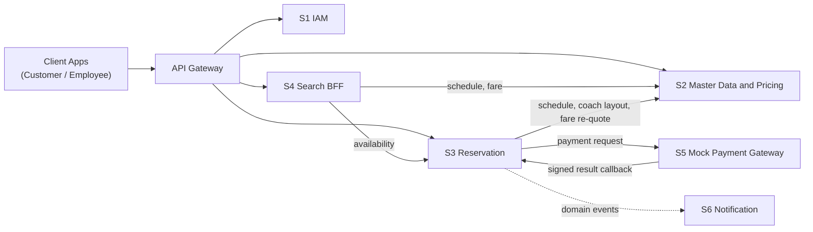

# Microservices Identification: Phase 1 Foundation

**SRIS — Sarathi Railway Information System**

*A Unified Railway Management Platform*

*Inspired by CRIS and IRCTC · Independent project*

> **Status:** Approved | **Version:** 1.0 | **Date:** 2026-10-09 | **Document ID:** SRIS-P1-ARCH-001

| Field              | Value                                                             |
| ------------------ | ----------------------------------------------------------------- |
| Title              | Microservices Identification: Phase 1 Foundation                  |
| Software           | SRIS                                                              |
| Software Full Form | Sarathi Railway Information System                                |
| Team Codename      | Project Sarathi                                                   |
| Document ID        | SRIS-P1-ARCH-001                                                  |
| Task               | Microservices Identification for Phase 1 Foundation               |
| Document Type      | Architecture Decision Document                                    |
| Milestone          | Phase 1 Foundation                                                |
| Classification     | Internal                                                          |
| Version            | 1.0                                                               |
| Date               | 2026-10-09                                                        |
| Author             | Koushal Jha, Lead Architect                                       |
| Status             | Approved                                                          |
| Approved By        | Koushal Jha, Lead Architect                                       |
| Approval Date      | 2026-10-10                                                        |
| Supersedes         | None (first version)                                              |
| Related Documents  | See Appendix B                                                    |
| Affiliation        | Independent · Not affiliated with CRIS, IRCTC, or Indian Railways |

---

## Table of Contents

1. [Introduction](#1-introduction)
   - [1.1 Purpose](#11-purpose)
   - [1.2 Scope](#12-scope)
   - [1.3 Out of Scope](#13-out-of-scope)
   - [1.4 Intended Audience](#14-intended-audience)
   - [1.5 Definitions and Abbreviations](#15-definitions-and-abbreviations)
2. [Inputs and Constraints](#2-inputs-and-constraints)
3. [Methodology](#3-methodology)
   - [3.1 Identification Process](#31-identification-process)
   - [3.2 Decision Criteria](#32-decision-criteria)
4. [Railway Domain Capability Catalog](#4-railway-domain-capability-catalog)
   - [4.1 How to Read the Catalog](#41-how-to-read-the-catalog)
   - [4.2 Phase 1 Capabilities](#42-phase-1-capabilities)
   - [4.3 Deferred Capabilities](#43-deferred-capabilities)
5. [Architectural Strategy](#5-architectural-strategy)
   - [5.1 Why Microservices](#51-why-microservices)
   - [5.2 Why a Hybrid Macro-service Approach](#52-why-a-hybrid-macro-service-approach)
   - [5.3 Alternatives Considered](#53-alternatives-considered)
6. [Finalized Microservices for Phase 1](#6-finalized-microservices-for-phase-1)
   - [6.1 Service Catalog](#61-service-catalog)
   - [6.2 Service Specifications](#62-service-specifications)
   - [6.3 Capability Traceability](#63-capability-traceability)
   - [6.4 Interaction Overview](#64-interaction-overview)
   - [6.5 Supporting Infrastructure](#65-supporting-infrastructure)
7. [Justification of Service Boundaries](#7-justification-of-service-boundaries)
   - [7.1 Derivation of the Service Count](#71-derivation-of-the-service-count)
   - [7.2 Consolidations](#72-consolidations)
   - [7.3 Why Not Fewer Than Six](#73-why-not-fewer-than-six)
   - [7.4 Internal Module Boundary Rules](#74-internal-module-boundary-rules)
8. [Assumptions, Risks and Open Items](#8-assumptions-risks-and-open-items)
   - [8.1 Assumptions](#81-assumptions)
   - [8.2 Risks](#82-risks)
   - [8.3 Open Items](#83-open-items)
9. [Acceptance Criteria and Sign-off](#9-acceptance-criteria-and-sign-off)
   - [9.1 Acceptance Checklist](#91-acceptance-checklist)
   - [9.2 Approval](#92-approval)

- [Appendix A: Evolution of the Service List](#appendix-a-evolution-of-the-service-list)
- [Appendix B: Related Documents and Cross-Reference Index](#appendix-b-related-documents-and-cross-reference-index)
- [Revision History](#revision-history)

---

## 1. Introduction

### 1.1 Purpose

This document records the outcome of the task **Microservices Identification for Phase 1 Foundation**. The task decides the total number of microservices that Phase 1 needs so that a customer can book a ticket smoothly, from search to PNR. The document:

- lists the business capabilities of a railway ecosystem,
- groups them into bounded contexts,
- finalizes the deployable microservices for Phase 1, and
- justifies the grouping and the final count.

**Outcome:** Phase 1 Foundation requires **six** microservices: IAM, Master Data and Pricing, Reservation, Search Aggregator BFF, Mock Payment Gateway, and Notification.

SRIS (Sarathi Railway Information System) is an independent unified railway management platform built under the codename Project Sarathi. The word "Sarathi" is Sanskrit for "charioteer" — the guide who steers but does not own the journey. SRIS is inspired by the architecture and systems of CRIS and the booking experience of IRCTC, but is not affiliated with either organization.

### 1.2 Scope

In scope:

- Identification of railway domain capabilities (Phase 1 and deferred).
- Identification of bounded contexts and the deployable services for Phase 1.
- Justification of service boundaries and of the final count of six.

The Phase 1 goal that drives the scope is a **complete end-to-end booking flow**: an employee sets up train data, a customer searches, holds a seat, pays, and receives a PNR.

### 1.3 Out of Scope

| Topic                                                                                   | Where it is documented                                            |
| --------------------------------------------------------------------------------------- | ----------------------------------------------------------------- |
| Detailed domain rules (fare calculation logic, ticketing rules, waitlist algorithms)    | Requirement gathering tasks                                       |
| Technology choices and the reasons for them (languages, runtimes, data stores, tooling) | Technology Stack ADR and Infrastructure and Technology documents  |
| API contracts and event schemas                                                         | API and Integration design documents                              |
| Database schemas and data-store assignment                                              | Data design document                                              |
| Load targets, load model, performance acceptance values, and the load test plan         | Non-functional requirements and test documents                    |
| Local environment, hardware, memory limits, and resource sizing                         | Infrastructure and Technology documents                           |
| Service count and design for later phases                                               | Later tasks (the deferred capabilities are listed in section 4.3) |
| Project vision, goals, motivation, and overview                                         | Project vision and scope documentation (to be created)            |
| Development approach, team setup, roles, and responsibilities                           | Project management documentation (to be created)                  |

### 1.4 Intended Audience

  - **Project evaluators** — verify the completeness and quality of
    the microservices identification.
  - **Supervisor** — reviews the document as part of the academic
    project.
  - **Team members** — understand the service boundaries they will
    implement, test, or design against.
  - **Lead Architect** — maintains this document.
  - **Future contributors** — onboard into the architecture.

### 1.5 Definitions and Abbreviations

| Term              | Meaning                                                                                                  |
| ----------------- | -------------------------------------------------------------------------------------------------------- |
| Bounded Context   | A boundary within which a domain model and its terms have one consistent meaning (Domain-Driven Design). |
| Macro-service     | A deployable service that contains several cohesive modules, each with its own internal boundary.        |
| BFF               | Backend-For-Frontend: a service that composes data from several services for a client.                   |
| ACL               | Anti-Corruption Layer: an adapter that shields a domain from an external system's model.                 |
| PNR               | Passenger Name Record, the 10-digit booking reference.                                                   |
| Seat Matrix       | The generated set of bookable seats for a train run, derived from master data.                           |
| Chart Preparation | Producing the final reservation chart for a departure.                                                   |
| ADR               | Architecture Decision Record.                                                                            |

---

## 2. Inputs and Constraints

This section records the inputs used for the service decision. Load, environment, and resource constraints are documented separately.

| Item               | Value                                                                                      |
| ------------------ | ------------------------------------------------------------------------------------------ |
| Goal               | End-to-end booking: master data setup, search, seat hold, payment, PNR, notification       |
| Architecture style | Microservices, designed from bounded contexts first, then consolidated into macro-services |
| Delivery capacity  | Small team (5 members), approximately 2 months (input to criterion D5)                     |

---

## 3. Methodology

### 3.1 Identification Process

1. **List capabilities** across the full railway ecosystem, without regard to deployment.
2. **Tag each capability** as Phase 1, Phase 2, or Future.
3. **Group Phase 1 capabilities into bounded contexts** by business capability and consistency requirement, not by noun (for example, not "Train" or "Station" as services).
4. **Consolidate contexts into deployable services** using criteria D1 to D5 in section 3.2.
5. **Validate** through review and developer approval.

### 3.2 Decision Criteria

| ID  | Criterion            | Rule                                                                                                                      |
| --- | -------------------- | ------------------------------------------------------------------------------------------------------------------------- |
| D1  | Consistency          | Capabilities that share an invariant that must hold atomically stay in one service.                                       |
| D2  | Dependency direction | No cyclic synchronous dependencies between services.                                                                      |
| D3  | Change reason        | Capabilities that change for different reasons, for different actors, or at different rates are separated when D1 allows. |
| D4  | Failure isolation    | Side effects that must not block the core transaction (for example, notifications) are separated and asynchronous.        |
| D5  | Delivery capacity    | The result must be buildable by a small team in the available time.                                                       |

---

## 4. Railway Domain Capability Catalog

### 4.1 How to Read the Catalog

- Capabilities are grouped by domain and described by what the business does, not how.
- Capabilities in section 4.2 carry no fixed numbers on purpose, because the list is not final.
- Each row names the Phase 1 service that owns the capabilities (S1 to S6, defined in section 6).

### 4.2 Phase 1 Capabilities

> **Provisional.** This is a working baseline. Capability names, grouping, numbering, and order are not final and will be set in the requirement gathering tasks. The service decisions in section 6 depend on the capability *domains*, not on individual items.

| Domain                | Capabilities (indicative)                                                                                                                                                            | Owner     |
| --------------------- | ------------------------------------------------------------------------------------------------------------------------------------------------------------------------------------ | --------- |
| Identity and Access   | Customer registration and login; employee authentication; role-based access control; token issuance, refresh, and revocation; basic user profile                                     | S1        |
| Railway Master Data   | Station management; route and stop management with distances; train and schedule management (running days, timings); coach composition and berth layout; class and quota definitions | S2        |
| Fare and Pricing      | Base fare per kilometre by class; dynamic pricing rules; concessions; fare quote                                                                                                     | S2        |
| Inventory and Quota   | Seat matrix generation from master data; quota allocation; availability enquiry; seat hold, confirm, and release (double-booking prevention)                                         | S3        |
| Booking and Ticketing | Booking lifecycle (state machine); 10-digit PNR generation; waitlist handling and cascade; chart preparation; cancellation (seat release); ticket and PNR status retrieval           | S3        |
| Payment               | Payment initiation, attempt tracking, and callback verification (domain side); simulated payment processing and result callback (simulator side)                                     | S3 and S5 |
| Search and Discovery  | Train search by route and date; unified response combining schedule, availability, and fare                                                                                          | S4        |
| Notification          | Booking confirmation messages (SMS and email); message templates and delivery log                                                                                                    | S6        |

Expected to be deferred (to be confirmed): refund processing, payment reconciliation and settlement, and in-app or push notifications.

### 4.3 Deferred Capabilities

These belong to the complete railway ecosystem but are outside the Phase 1 booking flow.

| ID   | Capability                                        | Domain                 | Target  |
| ---- | ------------------------------------------------- | ---------------------- | ------- |
| D-01 | Train running status and delay tracking           | Live Operations        | Phase 2 |
| D-02 | Disruption management (cancellations, diversions) | Live Operations        | Phase 2 |
| D-03 | Platform allocation                               | Station Operations     | Phase 2 |
| D-04 | Station facilities management                     | Station Operations     | Phase 2 |
| D-05 | Employee records and departments                  | Workforce (HR)         | Phase 2 |
| D-06 | Crew rostering and duty assignment                | Workforce (HR)         | Phase 2 |
| D-07 | Leave and attendance                              | Workforce (HR)         | Phase 2 |
| D-08 | Operational dashboards and reports                | Insights and Reporting | Phase 2 |
| D-09 | Passenger grievance handling                      | Grievance              | Future  |
| D-10 | Catering and on-board services                    | Catering               | Future  |
| D-11 | Vendor management                                 | Vendor Management      | Future  |

Cross-cutting concerns (edge routing, health checks, structured logging, audit trail) apply to every service and are specified in the Infrastructure and Technology documents, not here.

---

## 5. Architectural Strategy

### 5.1 Why Microservices

A single monolith couples unrelated domains, for example internal administrative master data and public-facing search. Microservices give independent fault isolation, room for targeted scaling in later phases, and a logical separation of business concerns that mirrors enterprise practice.

### 5.2 Why a Hybrid Macro-service Approach

The project designs the ideal bounded contexts first, then consolidates them into macro-services while keeping each context as a separate internal module (section 7.4). Two drivers decide the consolidation:

1. **Domain cohesion (D1, D2).** Some contexts share invariants and would form cyclic dependencies if split. Keeping them together avoids distributed transactions and a distributed monolith.
2. **Delivery capacity (D5).** Each additional deployable adds build, security, contract, and test overhead for a small team.

Load and memory validation is performed in separate documents and does not decide the service count (section 1.3).

### 5.3 Alternatives Considered

| Option                                        | Services | Verdict      | Reason                                                                                                                                                                                                                                                                   |
| --------------------------------------------- | -------- | ------------ | ------------------------------------------------------------------------------------------------------------------------------------------------------------------------------------------------------------------------------------------------------------------------ |
| Fine-grained baseline (initial research list) | 14       | Rejected     | Several services are sliced by noun (Train, Station, Profile, Fare) instead of by business capability. Booking, Inventory, and Payment form cross-service transactional dependencies. Coordination and delivery cost is too high for a small team in the available time. |
| Phase 1 baseline                              | 8        | Revised      | Inventory and Booking depend on each other in a cycle. Fare is a stateless calculation over data that Master Data owns and does not justify its own deployable. Payment is an external system, not a domain context.                                                     |
| Coarse-grained                                | 4        | Rejected     | Too coarse: weakens isolation and the event-driven design. "Admin" is a user interface, not a bounded context.                                                                                                                                                           |
| Pure monolith                                 | 1        | Rejected     | Couples unrelated domains and removes fault isolation (section 5.1).                                                                                                                                                                                                     |
| **Hybrid macro-services**                     | **6**    | **Selected** | Meets D1 to D5.                                                                                                                                                                                                                                                          |

---

## 6. Finalized Microservices for Phase 1

### 6.1 Service Catalog

Six deployable services: five domain-facing services and one external-system simulator. Supporting infrastructure (gateway, data stores, event backbone) is not counted as microservices (section 6.5).

These six are the **Phase 1 Foundation count**. They are not the final count for the complete system: later phases add services for the deferred capabilities in section 4.3.

| ID  | Service                         | DDD Classification | Bounded Contexts Contained                 | Core Responsibility                                             |
| --- | ------------------------------- | ------------------ | ------------------------------------------ | --------------------------------------------------------------- |
| S1  | IAM Service                     | Generic            | Identity and Access                        | Authenticate and authorize customers and employees              |
| S2  | Master Data and Pricing Service | Supporting         | Railway Master Data, Fare and Pricing      | Single source of truth for railway configuration and fare rules |
| S3  | Reservation Service             | **Core**           | Inventory and Quota, Booking and Ticketing | Seat inventory and the booking state machine                    |
| S4  | Search Aggregator BFF           | Supporting         | Search and Discovery                       | One unified search API for client applications                  |
| S5  | Mock Payment Gateway            | External simulator | Payment (external system)                  | Simulate third-party payment processing                         |
| S6  | Notification Service            | Generic            | Notification and Eventing                  | Asynchronous user alerts from domain events                     |

### 6.2 Service Specifications

#### S1: IAM Service

- **Purpose:** Establish who the caller is and what role they hold.
- **Responsibilities:** The Identity and Access capabilities (section 4.2): registration and login for customers, employee authentication, role-based access, token lifecycle, basic profile.
- **Owns:** Users, credentials, roles, tokens, basic profile.
- **Depends on:** Nothing (leaf service).
- **Used by:** All services, for token validation.
- **Not responsible for:** Employment records, which belong to the future Workforce context (D-05 to D-07). IAM holds only the employee's *login identity*.

#### S2: Master Data and Pricing Service

- **Purpose:** The administrative backend where employees configure the railway network, and the authority for fares.
- **Responsibilities:** The Railway Master Data and Fare and Pricing capabilities: stations, routes and stops, trains and schedules, coach compositions, class and quota definitions, fare rules, concessions, and fare quotes.
- **Owns:** All static railway configuration and fare rules.
- **Depends on:** IAM (authorization of employee actions).
- **Used by:** Search BFF (schedules, fares) and Reservation (schedules, coach layouts, fare re-quote).
- **Not responsible for:** Live operations such as running status or platform allocation (deferred, D-01 to D-04). The word "Operations" was dropped from the service name for this reason.

#### S3: Reservation Service (Core)

- **Purpose:** Guarantee that a seat is never sold twice and drive the booking to a PNR.
- **Responsibilities:** Contains two internal modules:
  - **Inventory module:** seat matrix generation, quota allocation, availability, seat hold, confirm, and release.
  - **Booking module:** booking state machine, PNR generation, waitlist cascade, chart preparation, cancellation, ticket retrieval, payment attempt tracking, and verification of the payment callback (behind an anti-corruption layer facing the payment gateway).
- **Owns:** Seat inventory, bookings, passengers, PNRs, waitlist, payment attempt records.
- **Depends on:** Master Data and Pricing (schedule, coach layout, fare re-quote), Mock Payment Gateway (outbound payment request).
- **Used by:** Search BFF (availability), clients (booking operations).
- **Publishes:** Domain events (for example, booking confirmed) for Notification.
- **Not responsible for:** Fare calculation. The booking uses a fare re-quoted by Master Data and Pricing at booking time, not a price supplied by search.

#### S4: Search Aggregator BFF

- **Purpose:** Give the client one clean search response.
- **Responsibilities:** The Search and Discovery capabilities. Accept a search query, fetch schedules and fares from S2 and availability from S3, and return one combined result.
- **Owns:** No business data (stateless; an optional cache only).
- **Depends on:** S2, S3.
- **Not responsible for:** Any state change. It is read-only.

#### S5: Mock Payment Gateway

- **Purpose:** Stand in for an external payment provider so the flow can be built and demonstrated without real money.
- **Responsibilities:** Process a dummy payment with configurable outcomes and return a signed result callback (webhook) to Reservation.
- **Owns:** Simulated transaction records only.
- **Classification:** An **external system simulator**, not a domain bounded context. Reservation talks to it through an anti-corruption layer, so it can be replaced by a real gateway without changing the domain.

#### S6: Notification Service

- **Purpose:** Send confirmations without blocking the booking transaction.
- **Responsibilities:** Consume domain events from the event stream, render templates, send SMS and email, record delivery, and retry failures.
- **Owns:** Templates and delivery log.
- **Depends on:** The event stream only. It does not call back into Reservation.

### 6.3 Capability Traceability

| Service                    | Capability domains owned (section 4.2)                            | Expected to be deferred                |
| -------------------------- | ----------------------------------------------------------------- | -------------------------------------- |
| S1 IAM                     | Identity and Access                                               | none                                   |
| S2 Master Data and Pricing | Railway Master Data; Fare and Pricing                             | none                                   |
| S3 Reservation             | Inventory and Quota; Booking and Ticketing; Payment (domain side) | Refunds; reconciliation and settlement |
| S4 Search BFF              | Search and Discovery                                              | none                                   |
| S5 Mock Payment Gateway    | Payment (simulator side)                                          | none                                   |
| S6 Notification            | Notification                                                      | In-app and push notifications          |

Each Phase 1 capability has exactly one owning service. The Payment domain is split by role: the domain side belongs to S3, and the simulator side belongs to S5.

### 6.4 Interaction Overview

| From                 | To                      | Style                              | Purpose                                                                                                                              |
| -------------------- | ----------------------- | ---------------------------------- | ------------------------------------------------------------------------------------------------------------------------------------ |
| Search BFF           | Master Data and Pricing | Synchronous request/response       | Schedules and fares for a search                                                                                                     |
| Search BFF           | Reservation             | Synchronous request/response       | Availability for a search                                                                                                            |
| Reservation          | Master Data and Pricing | Synchronous request/response       | Schedule and coach layout for seat matrix generation, and fare re-quote at booking (final mechanism confirmed in integration design) |
| Reservation          | Mock Payment Gateway    | Synchronous request/response       | Initiate payment                                                                                                                     |
| Mock Payment Gateway | Reservation             | Callback (webhook)                 | Deliver payment result                                                                                                               |
| Reservation          | Notification            | Asynchronous events (event stream) | Trigger confirmations                                                                                                                |
| All services         | IAM                     | Token validation                   | Authenticate and authorize requests                                                                                                  |

There is no cycle in the synchronous dependency graph. The only return path to Reservation is the payment callback from an external system.

### 6.5 Supporting Infrastructure

Supporting infrastructure is **not counted as microservices**. In this document it is described only by role:

- an entry gateway for client traffic,
- data stores for services,
- an event backbone for asynchronous messages, and
- tooling for development and operations.

Product choices, configuration, and operating procedures are documented in the separate Infrastructure and Technology documents.

Principles that do shape service boundaries:

1. Each service owns its data.
2. No service reads another service's data store directly.
3. Services communicate only through APIs or events.

---

## 7. Justification of Service Boundaries

### 7.1 Derivation of the Service Count

The count of six follows from the decision criteria D1 to D5 (section 3.2). It is derived in four steps:

| Step       | Action                                                                                                                                                                                         | Services | Criteria          |
| ---------- | ---------------------------------------------------------------------------------------------------------------------------------------------------------------------------------------------- | -------- | ----------------- |
| 1          | Start from the Phase 1 capability domains: Identity and Access, Railway Master Data, Fare and Pricing, Inventory and Quota, Booking and Ticketing, Payment, Search and Discovery, Notification | 8        | Section 4.2       |
| 2          | Merge Inventory and Quota, Booking and Ticketing, and the domain side of Payment into one Reservation Service                                                                                  | 6        | D1, D2            |
| 3          | Merge Fare and Pricing into Railway Master Data to form the Master Data and Pricing Service                                                                                                    | 5        | D3, D5            |
| 4          | Add the external payment gateway as a separate simulator service                                                                                                                               | 6        | M-3 (section 7.2) |
| **Result** | IAM, Master Data and Pricing, Reservation, Search BFF, Mock Payment Gateway, Notification                                                                                                      | **6**    |                   |

The count is decided by D1 to D5.

### 7.2 Consolidations

These are the reasons the count is not higher than six.

#### M-1: Inventory + Booking become the Reservation Service

- **Decision:** One deployable with two internal modules.
- **Rationale:**
  - *Cyclic dependency (D2).* A cancellation releases a seat in Inventory, which needs the head of the waitlist held in Booking. Booking must then be called back to promote the passenger and update the PNR. Two services would call each other.
  - *Shared invariant (D1).* "A seat is never sold twice" spans seat state, booking state, and payment state.
  - *Consistent snapshot.* Chart preparation needs all PNRs and all seat allocations at one point in time.
  - *Delivery (D5).* A single transactional boundary replaces distributed sagas and compensating transactions.
- **Trade-off accepted:** A larger, more complex service. Mitigated by the module rules in section 7.4.
- **Revisit trigger:** A later phase, or earlier if availability reads need to be separated from bookings (risk R-5). The extraction path is an availability read model split out of Reservation.

#### M-2: Fare + Master Data become the Master Data and Pricing Service

- **Decision:** One deployable with two internal modules.
- **Rationale:**
  - Pricing is a stateless rules computation over data that Master Data owns (distance, class, quota).
  - The same actor, an employee, configures both, so they change for the same reason (D3).
  - Keeping Fare separate would add an extra downstream call to every search and every booking re-quote.
  - One fewer service to build, secure, and test for a small team (D5).
- **Honest note:** This is the merge with the weakest domain-driven argument, because pricing could stand as its own context. It is justified by D3 and D5, and Fare stays a separate module so it can be extracted without changing the domain model.
- **Revisit trigger:** A later phase, if pricing logic grows or needs an independent release cycle.

#### M-3: Payment is reclassified, not merged away

- **Decision:** The payment gateway is an *external system simulator* (S5). The domain's own payment handling (attempt tracking, callback verification, idempotency) lives inside Reservation behind an anti-corruption layer.
- **Rationale:** Payment status directly determines booking confirmation (D1). The gateway itself is outside the domain, and modelling it as an external system lets it be replaced by a real provider later.

### 7.3 Why Not Fewer Than Six

These are the reasons the count is not lower than six. Each pair below was tested for merging and rejected.

| Pair tested                           | Verdict    | Reason                                                                                                                                                                                                                                                                                                                       |
| ------------------------------------- | ---------- | ---------------------------------------------------------------------------------------------------------------------------------------------------------------------------------------------------------------------------------------------------------------------------------------------------------------------------- |
| Master Data and Pricing + Reservation | Not merged | Different actors (employees configure, customers book), different change reasons (D3), and different consistency needs. Master data is slow-changing configuration, while Reservation must guarantee a seat is never sold twice. Merging puts every configuration change in the same release unit as the transactional core. |
| Search BFF + Master Data and Pricing  | Not merged | The BFF needs availability from Reservation, and Reservation already depends on Master Data. Placing the BFF inside Master Data would create a cycle (D2).                                                                                                                                                                   |
| Search BFF + Reservation              | Not merged | The BFF only reads and composes. Merging it would mix client-facing composition with the core transactional service (D3).                                                                                                                                                                                                    |
| IAM + any other service               | Not merged | A generic subdomain that every service depends on. It has a different change reason and needs security isolation (D3).                                                                                                                                                                                                       |
| Notification + Reservation            | Not merged | Notifications must be asynchronous and must never block or fail a booking (D4).                                                                                                                                                                                                                                              |
| Mock Payment Gateway + Reservation    | Not merged | It represents an external third party. Merging would remove the integration boundary that the anti-corruption layer protects.                                                                                                                                                                                                |

Five services or fewer would require at least one of these merges, and each violates a decision criterion.

### 7.4 Internal Module Boundary Rules

To keep consolidated modules extractable later, S2 and S3 follow these rules:

1. One package or module per bounded context.
2. One database schema per module; no shared entities or tables across modules.
3. Modules interact only through a public interface or in-process domain events.
4. No module reads another module's tables.

Following these rules means a module can become its own service in a later phase by changing wiring and deployment, not the domain model.

---

## 8. Assumptions, Risks and Open Items

### 8.1 Assumptions

| ID  | Assumption                                                                                                                         |
| --- | ---------------------------------------------------------------------------------------------------------------------------------- |
| A-1 | Payment is simulated only; there is no real gateway in Phase 1.                                                                    |
| A-2 | IAM holds the basic user profile in Phase 1.                                                                                       |
| A-3 | The admin and customer interfaces are client applications, not services.                                                           |
| A-4 | The capability list in section 4.2 is provisional. Service decisions depend on capability domains, not on individual capabilities. |

### 8.2 Risks

| ID  | Risk                                                                         | Mitigation                                                                          |
| --- | ---------------------------------------------------------------------------- | ----------------------------------------------------------------------------------- |
| R-1 | Reservation grows into a mini-monolith                                       | Enforce the module rules in section 7.4; review at each milestone                   |
| R-2 | Pricing logic becomes coupled to master data internals                       | Keep pricing as a separate module with a defined interface                          |
| R-3 | Search BFF fan-out slows searches, because one search calls several services | Batched downstream endpoints; cache master data                                     |
| R-4 | A booking commits but its event is lost                                      | Atomic event publication from Reservation (eventing design)                         |
| R-5 | Availability reads inside the core transactional service slow bookings       | Cache availability; extract an availability read model if needed (section 7.2, M-1) |

### 8.3 Open Items

| ID   | Item                                                                                  | Owner          | Status                            |
| ---- | ------------------------------------------------------------------------------------- | -------------- | --------------------------------- |
| OI-1 | Finalize the capability list, numbering, and order in the requirement gathering tasks | Lead Architect | Deferred to requirement gathering |
| OI-2 | Confirm the Master Data to Reservation mechanism (synchronous or event)               | Lead Architect | Deferred to integration design    |

---

## 9. Acceptance Criteria and Sign-off

### 9.1 Acceptance Checklist

Mapped to the task definition.

| Task requirement                                          | Evidence                                | Status |
| --------------------------------------------------------- | --------------------------------------- | ------ |
| Complete list of railway domain capabilities              | Section 4 (Phase 1 list is provisional) | Done   |
| Grouped list of microservices with clear responsibilities | Section 6                               | Done   |
| Justification for the grouping and the final count        | Sections 5 and 7                        | Done   |
| List finalized and approved by the developer              | Section 9.2                             | Done   |
| Output ready to convert into a formal document            | This document                           | Done   |

### 9.2 Approval

The Lead Architect approved this document on 2026-10-09, and the task is closed. OI-1 and OI-2 are deferred by design and did not block approval.

| Role           | Name        | Decision | Date       |
| -------------- | ----------- | -------- | ---------- |
| Lead Architect | Koushal Jha | Approved | 2026-10-10 |

---

## Appendix A: Evolution of the Service List

| Option                             | Services                                                                                                                                 | Origin               | Outcome                                                                                                                                                                 |
| ---------------------------------- | ---------------------------------------------------------------------------------------------------------------------------------------- | -------------------- | ----------------------------------------------------------------------------------------------------------------------------------------------------------------------- |
| Fine-grained list                  | 14: Auth, Profile, Search, Inventory, Booking, Payment, Fare, Train, Station, HR, Operations, Notification, Admin, Reporting             | Initial research     | Too fine-grained; noun-based slices                                                                                                                                     |
| Ecosystem map and Phase 1 baseline | 10 (full ecosystem) / 8 (Phase 1 baseline: IAM, Master Data and Operations, Fare, Inventory, Booking, Payment, Search BFF, Notification) | Earlier research     | Covered all capabilities, but the Phase 1 baseline carried a cross-service transactional cycle (Inventory and Booking) and a standalone Fare service, so it was revised |
| Coarse-grained                     | 4: Core Commerce, Operations, Realtime, Admin                                                                                            | Alternative proposal | Rejected as too coarse                                                                                                                                                  |
| **Final**                          | **6: IAM, Master Data and Pricing, Reservation, Search BFF, Mock Payment Gateway, Notification**                                         | Lead Architect       | **Selected for Phase 1**                                                                                                                                                |

## Appendix B: Related Documents and Cross-Reference Index

This appendix lists every document referenced by this document, along with its identity and status in the Phase 1 register. Use this table to locate any related document by its sequence number, ID, or name.

### B.1 — Directly Referenced Documents

| Seq  | Document ID      | Document Name                                | Wave | Pri | Tag     | Status  |
| ---- | ---------------- | -------------------------------------------- | ---- | --- | ------- | ------- |
| 2.1  | SRIS-P1-ARCH-001 | Microservices Identification                 | 2    | P0  | DONE    | Done    |
| 2.2  | SRIS-P1-ARCH-002 | Architecture Principles                      | 2    | P0  | UNBLOCK | Planned |
| 2.3  | SRIS-P1-ARCH-003 | System Architecture Document                 | 2    | P0  | UNBLOCK | Planned |
| 2.8  | SRIS-P1-ARCH-008 | Technology Stack ADR                         | 2    | P0  | UNBLOCK | Planned |
| 2.9  | SRIS-P1-ARCH-009 | Service Interaction and Communication Design | 2    | P0  | UNBLOCK | Planned |
| 2.14 | SRIS-P1-ARCH-014 | Distributed Concurrency and Locking Strategy | 2    | P0  | UNBLOCK | Planned |
| 3.14 | SRIS-P1-API-001  | API Contract Document (OpenAPI)              | 3    | P0  | UNBLOCK | Planned |
| 3.16 | SRIS-P1-API-003  | Event Schema Document (AsyncAPI)             | 3    | P0  | UNBLOCK | Planned |
| 3.1  | SRIS-P1-DATA-001 | Data Design Document                         | 3    | P0  | UNBLOCK | Planned |
| 5.1  | SRIS-P1-INF-001  | Infrastructure and Technology Document       | 5    | P0  | UNBLOCK | Planned |
| 1.5  | SRIS-P1-REQ-005  | Non-Functional Requirements (ISO 25010)      | 1    | P0  | UNBLOCK | Planned |
| 0.4  | SRIS-P1-GOV-005  | Project Vision and Scope Document            | 0    | P0  | UNBLOCK | Planned |
| 0.6  | SRIS-P1-GOV-007  | Project Management Plan                      | 0    | P0  | UNBLOCK | Planned |

### B.2 — Documents That Reference This Document

| Seq  | Document ID      | Document Name                | Why It References             |
| ---- | ---------------- | ---------------------------- | ----------------------------- |
| 2.3  | SRIS-P1-ARCH-003 | System Architecture Document | Extends this service catalog  |
| 2.4  | SRIS-P1-ARCH-004 | Bounded Context Map          | Visualizes this context split |
| 2.9  | SRIS-P1-ARCH-009 | Service Interaction Design   | Details these interactions    |
| 3.1  | SRIS-P1-DATA-001 | Data Design Document         | Schema per service            |
| 3.14 | SRIS-P1-API-001  | API Contract Document        | Endpoints per service         |

### B.3 — Documents This Document Depends On (Upstream)

| Seq | Document ID     | Document Name                     | Dependency Type |
| --- | --------------- | --------------------------------- | --------------- |
| 1.3 | SRIS-P1-REQ-003 | Capability Catalog (Final)        | Hard            |
| 1.2 | SRIS-P1-REQ-002 | Business Requirements Document    | Hard            |
| 0.4 | SRIS-P1-GOV-005 | Project Vision and Scope Document | Soft            |
| 0.3 | SRIS-P1-GOV-004 | Document Cross-Reference Standard | Hard            |

### B.4 — Documents This Document Unblocks (Downstream)

| Seq  | Document ID      | Document Name                                | Blocked Until |
| ---- | ---------------- | -------------------------------------------- | ------------- |
| 2.3  | SRIS-P1-ARCH-003 | System Architecture Document                 | This approved |
| 2.4  | SRIS-P1-ARCH-004 | Bounded Context Map                          | This approved |
| 2.5  | SRIS-P1-ARCH-005 | Domain Model Document                        | This approved |
| 2.9  | SRIS-P1-ARCH-009 | Service Interaction and Communication Design | This approved |
| 3.14 | SRIS-P1-API-001  | API Contract Document (OpenAPI)              | This approved |
| 3.16 | SRIS-P1-API-003  | Event Schema Document (AsyncAPI)             | This approved |
| 3.1  | SRIS-P1-DATA-001 | Data Design Document                         | This approved |

### B.5 — Master Documentation Index

For the complete list of all Phase 1 documents with sequence, ID, wave, priority, tag, status, and category, see:

SRIS-P1-GOV-001 — Documentation Index and Navigation Map

The Documentation Index provides:

- Full searchable list of all Phase 1 documents
- Filtering by wave, priority, tag, status
- Reading paths by role
- Dependency graph visualization

### B.6 — External Reference Documents

| Reference Type         | Where It Is Documented                  |
| ---------------------- | --------------------------------------- |
| Detailed domain rules  | SRIS-P1-REQ-007 to SRIS-P1-REQ-011      |
| Technology choices     | SRIS-P1-ARCH-008 (Technology Stack ADR) |
| API contracts          | SRIS-P1-API-001 to SRIS-P1-API-013      |
| Event schemas          | SRIS-P1-API-003 (AsyncAPI)              |
| Database schemas       | SRIS-P1-DATA-003 (Physical Schema)      |
| Load and resource data | SRIS-P1-NFR-HOLD-001 (Holding file)     |
| Concurrency strategy   | SRIS-P1-ARCH-014                        |
| Saga pattern design    | SRIS-P1-ARCH-015                        |

### B.7 — Document Conventions

| Convention | Meaning                                                       |
| ---------- | ------------------------------------------------------------- |
| Seq        | Wave-based sequence number in the Phase 1 register            |
| Doc ID     | Stable document identifier (`SRIS-P1-<CATEGORY>-<NNN>`)       |
| Wave       | Lifecycle wave 0 to 9                                         |
| Pri        | Priority: P0 critical, P1 high, P2 medium, P3 low             |
| Tag        | UNBLOCK before coding, FOLLOW during/after coding, DONE, HOLD |
| Status     | Not Started / In Progress / In Review / Completed             |

## Revision History

| Version | Date       | Author      | Change                     |
| ------- | ---------- | ----------- | -------------------------- |
| 1.0     | 2026-10-09 | Koushal Jha | Initial release (approved) |