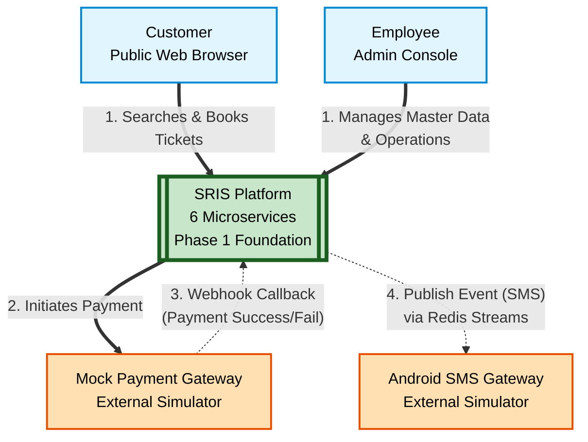
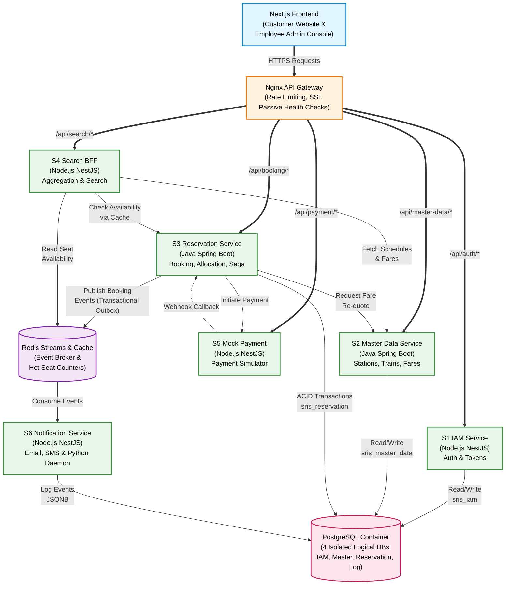
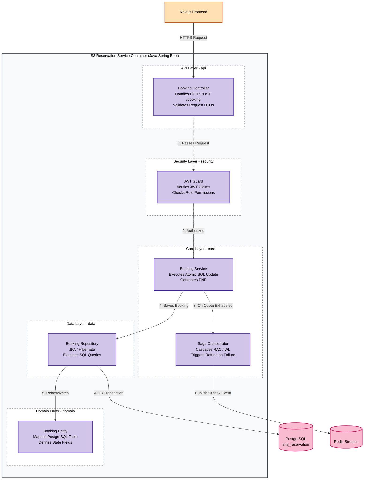
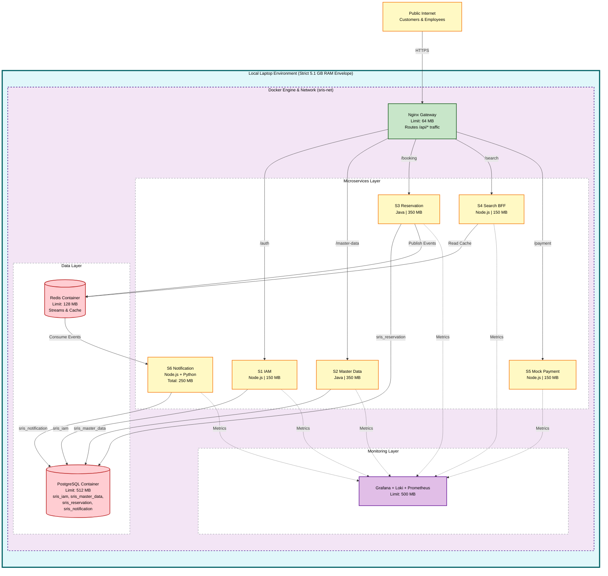
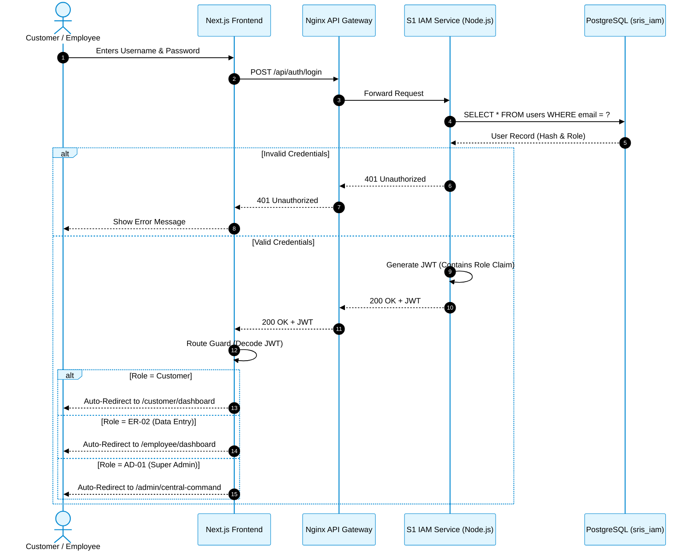
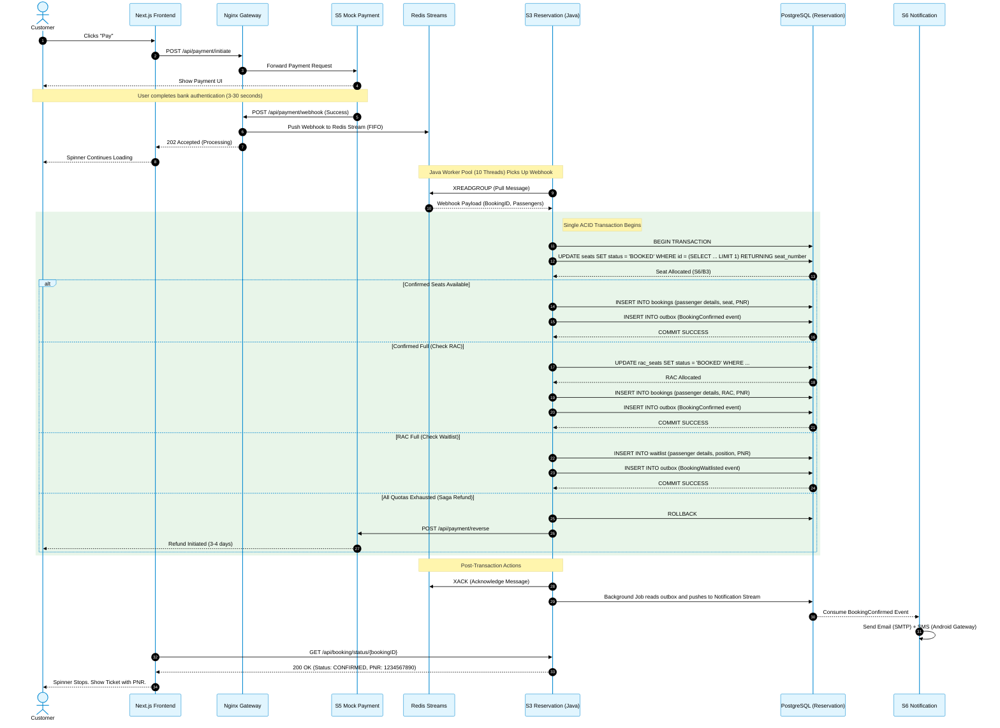
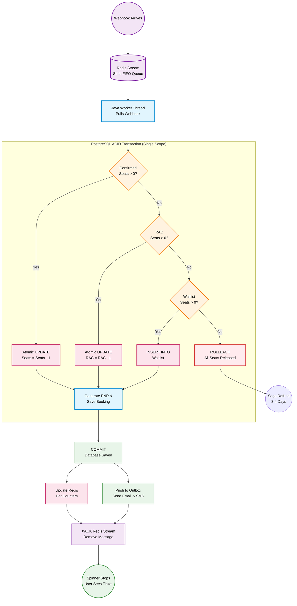

# System Architecture Document

*SRIS — Sarathi Railway Information System*

*A Unified Railway Management Platform*

*Inspired by CRIS and IRCTC · Independent project*

> **Version:** 1.0 | **Date:** 2026-10-19 | **Document ID:** SRIS-P1-ARCH-003

| Field              | Value                                                             |
| ------------------ | ----------------------------------------------------------------- |
| Title              | System Architecture Document                                      |
| Software           | SRIS                                                              |
| Software Full Form | Sarathi Railway Information System                                |
| Team Codename      | Project Sarathi                                                   |
| Document ID        | SRIS-P1-ARCH-003                                                  |
| Task               | Define the physical and structural architecture of Phase 1        |
| Document Type      | Architecture Document                                             |
| Milestone          | Phase 1 Foundation                                                |
| Classification     | Internal                                                          |
| Version            | 1.0                                                               |
| Date               | 2026-10-19                                                        |
| Author             | Koushal Jha, Lead Architect                                       |
| Approved By        | Koushal Jha, Lead Architect                                       |
| Approval Date      | 2026-10-19                                                        |
| Supersedes         | None (first version)                                              |
| Related Documents  | See Appendix B                                                    |
| Affiliation        | Independent · Not affiliated with CRIS, IRCTC, or Indian Railways |

---

## Table of Contents

1. [Introduction](#1-introduction)
   - [1.1 Purpose](#11-purpose)
   - [1.2 Scope](#12-scope)
   - [1.3 Audience](#13-audience)
   - [1.4 Terminology and Conventions](#14-terminology-and-conventions)
2. [Architectural Vision and Locked Decisions](#2-architectural-vision-and-locked-decisions)
   - [2.1 Modular 3-Tier Code Structure](#21-modular-3-tier-code-structure)
   - [2.2 Service Discovery and Developer Workflow](#22-service-discovery-and-developer-workflow)
   - [2.3 Database Architecture and Isolation](#23-database-architecture-and-isolation)
   - [2.4 Edge Security and Observability](#24-edge-security-and-observability)
3. [System Context (C4 Level 1)](#3-system-context-c4-level-1)
4. [Container Architecture (C4 Level 2)](#4-container-architecture-c4-level-2)
5. [Component Architecture (C4 Level 3)](#5-component-architecture-c4-level-3)
6. [Deployment Topology and Resource Envelope](#6-deployment-topology-and-resource-envelope)
7. [Core Sequence Flows](#7-core-sequence-flows)
8. [Approval](#8-approval)

- [Revision History](#revision-history)
- [Appendix A: Not Applicable](#appendix-a-not-applicable)
- [Appendix B: Related Documents](#appendix-b-related-documents)

---

## 1. Introduction

### 1.1 Purpose

This document records the System Architecture of Phase 1 of SRIS. It serves as the physical blueprint for the software, bridging the gap between the conceptual domain model ([SRIS-P1-ARCH-005](./SRIS-P1-ARCH-005_DomainModelDocument.md) — Domain Model Document), the service boundaries ([SRIS-P1-ARCH-001](./SRIS-P1-ARCH-001_MicroservicesIdentification.md) — Microservices Identification), and the technology stack ([SRIS-P1-ARCH-008](./SRIS-P1-ARCH-008_TechnologyStackADR.md) — Technology Stack ADR).

It dictates exactly how the 6 microservices are structured internally, how they communicate across the network, and how they are physically deployed within a strict 5.1 GB RAM envelope. It is written so that a new developer joining in Phase 2 can understand the entire structural and behavioural flow of the system without needing to reverse-engineer the code.

### 1.2 Scope

**In scope**

- The internal code structure and directory naming conventions for Java and Node.js services.
- The service discovery and internal routing mechanisms.
- The database isolation strategy and concurrency controls.
- The C4 Model diagrams (Context, Container, Component, and Deployment).
- The core behavioural Sequence Diagrams (Authentication and Post-Payment Allocation).
- The provisional memory allocation envelope for Docker containers.

**Out of scope**

- The detailed API contracts, which belong to [SRIS-P1-API-001](./SRIS-P1-API-001_APIContractDocumentOpenAPI.md) — API Contract Document (OpenAPI).
- The physical database schemas and entity-relationship diagrams, which belong to [SRIS-P1-DATA-003](./SRIS-P1-DATA-003_PhysicalDatabaseSchemaDocument.md) — Physical Database Schema Document.
- Edge case sequence diagrams (e.g., session expiry, partial notifications), which belong to [SRIS-P1-ARCH-009](./SRIS-P1-ARCH-009_ServiceInteractionAndCommunicationDesign.md) — Service Interaction and Communication Design.

### 1.3 Audience

- **Lead Architect:** maintains this document and is the authority on architectural changes.
- **Backend and frontend developers:** must build the software using the exact structural patterns and diagrams defined here.
- **DevOps engineer:** uses the deployment topology and memory limits to configure the Docker environment.
- **Project supervisor and evaluator:** verifies that the system architecture is realistic, logically sound, and adheres to enterprise standards.

### 1.4 Terminology and Conventions

Every term in this document has the meaning recorded in [SRIS-P1-REQ-001](../wave-1-requirements/SRIS-P1-REQ-001_GlossaryAndDomainDictionary.md) — Glossary and Domain Dictionary. The terms below carry the most weight in this document.

| Term | Meaning |
| :--- | :--- |
| ACID | Atomicity, Consistency, Isolation, Durability. The properties of a reliable database transaction. |
| C4 Model | Context, Containers, Components, and Code. A standard method for visualizing software architecture. |
| DNS | Domain Name System. In Docker, it allows containers to resolve each other by name. |
| FIFO | First-In-First-Out. A queueing discipline where the first request to arrive is the first to be processed. |
| OOM | Out Of Memory. A state where the operating system kills a process because it exceeded its memory limit. |
| TOCTOU | Time-of-Check to Time-of-Use. A race condition where a resource changes state between the moment it is checked and the moment it is used. |

This document follows the standards below.

- [SRIS-P1-GOV-002](../wave-0-project-foundation/SRIS-P1-GOV-002_DocumentTemplateStandard.md) — Document Template Standard.
- [SRIS-P1-GOV-003](../wave-0-project-foundation/SRIS-P1-GOV-003_DocumentIDAndCategoryScheme.md) — Document ID and Category Scheme.
- [SRIS-P1-GOV-004](../wave-0-project-foundation/SRIS-P1-GOV-004_DocumentCrossReferenceStandard.md) — Document Cross-Reference Standard.

---

## 2. Architectural Vision and Locked Decisions

To maintain FAANG-grade rigour and ensure the system survives the 5.1 GB RAM constraint, this section locks the strict architectural patterns that all developers must follow. These decisions are final and any deviation requires a formal revision of this document.

### 2.1 Modular 3-Tier Code Structure

Enterprise systems require a balance between strict separation of concerns and development velocity. We explicitly reject the verbose boilerplate of pure Hexagonal Architecture because it would consume too much of the 8-week timeline. Instead, we mandate a **Modular 3-Tier Architecture** for all 6 microservices.

The directory structure is strictly defined. For Java (Spring Boot) and Node.js (NestJS), the following folders are mandatory:
- `api/` (or `controller/`): Handles HTTP routing, request validation, and response formatting.
- `core/` (or `service/`): Contains the pure business logic, algorithms (e.g., the RAC/WL cascade), and orchestration.
- `data/` (or `repository/`): Handles all database interactions (JPA/Prisma). No SQL or database queries may exist outside this folder.
- `domain/` (or `model/`): Contains Entities, DTOs, and Enums.
- `security/`: Contains only granular authorization logic (e.g., verifying JWT claims). Heavy bot detection is offloaded to Nginx.
- `config/`: Application configurations (Redis, DB, external APIs).

This structure ensures that a Phase 2 developer can instantly locate any logic. Security is isolated, database access is isolated, and business logic is isolated. No file may cross these boundaries.

### 2.2 Service Discovery and Developer Workflow

- **Service Discovery:** Services find each other using Docker's embedded DNS (e.g., `http://s3-reservation:8080`). Heavy service registries like Eureka are explicitly rejected to save approximately 500 MB of RAM.
- **Developer Workflow (Sprint Isolation):** The infrastructure is split into modular Docker Compose files (`infra`, `services`, `gateway`, `monitoring`). We mandate the use of Docker **Profiles**. A developer building S1 in Sprint 3 will run `docker compose --profile sprint-3 up`, which starts *only* S1, PostgreSQL, and Redis. The other services remain off. The full stack only boots when the `all` profile is selected, preventing the laptop from crashing during early development.

### 2.3 Database Architecture and Isolation

To prevent kernel OOM (Out-Of-Memory) crashes while maintaining the "Own Your Data" principle, the architecture mandates **one** PostgreSQL container. Running four separate physical database containers would duplicate shared memory and exhaust the 5.1 GB limit.

Inside this single container, four isolated logical databases exist:
1.  `sris_iam`
2.  `sris_master_data`
3.  `sris_reservation`
4.  `sris_notification`

**Strict Rules:**
- Each service authenticates to its own database using a dedicated role. S3 cannot read `sris_iam`.
- Direct database-to-database querying is strictly forbidden. Cross-domain data must flow through REST APIs or Redis Streams.
- **Concurrency Control:** We explicitly **BAN** Pessimistic Locking (`SELECT ... FOR UPDATE`). All inventory updates must use **Optimistic Concurrency Control** (e.g., `UPDATE seats SET available = available - 1 WHERE available > 0`) to prevent connection pool exhaustion under extreme load.

### 2.4 Edge Security and Observability

- **Edge Security:** Nginx handles all ingress routing, rate-limiting, and anti-bot behavioral checks. The microservices remain lean and only perform micro-authorization (checking if the JWT role matches the endpoint).
- **Observability:** Promtail and Loki aggregate logs. Grafana is embedded in the Next.js Admin Console. To support non-technical employees (Operations Head), Grafana uses **Dashboard Variables** (dropdowns for Service, Log Level, and Time Range), ensuring zero-query syntax is required.

---

## 3. System Context (C4 Level 1)

The System Context diagram defines the highest-level view of SRIS. It illustrates how the platform interacts with its users and external simulators, treating the entire 6-microservice architecture as a single black box. 

This view is critical because it establishes the trust boundaries. The public internet is outside the black box, and the internal microservices are inside. 

---

## 4. Container Architecture (C4 Level 2)

The Container diagram zooms into the SRIS Platform. It shows the high-level technical building blocks (the 6 microservices, the gateway, the frontend, and the data stores) and how they communicate with each other over the network.

This diagram enforces the strict boundary rules defined in Section 2:
1. The frontend never talks directly to a database.
2. The microservices never query each other's databases.
3. Synchronous communication happens via REST (Nginx), and asynchronous communication happens via Redis Streams.

---

## 5. Component Architecture (C4 Level 3)

The Component diagram zooms into a single microservice to show its internal structure. We mandate a **Modular 3-Tier Architecture** for all services. This balances the speed of development with enterprise separation of concerns.

The diagram below uses the Java Reservation Service (S3) as the reference implementation. The Node.js services (NestJS) follow the exact same logical structure, simply using the equivalent NestJS terminology (Controllers, Providers, Modules).

This structure ensures that security is isolated, business logic is protected, and database queries are centralised in one layer.

---

## 6. Deployment Topology and Resource Envelope

This section defines the physical deployment of SRIS. The entire architecture runs within a single **Docker Engine** on a local laptop, strictly bounded by the **5.1 GB RAM envelope** (Constraint C-2 in [SRIS-P1-GOV-005](../wave-0-project-foundation/SRIS-P1-GOV-005_ProjectVisionAndScopeDocument.md) — Project Vision and Scope Document).

### 6.1 Memory Allocation Strategy (Provisional Targets)

To prevent the Linux kernel's Out-Of-Memory (OOM) killer from terminating containers (Exit Code 137), we mandate hard memory limits using the modern Docker Compose `deploy.resources.limits.memory` syntax. 

The limits below are **Provisional Targets**. They are calculated baselines derived from the technology stack. During Week 4 of Phase 1, these limits will be monitored via Grafana and tuned dynamically to match actual runtime behaviour.

| Container | Initial Memory Limit | Rationale |
| :--- | :--- | :--- |
| **Java Services (S2, S3)** | 350 MB each | Requires headroom for JVM heap, Metaspace, and native memory. |
| **Node.js Services (S1, S4, S5, S6)** | 150 MB each | Lightweight V8 heap and Rust Prisma engine. |
| **Next.js Frontend** | 100 MB | Static server and Node runtime. |
| **PostgreSQL** | 512 MB | Shared buffer cache for all 4 logical databases. |
| **Redis** | 128 MB | In-memory cache and Streams. |
| **Nginx** | 64 MB | Edge routing and rate limiting. |
| **Observability (Grafana, Loki, Prometheus)** | 500 MB (total) | Combined limit for the monitoring stack. |
| **Python Agent** | 100 MB | Lightweight SRE daemon. |
| **Total Allocated** | **~4,050 MB (4.05 GB)** | Leaves ~1 GB for OS, Docker daemon, and unexpected spikes. |

### 6.2 Physical Deployment Diagram

The diagram below illustrates how the Docker containers are physically mapped onto the laptop's operating system. It explicitly shows the memory limits applied to each component and the internal Docker network that connects them.

Notice that the PostgreSQL container hosts all 4 logical databases, while Nginx acts as the strict perimeter for all inbound traffic. The Python Agent runs as a sidecar inside the S6 container, monitoring the overall resource envelope.

### 6.2 Physical Deployment Diagram

The diagram below illustrates how the Docker containers are physically mapped onto the laptop's operating system. It explicitly shows the memory limits applied to each component and the internal Docker network that connects them.

Notice the explicit data connections: S1, S2, S3, and S6 connect to their respective logical databases inside the single PostgreSQL container. S3 and S4 connect to Redis for caching and event streams. All services send metrics to Prometheus/Grafana.

---

## 7. Core Sequence Flows

Structure is meaningless without behaviour. This section provides the Sequence Diagrams for the two most critical flows in SRIS: Authentication and Post-Payment Allocation.

### 7.1 Authentication and Automatic Routing Flow

This flow demonstrates the strict portal separation. There is no role-selection dropdown on the login screen. The identity is verified by S1 IAM, and the Next.js Route Guard automatically intercepts the JWT to route the user to the correct dashboard based on their embedded role claim.

---

### 7.2 Post-Payment Allocation and Saga Cascade Flow

This flow demonstrates how the system handles extreme concurrency (e.g., hundreds of users paying at the same time). It proves the **Post-Payment Allocation** model: seats are not locked during browsing. Allocation happens only after the payment webhook arrives.

The Java Worker executes a single ACID transaction that:
1.  Atomically updates the seat status (using optimistic concurrency, not row locks).
2.  Generates the PNR.
3.  Writes passenger details to the database.
4.  Writes the Outbox event (ensuring the notification is never lost, even if the server crashes).

If the Confirmed quota is exhausted, the algorithm cascades to RAC, then Waitlist, then RLWL, and finally triggers a Saga Refund.

---

### 7.3 Post-Payment Allocation Flowchart (Algorithmic Deep Dive)

While the Sequence Diagram (Section 7.2) shows the chronological interaction between containers, the flowchart below illustrates the exact decision logic executed by the Java Worker inside the S3 Reservation Service. 

It explicitly demonstrates the **ACID Transaction Boundary** and the **All-or-Nothing Rollback** rule. If a group of passengers cannot be fully accommodated across the quota tiers, the entire database transaction is rolled back, and a Saga Refund is triggered.

---

## 8. Approval

| Role           | Name        | Decision | Date       |
| -------------- | ----------- | -------- | ---------- |
| Lead Architect | Koushal Jha | Approved | 2026-10-19 |

---

## Revision History

| Version | Date       | Author      | Change           |
| ------- | ---------- | ----------- | ---------------- |
| 1.0     | 2026-10-19 | Koushal Jha | Initial release. |

---

## Appendix A: Not Applicable

Not applicable.

---

## Appendix B: Related Documents

### B.1 Directly Referenced Documents

| Seq  | Document ID                                                                                                    | Document Name                                     | Wave | Pri | Tag     |
| ---- | -------------------------------------------------------------------------------------------------------------- | ------------------------------------------------- | ---- | --- | ------- |
| 0.1  | [SRIS-P1-GOV-002](../wave-0-project-foundation/SRIS-P1-GOV-002_DocumentTemplateStandard.md)                     | Document Template Standard                        | 0    | P0  | UNBLOCK |
| 0.2  | [SRIS-P1-GOV-003](../wave-0-project-foundation/SRIS-P1-GOV-003_DocumentIDAndCategoryScheme.md)                  | Document ID and Category Scheme                   | 0    | P1  | UNBLOCK |
| 0.3  | [SRIS-P1-GOV-004](../wave-0-project-foundation/SRIS-P1-GOV-004_DocumentCrossReferenceStandard.md)               | Document Cross-Reference Standard                 | 0    | P1  | UNBLOCK |
| 0.4  | [SRIS-P1-GOV-005](../wave-0-project-foundation/SRIS-P1-GOV-005_ProjectVisionAndScopeDocument.md)                | Project Vision and Scope Document                 | 0    | P0  | UNBLOCK |
| 1.1  | [SRIS-P1-REQ-001](../wave-1-requirements/SRIS-P1-REQ-001_GlossaryAndDomainDictionary.md)                        | Glossary and Domain Dictionary                    | 1    | P0  | UNBLOCK |
| 2.1  | [SRIS-P1-ARCH-001](./SRIS-P1-ARCH-001_MicroservicesIdentification.md)                                           | Microservices Identification                      | 2    | P0  | UNBLOCK |
| 2.5  | [SRIS-P1-ARCH-005](./SRIS-P1-ARCH-005_DomainModelDocument.md)                                                   | Domain Model Document                             | 2    | P0  | UNBLOCK |
| 2.8  | [SRIS-P1-ARCH-008](./SRIS-P1-ARCH-008_TechnologyStackADR.md)                                                    | Technology Stack ADR                              | 2    | P0  | UNBLOCK |
| 2.9  | [SRIS-P1-ARCH-009](./SRIS-P1-ARCH-009_ServiceInteractionAndCommunicationDesign.md)                              | Service Interaction and Communication Design      | 2    | P0  | UNBLOCK |
| 3.2  | [SRIS-P1-DATA-002](./SRIS-P1-DATA-002_LogicalDataModelPerService.md)                                            | Logical Data Model (per service)                  | 3    | P0  | UNBLOCK |
| 3.3  | [SRIS-P1-DATA-003](./SRIS-P1-DATA-003_PhysicalDatabaseSchemaDocument.md)                                        | Physical Database Schema Document                 | 3    | P0  | UNBLOCK |
| 3.14 | [SRIS-P1-API-001](./SRIS-P1-API-001_APIContractDocumentOpenAPI.md)                                              | API Contract Document (OpenAPI)                   | 3    | P0  | UNBLOCK |

### B.2 Documents That Reference This Document

| Seq  | Document ID                                                                             | Document Name                                | Why It References                                                                 |
| ---- | --------------------------------------------------------------------------------------- | -------------------------------------------- | --------------------------------------------------------------------------------- |
| 2.4  | [SRIS-P1-ARCH-004](./SRIS-P1-ARCH-004_BoundedContextMap.md)                                 | Bounded Context Map                          | Uses the container boundaries defined here to map contexts                        |
| 2.9  | [SRIS-P1-ARCH-009](./SRIS-P1-ARCH-009_ServiceInteractionAndCommunicationDesign.md)          | Service Interaction and Communication Design | Expands on the sequence flows and algorithm logic defined in Section 7            |
| 2.12 | [SRIS-P1-ARCH-012](./SRIS-P1-ARCH-012_ObservabilityAndMonitoringDesignOTelW3C.md)           | Observability and Monitoring Design          | Details the Prometheus/Grafana integration mentioned in Section 2.4               |
| 3.2  | [SRIS-P1-DATA-002](./SRIS-P1-DATA-002_LogicalDataModelPerService.md)                        | Logical Data Model (per service)             | Maps the logical databases described in Section 2.3 to physical schemas           |
| 3.14 | [SRIS-P1-API-001](./SRIS-P1-API-001_APIContractDocumentOpenAPI.md)                          | API Contract Document (OpenAPI)              | Defines the exact REST endpoints for the communication paths shown in Section 4    |
| 6.2  | [SRIS-P1-DEV-004](../wave-6-developer-standards/SRIS-P1-DEV-004_CodingStandardsAndConventions.md) | Coding Standards and Conventions             | Enforces the Modular 3-Tier directory structure defined in Section 2.1            |

### B.3 Documents This Document Depends On (Upstream)

| Seq | Document ID                                                                                 | Document Name                          | Dependency Type |
| --- | ------------------------------------------------------------------------------------------- | -------------------------------------- | --------------- |
| 0.1 | [SRIS-P1-GOV-002](../wave-0-project-foundation/SRIS-P1-GOV-002_DocumentTemplateStandard.md)           | Document Template Standard             | Hard            |
| 2.1 | [SRIS-P1-ARCH-001](./SRIS-P1-ARCH-001_MicroservicesIdentification.md)                                 | Microservices Identification           | Hard            |
| 2.5 | [SRIS-P1-ARCH-005](./SRIS-P1-ARCH-005_DomainModelDocument.md)                                         | Domain Model Document                  | Hard            |
| 2.8 | [SRIS-P1-ARCH-008](./SRIS-P1-ARCH-008_TechnologyStackADR.md)                                          | Technology Stack ADR                   | Hard            |
| 0.4 | [SRIS-P1-GOV-005](../wave-0-project-foundation/SRIS-P1-GOV-005_ProjectVisionAndScopeDocument.md)      | Project Vision and Scope Document      | Soft            |

### B.4 Documents This Document Unblocks (Downstream)

| Seq  | Document ID                                                                             | Document Name                                | Blocked Until |
| ---- | --------------------------------------------------------------------------------------- | -------------------------------------------- | ------------- |
| 2.4  | [SRIS-P1-ARCH-004](./SRIS-P1-ARCH-004_BoundedContextMap.md)                                 | Bounded Context Map                          | This approved |
| 2.9  | [SRIS-P1-ARCH-009](./SRIS-P1-ARCH-009_ServiceInteractionAndCommunicationDesign.md)          | Service Interaction and Communication Design | This approved |
| 2.12 | [SRIS-P1-ARCH-012](./SRIS-P1-ARCH-012_ObservabilityAndMonitoringDesignOTelW3C.md)           | Observability and Monitoring Design          | This approved |
| 3.2  | [SRIS-P1-DATA-002](./SRIS-P1-DATA-002_LogicalDataModelPerService.md)                        | Logical Data Model (per service)             | This approved |
| 3.14 | [SRIS-P1-API-001](./SRIS-P1-API-001_APIContractDocumentOpenAPI.md)                          | API Contract Document (OpenAPI)              | This approved |
| 5.1  | [SRIS-P1-INF-001](../wave-5-devops-operations/SRIS-P1-INF-001_InfrastructureAndTechnologyDocument.md) | Infrastructure and Technology Document       | This approved |

### B.5 Master Documentation Index

The complete list of Phase 1 documents is in [SRIS-P1-GOV-001](../wave-0-project-foundation/SRIS-P1-GOV-001_DocumentationIndexAndNavigationMap.md) — Documentation Index and Navigation Map.

### B.6 External Reference Documents

| Reference Type | Where It Is Documented                                                                                                                                                                                                                                     |
| -------------- | ---------------------------------------------------------------------------------------------------------------------------------------------------------------------------------------------------------------------------------------------------------- |
| Website        | Mermaid JS Documentation. https://mermaid.js.org/. Referenced for the C4 model, sequence diagram syntax, and flowchart configuration.                                                                                                                      |

### B.7 Document Conventions

The conventions for Priority and Tag values are defined in [Section 9](../wave-0-project-foundation/SRIS-P1-GOV-002_DocumentTemplateStandard.md#9-vocabulary-standards) of [SRIS-P1-GOV-002](../wave-0-project-foundation/SRIS-P1-GOV-002_DocumentTemplateStandard.md) — Document Template Standard.