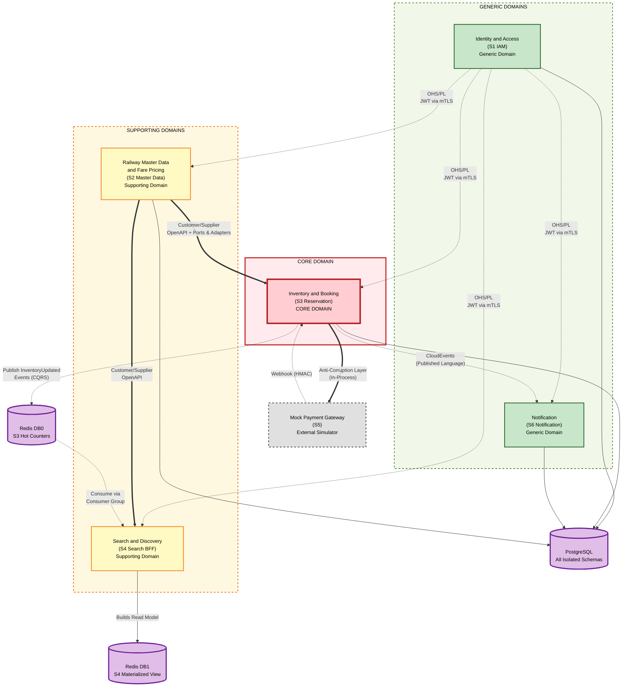

# Bounded Context Map

*SRIS — Sarathi Railway Information System*

*A Unified Railway Management Platform*

*Inspired by CRIS and IRCTC · Independent project*

> **Version:** 1.0 | **Date:** 2026-10-20 | **Document ID:** SRIS-P1-ARCH-004

| Field              | Value                                                             |
| ------------------ | ----------------------------------------------------------------- |
| Title              | Bounded Context Map                                               |
| Software           | SRIS                                                              |
| Software Full Form | Sarathi Railway Information System                                |
| Team Codename      | Project Sarathi                                                   |
| Document ID        | SRIS-P1-ARCH-004                                                  |
| Task               | Define the strategic domain boundaries and relationships          |
| Document Type      | Architecture Document                                             |
| Milestone          | Phase 1 Foundation                                                |
| Classification     | Internal                                                          |
| Version            | 1.0                                                               |
| Date               | 2026-10-20                                                        |
| Author             | Koushal Jha, Lead Architect                                       |
| Approved By        | Koushal Jha, Lead Architect                                       |
| Approval Date      | 2026-10-20                                                        |
| Supersedes         | None (first version)                                              |
| Related Documents  | See Appendix B                                                    |
| Affiliation        | Independent · Not affiliated with CRIS, IRCTC, or Indian Railways |

---

## Table of Contents

1. [Introduction](#1-introduction)
   - [1.1 Purpose](#11-purpose)
   - [1.2 Scope](#12-scope)
   - [1.3 Audience](#13-audience)
   - [1.4 Terminology and Conventions](#14-terminology-and-conventions)
2. [Domain Classification](#2-domain-classification)
   - [2.1 The Three Domain Categories](#21-the-three-domain-categories)
   - [2.2 Classification of the 8 Domains](#22-classification-of-the-8-domains)
   - [2.3 The Strategic Value of Classification](#23-the-strategic-value-of-classification)
3. [DDD Relationship Patterns](#3-ddd-relationship-patterns)
   - [3.1 The Six Patterns Used in SRIS](#31-the-six-patterns-used-in-sris)
   - [3.2 Why Each Pattern Was Chosen or Rejected](#32-why-each-pattern-was-chosen-or-rejected)
4. [The Bounded Context Map](#4-the-bounded-context-map)
5. [Relationship Deep Dive](#5-relationship-deep-dive)
6. [Approval](#6-approval)

- [Revision History](#revision-history)
- [Appendix A: Not Applicable](#appendix-a-not-applicable)
- [Appendix B: Related Documents](#appendix-b-related-documents)

---

## 1. Introduction

### 1.1 Purpose

This document records the Bounded Context Map of Phase 1 of SRIS. It is the strategic bridge between the business requirements (Wave 1) and the physical architecture (ARCH-001, ARCH-003, ARCH-008, ARCH-009). 

While the Microservices Identification document ([SRIS-P1-ARCH-001](./SRIS-P1-ARCH-001_MicroservicesIdentification.md) — Microservices Identification) defines *how many* services exist and the Domain Model document ([SRIS-P1-ARCH-005](./SRIS-P1-ARCH-005_DomainModelDocument.md) — Domain Model Document) defines *what concepts* they hold, this document defines *how those boundaries relate to one another*. 

It classifies the 8 business domains into Core, Supporting, and Generic categories, and maps the exact Domain-Driven Design (DDD) integration patterns between them. It proves that the boundaries are not arbitrary technical divisions, but deliberate strategic choices that protect the Core Domain and prepare the system for Phase 2 evolution.

### 1.2 Scope

**In scope**

- The classification of the 8 business domains (Identity, Master Data, Pricing, Inventory, Booking, Payment, Search, Notification).
- The DDD integration patterns between each domain pair.
- The C4 Context Map diagram showing the 8 domains and their relationships.
- The strategic reasoning behind each relationship choice.
- The evidence that the Shared Cache anti-pattern has been eradicated.

**Out of scope**

- The physical deployment topology, which belongs to [SRIS-P1-ARCH-003](./SRIS-P1-ARCH-003_SystemArchitectureDocument.md) — System Architecture Document.
- The implementation mechanics of mTLS, Redis Streams, or the Transactional Outbox, which belong to [SRIS-P1-ARCH-009](./SRIS-P1-ARCH-009_ServiceInteractionAndCommunicationDesign.md) — Service Interaction and Communication Design.
- The aggregates and invariants, which belong to [SRIS-P1-ARCH-005](./SRIS-P1-ARCH-005_DomainModelDocument.md) — Domain Model Document.

### 1.3 Audience

- **Lead Architect:** maintains this document and is the authority on strategic boundaries.
- **Backend developers:** must understand the boundary rules before writing code that crosses them.
- **Architecture reviewers:** verify that the boundaries are theoretically sound and pragmatically achievable.
- **Phase 2 developers:** use this map to understand where new domains (Crew, Catering, HR) will plug in without breaking the Core.
- **Project supervisor and evaluator:** verifies that the team has applied DDD strategic patterns correctly under the 5.1 GB constraint.

### 1.4 Terminology and Conventions

Every term in this document has the meaning recorded in [SRIS-P1-REQ-001](../wave-1-requirements/SRIS-P1-REQ-001_GlossaryAndDomainDictionary.md) — Glossary and Domain Dictionary. The terms below carry the most weight in this document.

| Term | Meaning |
| :--- | :--- |
| Bounded Context | A boundary within which a domain model and its vocabulary are consistent. |
| Core Domain | The primary competitive advantage of the business. Receives the most engineering effort. |
| Supporting Domain | Necessary for the Core to function but does not provide unique competitive value. |
| Generic Domain | A universal capability every business needs (auth, notifications). Uses standard patterns. |
| Anti-Corruption Layer | A translation boundary that protects a downstream domain from an upstream domain's model. |
| Customer/Supplier | An upstream-downstream relationship where the Supplier accommodates the Customer's needs. |
| Conformist | A downstream domain that fully accepts the upstream's model without translation. |
| Open Host Service | An upstream domain that exposes a stable, well-documented protocol for all consumers. |
| Published Language | A shared, documented protocol (e.g., CloudEvents JSON) used for integration. |
| CQRS | Command Query Responsibility Segregation. Separating write and read models. |

This document follows the standards below.

- [SRIS-P1-GOV-002](../wave-0-project-foundation/SRIS-P1-GOV-002_DocumentTemplateStandard.md) — Document Template Standard.
- [SRIS-P1-GOV-003](../wave-0-project-foundation/SRIS-P1-GOV-003_DocumentIDAndCategoryScheme.md) — Document ID and Category Scheme.
- [SRIS-P1-GOV-004](../wave-0-project-foundation/SRIS-P1-GOV-004_DocumentCrossReferenceStandard.md) — Document Cross-Reference Standard.

---

## 2. Domain Classification

### 2.1 The Three Domain Categories

Domain-Driven Design requires every business domain to be classified into one of three categories. This classification is not academic; it dictates where the Lead Architect allocates the strongest developers, the most rigorous testing, and the highest performance optimization.

| Category | Strategic Purpose | Resource Allocation |
| :--- | :--- | :--- |
| **Core Domain** | The unique competitive advantage. This is what makes SRIS a railway system rather than a generic e-commerce store. | Highest priority. Best developers. Most rigorous testing. Custom-built from scratch. |
| **Supporting Domain** | Necessary for the Core to function but does not differentiate SRIS from other railway systems. | Medium priority. Custom-built but with simpler patterns (CRUD). |
| **Generic Domain** | Universal capabilities every modern application needs. Nothing unique to railways. | Low priority. Standard patterns. Do not reinvent the wheel. |

### 2.2 Classification of the 8 Domains

SRIS has exactly 8 business domains. Their classification is strictly aligned with [SRIS-P1-ARCH-001](./SRIS-P1-ARCH-001_MicroservicesIdentification.md) — Microservices Identification, which locked the service count at 6 deployable units.

| Domain | Owning Service | Category | Rationale |
| :--- | :--- | :--- | :--- |
| Identity and Access | S1 IAM Service | **Generic** | Authentication and authorization are universal problems. A bespoke security model would waste precious development time. |
| Railway Master Data | S2 Master Data and Pricing | **Supporting** | Trains, routes, and stations are essential configuration data, but they are CRUD operations. No complex invariants. |
| Fare and Pricing | S2 Master Data and Pricing | **Supporting** | Fare calculation is a rules engine over data that Master Data owns. It supports the Core, but does not differentiate the platform. |
| Inventory and Quota | S3 Reservation (Inventory module) | **Core** | The seat matrix and quota allocation algorithms are the heart of the business. |
| Booking and Ticketing | S3 Reservation (Booking module) | **Core** | The booking state machine and the double-booking prevention invariant form the primary competitive advantage. |
| Payment | S3 (domain side) + S5 (simulator side) | **External Simulator** | The Payment domain is treated as an external system. S3 handles payment orchestration; S5 simulates the provider for Phase 1. |
| Search and Discovery | S4 Search BFF | **Supporting** | Search is a read-only composition layer. It is critical for UX but does not own any business invariants. |
| Notification | S6 Notification Service | **Generic** | Email and SMS delivery are universal. Using standard SMTP and webhook integrations is the only viable path. |

**The Single Core Domain: Reservation.** This is the most consequential decision in this document. By identifying exactly one Core Domain, we guarantee that the Lead Architect and the team focus their best engineering effort on the seat allocation algorithm and the booking state machine. If we had classified multiple domains as Core (e.g., adding Pricing or Search), the effort would be spread too thin, and the 8-week deadline would be missed.

### 2.3 The Strategic Value of Classification

The classification has three concrete consequences:

1. **Resource Allocation:** The best developers are assigned to S3 (Reservation). Supporting and Generic domains use simpler patterns.
2. **Testing Rigor:** S3 receives extensive integration tests, load tests, and property-based tests for its invariants. S1 (IAM) receives standard contract tests.
3. **Phase 2 Evolution:** If the team grows in Phase 2, S3 remains the most protected boundary. New developers can safely work on Generic and Supporting domains without risking the Core.

---

## 3. DDD Relationship Patterns

### 3.1 The Six Patterns Used in SRIS

Bounded Contexts do not exist in isolation. Each pair of contexts must have a formally defined integration pattern. SRIS uses exactly six patterns, drawn from the DDD strategic design vocabulary.

| Pattern | Definition | Where Used in SRIS |
| :--- | :--- | :--- |
| **Open Host Service / Published Language** | The upstream domain exposes a stable, well-documented protocol that any consumer can use without negotiation. | S1 IAM exposes the JWT (Published Language) via a standard API (Open Host Service). |
| **Customer/Supplier** | The downstream domain (Customer) has influence over the upstream domain's (Supplier) API design. | S3 (Reservation) is the Customer of S2 (Master Data). |
| **Conformist** | The downstream domain accepts the upstream's model without translation. | Not used between any two internal domains. Only used by S4 consuming S1's JWT. |
| **Anti-Corruption Layer (ACL)** | A translation boundary protecting the downstream domain from the upstream's model. | Inside S3, protecting the Core Domain from the external Mock Payment Gateway (S5). |
| **Shared Kernel** | Two domains share a subset of code. | **REJECTED.** Would cause cross-language (Java/Node.js) incompatibility. |
| **Separate Ways** | Two domains have no integration. | **REJECTED.** Every domain in SRIS integrates with at least one other. |

### 3.2 Why Each Pattern Was Chosen or Rejected

**3.2.1 Open Host Service / Published Language (S1 -> All)**

S1 IAM is a Generic Domain. Every other service depends on it. If S1 changed its authentication protocol, the entire system would break. Therefore, S1 must offer the most stable, standard protocol possible.

- **The Open Host Service** is the JWT issuance and verification API.
- **The Published Language** is the JWT standard itself (RFC 7519).
- **Why not Shared Kernel:** A shared security library across Java and Node.js would require maintaining two versions of the same code. Any change to one would require synchronized deployments of all 6 services. This violates the "Deploy by Configuration Alone" principle.
- **Why not Customer/Supplier:** S1 is Generic. It does not need to accommodate the specific needs of any single consumer. It provides a universal protocol.

**3.2.2 Customer/Supplier (S2 -> S3 and S2 -> S4)**

S2 Master Data is a Supporting Domain. It feeds data into two consumers: the Core Domain (S3) and a read-heavy consumer (S4).

- **Why Customer/Supplier:** S3 is the Core Domain. It has the right to influence S2's API design (e.g., "we need a `GET /trains/{id}/schedule` endpoint that returns the coach layout"). S2, as the Supplier, accommodates this need.
- **Why not Anti-Corruption Layer:** An ACL between S2 and S3 would add latency and hundreds of lines of translation code. For an 8-week timeline, this is over-engineering. The Master Data model (Train, Route, Station) is stable and does not need translation.
- **The Mitigation:** We mandate the **Ports and Adapters (Hexagonal) pattern** inside S3. The Core Domain defines an `ITrainScheduleProvider` interface (the Port). The OpenAPI client for S2 lives in S3's `infrastructure/` folder (the Adapter). This isolates S3's core from compilation breakages if S2 changes its API.

**3.2.3 Anti-Corruption Layer (S3 <-> S5)**

S5 Mock Payment Gateway is an External System. It uses a completely different vocabulary (Charges, PaymentIntents) than the internal SRIS model (Bookings, PNRs, SeatAllocations).

- **Why Anti-Corruption Layer:** Without an ACL, S3 would become tightly coupled to the Mock Gateway's payload format. When Phase 2 arrives and we integrate Razorpay, S3's code would break catastrophically.
- **Placement:** Inside S3's `infrastructure/payment/acl/` folder. This ensures the ACL is in-process (no extra RAM for a new microservice) and only the ACL needs to be rewritten in Phase 2.

**3.2.4 Conformist (Rejected as a General Pattern)**

The Conformist pattern says the downstream domain accepts the upstream's model without translation. We explicitly reject this between any two internal domains, because it creates tight coupling.

- **Where it is used:** Only for S4 consuming S1's JWT. S4 is a Conformist to the JWT standard. It does not negotiate the token format; it simply accepts the standard.
- **Why not used elsewhere:** Accepting S2's Master Data model without translation into S3 would expose S3's core to upstream changes. The Ports and Adapters pattern solves this.

**3.2.5 Shared Kernel (Rejected)**

The Shared Kernel pattern says two domains share a subset of code. We explicitly reject this.

- **Why:** SRIS is polyglot (Java for S2 and S3, Node.js for S1, S4, S5, S6). A shared library would have to be maintained in two languages, and any change would force synchronized deployments. This violates Principle 8 (Deploy by Configuration Alone).

**3.2.6 CQRS for S3 -> S4 (The Critical Pattern)**

The most important integration pattern in SRIS is between S3 (Reservation) and S4 (Search BFF). S4 must show seat availability to users, but it must never query S3's transactional database.

- **The Original Design (Rejected):** S4 reads S3's Redis cache directly. This is the **Shared Cache Anti-Pattern**. It violates data sovereignty and causes outages when Redis evicts keys.
- **The Final Design (CQRS):** 
  1. S3 publishes `InventoryUpdated` events to a Redis Stream (`sris.inventory_updates`) whenever a seat is booked, released, or blocked.
  2. S4 subscribes to this stream via a Consumer Group.
  3. S4 builds its own **Materialized View** in **Redis DB1** (strictly isolated from S3's Redis DB0).
  4. **TTL Override:** All keys in S4's read model are given a strict TTL (24 hours after departure). This prevents memory bloat and protects the 5.1 GB envelope.

- **Why this is the correct pattern:** S4 now owns its data. If S3's Redis crashes, S4 continues serving search results from its own cache. If S3 changes its internal cache format, S4 is not affected. The only contract is the `InventoryUpdated` event schema, which is a standard Published Language.

---

## 4. The Bounded Context Map

The C4 Context Map below is the strategic centerpiece of this document. It shows the 8 business domains, their classifications (Core, Supporting, Generic, External), and the exact DDD integration patterns between them.

This map proves that the boundaries are not arbitrary. Every arrow is a strategic decision that protects the Core Domain (Reservation) and prepares the system for Phase 2 evolution.

---

## 5. Relationship Deep Dive

While the diagram in Section 4 shows *what* the relationships are, this section explains *why* each was chosen. This is the strategic justification that proves the architecture is not arbitrary.

### 5.1 S1 IAM: Open Host Service / Published Language

S1 IAM is the only Generic Domain that every other service depends on. It must therefore be the most stable and most standardized integration point in the entire system.

- **The Open Host Service** is the REST API for JWT issuance and verification.
- **The Published Language** is the JWT standard (RFC 7519). Every consumer (S2, S3, S4, S5, S6) is a **Conformist** to this standard.
- **Why this pattern was chosen:** Any change to S1's authentication protocol would cascade through all 6 services. By mandating a universal standard (JWT), we eliminate the risk of cascading failures. No service needs to negotiate or translate the token format.
- **Why not Shared Kernel:** A shared security library across Java (S2, S3) and Node.js (S1, S4, S5, S6) would require maintaining two versions of the same code. Any change would force synchronized deployments of all 6 services. This violates Principle 8 (Deploy by Configuration Alone).

### 5.2 S2 Master Data -> S3 Reservation: Customer/Supplier

S2 is a Supporting Domain. S3 is the Core Domain. The relationship must give the Core Domain influence over the Supporting Domain without exposing the Core to upstream changes.

- **Why Customer/Supplier:** S3 (the Customer) dictates the shape of the data it needs from S2 (the Supplier). For example, S3 requires `GET /api/v1/trains/{trainId}/coach-layout` to know the seat matrix. S2 must provide this endpoint exactly as S3 requires.
- **Why not Anti-Corruption Layer:** An ACL between S2 and S3 would add latency and hundreds of lines of translation code. For an 8-week timeline, this is over-engineering. The Master Data model (Train, Route, Station) is stable and does not require translation.
- **The Mitigation (Ports and Adapters):** Because there is no ACL, we mandate the **Hexagonal Architecture (Ports and Adapters)** pattern inside S3. S3's core domain defines an `ITrainScheduleProvider` interface (the Port). The OpenAPI client for S2 lives in S3's `infrastructure/` folder (the Adapter). This isolates S3's core from compilation breakages if S2's API ever changes.

### 5.3 S2 Master Data -> S4 Search BFF: Customer/Supplier

This is the same Customer/Supplier pattern as S2 -> S3. S4 consumes train schedules and fares from S2 via the OpenAPI contract.

- **Why it is safe:** S4 is a read-only Supporting Domain. It has no invariants to protect. It simply displays the data that S2 provides.
- **Why not CQRS here:** S2's Master Data changes infrequently (e.g., a new train is added weekly). Polling or synchronous queries are acceptable. CQRS is reserved for S3 because seat inventory changes in milliseconds.

### 5.4 S3 Reservation -> S5 Mock Payment: Anti-Corruption Layer

S5 is an **External Simulator** (a stand-in for a real payment provider like Razorpay). It uses completely different vocabulary (Charges, PaymentIntents) than the internal SRIS model (Bookings, PNRs).

- **Why Anti-Corruption Layer:** Without an ACL, S3's core domain would become tightly coupled to the Mock Gateway's JSON format. When Phase 2 arrives and we integrate Razorpay, S3's code would break catastrophically. The ACL translates between our internal `PaymentInitiated` event and the external gateway's payload.
- **Placement:** Inside S3's `infrastructure/payment/acl/` folder. This is an **in-process ACL**, meaning it consumes zero additional RAM compared to a separate microservice.
- **Phase 2 Migration:** When we switch to Razorpay, **only the ACL folder is rewritten**. The Saga Orchestrator, the seat allocation logic, and the booking state machine are never touched.

### 5.5 S3 Reservation -> S4 Search BFF: Event-Driven CQRS

This is the most critical relationship in the system. It was the subject of a major architectural correction (rejecting the Shared Cache anti-pattern).

**The Original Design (Rejected):** S4 reads S3's Redis cache directly (`train:123:seats`). This violates data sovereignty:
- If S3 changes its key format, S4 breaks.
- If Redis evicts the key, S4 loses data.
- If S3's cache crashes, S4 cannot serve search results.

**The Final Design (CQRS):**
1. When S3 books, releases, or blocks a seat, it publishes an `InventoryUpdated` event to a Redis Stream (`sris.inventory_updates`).
2. S4 subscribes via a Consumer Group and builds its own **Materialized View** in **Redis DB1**.
3. S3 uses **Redis DB0** for its hot counters. The two databases are completely isolated.
4. **TTL Override:** All keys in S4's DB1 are given a strict TTL (24 hours after departure). This prevents memory bloat and protects the 5.1 GB envelope.

**Why this pattern is the correct choice:**
- **Data Sovereignty:** S4 owns its data. It can rebuild its cache by replaying the Redis Stream from ID `0-0` if it crashes.
- **Independent Availability:** If S3's Redis DB0 crashes, S4 continues serving search results from DB1.
- **Zero Coupling:** S3 knows nothing about S4. S3 simply publishes a standard CloudEvent. S4 decides how to consume it.

### 5.6 S3 Reservation -> S6 Notification: Published Language

S6 is a Generic Domain. It consumes `BookingConfirmed`, `BookingWaitlisted`, `BookingCancelled` events from S3 and sends emails/SMS.

- **Why Published Language:** S3 does not know S6 exists. S3 simply publishes a CloudEvent in a standard format (documented in ARCH-009 Rule 2.3). Any consumer can subscribe.
- **Why not Synchronous:** Notification delivery must never block a booking. If we used a synchronous call, an SMTP outage would stop bookings. The asynchronous Published Language pattern eliminates this risk.

---

## 6. Approval

| Role           | Name        | Decision | Date       |
| -------------- | ----------- | -------- | ---------- |
| Lead Architect | Koushal Jha | Approved | 2026-10-20 |

---

## Revision History

| Version | Date       | Author      | Change           |
| ------- | ---------- | ----------- | ---------------- |
| 1.0     | 2026-10-20 | Koushal Jha | Initial release. |

---

## Appendix A: Not Applicable

Not applicable.

---

## Appendix B: Related Documents

### B.1 Directly Referenced Documents

| Seq  | Document ID                                                                                                    | Document Name                                     | Wave | Pri | Tag     |
| ---- | -------------------------------------------------------------------------------------------------------------- | ------------------------------------------------- | ---- | --- | ------- |
| 0.1  | [SRIS-P1-GOV-002](../wave-0-project-foundation/SRIS-P1-GOV-002_DocumentTemplateStandard.md)                     | Document Template Standard                        | 0    | P0  | UNBLOCK |
| 0.2  | [SRIS-P1-GOV-003](../wave-0-project-foundation/SRIS-P1-GOV-003_DocumentIDAndCategoryScheme.md)                  | Document ID and Category Scheme                   | 0    | P1  | UNBLOCK |
| 0.3  | [SRIS-P1-GOV-004](../wave-0-project-foundation/SRIS-P1-GOV-004_DocumentCrossReferenceStandard.md)               | Document Cross-Reference Standard                 | 0    | P1  | UNBLOCK |
| 1.1  | [SRIS-P1-REQ-001](../wave-1-requirements/SRIS-P1-REQ-001_GlossaryAndDomainDictionary.md)                        | Glossary and Domain Dictionary                    | 1    | P0  | UNBLOCK |
| 2.1  | [SRIS-P1-ARCH-001](./SRIS-P1-ARCH-001_MicroservicesIdentification.md)                                           | Microservices Identification                      | 2    | P0  | UNBLOCK |
| 2.5  | [SRIS-P1-ARCH-005](./SRIS-P1-ARCH-005_DomainModelDocument.md)                                                   | Domain Model Document                             | 2    | P0  | UNBLOCK |
| 2.9  | [SRIS-P1-ARCH-009](./SRIS-P1-ARCH-009_ServiceInteractionAndCommunicationDesign.md)                              | Service Interaction and Communication Design      | 2    | P0  | UNBLOCK |

### B.2 Documents That Reference This Document

| Seq  | Document ID                                                                             | Document Name                                | Why It References                                                                 |
| ---- | --------------------------------------------------------------------------------------- | -------------------------------------------- | --------------------------------------------------------------------------------- |
| 2.3  | [SRIS-P1-ARCH-003](./SRIS-P1-ARCH-003_SystemArchitectureDocument.md)                        | System Architecture Document                 | Uses the context boundaries to define container topology                          |
| 2.9  | [SRIS-P1-ARCH-009](./SRIS-P1-ARCH-009_ServiceInteractionAndCommunicationDesign.md)          | Service Interaction and Communication Design | Details the CQRS flow and ACL implementation                                      |
| 3.2  | [SRIS-P1-DATA-002](./SRIS-P1-DATA-002_LogicalDataModelPerService.md)                        | Logical Data Model (per service)             | Maps the Redis DB0 and DB1 isolation into the physical data model                 |

### B.3 Documents This Document Depends On (Upstream)

| Seq | Document ID                                                                                 | Document Name                          | Dependency Type |
| --- | ------------------------------------------------------------------------------------------- | -------------------------------------- | --------------- |
| 0.1 | [SRIS-P1-GOV-002](../wave-0-project-foundation/SRIS-P1-GOV-002_DocumentTemplateStandard.md)           | Document Template Standard             | Hard            |
| 2.1 | [SRIS-P1-ARCH-001](./SRIS-P1-ARCH-001_MicroservicesIdentification.md)                                 | Microservices Identification           | Hard            |
| 2.5 | [SRIS-P1-ARCH-005](./SRIS-P1-ARCH-005_DomainModelDocument.md)                                         | Domain Model Document                  | Hard            |
| 2.9 | [SRIS-P1-ARCH-009](./SRIS-P1-ARCH-009_ServiceInteractionAndCommunicationDesign.md)                    | Service Interaction and Communication Design | Hard       |

### B.4 Documents This Document Unblocks (Downstream)

| Seq  | Document ID                                                                             | Document Name                                | Blocked Until |
| ---- | --------------------------------------------------------------------------------------- | -------------------------------------------- | ------------- |
| 3.2  | [SRIS-P1-DATA-002](./SRIS-P1-DATA-002_LogicalDataModelPerService.md)                        | Logical Data Model (per service)             | This approved |
| 3.14 | [SRIS-P1-API-001](./SRIS-P1-API-001_APIContractDocumentOpenAPI.md)                          | API Contract Document (OpenAPI)              | This approved |
| 3.16 | [SRIS-P1-API-003](./SRIS-P1-API-003_EventSchemaDocumentAsyncAPI.md)                         | Event Schema Document (AsyncAPI)             | This approved |

### B.5 Master Documentation Index

The complete list of Phase 1 documents is in [SRIS-P1-GOV-001](../wave-0-project-foundation/SRIS-P1-GOV-001_DocumentationIndexAndNavigationMap.md) — Documentation Index and Navigation Map.

### B.6 External Reference Documents

| Reference Type | Where It Is Documented                                                                                                                                                                                                                                     |
| -------------- | ---------------------------------------------------------------------------------------------------------------------------------------------------------------------------------------------------------------------------------------------------------- |
| Book           | Evans, Eric. "Domain-Driven Design: Tackling Complexity in the Heart of Software." Addison-Wesley, 2003. Referenced for the definitions of Bounded Context, Core Domain, Anti-Corruption Layer, and the six relationship patterns.                     |
| Book           | Vernon, Vaughn. "Implementing Domain-Driven Design." Addison-Wesley, 2013. Referenced for the strategic application of context mapping patterns and the CQRS pattern.                                                                                    |

### B.7 Document Conventions

The conventions for Priority and Tag values are defined in [Section 9](../wave-0-project-foundation/SRIS-P1-GOV-002_DocumentTemplateStandard.md#9-vocabulary-standards) of [SRIS-P1-GOV-002](../wave-0-project-foundation/SRIS-P1-GOV-002_DocumentTemplateStandard.md) — Document Template Standard.