

# Domain Model Document

*SRIS — Sarathi Railway Information System*

*A Unified Railway Management Platform*

*Inspired by CRIS and IRCTC · Independent project*

> **Version:** 1.0 | **Date:** 2026-10-16 | **Document ID:** SRIS-P1-ARCH-005

| Field              | Value                                                             |
| ------------------ | ----------------------------------------------------------------- |
| Title              | Domain Model Document                                             |
| Software           | SRIS                                                              |
| Software Full Form | Sarathi Railway Information System                                |
| Team Codename      | Project Sarathi                                                   |
| Document ID        | SRIS-P1-ARCH-005                                                  |
| Task               | Define the domain model of Phase 1                                |
| Document Type      | Architecture Document                                             |
| Milestone          | Phase 1 Foundation                                                |
| Classification     | Internal                                                          |
| Version            | 1.0                                                               |
| Date               | 2026-10-16                                                        |
| Author             | Koushal Jha, Lead Architect                                       |
| Approved By        | Koushal Jha, Lead Architect                                       |
| Approval Date      | 2026-10-16                                                        |
| Supersedes         | None (first version)                                              |
| Related Documents  | See Appendix B                                                    |
| Affiliation        | Independent · Not affiliated with CRIS, IRCTC, or Indian Railways |

---

## Table of Contents

1. [Introduction](#1-introduction)
   - [1.1 Purpose](#11-purpose)
   - [1.2 Scope](#12-scope)
   - [1.3 Audience](#13-audience)
   - [1.4 Terminology and Conventions](#14-terminology-and-conventions)
2. [Domain Model Format and Governance](#2-domain-model-format-and-governance)
   - [2.1 What a Domain Model Is](#21-what-a-domain-model-is)
   - [2.2 What This Document Does Not Contain](#22-what-this-document-does-not-contain)
   - [2.3 How to Read This Document](#23-how-to-read-this-document)
   - [2.4 The Citation Pattern](#24-the-citation-pattern)
   - [2.5 The Format of an Aggregate Entry](#25-the-format-of-an-aggregate-entry)
   - [2.6 The 15 Aggregate Decisions](#26-the-15-aggregate-decisions)
3. [Identity and Access](#3-identity-and-access)
   - [3.1 UserAccount](#31-useraccount)
   - [3.2 Session](#32-session)
4. [Railway Master Data](#4-railway-master-data)
   - [4.1 Station](#41-station)
   - [4.2 Route](#42-route)
   - [4.3 CoachTemplate](#43-coachtemplate)
   - [4.4 Train](#44-train)
   - [4.5 TrainSchedule](#45-trainschedule)
5. [Fare and Pricing](#5-fare-and-pricing)
   - [5.1 TariffRule](#51-tariffrule)
   - [5.2 ConcessionRule](#52-concessionrule)
   - [5.3 FareQuote (Value Object)](#53-farequote-value-object)
6. [Inventory and Quota](#6-inventory-and-quota)
   - [6.1 CoachInventory](#61-coachinventory)
   - [6.2 WaitlistQueue](#62-waitlistqueue)
7. [Booking and Ticketing](#7-booking-and-ticketing)
   - [7.1 Booking](#71-booking)
   - [7.2 Passenger (Child Entity)](#72-passenger-child-entity)
8. [Payment](#8-payment)
   - [8.1 PaymentAttempt](#81-paymentattempt)
9. [Notification](#9-notification)
   - [9.1 NotificationRecord](#91-notificationrecord)
10. [Search and Discovery](#10-search-and-discovery)
    - [10.1 Zero Aggregates](#101-zero-aggregates)
11. [Cross-Context Events](#11-cross-context-events)
    - [11.1 The Eight Integration Events](#111-the-eight-integration-events)
    - [11.2 Event Naming and Payload Rules](#112-event-naming-and-payload-rules)
    - [11.3 Events Deliberately Not Used](#113-events-deliberately-not-used)
    - [11.4 Audit Trail](#114-audit-trail)
12. [Traceability](#12-traceability)
    - [12.1 Aggregate to Capability Map](#121-aggregate-to-capability-map)
    - [12.2 Aggregate to Service Map](#122-aggregate-to-service-map)
13. [Approval](#13-approval)

- [Revision History](#revision-history)
- [Appendix A: Domain Model Glossary](#appendix-a-domain-model-glossary)
- [Appendix B: Related Documents](#appendix-b-related-documents)

---

## 1. Introduction

### 1.1 Purpose

This document fixes the domain model of Phase 1. A domain model is the conceptual structure of the business: the aggregates, entities, value objects, invariants, and events that the system must enforce. Every downstream architecture, data, API, UI, and test document derives its entities and rules from this document.

This document answers a single question: what does the business consist of, and what must always be true about it? It does not answer how the business is stored, how it is transmitted, how it is presented, or how it is protected. Those questions belong to other documents.

### 1.2 Scope

**In scope**

- The definition of a domain model and its distinction from a data model.
- How to read this document without prior knowledge of the register.
- The citation pattern used when another document is referenced.
- The format of an aggregate entry.
- The 15 aggregate decisions for Phase 1.
- For each aggregate: its definition, its conceptual state, its references by identity, its invariants, its value objects, its state machine, its state transitions, its domain events, and its cross-context events.
- The eight cross-context integration events of Phase 1.
- The aggregate-to-capability and aggregate-to-service traceability.

**Out of scope**

- The service catalogue and the service boundaries, which are recorded in [SRIS-P1-ARCH-001](./SRIS-P1-ARCH-001_MicroservicesIdentification.md) — Microservices Identification, which identifies the six services and justifies their boundaries.
- The architectural principles that constrain the model, which are recorded in [SRIS-P1-ARCH-002](./SRIS-P1-ARCH-002_ArchitecturePrinciples.md) — Architecture Principles, which fixes the nine binding rules that every architecture decision respects.
- The system architecture and its component view, which is defined in [SRIS-P1-ARCH-003](./SRIS-P1-ARCH-003_SystemArchitectureDocument.md) — System Architecture Document.
- The bounded context map, which is defined in [SRIS-P1-ARCH-004](./SRIS-P1-ARCH-004_BoundedContextMap.md) — Bounded Context Map.
- The individual architecture decisions, which are recorded in [SRIS-P1-ARCH-007](./SRIS-P1-ARCH-007_ArchitectureDecisionRecordsMasterIndex.md) — Architecture Decision Records — Master Index.
- The technology stack, which is defined in [SRIS-P1-ARCH-008](./SRIS-P1-ARCH-008_TechnologyStackADR.md) — Technology Stack ADR.
- The service interaction design, which is defined in [SRIS-P1-ARCH-009](./SRIS-P1-ARCH-009_ServiceInteractionAndCommunicationDesign.md) — Service Interaction and Communication Design.
- The concurrency and locking strategy, which is defined in [SRIS-P1-ARCH-014](./SRIS-P1-ARCH-014_DistributedConcurrencyAndLockingStrategy.md) — Distributed Concurrency and Locking Strategy.
- The saga design, which is defined in [SRIS-P1-ARCH-015](./SRIS-P1-ARCH-015_DistributedTransactionAndSagaPatternDesign.md) — Distributed Transaction and Saga Pattern Design.
- The logical data model per service, which is defined in [SRIS-P1-DATA-002](./SRIS-P1-DATA-002_LogicalDataModelPerService.md) — Logical Data Model (per service).
- The physical database schema, which is defined in [SRIS-P1-DATA-003](./SRIS-P1-DATA-003_PhysicalDatabaseSchemaDocument.md) — Physical Database Schema Document.
- The database naming conventions, which are defined in [SRIS-P1-DATA-013](./SRIS-P1-DATA-013_DatabaseNamingConventions.md) — Database Naming Conventions.
- The API contracts, which are defined in [SRIS-P1-API-001](./SRIS-P1-API-001_APIContractDocumentOpenAPI.md) — API Contract Document (OpenAPI).
- The event schemas, which are defined in [SRIS-P1-API-003](./SRIS-P1-API-003_EventSchemaDocumentAsyncAPI.md) — Event Schema Document (AsyncAPI).
- The business requirements, which are recorded in [SRIS-P1-REQ-002](../wave-1-requirements/SRIS-P1-REQ-002_BusinessRequirementsDocumentBRD.md) — Business Requirements Document (BRD), which lists the business needs Phase 1 must satisfy.
- The capabilities and their identifiers, which are recorded in [SRIS-P1-REQ-003](../wave-1-requirements/SRIS-P1-REQ-003_CapabilityCatalogFinal.md) — Capability Catalog (Final), which lists the 30 business capabilities Phase 1 provides.
- The software requirements, which are recorded in [SRIS-P1-REQ-004](../wave-1-requirements/SRIS-P1-REQ-004_SoftwareRequirementsSpecificationSRS.md) — Software Requirements Specification (SRS), which states what the software must do.
- The domain rules that the invariants of this document reference, which are recorded in [SRIS-P1-REQ-007](../wave-1-requirements/SRIS-P1-REQ-007_DomainRulesFareCalculation.md) — Domain Rules: Fare Calculation to [SRIS-P1-REQ-011](../wave-1-requirements/SRIS-P1-REQ-011_DomainRulesSeatMatrixAndInventory.md) — Domain Rules: Seat Matrix and Inventory, the five domain rule documents that own fare calculation, ticketing, waitlist and cancellation, chart preparation, and seat matrix and inventory.

### 1.3 Audience

- **Lead Architect:** maintains this document and approves every aggregate decision.
- **Backend developers:** implement the aggregates, their invariants, and their state machines.
- **Frontend developers:** understand the concepts that the two surfaces present and manipulate.
- **Tester (QA):** derives aggregate-level invariants and state-transition tests from this document.
- **Data modeller:** derives the logical and physical data model from the conceptual model recorded here.
- **Project supervisor and evaluator:** uses this document as the conceptual foundation of the architecture.
- **Technical reviewers:** engineers or interviewers who open the repository and need the domain structure of Phase 1.

### 1.4 Terminology and Conventions

Every term in this document has the meaning recorded in [SRIS-P1-REQ-001](../wave-1-requirements/SRIS-P1-REQ-001_GlossaryAndDomainDictionary.md) — Glossary and Domain Dictionary, which fixes the authoritative vocabulary of the register. The terms below carry the most weight in this document and are used with the meanings defined here.

| Term                  | Meaning                                                                                                                                    |
| --------------------- | ------------------------------------------------------------------------------------------------------------------------------------------ |
| Aggregate             | A cluster of domain objects treated as a single unit for data changes, with one aggregate root as its sole entry point.                     |
| Aggregate root        | The single entity inside an aggregate that external code refers to and that enforces every invariant of the aggregate.                      |
| Entity                | A domain object with identity that persists across state changes.                                                                          |
| Value object          | An immutable domain object defined entirely by its attributes, replaced rather than updated.                                                |
| Child entity          | An entity that lives inside an aggregate and is not independently accessible.                                                               |
| Invariant             | A business rule that must always hold for the aggregate to be valid. Enforced at every state transition by the aggregate root.              |
| Domain event          | A past-tense fact that a significant business action has occurred inside an aggregate.                                                      |
| Integration event     | A domain event that crosses a bounded context boundary and is consumed by another service.                                                  |
| Reference by identity | The rule that an aggregate refers to another aggregate by identity, not by object reference.                                                |
| State machine         | The set of business states an aggregate can be in, and the transitions permitted between them.                                              |

The identifier prefix below is local to this document.

| Prefix    | Meaning              |
| --------- | -------------------- |
| INV-XX-NN | Invariant identifier |

Local prefixes from other documents that appear in citations are defined in those documents.

This document follows the standards below.

- [SRIS-P1-GOV-002](../wave-0-project-foundation/SRIS-P1-GOV-002_DocumentTemplateStandard.md) — Document Template Standard, which fixes the structure, header, and style of every register document.
- [SRIS-P1-GOV-003](../wave-0-project-foundation/SRIS-P1-GOV-003_DocumentIDAndCategoryScheme.md) — Document ID and Category Scheme, which fixes the Document ID format.
- [SRIS-P1-GOV-004](../wave-0-project-foundation/SRIS-P1-GOV-004_DocumentCrossReferenceStandard.md) — Document Cross-Reference Standard, which fixes the citation and linking rules.

Three external references inform the definitions used in this document. Eric Evans, "Domain-Driven Design" is referenced for the definitions of a domain model, an aggregate, an entity, a value object, and a domain event. Vaughn Vernon, "Implementing Domain-Driven Design" is referenced for aggregate boundary decisions, invariant enforcement, and event modelling. Bertrand Meyer, "Object-Oriented Software Construction" is referenced for the definition of an invariant.

---

## 2. Domain Model Format and Governance

### 2.1 What a Domain Model Is

A domain model is the conceptual structure of the business. It captures the aggregates, entities, value objects, invariants, and events that the system must enforce, stated in the language of the business rather than the language of the implementation.

In SRIS, the domain model is the foundation of every downstream document. The data model derives its tables from the aggregates, and the API contracts derive their resources from the aggregates. The UI documents derive their screens from the concepts, and the test cases derive their assertions from the invariants. If the domain model is wrong, everything downstream inherits the error.

A domain model is therefore written first, and with the greatest care. It is the least changeable document in the architecture set, because a change here cascades into every other document.

### 2.2 What This Document Does Not Contain

This document contains the domain model. It does not contain the following.

| Not in this document | Owner |
| -------------------- | ----- |
| Column names, data types, physical tables, indexes | [SRIS-P1-DATA-002](./SRIS-P1-DATA-002_LogicalDataModelPerService.md) — Logical Data Model (per service) |
| Concrete SQL schemas | [SRIS-P1-DATA-003](./SRIS-P1-DATA-003_PhysicalDatabaseSchemaDocument.md) — Physical Database Schema Document |
| Naming conventions for database fields | [SRIS-P1-DATA-013](./SRIS-P1-DATA-013_DatabaseNamingConventions.md) — Database Naming Conventions |
| API endpoints, HTTP methods, payloads | [SRIS-P1-API-001](./SRIS-P1-API-001_APIContractDocumentOpenAPI.md) — API Contract Document (OpenAPI) |
| Event schemas, topic names, message formats | [SRIS-P1-API-003](./SRIS-P1-API-003_EventSchemaDocumentAsyncAPI.md) — Event Schema Document (AsyncAPI) |
| Concurrency controls, locks, version columns | [SRIS-P1-ARCH-014](./SRIS-P1-ARCH-014_DistributedConcurrencyAndLockingStrategy.md) — Distributed Concurrency and Locking Strategy |
| Saga orchestration and compensation | [SRIS-P1-ARCH-015](./SRIS-P1-ARCH-015_DistributedTransactionAndSagaPatternDesign.md) — Distributed Transaction and Saga Pattern Design |
| Screen layouts and wireframes | [SRIS-P1-UI-001](./SRIS-P1-UI-001_UIUXRequirementsDocument.md) — UI/UX Requirements Document to [SRIS-P1-UI-004](./SRIS-P1-UI-004_WireframesEmployeeAdminFlow.md) — Wireframes (Employee/Admin Flow) |
| Test cases and test data | [SRIS-P1-TEST-003](../wave-4-testing/SRIS-P1-TEST-003_TestCasesFunctional.md) — Test Cases (Functional) |

Where a downstream document must make a decision that relates to a concept in this document, it cites the aggregate by name and moves on. It does not restate the aggregate.

### 2.3 How to Read This Document

This document is the domain model. It is a reference. A reader who opens it for the first time may not have read the twelve documents that precede it. This section explains how to read the document without reading the whole register.

**Start with Section 2.6.** The table lists the 14 aggregates and the value object of Phase 1. It tells you what the business consists of. If you only read one section, read that one.

**Then read the aggregate you need.** Each aggregate is presented in Sections 3 to 9. Every aggregate follows the same format, so once you have read one, you can navigate the rest quickly.

**Every aggregate entry has the same parts.**

| Part | What it tells you |
| ---- | ----------------- |
| **Definition** | What the aggregate is, in one paragraph. |
| **Aggregate Root** | Whether the concept is the root or a child. |
| **Child Entities** | Any entities inside the aggregate. |
| **Value Objects Owned** | Any value objects the aggregate contains. |
| **References by Identity** | Which other aggregates this aggregate refers to, and why. |
| **Conceptual State** | The information the aggregate holds, in business language. |
| **Invariants** | The business rules the aggregate must always satisfy. |
| **Value Objects Used** | A short list of the value objects with one-line purposes. |
| **State Machine** | The business states the aggregate can be in. |
| **State Transitions** | The permitted transitions and their triggers. |
| **Domain Events Published** | The events the aggregate publishes and the facts they carry. |
| **Cross-Context Events Consumed** | The events the aggregate listens for. |
| **Traceability** | A short table linking the aggregate to its capabilities and software requirements. |

**If a section refers to a document you have not read, the citation tells you what that document is.** See Section 2.4.

**If you want to understand the whole shape of the model in one view, read Sections 2.6 and 12.** Section 2.6 lists the aggregates. Section 12 maps each aggregate to its capability and its service.

### 2.4 The Citation Pattern

When this document refers to another register document, it uses the citation format defined in [SRIS-P1-GOV-004](../wave-0-project-foundation/SRIS-P1-GOV-004_DocumentCrossReferenceStandard.md) — Document Cross-Reference Standard. On first mention in a section, the citation gives the full Document ID as the link text, followed by an em dash and the exact title of the target document. On later mentions in the same section, the citation gives the Document ID as the link text only.

A citation on first mention reads as follows. The rule is recorded in [SRIS-P1-REQ-008](../wave-1-requirements/SRIS-P1-REQ-008_DomainRulesTicketing.md) — Domain Rules: Ticketing.

A later mention in the same section omits the title, as in [SRIS-P1-REQ-008](../wave-1-requirements/SRIS-P1-REQ-008_DomainRulesTicketing.md). The link itself is never omitted.

The pattern is not used in Appendix B, whose tables list Document IDs and titles as separate columns.

### 2.5 The Format of an Aggregate Entry

Every aggregate in Sections 3 to 9 is presented in the format described in Section 2.3. The format is consistent across all 14 aggregates.

### 2.6 The 15 Aggregate Decisions

The 15 aggregate decisions for Phase 1 are recorded in [SRIS-P1-ARCH-007](./SRIS-P1-ARCH-007_ArchitectureDecisionRecordsMasterIndex.md) — Architecture Decision Records — Master Index. They are repeated here in summary, without their rationale.

| # | Aggregate | Bounded Context | Owning Service |
| - | --------- | --------------- | -------------- |
| 1 | UserAccount | Identity and Access | S1 IAM Service |
| 2 | Session | Identity and Access | S1 IAM Service |
| 3 | Station | Railway Master Data | S2 Master Data and Pricing Service |
| 4 | Route | Railway Master Data | S2 Master Data and Pricing Service |
| 5 | CoachTemplate | Railway Master Data | S2 Master Data and Pricing Service |
| 6 | Train | Railway Master Data | S2 Master Data and Pricing Service |
| 7 | TrainSchedule | Railway Master Data | S2 Master Data and Pricing Service |
| 8 | TariffRule | Fare and Pricing | S2 Master Data and Pricing Service |
| 9 | ConcessionRule | Fare and Pricing | S2 Master Data and Pricing Service |
| 10 | CoachInventory | Inventory and Quota | S3 Reservation Service (Inventory module) |
| 11 | WaitlistQueue | Inventory and Quota | S3 Reservation Service (Inventory module) |
| 12 | Booking | Booking and Ticketing | S3 Reservation Service (Booking module) |
| 13 | PaymentAttempt | Payment | S5 Mock Payment Gateway |
| 14 | NotificationRecord | Notification | S6 Notification Service |
| 15 | Search and Discovery | Search and Discovery | S4 Search Aggregator BFF (zero aggregates) |

The FareQuote value object is not an aggregate. It is transient and produced by the pricing service on demand. It is documented in [Section 5.3](#53-farequote-value-object).

Rows 1 through 14 of the table are aggregates. Row 15 is a domain that has been analysed and found to require no aggregates, and it is listed so that the reader sees the analysis was performed rather than skipped.

---

## 3. Identity and Access

The Identity and Access capability domain is owned by S1 IAM Service. It contains two aggregates, UserAccount and Session. A UserAccount is the identity of a customer or an employee. A Session is a temporary credential issued when a UserAccount logs in. The two are separate aggregates because a user account changes rarely, while a session changes on every login, token refresh, and logout.

The capabilities of the domain are recorded in [SRIS-P1-REQ-003](../wave-1-requirements/SRIS-P1-REQ-003_CapabilityCatalogFinal.md) — Capability Catalog (Final), which lists the 30 business capabilities Phase 1 provides, as CAP-001 to CAP-005. The software requirements are recorded in [SRIS-P1-REQ-004](../wave-1-requirements/SRIS-P1-REQ-004_SoftwareRequirementsSpecificationSRS.md) — Software Requirements Specification (SRS), which states what the software must do, as SR-001 to SR-018.

### 3.1 UserAccount

#### Definition

A UserAccount is the identity of a person who interacts with SRIS. It is created when a customer registers on the Customer Booking Website, or when a Super Admin creates an employee account on the Employee Admin Console. It holds the person's credentials, the role assigned to them, and the state of their account.

A UserAccount is distinct from any passenger record. A UserAccount is the person who logs in and pays. A Passenger is a traveller on a booking. One UserAccount can book on behalf of many Passengers.

#### Aggregate Root

Yes. The UserAccount is an aggregate root.

#### Child Entities

None.

#### Value Objects Owned

EmailAddress, PhoneNumber, Role.

#### References by Identity

None. A UserAccount is a top-level identity and does not refer to any other aggregate.

#### Conceptual State

| Concept          | Meaning                                                                                                          |
| :--------------- | :--------------------------------------------------------------------------------------------------------------- |
| Account identity | The unique identity of this account, assigned at creation.                                                        |
| Email address    | The email address associated with the account. It is unique across all accounts.                                  |
| Phone number     | The phone number associated with the account, if provided.                                                        |
| Credential       | The hashed representation of the password, if the account uses password authentication.                            |
| Role             | The single role assigned to the account. One of the fourteen role identifiers of Phase 1.                          |
| Status           | The current lifecycle state of the account.                                                                       |
| Created at       | The moment the account was created.                                                                               |
| Last login at    | The moment of the most recent successful login, if any.                                                           |

#### Invariants

| ID        | Invariant                                                                                                          | Source                                                                                                                   |
| :-------- | :----------------------------------------------------------------------------------------------------------------- | :----------------------------------------------------------------------------------------------------------------------- |
| INV-UA-01 | Every account has exactly one email address, and no two accounts may share the same email address.                 | [SRIS-P1-REQ-004](../wave-1-requirements/SRIS-P1-REQ-004_SoftwareRequirementsSpecificationSRS.md) SR-001                |
| INV-UA-02 | Every account has exactly one role, drawn from the fourteen role identifiers defined in the register.              | [SRIS-P1-REQ-006](../wave-1-requirements/SRIS-P1-REQ-006_UserStoriesAndUseCases.md) §2                                  |
| INV-UA-03 | A deactivated account cannot log in and cannot hold an active session.                                             | [SRIS-P1-REQ-004](../wave-1-requirements/SRIS-P1-REQ-004_SoftwareRequirementsSpecificationSRS.md) SR-003, SR-017         |
| INV-UA-04 | The status must be one of: Pending Verification, Active, Locked, Deactivated.                                       | [SRIS-P1-REQ-004](../wave-1-requirements/SRIS-P1-REQ-004_SoftwareRequirementsSpecificationSRS.md) SR-001, SR-002, SR-017 |
| INV-UA-05 | A Locked account may return to Active only after the lock duration has elapsed or an administrator unlocks it.       | [SRIS-P1-REQ-004](../wave-1-requirements/SRIS-P1-REQ-004_SoftwareRequirementsSpecificationSRS.md) SR-003                |
| INV-UA-06 | Deactivated is terminal. No transition out of Deactivated is permitted.                                            | [SRIS-P1-REQ-004](../wave-1-requirements/SRIS-P1-REQ-004_SoftwareRequirementsSpecificationSRS.md) SR-017                |

#### Value Objects Used

| Value object | What it represents                              |
| :----------- | :---------------------------------------------- |
| EmailAddress | The unique email address of the account.        |
| PhoneNumber  | The optional phone number of the account.       |
| Role         | The single role assigned to the account.        |

#### State Machine

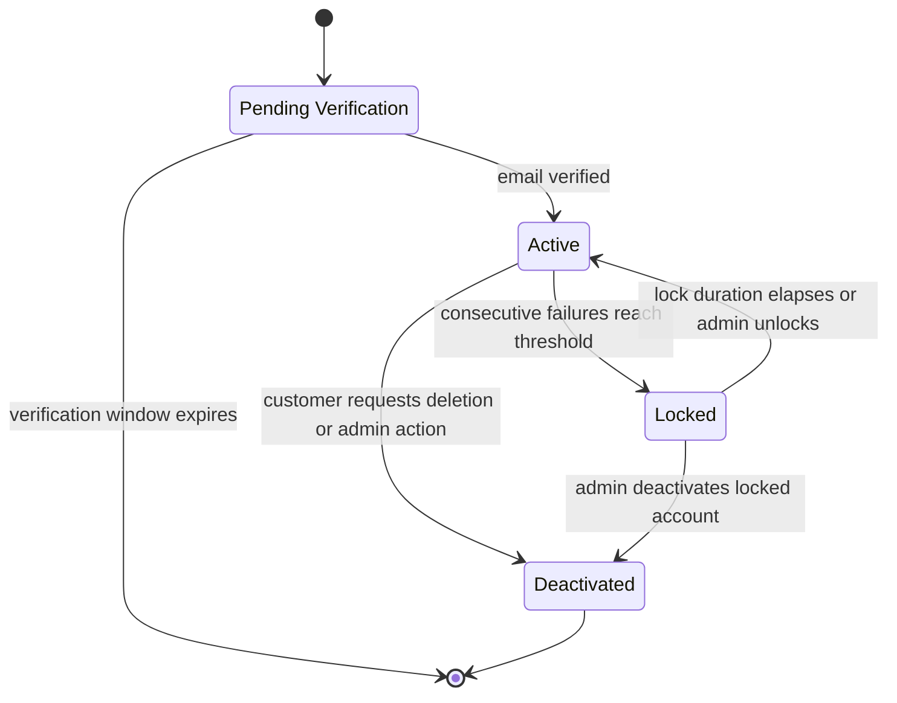

#### State Transitions

| From                 | To                  | Trigger                                         | Notes                                                                                                       |
| :------------------- | :------------------ | :---------------------------------------------- | :---------------------------------------------------------------------------------------------------------- |
| Pending Verification | Active              | Email verification token validated              | The verification token must match the token issued at registration (INV-UA-04).                              |
| Pending Verification | (none)              | Verification window expires                     | An account that remains unverified beyond the window is pruned. Terminal transition.                         |
| Active               | Locked              | Consecutive authentication failures reach limit | The account is locked after the consecutive failure threshold is reached (INV-UA-05).                        |
| Locked               | Active              | Lock duration elapses or administrator unlocks  | The lock is released either by time or by explicit administrator action (INV-UA-05).                          |
| Active               | Deactivated         | Customer requests deletion, or admin action     | Self-service deletion by the customer, or administrative deactivation by a Super Admin (INV-UA-06).           |
| Locked               | Deactivated         | Administrator deactivates locked account        | Direct administrative action on a locked account (INV-UA-06).                                                 |
| Deactivated          | (none)              | —                                               | Deactivated is terminal. No transition out of Deactivated is permitted (INV-UA-06).                           |

#### Domain Events Published

| Domain event          | Fact captured                                                              | Integration scope    |
| :-------------------- | :------------------------------------------------------------------------- | :------------------- |
| UserAccountRegistered | A new account identity has been registered with a role and email address.  | Integration (S1 → S6) |

#### Cross-Context Events Consumed

None. The UserAccount is an upstream master identity aggregate within S1 IAM Service. No event from another bounded context causes a state change in this aggregate.

#### Traceability

| Capability                          | Software Requirements | Business Rules                      |
| :---------------------------------- | :-------------------- | :---------------------------------- |
| CAP-001, CAP-002, CAP-003, CAP-005  | SR-001 to SR-017      | BR-1, BR-2, BR-3, BR-4, BRL-7, BA-7 |

---

### 3.2 Session

#### Definition

A Session is a temporary credential issued to a UserAccount after that account successfully logs in. It represents the period during which the account is treated as authenticated. A Session exists only as long as it is valid; once it is revoked or expires, the account must log in again to obtain a new one.

A Session is a separate aggregate from UserAccount because the two change on entirely different rhythms. A UserAccount changes rarely. A Session changes on every login, refresh, and logout. Placing them in one aggregate would lock the account on every session event.

#### Aggregate Root

Yes. The Session is an aggregate root.

#### Child Entities

None.

#### Value Objects Owned

Token, RefreshToken.

#### References by Identity

The Session refers to exactly one UserAccount, by the identity of that account. It does not hold an object reference to the account.

#### Conceptual State

| Concept            | Meaning                                                                    |
| :----------------- | :------------------------------------------------------------------------- |
| Session identity   | The unique identity of this session, assigned at creation.                  |
| Account            | The identity of the UserAccount this session belongs to.                    |
| Issued at          | The moment the session was established.                                     |
| Expires at         | The moment the session ceases to be valid without a refresh.                |
| Status             | The current lifecycle state of the session.                                 |
| Client fingerprint | An optional client identifier recorded at issuance.                         |

#### Invariants

| ID        | Invariant                                                              | Source                                                                                                                        |
| :-------- | :--------------------------------------------------------------------- | :---------------------------------------------------------------------------------------------------------------------------- |
| INV-SS-01 | A Session refers to an existing UserAccount.                           | [SRIS-P1-REQ-004](../wave-1-requirements/SRIS-P1-REQ-004_SoftwareRequirementsSpecificationSRS.md) SR-003                      |
| INV-SS-02 | The expiry time of a Session is strictly later than its issue time.    | [SRIS-P1-REQ-004](../wave-1-requirements/SRIS-P1-REQ-004_SoftwareRequirementsSpecificationSRS.md) SR-007                      |
| INV-SS-03 | A Session cannot be extended past its maximum absolute lifetime.       | [SRIS-P1-REQ-005](../wave-1-requirements/SRIS-P1-REQ-005_NonFunctionalRequirementsISO25010.md) NFR-044                        |
| INV-SS-04 | A Revoked or Expired Session cannot return to Active.                  | [SRIS-P1-REQ-004](../wave-1-requirements/SRIS-P1-REQ-004_SoftwareRequirementsSpecificationSRS.md) SR-007                      |
| INV-SS-05 | A Session is Active only if the UserAccount it refers to is Active.    | [SRIS-P1-REQ-004](../wave-1-requirements/SRIS-P1-REQ-004_SoftwareRequirementsSpecificationSRS.md) SR-003, SR-008               |

#### Value Objects Used

| Value object | What it represents                                                  |
| :----------- | :------------------------------------------------------------------ |
| Token        | The opaque credential presented by the client on each request.      |
| RefreshToken | The credential used to obtain a new Token without re-authenticating. |

#### State Machine

#### State Machine

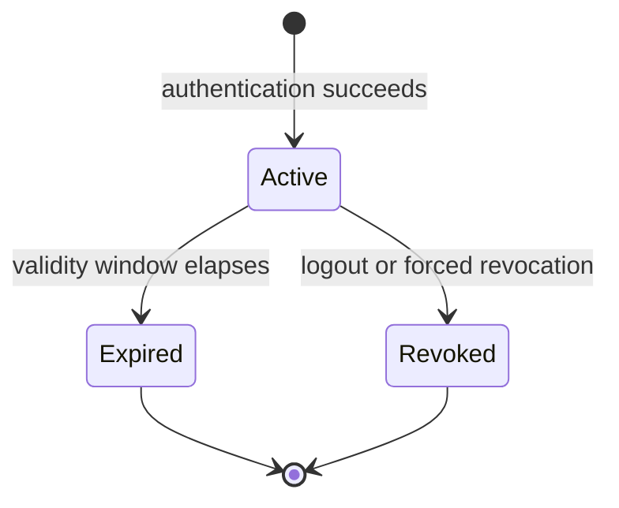

#### State Transitions

| From    | To      | Trigger                     | Notes                                                                                                          |
| :------ | :------ | :-------------------------- | :------------------------------------------------------------------------------------------------------------- |
| Active  | Expired | Validity window elapses     | The session reaches its expiry time without a successful refresh (INV-SS-02, INV-SS-03).                       |
| Active  | Revoked | Logout or forced revocation | The user logs out, or the session is revoked by an administrator or by the password-change policy (INV-SS-04). |
| Expired | (none)  | —                           | Expired is terminal. No transition out of Expired is permitted (INV-SS-04).                                    |
| Revoked | (none)  | —                           | Revoked is terminal. No transition out of Revoked is permitted (INV-SS-04).                                    |

#### Domain Events Published

None. Session transitions are internal to S1 IAM Service and are not published as cross-context events.

#### Cross-Context Events Consumed

| Event                           | Source         | Action                                                |
| :------------------------------ | :------------- | :---------------------------------------------------- |
| Password changed on UserAccount | S1 IAM Service | Revoke every Active Session for the affected account. |

This row is a cross-aggregate policy, not an invariant of the Session aggregate. The Session cannot observe a password change on its own, because a password change is a fact about the UserAccount, not about the Session. The rule is enforced through the event flow, and the mechanics of that flow are owned by [SRIS-P1-ARCH-009](./SRIS-P1-ARCH-009_ServiceInteractionAndCommunicationDesign.md) — Service Interaction and Communication Design. The requirement is recorded in [SRIS-P1-REQ-004](../wave-1-requirements/SRIS-P1-REQ-004_SoftwareRequirementsSpecificationSRS.md) SR-014.

#### Traceability

| Capability | Software Requirements          | Business Rules   |
| :--------- | :----------------------------- | :--------------- |
| CAP-004    | SR-003, SR-004, SR-007, SR-008 | BR-1, BR-2, BR-3 |

---

## 4. Railway Master Data

The Railway Master Data domain is owned by S2 Master Data and Pricing Service. It contains five aggregates: Station, Route, CoachTemplate, Train, and TrainSchedule. Together they define the physical railway network, the rolling stock, and the operational schedule of Phase 1. Station and Route define the geography of the network. CoachTemplate defines the physical composition of a train. Train and TrainSchedule define the service that runs on that network.

The capabilities of the domain are recorded in [SRIS-P1-REQ-003](../wave-1-requirements/SRIS-P1-REQ-003_CapabilityCatalogFinal.md) — Capability Catalog (Final), which lists the 30 business capabilities Phase 1 provides. The software requirements are recorded in [SRIS-P1-REQ-004](../wave-1-requirements/SRIS-P1-REQ-004_SoftwareRequirementsSpecificationSRS.md) — Software Requirements Specification (SRS), which states what the software must do.

### 4.1 Station

#### Definition

A Station is a physical location on the railway network where a train may halt. It is the base of the master data chain in SRIS. Every Route, TrainSchedule, and fare calculation refers to stations. A Station is identified by a unique station code, which is the code used in every operational and passenger-facing context.

#### Aggregate Root

Yes. The Station is an aggregate root.

#### Child Entities

None.

#### Value Objects Owned

StationCode.

#### References by Identity

None. A Station is a top-level master data aggregate and does not refer to any other aggregate.

#### Conceptual State

| Concept            | Meaning                                                               |
| :----------------- | :-------------------------------------------------------------------- |
| Station identity   | The unique identity of this station, assigned at creation.             |
| Station code       | The short code that uniquely identifies the station.                   |
| Name               | The full name of the station.                                         |
| Network attributes | Optional attributes that describe the station's place in the network.  |
| Operational status | The current lifecycle state of the station.                           |

#### Invariants

| ID        | Invariant                                                                    | Source                                                                                                       |
| :-------- | :--------------------------------------------------------------------------- | :----------------------------------------------------------------------------------------------------------- |
| INV-ST-01 | Every station has a unique station code.                                     | [SRIS-P1-REQ-004](../wave-1-requirements/SRIS-P1-REQ-004_SoftwareRequirementsSpecificationSRS.md) SR-019      |
| INV-ST-02 | Every station has a non-empty name.                                          | [SRIS-P1-REQ-004](../wave-1-requirements/SRIS-P1-REQ-004_SoftwareRequirementsSpecificationSRS.md) SR-019      |
| INV-ST-03 | The station code is immutable after creation.                                | [SRIS-P1-REQ-004](../wave-1-requirements/SRIS-P1-REQ-004_SoftwareRequirementsSpecificationSRS.md) SR-020      |
| INV-ST-04 | A station referenced by an active route or schedule cannot be deactivated.   | [SRIS-P1-REQ-004](../wave-1-requirements/SRIS-P1-REQ-004_SoftwareRequirementsSpecificationSRS.md) SR-021      |

#### Value Objects Used

| Value object | What it represents                                |
| :----------- | :------------------------------------------------ |
| StationCode  | The unique short code that identifies the station. |

#### State Machine

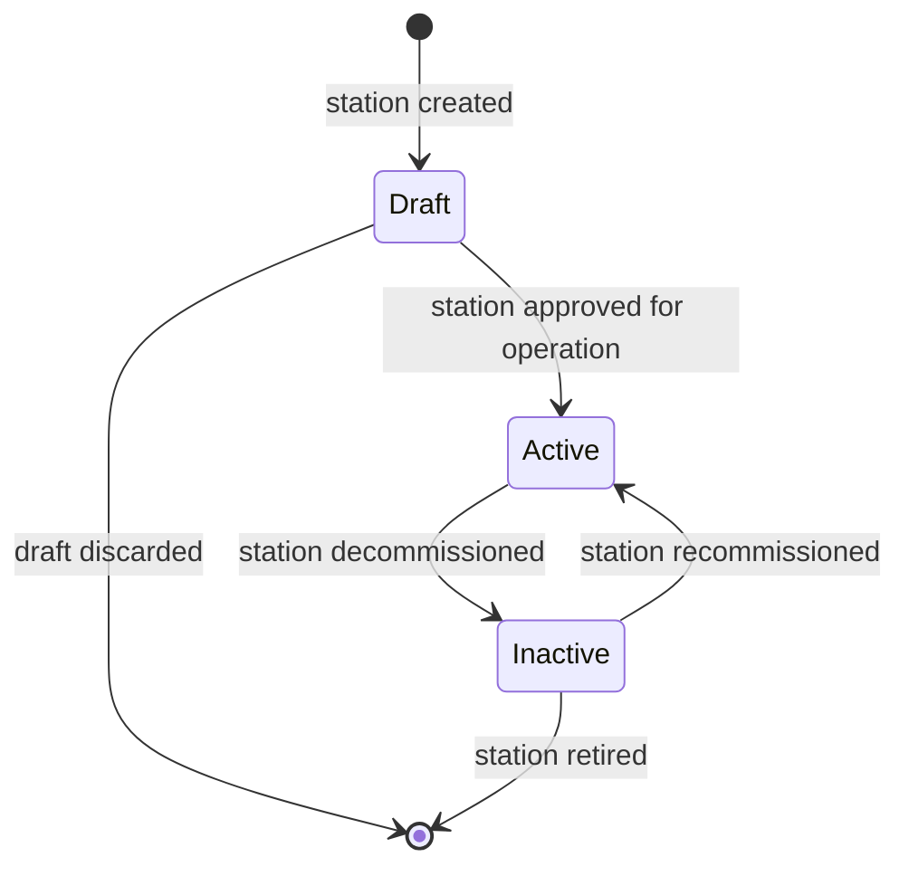

#### State Transitions

| From     | To       | Trigger                             | Notes                                                                                                       |
| :------- | :------- | :---------------------------------- | :---------------------------------------------------------------------------------------------------------- |
| Draft    | Active   | Station approved for operation      | The station becomes available for reference by new routes and schedules.                                    |
| Active   | Inactive | Station decommissioned              | The station is removed from operational service. A station referenced by an active route or schedule cannot be deactivated (INV-ST-04). |
| Inactive | Active   | Station recommissioned              | The station is returned to operational service and may again be referenced by new routes and schedules.       |
| Draft    | (none)   | Draft discarded                     | A draft station that is discarded does not enter operation. Terminal transition.                             |
| Inactive | (none)   | Station retired                     | A retired station is not returned to service. Terminal transition.                                           |

#### Domain Events Published

| Domain event       | Fact captured                                            | Integration scope |
| :----------------- | :------------------------------------------------------- | :---------------- |
| StationActivated   | A station has been activated for operational service.    | Internal          |
| StationDeactivated | A station has been removed from operational service.     | Internal          |

No consumers in Phase 1. Both events are published by the aggregate and are available for consumption by a future audit consumer or by a future downstream service.

#### Cross-Context Events Consumed

None. The Station is a master data aggregate within S2 Master Data and Pricing Service. No event from another bounded context causes a state change in this aggregate.

#### Traceability

| Capability | Software Requirements          | Business Rules |
| :--------- | :----------------------------- | :------------- |
| CAP-006    | SR-019, SR-020, SR-021, SR-035 | BR-5, BR-6, BRL-7 |

---

### 4.2 Route

#### Definition

A Route is an ordered sequence of stations with a cumulative distance from the origin. It describes the geography of a journey without any dates or timings. A TrainSchedule is built by placing timings on a Route. A Route may be shared across multiple trains and return services, which is why it is a first-class aggregate rather than an embedded list inside TrainSchedule.

#### Aggregate Root

Yes. The Route is an aggregate root.

#### Child Entities

None. The stops of a route are modelled as value objects rather than child entities, because a stop has no identity of its own and is fully described by the station it refers to and its distance from the origin.

#### Value Objects Owned

RouteStop.

#### References by Identity

Each RouteStop refers to a Station by the identity of that station, using the station code. The Route does not hold object references to the Station aggregates.

#### Conceptual State

| Concept        | Meaning                                                                |
| :------------- | :--------------------------------------------------------------------- |
| Route identity | The unique identity of this route, assigned at creation.               |
| Route name     | A human-readable name for the route.                                   |
| Stops          | The ordered sequence of RouteStop value objects that compose the route. |
| Total distance | The cumulative distance from the first stop to the last stop.          |
| Status         | The current lifecycle state of the route.                              |

#### Invariants

| ID        | Invariant                                                                                          | Source                                                                                                   |
| :-------- | :------------------------------------------------------------------------------------------------- | :------------------------------------------------------------------------------------------------------- |
| INV-RT-01 | A Route has at least two stops.                                                                    | [SRIS-P1-REQ-004](../wave-1-requirements/SRIS-P1-REQ-004_SoftwareRequirementsSpecificationSRS.md) SR-022 |
| INV-RT-02 | The first and last stops of a Route must not be the same station.                                  | [SRIS-P1-REQ-004](../wave-1-requirements/SRIS-P1-REQ-004_SoftwareRequirementsSpecificationSRS.md) SR-022 |
| INV-RT-03 | Every stop refers to an existing, active station.                                                  | [SRIS-P1-REQ-004](../wave-1-requirements/SRIS-P1-REQ-004_SoftwareRequirementsSpecificationSRS.md) SR-022 |
| INV-RT-04 | The cumulative distance of the stops is strictly increasing from first to last.                     | [SRIS-P1-REQ-004](../wave-1-requirements/SRIS-P1-REQ-004_SoftwareRequirementsSpecificationSRS.md) SR-022 |
| INV-RT-05 | The first stop has a cumulative distance of zero.                                                  | [SRIS-P1-REQ-004](../wave-1-requirements/SRIS-P1-REQ-004_SoftwareRequirementsSpecificationSRS.md) SR-022 |
| INV-RT-06 | No two stops of the same Route refer to the same station.                                          | [SRIS-P1-REQ-004](../wave-1-requirements/SRIS-P1-REQ-004_SoftwareRequirementsSpecificationSRS.md) SR-022 |
| INV-RT-07 | A Route referenced by an active schedule cannot have its stop order or distances changed in place.  | [SRIS-P1-REQ-004](../wave-1-requirements/SRIS-P1-REQ-004_SoftwareRequirementsSpecificationSRS.md) SR-023 |

#### Value Objects Used

| Value object | What it represents                                                   |
| :----------- | :------------------------------------------------------------------- |
| RouteStop    | A station on the route, with its cumulative distance from the origin. |

#### State Machine

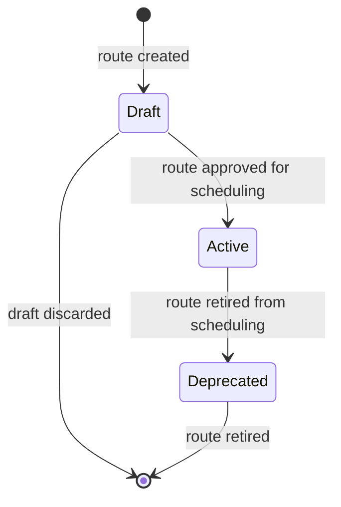

#### State Transitions

| From       | To         | Trigger                       | Notes                                                                                                                                                                  |
| :--------- | :--------- | :---------------------------- | :--------------------------------------------------------------------------------------------------------------------------------------------------------------------- |
| Draft      | Active     | Route approved for scheduling | The route becomes available for reference by new TrainSchedules.                                                                                                       |
| Active     | Deprecated | Route retired from scheduling | The route cannot be referenced by new TrainSchedules. A route referenced by an active schedule cannot have its stop order or distances changed in place (INV-RT-07).    |
| Draft      | (none)     | Draft discarded               | A draft route that is discarded never enters service. Terminal transition.                                                                                             |
| Deprecated | (none)     | Route retired                 | A deprecated route is not returned to Active. Terminal transition.                                                                                                     |

#### Domain Events Published

| Domain event    | Fact captured                             | Integration scope |
| :-------------- | :---------------------------------------- | :---------------- |
| RouteActivated  | A route has been activated for scheduling. | Internal          |
| RouteDeprecated | A route has been retired from scheduling.  | Internal          |

No consumers in Phase 1. Both events are available for a future audit consumer or downstream service.

#### Cross-Context Events Consumed

None. The Route is a master data aggregate within S2 Master Data and Pricing Service. No event from another bounded context causes a state change in this aggregate.

#### Traceability

| Capability | Software Requirements          | Business Rules |
| :--------- | :----------------------------- | :------------- |
| CAP-007    | SR-022, SR-023, SR-024, SR-035 | BR-5, BR-6, BR-7 |

---

### 4.3 CoachTemplate

#### Definition

A CoachTemplate is the physical blueprint of a passenger coach. It defines the number of berths, the class of travel, and the layout of the berths inside the coach. A single CoachTemplate is reused across many trains and many dates, which is why it is modelled as a standalone aggregate rather than being embedded in each Train. The template is a reusable blueprint; the actual seat inventory for a specific journey is a separate aggregate, CoachInventory, instantiated from the template.

#### Aggregate Root

Yes. The CoachTemplate is an aggregate root.

#### Child Entities

None. The berths of a coach are modelled as value objects rather than child entities, because a berth has no identity of its own and is fully described by its number, its class, and its position within the coach.

#### Value Objects Owned

BerthDefinition.

#### References by Identity

None. A CoachTemplate is a master data aggregate and does not refer to any other aggregate. It is referred to by identity from Train and from CoachInventory.

#### Conceptual State

| Concept           | Meaning                                                                  |
| :---------------- | :----------------------------------------------------------------------- |
| Template identity | The unique identity of this coach template, assigned at creation.         |
| Template name     | A human-readable name for the coach template.                            |
| Travel class      | The class of travel served by this coach template.                       |
| Berths            | The ordered set of BerthDefinition value objects that compose the coach.  |
| Capacity          | The number of berths in the coach, which equals the size of the berth set. |
| Status            | The current lifecycle state of the coach template.                       |

#### Invariants

The travel class invariant draws on the class definitions recorded in [SRIS-P1-REQ-001](../wave-1-requirements/SRIS-P1-REQ-001_GlossaryAndDomainDictionary.md) — Glossary and Domain Dictionary, which fixes the classes used across the register.

| ID        | Invariant                                                              | Source                                                                                                   |
| :-------- | :--------------------------------------------------------------------- | :------------------------------------------------------------------------------------------------------- |
| INV-CT-01 | The berth count of a CoachTemplate equals its stated capacity.          | [SRIS-P1-REQ-004](../wave-1-requirements/SRIS-P1-REQ-004_SoftwareRequirementsSpecificationSRS.md) SR-029 |
| INV-CT-02 | Every berth number in a CoachTemplate is unique within the template.    | [SRIS-P1-REQ-004](../wave-1-requirements/SRIS-P1-REQ-004_SoftwareRequirementsSpecificationSRS.md) SR-029 |
| INV-CT-03 | Every berth in the same CoachTemplate belongs to one travel class.      | [SRIS-P1-REQ-004](../wave-1-requirements/SRIS-P1-REQ-004_SoftwareRequirementsSpecificationSRS.md) SR-029 |
| INV-CT-04 | The travel class of a CoachTemplate is one of the classes defined in the register. | [SRIS-P1-REQ-001](../wave-1-requirements/SRIS-P1-REQ-001_GlossaryAndDomainDictionary.md) §3.3 |

#### Value Objects Used

| Value object    | What it represents                                                       |
| :-------------- | :----------------------------------------------------------------------- |
| BerthDefinition | A single berth inside the coach, defined by number, class, and position. |

#### State Machine

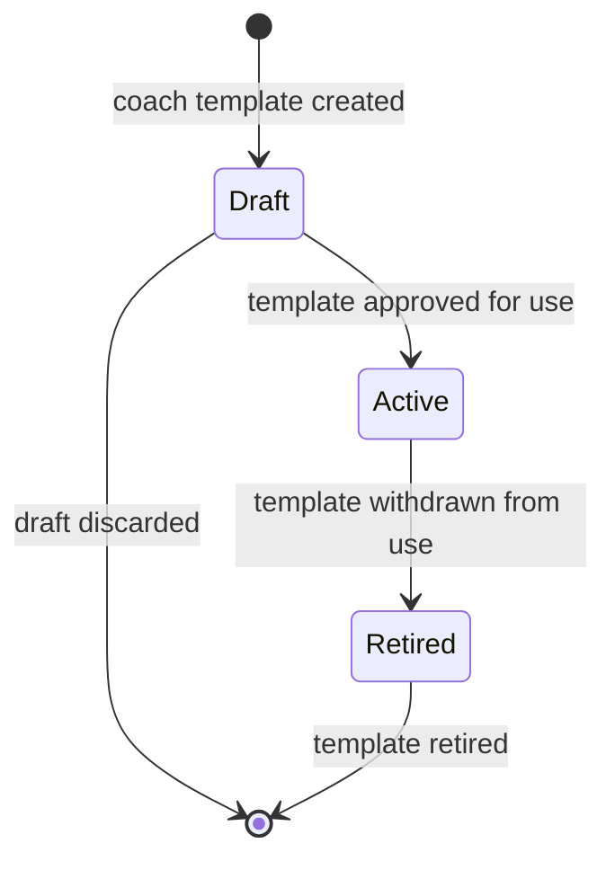

#### State Transitions

| From    | To      | Trigger                     | Notes                                                                                                 |
| :------ | :------ | :-------------------------- | :---------------------------------------------------------------------------------------------------- |
| Draft   | Active  | Template approved for use   | The template becomes available for reference by new Trains and by new CoachInventory instantiation.    |
| Active  | Retired | Template withdrawn from use | The template cannot be referenced by new Trains. Coaches already in service continue with their existing inventory until retired. |
| Draft   | (none)  | Draft discarded             | A draft template that is discarded never enters service. Terminal transition.                          |
| Retired | (none)  | Template retired            | A retired template is not returned to Active. Terminal transition.                                     |

#### Domain Events Published

| Domain event           | Fact captured                                 | Integration scope |
| :--------------------- | :-------------------------------------------- | :---------------- |
| CoachTemplateActivated | A coach template has been activated for use.  | Internal          |
| CoachTemplateRetired   | A coach template has been withdrawn from use. | Internal          |

No consumers in Phase 1. Both events are available for a future audit consumer or downstream service.

#### Cross-Context Events Consumed

None. The CoachTemplate is a master data aggregate within S2 Master Data and Pricing Service. No event from another bounded context causes a state change in this aggregate.

#### Traceability

| Capability | Software Requirements  | Business Rules |
| :--------- | :--------------------- | :------------- |
| CAP-009    | SR-029, SR-030, SR-035 | BR-6, BR-7     |

---

### 4.4 Train

#### Definition

A Train is the identity of a specific railway service. It records the number by which the service is known, its name, its type, and the ordered composition of coaches that make up the train. A Train does not carry dates or timings; those belong to TrainSchedule. The separation exists because Train identity is stable for years, while the timetable changes frequently.

#### Aggregate Root

Yes. The Train is an aggregate root.

#### Child Entities

None. The coach composition of a train is modelled as an ordered list of references by identity to CoachTemplate aggregates, not as child entities.

#### Value Objects Owned

None.

#### References by Identity

The ordered coach composition of a Train refers to CoachTemplate aggregates by the identity of each template. The Train does not hold object references to those templates.

#### Conceptual State

| Concept           | Meaning                                                                 |
| :---------------- | :---------------------------------------------------------------------- |
| Train identity    | The unique identity of this train, assigned at creation.                 |
| Train number      | The five-digit number by which the train is known.                       |
| Train name        | The human-readable name of the train.                                    |
| Train type        | The category of the train, drawn from the defined types.                 |
| Coach composition | The ordered sequence of references by identity to CoachTemplate aggregates. |
| Status            | The current lifecycle state of the train.                                |

#### Invariants

| ID        | Invariant                                                              | Source                                                                                                   |
| :-------- | :--------------------------------------------------------------------- | :------------------------------------------------------------------------------------------------------- |
| INV-TR-01 | Every train has a unique five-digit train number.                      | [SRIS-P1-REQ-004](../wave-1-requirements/SRIS-P1-REQ-004_SoftwareRequirementsSpecificationSRS.md) SR-025 |
| INV-TR-02 | Every train has a non-empty name.                                      | [SRIS-P1-REQ-004](../wave-1-requirements/SRIS-P1-REQ-004_SoftwareRequirementsSpecificationSRS.md) SR-025 |
| INV-TR-03 | The train type is one of the defined types.                            | [SRIS-P1-REQ-004](../wave-1-requirements/SRIS-P1-REQ-004_SoftwareRequirementsSpecificationSRS.md) SR-025 |
| INV-TR-04 | The train number is immutable after creation.                          | [SRIS-P1-REQ-004](../wave-1-requirements/SRIS-P1-REQ-004_SoftwareRequirementsSpecificationSRS.md) SR-026 |
| INV-TR-05 | Every coach in the composition refers to an active CoachTemplate.      | [SRIS-P1-REQ-004](../wave-1-requirements/SRIS-P1-REQ-004_SoftwareRequirementsSpecificationSRS.md) SR-029 |
| INV-TR-06 | A Train has at least one coach template in its composition.            | [SRIS-P1-REQ-004](../wave-1-requirements/SRIS-P1-REQ-004_SoftwareRequirementsSpecificationSRS.md) SR-029 |

#### Value Objects Used

None.

#### State Machine

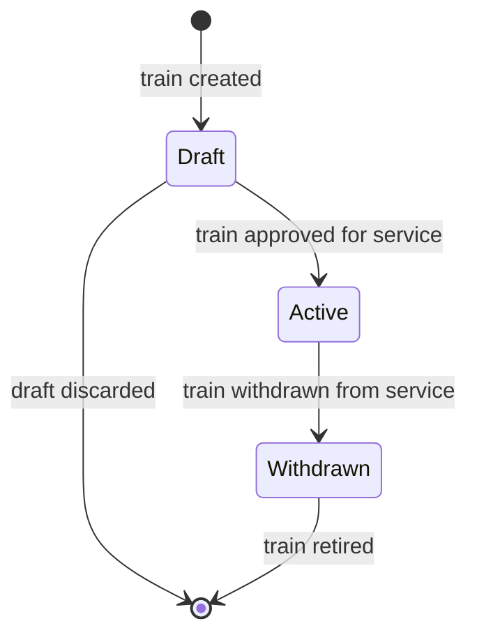

#### State Transitions

| From      | To        | Trigger                      | Notes                                                                                                                         |
| :-------- | :-------- | :--------------------------- | :---------------------------------------------------------------------------------------------------------------------------- |
| Draft     | Active    | Train approved for service   | The train becomes available for reference by new TrainSchedules. Every coach in the composition must refer to an active CoachTemplate (INV-TR-05). |
| Active    | Withdrawn | Train withdrawn from service | The train cannot be referenced by new TrainSchedules. Existing schedules continue until completed.                            |
| Draft     | (none)    | Draft discarded              | A draft train that is discarded never enters service. Terminal transition.                                                    |
| Withdrawn | (none)    | Train retired                | A withdrawn train is not returned to Active. Terminal transition.                                                             |

#### Domain Events Published

| Domain event   | Fact captured                            | Integration scope |
| :------------- | :--------------------------------------- | :---------------- |
| TrainActivated | A train has been activated for service.  | Internal          |
| TrainWithdrawn | A train has been withdrawn from service. | Internal          |

No consumers in Phase 1. Both events are available for a future audit consumer or downstream service.

#### Cross-Context Events Consumed

None. The Train is a master data aggregate within S2 Master Data and Pricing Service. No event from another bounded context causes a state change in this aggregate.

#### Traceability

| Capability | Software Requirements                  | Business Rules |
| :--------- | :------------------------------------- | :------------- |
| CAP-008    | SR-025, SR-026, SR-029, SR-030, SR-035 | BR-5, BR-6, BR-7 |

---

### 4.5 TrainSchedule

#### Definition

A TrainSchedule is a dated timetable for a specific Train along a specific Route. It places arrival and departure timings on each stop of the route for one operating period. A TrainSchedule refers to a Train and a Route by identity, and does not duplicate their content. A schedule with confirmed bookings cannot have its timings changed in place; a new schedule must be published instead.

#### Aggregate Root

Yes. The TrainSchedule is an aggregate root.

#### Child Entities

None. The stops of a schedule are modelled as value objects, because a schedule stop has no identity of its own and is fully described by the station it refers to and its arrival and departure timings.

#### Value Objects Owned

ScheduleStop.

#### References by Identity

The TrainSchedule refers to exactly one Train, by the identity of that train, and to exactly one Route, by the identity of that route. It does not hold object references to either aggregate.

#### Conceptual State

| Concept           | Meaning                                                                 |
| :---------------- | :---------------------------------------------------------------------- |
| Schedule identity | The unique identity of this schedule, assigned at creation.              |
| Train             | The identity of the Train this schedule belongs to.                      |
| Route             | The identity of the Route this schedule follows.                         |
| Operating period  | The date range over which the schedule is valid.                         |
| Stops             | The ordered sequence of ScheduleStop value objects that carry the timings. |
| Status            | The current lifecycle state of the schedule.                             |

#### Invariants

| ID        | Invariant                                                                                       | Source                                                                                                   |
| :-------- | :---------------------------------------------------------------------------------------------- | :------------------------------------------------------------------------------------------------------- |
| INV-TS-01 | A TrainSchedule refers to an existing Train and an existing Route.                              | [SRIS-P1-REQ-004](../wave-1-requirements/SRIS-P1-REQ-004_SoftwareRequirementsSpecificationSRS.md) SR-027 |
| INV-TS-02 | Every stop on the Route has a timing in the TrainSchedule.                                      | [SRIS-P1-REQ-004](../wave-1-requirements/SRIS-P1-REQ-004_SoftwareRequirementsSpecificationSRS.md) SR-027 |
| INV-TS-03 | The departure time at a stop is not earlier than the arrival time at the same stop.             | [SRIS-P1-REQ-004](../wave-1-requirements/SRIS-P1-REQ-004_SoftwareRequirementsSpecificationSRS.md) SR-027 |
| INV-TS-04 | The arrival time at each subsequent stop is later than the departure time at the preceding stop. | [SRIS-P1-REQ-004](../wave-1-requirements/SRIS-P1-REQ-004_SoftwareRequirementsSpecificationSRS.md) SR-027 |
| INV-TS-05 | The halt duration at a stop equals the departure time minus the arrival time at that stop.      | [SRIS-P1-REQ-004](../wave-1-requirements/SRIS-P1-REQ-004_SoftwareRequirementsSpecificationSRS.md) SR-027 |
| INV-TS-06 | A TrainSchedule with confirmed bookings cannot have its timings changed in place.               | [SRIS-P1-REQ-004](../wave-1-requirements/SRIS-P1-REQ-004_SoftwareRequirementsSpecificationSRS.md) SR-028 |

#### Value Objects Used

| Value object | What it represents                                                                 |
| :----------- | :--------------------------------------------------------------------------------- |
| ScheduleStop | A stop on the schedule, with its station reference, arrival time, and departure time. |

#### State Machine

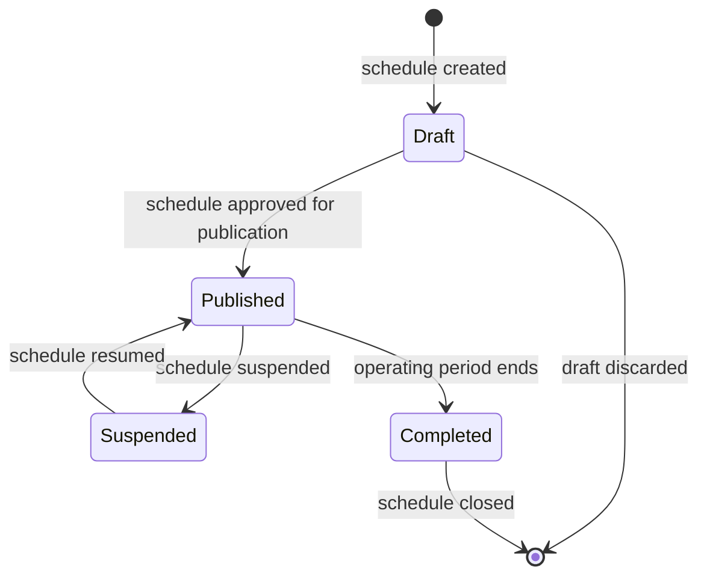

#### State Transitions

| From      | To        | Trigger                           | Notes                                                                                                              |
| :-------- | :-------- | :-------------------------------- | :----------------------------------------------------------------------------------------------------------------- |
| Draft     | Published | Schedule approved for publication | The schedule becomes visible to search and bookable. A schedule with confirmed bookings cannot have its timings changed in place (INV-TS-06). |
| Published | Suspended | Schedule suspended                | The schedule is temporarily removed from booking. Existing bookings are handled by a separate policy owned by the requirements documents. |
| Suspended | Published | Schedule resumed                  | The schedule returns to bookable state, subject to INV-TS-06 if it had confirmed bookings before suspension.          |
| Published | Completed | Operating period ends             | The schedule reaches the end of its operating period and stops accepting bookings.                                   |
| Draft     | (none)    | Draft discarded                   | A draft schedule that is discarded never enters service. Terminal transition.                                       |
| Completed | (none)    | Schedule closed                   | A completed schedule is not returned to Published. Terminal transition.                                              |

#### Domain Events Published

| Domain event           | Fact captured                                                   | Integration scope |
| :--------------------- | :-------------------------------------------------------------- | :---------------- |
| TrainSchedulePublished | A schedule has been published and is available for booking.     | Internal          |
| TrainScheduleSuspended | A schedule has been suspended and is unavailable for new booking. | Internal         |

No consumers in Phase 1. Both events are available for a future audit consumer or downstream service.

#### Cross-Context Events Consumed

None. The TrainSchedule is a master data aggregate within S2 Master Data and Pricing Service. No event from another bounded context causes a state change in this aggregate.

#### Traceability

| Capability | Software Requirements  | Business Rules |
| :--------- | :--------------------- | :------------- |
| CAP-008    | SR-027, SR-028, SR-035 | BR-5, BR-6, BR-7 |

---

## 5. Fare and Pricing

The Fare and Pricing domain is owned by S2 Master Data and Pricing Service. It contains two aggregates, TariffRule and ConcessionRule, and one value object, FareQuote. A TariffRule defines how the base fare of a ticket is calculated. A ConcessionRule defines a fare reduction for a specific passenger category. A FareQuote is the priced result of a fare calculation; it is produced on demand and discarded when it expires, and it is therefore not an aggregate.

The capabilities of the domain are recorded in [SRIS-P1-REQ-003](../wave-1-requirements/SRIS-P1-REQ-003_CapabilityCatalogFinal.md) — Capability Catalog (Final), which lists the 30 business capabilities Phase 1 provides. The software requirements are recorded in [SRIS-P1-REQ-004](../wave-1-requirements/SRIS-P1-REQ-004_SoftwareRequirementsSpecificationSRS.md) — Software Requirements Specification (SRS), which states what the software must do.

### 5.1 TariffRule

#### Definition

A TariffRule is the administrative definition of how the base fare of a ticket is calculated. It holds the base rate per kilometre, the distance slabs that scale the rate, the class multipliers that adapt the rate to each class of travel, and the effective period over which the rule applies. A TariffRule does not calculate fares by itself; it provides the parameters that the pricing service uses when it produces a FareQuote. Dynamic pricing is modelled in Phase 1 as an additional attribute on TariffRule, not as a separate aggregate.

#### Aggregate Root

Yes. The TariffRule is an aggregate root.

#### Child Entities

None. The distance slabs of a tariff rule are modelled as value objects, because a slab has no identity of its own and is fully described by its lower bound, its upper bound, and its rate.

#### Value Objects Owned

DistanceSlab, Money.

#### References by Identity

None. A TariffRule is a top-level pricing aggregate and does not refer to any other aggregate.

#### Conceptual State

| Concept          | Meaning                                                                       |
| :--------------- | :---------------------------------------------------------------------------- |
| Rule identity    | The unique identity of this tariff rule, assigned at creation.                 |
| Travel class     | The class of travel this rule applies to.                                      |
| Base rate        | The base rate per kilometre used to calculate the distance component.          |
| Distance slabs   | The ordered set of DistanceSlab value objects that scale the rate by distance. |
| Class multiplier | The factor that adapts the base rate to the travel class.                      |
| Dynamic pricing  | An optional adjustment that varies the fare by demand, modelled as an attribute. |
| Effective period | The period during which this rule applies, with a from date and an until date. |
| Status           | The current lifecycle state of the rule.                                       |

#### Invariants

| ID        | Invariant                                                                    | Source                                                                                                                             |
| :-------- | :--------------------------------------------------------------------------- | :--------------------------------------------------------------------------------------------------------------------------------- |
| INV-TF-01 | The base rate per kilometre is non-negative.                                 | [SRIS-P1-REQ-007](../wave-1-requirements/SRIS-P1-REQ-007_DomainRulesFareCalculation.md) — Domain Rules: Fare Calculation             |
| INV-TF-02 | The distance slabs of a TariffRule do not overlap and leave no gaps between them. | [SRIS-P1-REQ-004](../wave-1-requirements/SRIS-P1-REQ-004_SoftwareRequirementsSpecificationSRS.md) SR-036                              |
| INV-TF-03 | The class multiplier of a TariffRule is positive.                            | [SRIS-P1-REQ-004](../wave-1-requirements/SRIS-P1-REQ-004_SoftwareRequirementsSpecificationSRS.md) SR-031                              |
| INV-TF-04 | Two TariffRules for the same travel class do not have overlapping effective periods. | [SRIS-P1-REQ-004](../wave-1-requirements/SRIS-P1-REQ-004_SoftwareRequirementsSpecificationSRS.md) SR-036                              |
| INV-TF-05 | The effective-until date of a TariffRule is later than its effective-from date. | [SRIS-P1-REQ-004](../wave-1-requirements/SRIS-P1-REQ-004_SoftwareRequirementsSpecificationSRS.md) SR-036                               |

#### Value Objects Used

| Value object | What it represents                                                           |
| :----------- | :--------------------------------------------------------------------------- |
| DistanceSlab | A distance band with a lower bound, an upper bound, and a rate for that band. |
| Money        | A monetary amount with an amount and a currency.                              |

#### State Machine

#### State Machine

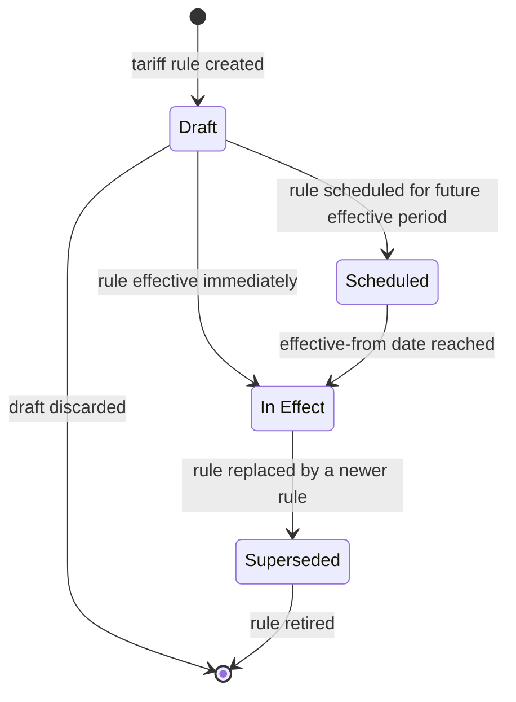

#### State Transitions

| From       | To         | Trigger                                      | Notes                                                                                                                                 |
| :--------- | :--------- | :------------------------------------------- | :------------------------------------------------------------------------------------------------------------------------------------ |
| Draft      | Scheduled  | Rule scheduled for a future effective period | The rule becomes pending and will enter effect on the effective-from date. Two rules for the same class must not have overlapping effective periods (INV-TF-04). |
| Draft      | In Effect  | Rule effective immediately                   | The rule becomes effective from the moment of approval. Two rules for the same class must not have overlapping effective periods (INV-TF-04). |
| Scheduled  | In Effect  | Effective-from date reached                  | The rule transitions automatically on the effective-from date.                                                                         |
| In Effect  | Superseded | Rule replaced by a newer rule                | The rule ceases to apply to new fare calculations. Quotes already issued remain valid until they expire.                               |
| Draft      | (none)     | Draft discarded                              | A draft rule that is discarded never takes effect. Terminal transition.                                                               |
| Superseded | (none)     | Rule retired                                 | A superseded rule is not returned to In Effect. Terminal transition.                                                                  |

#### Domain Events Published

| Domain event         | Fact captured                                                 | Integration scope |
| :------------------- | :------------------------------------------------------------ | :---------------- |
| TariffRuleScheduled  | A tariff rule has been scheduled for a future effective period. | Internal          |
| TariffRuleInEffect   | A tariff rule has become effective.                           | Internal          |
| TariffRuleSuperseded | A tariff rule has been superseded by a newer rule.            | Internal          |

Every state change publishes exactly one event, in accordance with PN-002. No consumers in Phase 1. The events are available for a future audit consumer or downstream service.

#### Cross-Context Events Consumed

None. The TariffRule is a top-level pricing aggregate within S2 Master Data and Pricing Service. No event from another bounded context causes a state change in this aggregate.

#### Traceability

| Capability | Software Requirements          | Business Rules |
| :--------- | :----------------------------- | :------------- |
| CAP-011    | SR-036, SR-037, SR-044, SR-046 | BR-5, BR-6, BR-8 |

A note on dynamic pricing (PN-010). Dynamic pricing is modelled in Phase 1 as an additional attribute on TariffRule, not as a separate aggregate. If it grows beyond a rule attribute in a later phase, it will be extracted as its own aggregate. The extraction path is recorded in Section 12.2.

---

### 5.2 ConcessionRule

#### Definition

A ConcessionRule is the administrative definition of a fare reduction for a specific passenger category. It records the category to which it applies, the amount or rate of the reduction, the eligibility criteria, and the effective period over which the reduction applies. A ConcessionRule is a separate aggregate from TariffRule because fare policy and social policy change for different reasons, on different schedules, and through separate approval flows.

#### Aggregate Root

Yes. The ConcessionRule is an aggregate root.

#### Child Entities

None.

#### Value Objects Owned

Money.

#### References by Identity

None. A ConcessionRule is a top-level pricing aggregate and does not refer to any other aggregate.

#### Conceptual State

| Concept              | Meaning                                                                       |
| :------------------- | :---------------------------------------------------------------------------- |
| Rule identity        | The unique identity of this concession rule, assigned at creation.             |
| Passenger category   | The category of passenger to which this rule applies.                          |
| Reduction            | The amount or rate of the fare reduction.                                      |
| Eligibility criteria | The stated conditions under which the reduction applies.                       |
| Stacking permitted   | Whether this reduction may be combined with another reduction.                  |
| Effective period     | The period during which this rule applies, with a from date and an until date. |
| Status               | The current lifecycle state of the rule.                                       |

#### Invariants

| ID        | Invariant                                                                                                                       | Source                                                                                                   |
| :-------- | :------------------------------------------------------------------------------------------------------------------------------ | :------------------------------------------------------------------------------------------------------- |
| INV-CR-01 | The reduction of a ConcessionRule is between zero and one hundred inclusive.                                                    | [SRIS-P1-REQ-004](../wave-1-requirements/SRIS-P1-REQ-004_SoftwareRequirementsSpecificationSRS.md) SR-039 |
| INV-CR-02 | The eligibility criteria of a ConcessionRule are stated explicitly, not implied.                                                | [SRIS-P1-REQ-004](../wave-1-requirements/SRIS-P1-REQ-004_SoftwareRequirementsSpecificationSRS.md) SR-039 |
| INV-CR-03 | Two ConcessionRules for the same passenger category do not have overlapping effective periods unless stacking is permitted.      | [SRIS-P1-REQ-004](../wave-1-requirements/SRIS-P1-REQ-004_SoftwareRequirementsSpecificationSRS.md) SR-039 |
| INV-CR-04 | Where a passenger qualifies for more than one concession and stacking is not permitted, the highest-value concession applies.     | [SRIS-P1-REQ-004](../wave-1-requirements/SRIS-P1-REQ-004_SoftwareRequirementsSpecificationSRS.md) SR-042 |

#### Value Objects Used

| Value object | What it represents                              |
| :----------- | :---------------------------------------------- |
| Money        | A monetary amount with an amount and a currency. |

#### State Machine

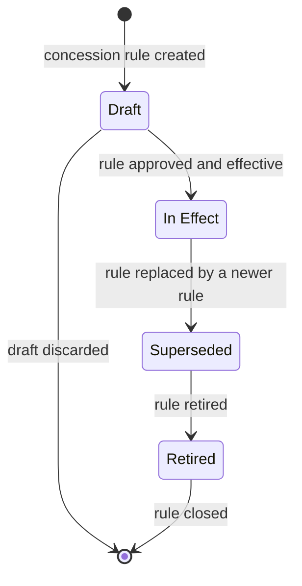

#### State Transitions

| From       | To         | Trigger                        | Notes                                                                                                                                                 |
| :--------- | :--------- | :----------------------------- | :---------------------------------------------------------------------------------------------------------------------------------------------------- |
| Draft      | In Effect  | Rule approved and effective    | The rule becomes effective from the moment of approval. Two rules for the same category must not have overlapping effective periods unless stacking is permitted (INV-CR-03). |
| In Effect  | Superseded | Rule replaced by a newer rule  | The rule ceases to apply to new fare calculations. Quotes already issued remain valid until they expire.                                             |
| Superseded | Retired    | Rule retired                   | The rule is closed and cannot be reintroduced.                                                                                                        |
| Draft      | (none)     | Draft discarded                | A draft rule that is discarded never takes effect. Terminal transition.                                                                              |
| Retired    | (none)     | Rule closed                    | A retired rule is not returned to In Effect. Terminal transition.                                                                                    |

#### Domain Events Published

| Domain event             | Fact captured                                        | Integration scope |
| :----------------------- | :--------------------------------------------------- | :---------------- |
| ConcessionRuleInEffect   | A concession rule has become effective.              | Internal          |
| ConcessionRuleSuperseded | A concession rule has been superseded by a newer rule. | Internal        |
| ConcessionRuleRetired    | A concession rule has been retired.                  | Internal          |

Every state change publishes exactly one event, in accordance with PN-002. No consumers in Phase 1. The events are available for a future audit consumer or downstream service.

#### Cross-Context Events Consumed

None. The ConcessionRule is a top-level pricing aggregate within S2 Master Data and Pricing Service. No event from another bounded context causes a state change in this aggregate.

#### Traceability

| Capability | Software Requirements  | Business Rules |
| :--------- | :--------------------- | :------------- |
| CAP-013    | SR-039, SR-042, SR-046 | BR-6, BR-8     |

---

### 5.3 FareQuote (Value Object)

#### Definition

A FareQuote is the priced result of a fare calculation. It is produced on demand by the pricing service when a customer requests a search result or confirms a booking, and it is discarded when it expires. It is not an aggregate, because it has no lifecycle of its own: it is created, held for a short period, and replaced. A FareQuote that a customer accepts is copied into a Booking as a BookingFareSnapshot; the original FareQuote is not persisted as an aggregate.

#### Value Object Role

A FareQuote is a value object produced by S2 Master Data and Pricing Service. It is consumed by S4 Search Aggregator BFF, which presents the price to the customer during search, and by S3 Reservation Service, which uses it to compute the fare snapshot when a booking is confirmed. It carries no identity and no state machine.

#### Conceptual State

| Concept                    | Meaning                                                                  |
| :------------------------- | :----------------------------------------------------------------------- |
| Base fare                  | The distance-based fare before any adjustments.                          |
| Distance component         | The portion of the fare derived from the distance travelled.             |
| Class multiplier           | The factor applied for the class of travel.                              |
| Quota surcharge            | The additional amount for the quota in which the seat is booked.         |
| Concession adjustments     | The reductions applied for eligible passenger categories.                 |
| Dynamic pricing adjustment | The variation applied by the active dynamic pricing attribute.           |
| Taxes                      | The statutory taxes included in the fare.                                |
| Service charges            | The service charges applied by the system.                               |
| Total                      | The final amount payable.                                                |
| Quote time                 | The moment the quote was produced.                                       |
| Expires at                 | The moment the quote ceases to be valid.                                 |
| Rule version               | The version of the tariff and concession rules used to produce the quote. |

#### Invariants

| ID        | Invariant                                                                                   | Source                                                                                                                       |
| :-------- | :------------------------------------------------------------------------------------------ | :--------------------------------------------------------------------------------------------------------------------------- |
| INV-FQ-01 | Every monetary component of a FareQuote is non-negative.                                    | [SRIS-P1-REQ-007](../wave-1-requirements/SRIS-P1-REQ-007_DomainRulesFareCalculation.md) — Domain Rules: Fare Calculation      |
| INV-FQ-02 | The total of a FareQuote equals the sum of its components minus the concession adjustments.  | [SRIS-P1-REQ-004](../wave-1-requirements/SRIS-P1-REQ-004_SoftwareRequirementsSpecificationSRS.md) SR-044                      |
| INV-FQ-03 | All monetary components of a FareQuote share the same currency.                             | [SRIS-P1-REQ-004](../wave-1-requirements/SRIS-P1-REQ-004_SoftwareRequirementsSpecificationSRS.md) SR-044                      |
| INV-FQ-04 | The expiry time of a FareQuote is later than its issue time.                                | [SRIS-P1-REQ-004](../wave-1-requirements/SRIS-P1-REQ-004_SoftwareRequirementsSpecificationSRS.md) SR-040                      |
| INV-FQ-05 | A FareQuote is immutable once produced.                                                     | [SRIS-P1-REQ-001](../wave-1-requirements/SRIS-P1-REQ-001_GlossaryAndDomainDictionary.md) §5.1                                 |

#### Used By

| Consumer                                | How it uses the FareQuote                                               |
| :-------------------------------------- | :---------------------------------------------------------------------- |
| S4 Search Aggregator BFF                | Presents the total to the customer as part of a search result.           |
| S3 Reservation Service (Booking module) | Copies the accepted quote into a Booking as a BookingFareSnapshot.        |

#### Traceability

| Capability | Software Requirements                          | Business Rules |
| :--------- | :--------------------------------------------- | :------------- |
| CAP-014    | SR-040, SR-041, SR-042, SR-043, SR-044, SR-045 | BR-8, BRL-3    |

---

## 6. Inventory and Quota

The Inventory and Quota domain is owned by the Inventory module of S3 Reservation Service. It contains two aggregates, CoachInventory and WaitlistQueue. A CoachInventory is the bookable seat inventory of one physical coach on one specific dated journey. A WaitlistQueue is the ordered queue of passengers waiting for a seat in a specific class and quota on a specific dated journey.

These two aggregates live inside S3 Reservation Service rather than in separate services, because they share transactional invariants with the Booking aggregate. The invariant that a seat is never allocated to two active reservations on the same segment is enforced atomically across CoachInventory, WaitlistQueue, and Booking. Splitting them across services would require distributed transactions and would violate the principle of bounded context first recorded in [SRIS-P1-ARCH-002](./SRIS-P1-ARCH-002_ArchitecturePrinciples.md) — Architecture Principles, which fixes the nine binding rules that every architecture decision respects.

The capabilities of the domain are recorded in [SRIS-P1-REQ-003](../wave-1-requirements/SRIS-P1-REQ-003_CapabilityCatalogFinal.md) — Capability Catalog (Final), which lists the 30 business capabilities Phase 1 provides. The software requirements are recorded in [SRIS-P1-REQ-004](../wave-1-requirements/SRIS-P1-REQ-004_SoftwareRequirementsSpecificationSRS.md) — Software Requirements Specification (SRS), which states what the software must do.

### 6.1 CoachInventory

#### Definition

A CoachInventory is the bookable seat inventory of one physical coach on one specific dated journey. It is instantiated from a CoachTemplate, which provides the physical layout, and a TrainSchedule, which provides the date and the service. The CoachInventory owns the seats of that coach for that journey, the allocation of those seats across quotas, and the availability of each seat along the segments of the route. It is the aggregate that enforces the invariant that a seat is never allocated to two active reservations on the same segment, which is the most important invariant in the system.

#### Aggregate Root

Yes. The CoachInventory is an aggregate root.

#### Child Entities

Seat.

#### Value Objects Owned

QuotaAllocation, SeatSegmentAvailability.

#### References by Identity

The CoachInventory refers to exactly one TrainSchedule, by the identity of that schedule, and to exactly one CoachTemplate, by the identity of that template. It does not hold object references to either aggregate.

#### Conceptual State

| Concept            | Meaning                                                                    |
| :----------------- | :------------------------------------------------------------------------- |
| Inventory identity | The unique identity of this coach inventory, assigned at creation.          |
| Train schedule     | The identity of the TrainSchedule this inventory belongs to.                |
| Coach template     | The identity of the CoachTemplate this inventory was instantiated from.     |
| Coach position     | The position of this coach within the train composition.                     |
| Seats              | The set of Seat child entities that compose the inventory.                  |
| Quota allocation   | The QuotaAllocation value object that partitions the seats across quotas.    |
| Inventory state    | The current lifecycle state of the inventory.                               |

#### Invariants

| ID        | Invariant                                                                                                      | Source                                                                                                                       |
| :-------- | :------------------------------------------------------------------------------------------------------------- | :--------------------------------------------------------------------------------------------------------------------------- |
| INV-CI-01 | The total number of seats in a CoachInventory equals the capacity of the source CoachTemplate.                  | [SRIS-P1-REQ-004](../wave-1-requirements/SRIS-P1-REQ-004_SoftwareRequirementsSpecificationSRS.md) SR-047                      |
| INV-CI-02 | The sum of the quota capacities in a CoachInventory equals the total seat count of the inventory.                | [SRIS-P1-REQ-004](../wave-1-requirements/SRIS-P1-REQ-004_SoftwareRequirementsSpecificationSRS.md) SR-049                      |
| INV-CI-03 | No two seats in a CoachInventory share the same seat number.                                                    | [SRIS-P1-REQ-004](../wave-1-requirements/SRIS-P1-REQ-004_SoftwareRequirementsSpecificationSRS.md) SR-047                      |
| INV-CI-04 | For any seat, no two active reservations overlap on the journey segments.                                       | [SRIS-P1-REQ-004](../wave-1-requirements/SRIS-P1-REQ-004_SoftwareRequirementsSpecificationSRS.md) SR-056                      |
| INV-CI-05 | A Held seat carries a hold expiry that lies in the future at the moment of holding.                             | [SRIS-P1-REQ-004](../wave-1-requirements/SRIS-P1-REQ-004_SoftwareRequirementsSpecificationSRS.md) SR-053                      |
| INV-CI-06 | An Allocated seat refers to a booking identity.                                                                 | [SRIS-P1-REQ-004](../wave-1-requirements/SRIS-P1-REQ-004_SoftwareRequirementsSpecificationSRS.md) SR-055                      |
| INV-CI-07 | A Blocked seat cannot transition to Held or Allocated until it is unblocked.                                    | [SRIS-P1-REQ-004](../wave-1-requirements/SRIS-P1-REQ-004_SoftwareRequirementsSpecificationSRS.md) SR-053                      |
| INV-CI-08 | The quota allocation of a CoachInventory cannot change after chart preparation.                                 | [SRIS-P1-REQ-010](../wave-1-requirements/SRIS-P1-REQ-010_DomainRulesChartPreparation.md) — Domain Rules: Chart Preparation      |
| INV-CI-09 | Once a CoachInventory is closed by chart preparation, no seat transitions to Held or Allocated.                  | [SRIS-P1-REQ-010](../wave-1-requirements/SRIS-P1-REQ-010_DomainRulesChartPreparation.md) — Domain Rules: Chart Preparation      |

#### Value Objects Used

| Value object            | What it represents                                                            |
| :---------------------- | :---------------------------------------------------------------------------- |
| QuotaAllocation         | The partition of the seats across quotas, with a capacity per quota.          |
| SeatSegmentAvailability | The availability of a single seat along the segments of the journey.           |

#### State Machine

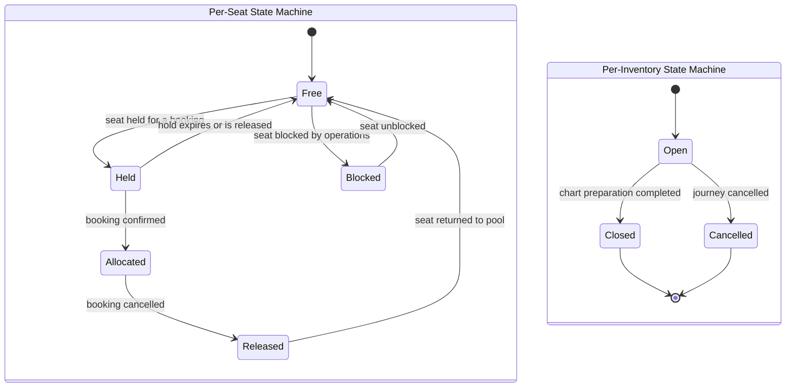

#### State Transitions

| From      | To        | Trigger                                 | Notes                                                                                                                           |
| :-------- | :-------- | :-------------------------------------- | :------------------------------------------------------------------------------------------------------------------------------ |
| Free      | Held      | Seat held for a booking                 | The hold carries a future expiry (INV-CI-05). The hold is requested by the Booking aggregate.                                    |
| Held      | Allocated | Booking confirmed                       | The seat is allocated to the booking identity (INV-CI-06). Two active reservations must not overlap on any segment (INV-CI-04). |
| Held      | Free      | Hold expires or is released             | The hold is released back to the pool of bookable seats.                                                                         |
| Allocated | Released  | Booking cancelled                       | The seat is released from the cancelled booking.                                                                                 |
| Released  | Free      | Seat returned to the pool               | The seat becomes available for new holdings.                                                                                     |
| Free      | Blocked   | Seat blocked by operations              | The seat is removed from bookable inventory.                                                                                     |
| Blocked   | Free      | Seat unblocked                          | The seat returns to the bookable pool. A blocked seat cannot transition to Held or Allocated while blocked (INV-CI-07).          |
| Open      | Closed    | Chart preparation completed             | No seat may transition to Held or Allocated after this point (INV-CI-09). Quota allocation is frozen (INV-CI-08).                |
| Open      | Cancelled | Journey cancelled                       | The inventory is cancelled for the journey. Terminal transition.                                                                 |
| Closed    | (none)    | —                                       | Closed is terminal at the inventory level.                                                                                       |
| Cancelled | (none)    | —                                       | Cancelled is terminal at the inventory level.                                                                                    |

#### Domain Events Published

| Domain event              | Fact captured                                                                 | Integration scope |
| :------------------------ | :---------------------------------------------------------------------------- | :---------------- |
| SeatReleased              | A seat has been released from a booking and returned to the pool.             | Internal          |
| ChartPreparationCompleted | Chart preparation for the inventory has completed and the inventory is closed. | Internal          |

Every state change at the seat level that affects the availability of the seat publishes a corresponding event, in accordance with PN-002. SeatReleased is internal to S3 Reservation Service and is consumed by the WaitlistQueue aggregate to trigger promotion. ChartPreparationCompleted is internal to S3 and is available for a future audit consumer.

#### Cross-Context Events Consumed

| Event                | Source                  | Action                                                                   |
| :------------------- | :---------------------- | :----------------------------------------------------------------------- |
| BookingCancelled     | S3 Booking module       | Release the seat segments held by the cancelled booking and return them to the pool. |
| PaymentAttemptFailed | S5 Mock Payment Gateway | Release any seats held by the failed booking attempt and return them to the pool.    |

Both rows are cross-aggregate policies within S3 Reservation Service and across to S5. The CoachInventory cannot observe a booking cancellation or a payment failure on its own, so these are enforced through the event flow.

#### Traceability

| Capability                         | Software Requirements | Business Rules                    |
| :--------------------------------- | :-------------------- | :-------------------------------- |
| CAP-015, CAP-016, CAP-017, CAP-018 | SR-047 to SR-058      | BR-13, BR-14, BR-15, BR-16, BRL-1 |

---

### 6.2 WaitlistQueue

#### Definition

A WaitlistQueue is the ordered queue of passengers waiting for a seat in a specific class and quota on a specific dated journey. Each entry in the queue refers to a Booking that is in the Waitlisted or RAC state. The queue enforces the ordering rule: when a seat is released, the next eligible entry is promoted. The cascade that follows a promotion, in which every subsequent entry moves forward in the queue, is a single atomic invariant on the queue.

#### Aggregate Root

Yes. The WaitlistQueue is an aggregate root.

#### Child Entities

WaitlistEntry.

#### Value Objects Owned

WaitlistPosition.

#### References by Identity

The WaitlistQueue refers to exactly one TrainSchedule, by the identity of that schedule. Each WaitlistEntry refers to exactly one Booking, by the identity of that booking. The WaitlistQueue does not hold object references to either aggregate.

#### Conceptual State

| Concept        | Meaning                                                                 |
| :------------- | :---------------------------------------------------------------------- |
| Queue identity | The unique identity of this waitlist queue, assigned at creation.        |
| Train schedule | The identity of the TrainSchedule this queue belongs to.                 |
| Travel class   | The class of travel served by this queue.                               |
| Quota          | The quota served by this queue.                                         |
| Entries        | The ordered set of WaitlistEntry child entities that compose the queue.  |
| Queue capacity | The maximum number of active entries the queue may hold.                |
| Status         | The current lifecycle state of the queue.                               |

#### Invariants

| ID        | Invariant                                                                                    | Source                                                                                                                             |
| :-------- | :------------------------------------------------------------------------------------------- | :--------------------------------------------------------------------------------------------------------------------------------- |
| INV-WQ-01 | Every WaitlistEntry refers to an existing Booking.                                           | [SRIS-P1-REQ-004](../wave-1-requirements/SRIS-P1-REQ-004_SoftwareRequirementsSpecificationSRS.md) SR-066                            |
| INV-WQ-02 | No two active entries of the same WaitlistQueue occupy the same position.                     | [SRIS-P1-REQ-009](../wave-1-requirements/SRIS-P1-REQ-009_DomainRulesWaitlistAndCancellation.md) — Domain Rules: Waitlist and Cancellation |
| INV-WQ-03 | The number of active entries does not exceed the queue capacity.                              | [SRIS-P1-REQ-004](../wave-1-requirements/SRIS-P1-REQ-004_SoftwareRequirementsSpecificationSRS.md) SR-066                            |
| INV-WQ-04 | The order of entries is fixed at insertion and preserved across cancellations and promotions. | [SRIS-P1-REQ-009](../wave-1-requirements/SRIS-P1-REQ-009_DomainRulesWaitlistAndCancellation.md) — Domain Rules: Waitlist and Cancellation |
| INV-WQ-05 | Promotion selects the highest-priority eligible entry.                                        | [SRIS-P1-REQ-009](../wave-1-requirements/SRIS-P1-REQ-009_DomainRulesWaitlistAndCancellation.md) — Domain Rules: Waitlist and Cancellation |
| INV-WQ-06 | A queue for a journey whose chart has been prepared does not accept new entries.              | [SRIS-P1-REQ-010](../wave-1-requirements/SRIS-P1-REQ-010_DomainRulesChartPreparation.md) — Domain Rules: Chart Preparation            |
| INV-WQ-07 | At chart preparation, all active entries are marked dropped and their bookings are refunded. | [SRIS-P1-REQ-010](../wave-1-requirements/SRIS-P1-REQ-010_DomainRulesChartPreparation.md) — Domain Rules: Chart Preparation            |

#### Value Objects Used

| Value object     | What it represents                                                 |
| :--------------- | :----------------------------------------------------------------- |
| WaitlistPosition | The position of an entry in the queue, unique among active entries. |

#### State Machine

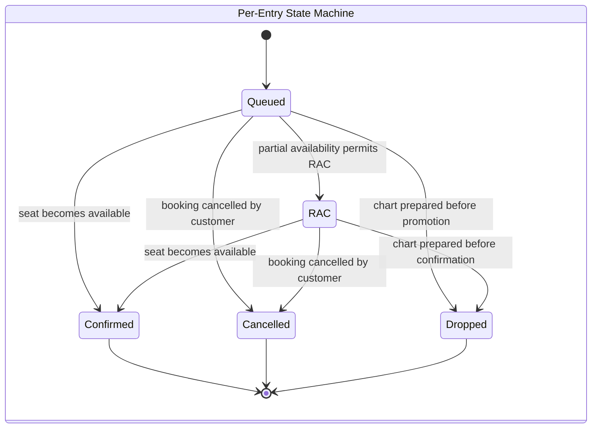

#### State Transitions

| From      | To        | Trigger                            | Notes                                                                                                                                                    |
| :-------- | :-------- | :--------------------------------- | :------------------------------------------------------------------------------------------------------------------------------------------------------- |
| Queued    | RAC       | Partial availability permits RAC   | The entry is promoted to RAC when the queue's seat pool can accommodate a partial allocation.                                                             |
| Queued    | Confirmed | Seat becomes available             | The entry is promoted to Confirmed when a full seat becomes available. This is the trigger for WaitlistEntryPromoted.                                     |
| RAC       | Confirmed | Seat becomes available             | An RAC entry is promoted to Confirmed when a full seat becomes available.                                                                                 |
| Queued    | Cancelled | Booking cancelled by customer      | The customer cancels the booking while the entry is still waiting.                                                                                        |
| RAC       | Cancelled | Booking cancelled by customer      | The customer cancels the booking while it is in the RAC state.                                                                                            |
| Queued    | Dropped   | Chart prepared before promotion    | At chart preparation, all active entries that are still Queued are marked dropped and their bookings are refunded (INV-WQ-07).                            |
| RAC       | Dropped   | Chart prepared before confirmation | At chart preparation, all RAC entries that are still not Confirmed are marked dropped and their bookings are refunded (INV-WQ-07).                        |
| Confirmed | (none)    | —                                  | Confirmed is terminal for the entry.                                                                                                                      |
| Cancelled | (none)    | —                                  | Cancelled is terminal for the entry.                                                                                                                      |
| Dropped   | (none)    | —                                  | Dropped is terminal for the entry.                                                                                                                        |

#### Domain Events Published

| Domain event          | Fact captured                                                                             | Integration scope         |
| :-------------------- | :---------------------------------------------------------------------------------------- | :------------------------ |
| WaitlistEntryPromoted | A waitlist entry has been promoted, either to RAC or to Confirmed.                        | Integration (S3 → S3, S6) |
| WaitlistEntryDropped  | A waitlist entry has been dropped at chart preparation and its booking has been refunded. | Internal                  |

Every state change publishes exactly one event, in accordance with PN-002. WaitlistEntryPromoted is consumed by the Booking module inside S3 and by S6 Notification Service. WaitlistEntryDropped is internal to S3 and is available for a future audit consumer.

#### Cross-Context Events Consumed

| Event            | Source              | Action                                                                                                        |
| :--------------- | :------------------ | :------------------------------------------------------------------------------------------------------------ |
| BookingCancelled | S3 Booking module   | Remove the corresponding entry from the queue and, if the queue is not at capacity, insert the next candidate. |
| SeatReleased     | S3 Inventory module | Attempt to promote the highest-priority eligible entry into the released seat.                                 |

Both rows are cross-aggregate policies within S3 Reservation Service. The WaitlistQueue cannot observe a seat release or a booking cancellation on its own, so these are enforced through the event flow.

#### Traceability

| Capability | Software Requirements          | Business Rules |
| :--------- | :----------------------------- | :------------- |
| CAP-021    | SR-066, SR-067, SR-068, SR-069 | BR-16a, BR-23  |

---

## 7. Booking and Ticketing

The Booking and Ticketing domain is owned by the Booking module of S3 Reservation Service. It contains one aggregate, Booking, and one child entity, Passenger. A Booking is the record of a customer's intent to travel on a specific train, on a specific date, in a specific class and quota, for one or more passengers. The Booking aggregate is the entry point for the customer's interaction with the seat inventory, the payment gateway, and the notification service.

A Booking does not own the seats it reserves. The seats are owned by the CoachInventory aggregate. A Booking holds references by identity to the CoachInventory, the TrainSchedule, and the PaymentAttempt that it depends on, and it relies on the event flow to keep its own state consistent with those aggregates.

The capabilities of the domain are recorded in [SRIS-P1-REQ-003](../wave-1-requirements/SRIS-P1-REQ-003_CapabilityCatalogFinal.md) — Capability Catalog (Final), which lists the 30 business capabilities Phase 1 provides. The software requirements are recorded in [SRIS-P1-REQ-004](../wave-1-requirements/SRIS-P1-REQ-004_SoftwareRequirementsSpecificationSRS.md) — Software Requirements Specification (SRS), which states what the software must do.

### 7.1 Booking

#### Definition

A Booking is the record of a customer's intent to travel on a specific train, on a specific date, in a specific class and quota, for one or more passengers. It is created when the customer initiates a booking, and it proceeds through a lifecycle that includes holding seats, waiting for payment, confirmation, waitlisting, and cancellation. The Booking aggregate is the single source of truth for the fare snapshot, the PNR, and the passenger list of that booking.

#### Aggregate Root

Yes. The Booking is an aggregate root.

#### Child Entities

Passenger.

#### Value Objects Owned

PNR, BookingFareSnapshot.

#### References by Identity

The Booking refers to exactly one UserAccount, by the identity of that account, to exactly one TrainSchedule, by the identity of that schedule, to exactly one CoachInventory, by the identity of that inventory, and to exactly one PaymentAttempt, by the identity of that attempt. It does not hold object references to any of these aggregates.

#### Conceptual State

| Concept         | Meaning                                                                      |
| :-------------- | :--------------------------------------------------------------------------- |
| Booking identity | The unique identity of this booking, assigned at creation.                   |
| Customer        | The identity of the UserAccount that made the booking.                       |
| Train schedule  | The identity of the TrainSchedule the booking is for.                        |
| Coach inventory | The identity of the CoachInventory that holds the seats.                     |
| Payment attempt | The identity of the PaymentAttempt associated with the booking.              |
| Passengers      | The set of Passenger child entities that compose the booking.                |
| Journey details | The origin, the destination, and the journey date.                           |
| Class and quota | The class of travel and the quota in which the booking is made.              |
| Fare snapshot   | The BookingFareSnapshot value object that records the fare at confirmation.   |
| PNR             | The PNR value object, present when the booking is Confirmed, Waitlisted, or RAC. |
| Hold expiry     | The moment by which the held booking must be confirmed or released.          |
| Status          | The current lifecycle state of the booking.                                  |

#### Invariants

| ID        | Invariant                                                                                             | Source                                                                                                                       |
| :-------- | :---------------------------------------------------------------------------------------------------- | :--------------------------------------------------------------------------------------------------------------------------- |
| INV-BK-01 | A Booking has at least one Passenger.                                                                 | [SRIS-P1-REQ-004](../wave-1-requirements/SRIS-P1-REQ-004_SoftwareRequirementsSpecificationSRS.md) SR-059                      |
| INV-BK-02 | A Booking has no more Passengers than the maximum permitted per booking.                              | [SRIS-P1-REQ-008](../wave-1-requirements/SRIS-P1-REQ-008_DomainRulesTicketing.md) — Domain Rules: Ticketing [PN-013]           |
| INV-BK-03 | The origin and destination of a Booking lie on the route, and the origin is strictly before the destination. | [SRIS-P1-REQ-004](../wave-1-requirements/SRIS-P1-REQ-004_SoftwareRequirementsSpecificationSRS.md) SR-060                      |
| INV-BK-04 | A Confirmed, Waitlisted, or RAC Booking has a PNR and a fare snapshot.                                | [SRIS-P1-REQ-002](../wave-1-requirements/SRIS-P1-REQ-002_BusinessRequirementsDocumentBRD.md) BRL-4                            |
| INV-BK-05 | A Held Booking carries a hold expiry that lies in the future at the moment of holding.                | [SRIS-P1-REQ-008](../wave-1-requirements/SRIS-P1-REQ-008_DomainRulesTicketing.md) — Domain Rules: Ticketing [PN-012]           |
| INV-BK-06 | A Cancelled or Refunded Booking is terminal.                                                          | [SRIS-P1-REQ-004](../wave-1-requirements/SRIS-P1-REQ-004_SoftwareRequirementsSpecificationSRS.md) SR-079                      |
| INV-BK-07 | The total fare of a Booking equals the sum of its passenger fares minus the concessions applied.       | [SRIS-P1-REQ-004](../wave-1-requirements/SRIS-P1-REQ-004_SoftwareRequirementsSpecificationSRS.md) SR-061                      |
| INV-BK-08 | No two Bookings share the same PNR.                                                                   | [SRIS-P1-REQ-002](../wave-1-requirements/SRIS-P1-REQ-002_BusinessRequirementsDocumentBRD.md) BRL-4                            |
| INV-BK-09 | A Booking cannot be Confirmed without a successful payment.                                           | [SRIS-P1-REQ-002](../wave-1-requirements/SRIS-P1-REQ-002_BusinessRequirementsDocumentBRD.md) BRL-2                            |
| INV-BK-10 | A Booking can be Held only after the seat inventory has reserved the requested segments.              | [SRIS-P1-REQ-004](../wave-1-requirements/SRIS-P1-REQ-004_SoftwareRequirementsSpecificationSRS.md) SR-062                      |

#### Value Objects Used

| Value object        | What it represents                                                            |
| :------------------ | :---------------------------------------------------------------------------- |
| PNR                 | The unique reference by which a confirmed or waitlisted booking is identified.  |
| BookingFareSnapshot | The immutable record of the fare as calculated at the moment of confirmation.  |

#### State Machine

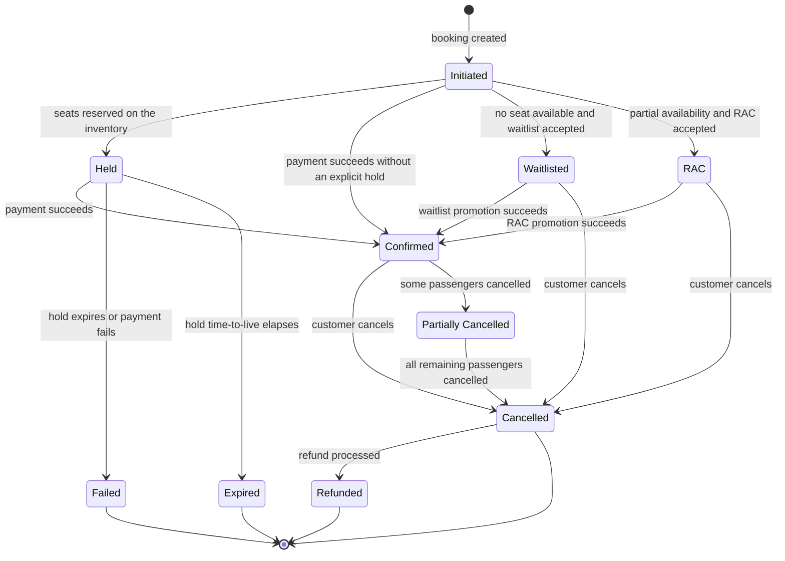

#### State Transitions

| From                | To                  | Trigger                                  | Notes                                                                                                                                              |
| :------------------ | :------------------ | :--------------------------------------- | :------------------------------------------------------------------------------------------------------------------------------------------------- |
| Initiated           | Held                | Seats reserved on the inventory          | The Booking can be Held only after the seat inventory has reserved the requested segments (INV-BK-10). The hold carries a future expiry (INV-BK-05). |
| Initiated           | Confirmed           | Payment succeeds without an explicit hold | Applicable when the customer pays in the same transaction that initiates the booking.                                                              |
| Initiated           | Waitlisted           | No seat available and waitlist accepted  | A PNR and a fare snapshot are assigned (INV-BK-04).                                                                                                |
| Initiated           | RAC                  | Partial availability and RAC accepted    | A PNR and a fare snapshot are assigned (INV-BK-04).                                                                                                |
| Held                | Confirmed            | Payment succeeds                         | The Booking cannot be Confirmed without a successful payment (INV-BK-09). The PNR and fare snapshot are assigned at this point.                     |
| Held                | Failed               | Hold expires or payment fails            | The seat segments held by the booking are released back to the inventory.                                                                          |
| Held                | Expired              | Hold time-to-live elapses                | The hold time-to-live is owned by [SRIS-P1-REQ-008](../wave-1-requirements/SRIS-P1-REQ-008_DomainRulesTicketing.md) — Domain Rules: Ticketing [PN-012]. |
| Waitlisted          | Confirmed            | Waitlist promotion succeeds              | The transition is triggered by WaitlistEntryPromoted from the WaitlistQueue aggregate.                                                             |
| RAC                 | Confirmed            | RAC promotion succeeds                   | The transition is triggered by WaitlistEntryPromoted from the WaitlistQueue aggregate.                                                             |
| Confirmed           | Cancelled            | Customer cancels                         | All passengers are cancelled. The PNR remains recorded but the booking is no longer active (INV-BK-06).                                            |
| Waitlisted          | Cancelled            | Customer cancels                         | The booking is removed from the waitlist queue.                                                                                                    |
| RAC                 | Cancelled            | Customer cancels                         | The booking is removed from the waitlist queue.                                                                                                    |
| Confirmed           | Partially Cancelled  | Some passengers cancelled                | The booking retains its PNR and its remaining passengers.                                                                                          |
| Partially Cancelled | Cancelled            | All remaining passengers cancelled       | The booking becomes fully cancelled (INV-BK-06).                                                                                                   |
| Cancelled           | Refunded             | Refund processed                         | The refund is processed by the payment gateway (PaymentAttemptReversed).                                                                           |
| Failed              | (none)               | —                                        | Failed is terminal.                                                                                                                                |
| Expired             | (none)               | —                                        | Expired is terminal.                                                                                                                               |
| Refunded            | (none)               | —                                        | Refunded is terminal (INV-BK-06).                                                                                                                  |
| Cancelled           | (none)               | —                                        | Cancelled is terminal if no refund is due (INV-BK-06).                                                                                             |

#### Domain Events Published

| Domain event      | Fact captured                                                            | Integration scope            |
| :---------------- | :----------------------------------------------------------------------- | :--------------------------- |
| BookingConfirmed  | A booking has been confirmed with a PNR and a fare snapshot.             | Integration (S3 → S6)        |
| BookingWaitlisted | A booking has been placed on the waitlist with a PNR and a waitlist position. | Integration (S3 → S6)        |
| BookingCancelled  | A booking has been cancelled, releasing its seat segments.               | Integration (S3 → S3, S5, S6) |

Every state change publishes exactly one event, in accordance with PN-002. The three events are the cross-context integration events defined in Section 11.1. Their consumers are listed in Section 11.1.

#### Cross-Context Events Consumed

| Event                   | Source                  | Action                                                                                                     |
| :---------------------- | :---------------------- | :--------------------------------------------------------------------------------------------------------- |
| PaymentAttemptSucceeded | S5 Mock Payment Gateway | Transition the booking from Held or Initiated to Confirmed, and assign the PNR and fare snapshot.          |
| PaymentAttemptFailed    | S5 Mock Payment Gateway | Transition the booking to Failed, and release the seat segments held by the booking.                        |
| PaymentAttemptReversed  | S5 Mock Payment Gateway | Record the reversal and transition the booking from Cancelled to Refunded.                                  |
| WaitlistEntryPromoted   | S3 Inventory module     | Transition the booking from Waitlisted or RAC to Confirmed, and record the newly allocated seat.            |

Every row is a cross-aggregate policy. The Booking cannot observe a payment result or a waitlist promotion on its own, so these are enforced through the event flow. The mechanics of the event flow are owned by [SRIS-P1-ARCH-009](./SRIS-P1-ARCH-009_ServiceInteractionAndCommunicationDesign.md) — Service Interaction and Communication Design.

#### Traceability

| Capability                                                  | Software Requirements | Business Rules                                  |
| :---------------------------------------------------------- | :-------------------- | :---------------------------------------------- |
| CAP-019, CAP-020, CAP-021, CAP-023, CAP-024                 | SR-059 to SR-079      | BRL-2, BRL-3, BRL-4, BR-16a, BR-21, BR-22, BR-23 |

Three pending decisions whose owning documents are not this document are surfaced in this section as invariants with pointers to their owners. PN-012 (hold time-to-live) is enforced by INV-BK-05, and its exact value is owned by [SRIS-P1-REQ-008](../wave-1-requirements/SRIS-P1-REQ-008_DomainRulesTicketing.md) — Domain Rules: Ticketing. PN-013 (maximum passengers per booking) is enforced by INV-BK-02, and its exact value is owned by the same document. PN-006 (employee concession verification) is enforced by INV-PS-04 in Section 7.2, and its verification mechanism is owned by the same document.

---

### 7.2 Passenger (Child Entity)

#### Definition

A Passenger is a traveller on a Booking. A Passenger is a child entity of the Booking aggregate, because a passenger has no meaningful identity outside the booking that carries them. A Passenger records the traveller's name, age, gender, any concession category claimed, any berth preference, and any seat allocation that results from the booking lifecycle.

#### Aggregate Root

No. The Passenger is a child entity inside the Booking aggregate.

#### Child Entities

None.

#### Value Objects Owned

None. All value objects required by a Passenger are owned by the Booking.

#### References by Identity

None. A Passenger is referenced only by its parent Booking. A Passenger does not refer to any other aggregate.

#### Conceptual State

| Concept             | Meaning                                                              |
| :------------------ | :------------------------------------------------------------------- |
| Passenger identity  | The identity of the passenger within the booking.                    |
| Name                | The full name of the passenger as recorded at booking time.          |
| Age                 | The age of the passenger.                                            |
| Gender              | The gender of the passenger.                                         |
| Concession category | The concession category claimed for the passenger, if any.           |
| Berth preference    | The passenger's preferred berth type, if any.                        |
| Status              | The current lifecycle state of the passenger within the booking.     |
| Seat allocation     | The seat that has been allocated to the passenger, if any.           |

#### Invariants

| ID        | Invariant                                                            | Source                                                                                                                       |
| :-------- | :------------------------------------------------------------------- | :--------------------------------------------------------------------------------------------------------------------------- |
| INV-PS-01 | Every Passenger has a non-empty name and a valid age.               | [SRIS-P1-REQ-004](../wave-1-requirements/SRIS-P1-REQ-004_SoftwareRequirementsSpecificationSRS.md) SR-059                      |
| INV-PS-02 | A Confirmed or RAC Passenger has a seat allocation.                 | [SRIS-P1-REQ-004](../wave-1-requirements/SRIS-P1-REQ-004_SoftwareRequirementsSpecificationSRS.md) SR-064                      |
| INV-PS-03 | A Cancelled Passenger has no active seat allocation.                 | [SRIS-P1-REQ-004](../wave-1-requirements/SRIS-P1-REQ-004_SoftwareRequirementsSpecificationSRS.md) SR-073                      |
| INV-PS-04 | The concession category of a Passenger matches an active concession rule. | [SRIS-P1-REQ-004](../wave-1-requirements/SRIS-P1-REQ-004_SoftwareRequirementsSpecificationSRS.md) SR-042 [PN-006]               |

#### Value Objects Used

None. All value objects used by a Passenger are owned by the Booking.

#### State Machine

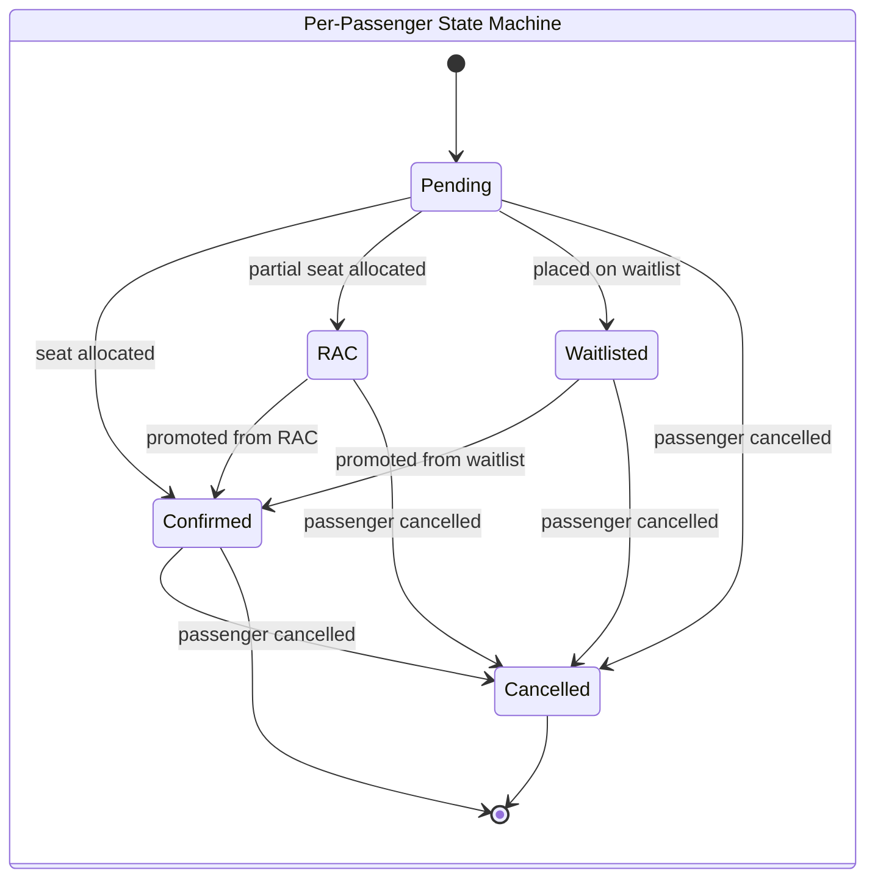

#### State Transitions

| From       | To         | Trigger                       | Notes                                                                                                   |
| :--------- | :--------- | :---------------------------- | :------------------------------------------------------------------------------------------------------ |
| Pending    | Confirmed  | Seat allocated                | The passenger receives a full seat allocation. The transition occurs as part of the parent Booking becoming Confirmed. |
| Pending    | RAC        | Partial seat allocated        | The passenger is placed on the RAC list and will be confirmed when a full seat becomes available.        |
| Pending    | Waitlisted | Placed on waitlist            | The passenger is added to the waitlist queue. A PNR is assigned by the parent Booking (INV-BK-04).       |
| Waitlisted | Confirmed  | Promoted from waitlist        | Triggered by WaitlistEntryPromoted from the WaitlistQueue aggregate (INV-PS-02).                         |
| RAC        | Confirmed  | Promoted from RAC             | Triggered by WaitlistEntryPromoted from the WaitlistQueue aggregate (INV-PS-02).                         |
| Pending    | Cancelled  | Passenger cancelled           | The passenger is removed from the booking before confirmation.                                           |
| Waitlisted | Cancelled  | Passenger cancelled           | The passenger is removed while still waiting for a seat.                                                 |
| RAC        | Cancelled  | Passenger cancelled           | The passenger is removed while in the RAC state.                                                         |
| Confirmed  | Cancelled  | Passenger cancelled           | The passenger's seat allocation is released (INV-PS-03).                                                 |
| Confirmed  | (none)     | —                             | Confirmed is terminal for a passenger unless the passenger is cancelled.                                 |
| Cancelled  | (none)     | —                             | Cancelled is terminal.                                                                                    |

#### Domain Events Published

None. The Passenger is a child entity inside the Booking aggregate. Every state change of a Passenger is a state change of its parent Booking and is published by the Booking aggregate as BookingConfirmed, BookingWaitlisted, or BookingCancelled.

#### Cross-Context Events Consumed

None. The Passenger is a child entity and does not consume events. The parent Booking consumes the events that affect the passenger list.

#### Traceability

| Capability | Software Requirements          | Business Rules      |
| :--------- | :----------------------------- | :------------------ |
| CAP-019    | SR-059, SR-064, SR-073, SR-042 | BRL-2, BRL-3, BRL-4 |

---

## 8. Payment

The Payment domain is owned by S5 Mock Payment Gateway. It contains one aggregate, PaymentAttempt. The mock gateway exists so that Phase 1 can demonstrate the payment lifecycle without contacting a real payment provider. It has the same lifecycle as a real provider would have, and it can be replaced in a later phase without changing the domain model.

The capabilities of the domain are recorded in [SRIS-P1-REQ-003](../wave-1-requirements/SRIS-P1-REQ-003_CapabilityCatalogFinal.md) — Capability Catalog (Final), which lists the 30 business capabilities Phase 1 provides. The software requirements are recorded in [SRIS-P1-REQ-004](../wave-1-requirements/SRIS-P1-REQ-004_SoftwareRequirementsSpecificationSRS.md) — Software Requirements Specification (SRS), which states what the software must do.

### 8.1 PaymentAttempt

#### Definition

A PaymentAttempt is a single attempt to pay for a booking through the mock payment gateway. It records the amount, the currency, the idempotency key, the outcome, and the reference to the booking it belongs to. A PaymentAttempt is an aggregate because it has its own transactional lifecycle: it is initiated, it either succeeds, fails, or is reversed, and each of those states has consequences for the booking that triggered the attempt.

#### Aggregate Root

Yes. The PaymentAttempt is an aggregate root.

#### Child Entities

None.

#### Value Objects Owned

Money, IdempotencyKey.

#### References by Identity

The PaymentAttempt refers to exactly one Booking, by the identity of that booking. It does not hold an object reference to the Booking aggregate.

#### Conceptual State

| Concept               | Meaning                                                                  |
| :-------------------- | :----------------------------------------------------------------------- |
| Attempt identity      | The unique identity of this payment attempt, assigned at creation.        |
| Booking               | The identity of the Booking this attempt is for.                         |
| Amount                | The monetary amount of the attempt, with its currency.                    |
| Idempotency key       | The unique key that guarantees a repeated request returns the same result. |
| Transaction reference | The reference assigned by the gateway when the attempt is processed.      |
| Status                | The current lifecycle state of the attempt.                               |
| Timestamp             | The moment the attempt was initiated.                                    |

#### Invariants

| ID        | Invariant                                                                                       | Source                                                                                                                                          |
| :-------- | :---------------------------------------------------------------------------------------------- | :---------------------------------------------------------------------------------------------------------------------------------------------- |
| INV-PA-01 | Every PaymentAttempt has a unique idempotency key.                                              | [SRIS-P1-API-005](../wave-3-detailed-design/SRIS-P1-API-005_IdempotencyAndRetryPolicySpecification.md) — Idempotency and Retry Policy Specification |
| INV-PA-02 | The amount of a PaymentAttempt equals the fare snapshot total of its Booking.                    | [SRIS-P1-REQ-004](../wave-1-requirements/SRIS-P1-REQ-004_SoftwareRequirementsSpecificationSRS.md) SR-080                                          |
| INV-PA-03 | The amount of a PaymentAttempt is strictly positive.                                            | [SRIS-P1-REQ-004](../wave-1-requirements/SRIS-P1-REQ-004_SoftwareRequirementsSpecificationSRS.md) SR-080                                          |
| INV-PA-04 | The status of a PaymentAttempt is one of: Initiated, Succeeded, Failed, Reversed.                | [SRIS-P1-REQ-004](../wave-1-requirements/SRIS-P1-REQ-004_SoftwareRequirementsSpecificationSRS.md) SR-084                                          |
| INV-PA-05 | A Failed PaymentAttempt is terminal and cannot transition to Succeeded.                         | [SRIS-P1-REQ-004](../wave-1-requirements/SRIS-P1-REQ-004_SoftwareRequirementsSpecificationSRS.md) SR-084                                          |
| INV-PA-06 | A Reversed PaymentAttempt must have been Succeeded before reversal.                             | [SRIS-P1-REQ-004](../wave-1-requirements/SRIS-P1-REQ-004_SoftwareRequirementsSpecificationSRS.md) SR-086                                          |
| INV-PA-07 | A second attempt with the same idempotency key returns the same result as the first.             | [SRIS-P1-REQ-004](../wave-1-requirements/SRIS-P1-REQ-004_SoftwareRequirementsSpecificationSRS.md) SR-085                                          |

#### Value Objects Used

| Value object   | What it represents                                                     |
| :------------- | :--------------------------------------------------------------------- |
| Money          | A monetary amount with an amount and a currency.                        |
| IdempotencyKey | The unique key that guarantees repeat requests return the same result.  |

#### State Machine

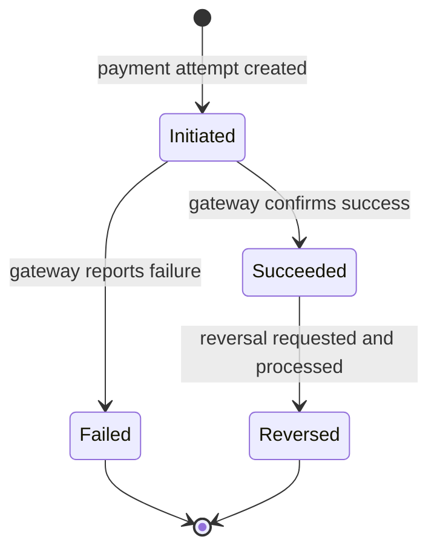

#### State Transitions

| From      | To        | Trigger                          | Notes                                                                                                    |
| :-------- | :-------- | :------------------------------- | :------------------------------------------------------------------------------------------------------- |
| Initiated | Succeeded | Gateway confirms success         | The amount must equal the fare snapshot total of the booking (INV-PA-02). The transaction reference is recorded. |
| Initiated | Failed    | Gateway reports failure          | The failure reason code is recorded. Failed is terminal (INV-PA-05).                                      |
| Succeeded | Reversed  | Reversal requested and processed | A Reversed attempt must have been Succeeded before reversal (INV-PA-06).                                  |
| Failed    | (none)    | —                                | Failed is terminal. No transition out of Failed is permitted (INV-PA-05).                                  |
| Reversed  | (none)    | —                                | Reversed is terminal.                                                                                      |

#### Domain Events Published

| Domain event            | Fact captured                                                                    | Integration scope         |
| :---------------------- | :------------------------------------------------------------------------------- | :------------------------ |
| PaymentAttemptSucceeded | A payment attempt has succeeded for a booking.                                   | Integration (S5 → S3)     |
| PaymentAttemptFailed    | A payment attempt has failed for a booking.                                      | Integration (S5 → S3)     |
| PaymentAttemptReversed  | A previously successful payment attempt has been reversed and the amount returned. | Integration (S5 → S3, S6) |

Every state change publishes exactly one event, in accordance with PN-002. The three events are the cross-context integration events defined in Section 11.1. Their consumers are listed in Section 11.1.

#### Cross-Context Events Consumed

| Event            | Source            | Action                                                                                                     |
| :--------------- | :---------------- | :--------------------------------------------------------------------------------------------------------- |
| BookingCancelled | S3 Booking module | The payment attempt associated with the cancelled booking is marked for reversal if the amount had been captured. |

This row is a cross-aggregate policy. The PaymentAttempt cannot observe a booking cancellation on its own, so the rule is enforced through the event flow. The mechanics of that flow are owned by [SRIS-P1-ARCH-009](./SRIS-P1-ARCH-009_ServiceInteractionAndCommunicationDesign.md) — Service Interaction and Communication Design.

#### Traceability

| Capability       | Software Requirements | Business Rules                            |
| :--------------- | :-------------------- | :---------------------------------------- |
| CAP-025, CAP-026 | SR-080 to SR-087      | BR-16, BR-17, BR-18, BR-19, BRL-2, BRL-6  |

---

## 9. Notification

The Notification domain is owned by S6 Notification Service. It contains one aggregate, NotificationRecord. A NotificationRecord is the record of one outbound notification to one recipient on one channel. The domain is a terminal consumer: it listens for events from other bounded contexts and produces notifications, but it does not produce domain events of its own. The reason a NotificationRecord is an aggregate rather than a simple delivery log is idempotency. A delivery log alone does not prevent duplicate sends; an aggregate with a state machine does.

The capabilities of the domain are recorded in [SRIS-P1-REQ-003](../wave-1-requirements/SRIS-P1-REQ-003_CapabilityCatalogFinal.md) — Capability Catalog (Final), which lists the 30 business capabilities Phase 1 provides. The software requirements are recorded in [SRIS-P1-REQ-004](../wave-1-requirements/SRIS-P1-REQ-004_SoftwareRequirementsSpecificationSRS.md) — Software Requirements Specification (SRS), which states what the software must do.

### 9.1 NotificationRecord

#### Definition

A NotificationRecord is the record of one outbound notification to one recipient on one channel. It is created when a notification is triggered by an event, and it proceeds through a lifecycle that includes queueing, sending, and either success or failure. The NotificationRecord refers to the source event by identity so that duplicate deliveries of the same event can be suppressed. Once a notification has been sent, the record is immutable.

#### Aggregate Root

Yes. The NotificationRecord is an aggregate root.

#### Child Entities

None.

#### Value Objects Owned

EmailAddress, PhoneNumber, MessagePayload.

#### References by Identity

The NotificationRecord refers to exactly one UserAccount, by the identity of that account, and to exactly one source event, by the identity of that event. It does not hold an object reference to the account or to the publishing aggregate.

#### Conceptual State

| Concept         | Meaning                                                                        |
| :-------------- | :----------------------------------------------------------------------------- |
| Record identity | The unique identity of this notification record, assigned at creation.           |
| Recipient       | The identity of the UserAccount to whom the notification is addressed.           |
| Channel         | The delivery channel used for the notification.                                 |
| Source event    | The identity of the event that triggered this notification.                     |
| Payload         | The rendered content of the notification, produced from the source event payload. |
| Status          | The current lifecycle state of the record.                                       |
| Queued at       | The moment the record was created.                                              |
| Sent at         | The moment the notification was successfully sent, if it was sent.               |

#### Invariants

| ID        | Invariant                                                                                                      | Source                                                                                                                                               |
| :-------- | :------------------------------------------------------------------------------------------------------------- | :--------------------------------------------------------------------------------------------------------------------------------------------------- |
| INV-NR-01 | Every NotificationRecord has a source event identity.                                                          | [SRIS-P1-REQ-004](../wave-1-requirements/SRIS-P1-REQ-004_SoftwareRequirementsSpecificationSRS.md) SR-095                                             |
| INV-NR-02 | No two NotificationRecords exist for the same source event on the same channel to the same recipient.           | [SRIS-P1-REQ-004](../wave-1-requirements/SRIS-P1-REQ-004_SoftwareRequirementsSpecificationSRS.md) SR-095                                             |
| INV-NR-03 | The recipient of a NotificationRecord is a valid recipient for the chosen channel.                              | [SRIS-P1-REQ-004](../wave-1-requirements/SRIS-P1-REQ-004_SoftwareRequirementsSpecificationSRS.md) SR-098                                             |
| INV-NR-04 | The payload of a NotificationRecord is non-empty after rendering.                                               | [SRIS-P1-REQ-004](../wave-1-requirements/SRIS-P1-REQ-004_SoftwareRequirementsSpecificationSRS.md) SR-098                                             |
| INV-NR-05 | A Sent NotificationRecord is immutable.                                                                        | [SRIS-P1-REQ-004](../wave-1-requirements/SRIS-P1-REQ-004_SoftwareRequirementsSpecificationSRS.md) SR-099                                             |
| INV-NR-06 | The payload of a NotificationRecord does not contain fields above the permitted classification level.           | [SRIS-P1-SEC-012](../wave-3-detailed-design/SRIS-P1-SEC-012_DataClassificationRegister.md) — Data Classification Register                            |

#### Value Objects Used

| Value object   | What it represents                                       |
| :------------- | :------------------------------------------------------- |
| EmailAddress   | The email address of the recipient, when the channel is email. |
| PhoneNumber    | The phone number of the recipient, when the channel is SMS.    |
| MessagePayload | The rendered content of the notification.                |

#### State Machine

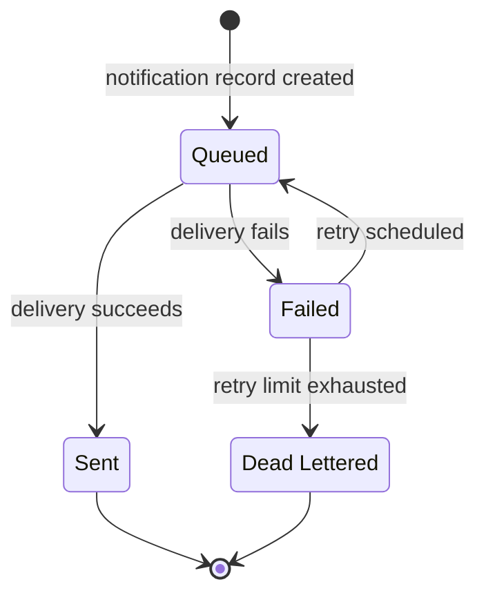

#### State Transitions

| From          | To            | Trigger                   | Notes                                                                                     |
| :------------ | :------------ | :------------------------ | :---------------------------------------------------------------------------------------- |
| Queued        | Sent          | Delivery succeeds         | The record becomes immutable once it is Sent (INV-NR-05). The sent-at timestamp is recorded. |
| Queued        | Failed        | Delivery fails            | The failure reason is recorded. A retry may be scheduled subject to the retry policy.       |
| Failed        | Queued        | Retry scheduled           | The record returns to the queue for another delivery attempt.                             |
| Failed        | Dead Lettered | Retry limit exhausted     | The record is moved to the dead letter store for manual investigation. Terminal transition. |
| Sent          | (none)        | —                         | Sent is terminal (INV-NR-05).                                                              |
| Dead Lettered | (none)        | —                         | Dead Lettered is terminal.                                                                 |

#### Domain Events Published

None. The NotificationRecord is a terminal consumer. It does not publish domain events.

#### Cross-Context Events Consumed

| Event                  | Source                  | Action                                                                     |
| :--------------------- | :---------------------- | :------------------------------------------------------------------------- |
| BookingConfirmed       | S3 Booking module       | Render and queue a booking confirmation notification to the customer.       |
| BookingWaitlisted      | S3 Booking module       | Render and queue a waitlist notification to the customer.                   |
| BookingCancelled       | S3 Booking module       | Render and queue a cancellation notification to the customer.               |
| WaitlistEntryPromoted  | S3 Inventory module     | Render and queue a waitlist promotion notification to the customer.         |
| PaymentAttemptReversed | S5 Mock Payment Gateway | Render and queue a refund notification to the customer.                     |
| UserAccountRegistered  | S1 IAM Service          | Render and queue a registration welcome notification to the new account holder. |

Every row is a cross-context policy. The NotificationRecord cannot act on its own for these events; it reacts to what other bounded contexts publish. Duplicate deliveries of the same source event are suppressed by INV-NR-02. The mechanics of the event flow are owned by [SRIS-P1-ARCH-009](./SRIS-P1-ARCH-009_ServiceInteractionAndCommunicationDesign.md) — Service Interaction and Communication Design.

#### Traceability

| Capability       | Software Requirements | Business Rules      |
| :--------------- | :-------------------- | :------------------ |
| CAP-029, CAP-030 | SR-095 to SR-100      | BR-24, BR-25, BRL-5 |

---

## 10. Search and Discovery

The Search and Discovery domain is owned by S4 Search Aggregator BFF. It has been analysed and found to require zero aggregates. The domain is present in the model because the reader must see that the analysis was performed rather than skipped, and because every other domain in this document has at least one aggregate. Search and Discovery is the exception, and the reason is principled.

### 10.1 Zero Aggregates

#### Rationale

An aggregate is a transactional consistency boundary. It exists to protect invariants that must hold at every moment within a single transaction. S4 Search Aggregator BFF performs no state changes. It reads data from S2 Master Data and Pricing Service (schedules, fares) and from S3 Reservation Service (availability), composes a response, and returns it to the caller. It does not own any invariant that must be protected atomically. Modelling SearchResult as an aggregate would be a category error, because a category error is not a modelling choice; it is a mistake.

#### How the Domain Is Modelled Instead

The Search and Discovery domain is modelled as read models and value objects, all transient, none persisted as aggregates.

| Concept               | What it is                                                                                        |
| :-------------------- | :------------------------------------------------------------------------------------------------ |
| TrainSearchCriteria   | The value object carrying the user's search inputs: origin, destination, date, class, and quota.   |
| TrainSearchResult     | The value object carrying one result row: train, schedule, timings, availability summary, and fare. |
| ClassAvailabilityView | The value object carrying the per-class availability for a specific schedule.                      |
| RouteScheduleView     | The value object carrying the ordered sequence of stops and timings for a schedule.                |

None of these value objects carries identity, none has a state machine, and none is protected by an invariant that spans a transaction. They are produced on demand, held for the duration of a request, and discarded.

#### Traceability

| Capability       | Software Requirements | Business Rules            |
| :--------------- | :-------------------- | :------------------------ |
| CAP-027, CAP-028 | SR-088 to SR-094      | BR-9, BR-10, BR-11, BR-12 |

---

## 11. Cross-Context Events

This section defines the cross-context integration events of Phase 1. These are the events that cross a bounded context boundary and are consumed by a service other than the one that publishes them. There are exactly eight. Every other event published inside an aggregate is internal to its bounded context and is documented inside the aggregate's own entry. The eight events below are the complete set that Phase 1 permits.

### 11.1 The Eight Integration Events

| # | Event                   | Publisher               | Consumers                                                              | Business payload                                                                                                                                                                                                                                                                                                                                                                                                                                                                                                            |
| - | :---------------------- | :---------------------- | :--------------------------------------------------------------------- | :-------------------------------------------------------------------------------------------------------------------------------------------------------------------------------------------------------------------------------------------------------------------------------------------------------------------------------------------------------------------------------------------------------------------------------------------------------------------------------------------------------------------------- |
| 1 | BookingConfirmed        | S3 Booking module       | S6 Notification Service                                                | Booking identity; PNR; journey date; origin and destination station codes and names; train number and name; class of travel; passenger list with names, ages, genders, and assigned berths; coach and berth positions; total fare paid; customer identity, email address, and phone number; timestamp of confirmation.                                                                                                                                                                                                          |
| 2 | BookingWaitlisted       | S3 Booking module       | S6 Notification Service                                                | Booking identity; PNR; customer identity and contact details; journey date; train number and name; origin and destination; waitlist position; class and quota.                                                                                                                                                                                                                                                                                                                                                                |
| 3 | BookingCancelled        | S3 Booking module       | S3 Inventory module; S5 Mock Payment Gateway; S6 Notification Service  | Booking identity; PNR; cancelled passenger identifiers; journey date; released seat segments; refund amount where applicable; timestamp.                                                                                                                                                                                                                                                                                                                                                                                     |
| 4 | WaitlistEntryPromoted   | S3 Inventory module     | S3 Booking module; S6 Notification Service                             | Queue identity; entry identity; associated booking identity; PNR; new status (RAC or Confirmed); new seat allocation; customer contact details for notification; timestamp.                                                                                                                                                                                                                                                                                                                                                   |
| 5 | PaymentAttemptSucceeded | S5 Mock Payment Gateway | S3 Booking module                                                      | Booking identity; idempotency key; transaction reference; amount; currency; timestamp of success.                                                                                                                                                                                                                                                                                                                                                                                                                             |
| 6 | PaymentAttemptFailed    | S5 Mock Payment Gateway | S3 Booking module                                                      | Booking identity; idempotency key; failure reason code; amount attempted; timestamp of failure.                                                                                                                                                                                                                                                                                                                                                                                                                               |
| 7 | PaymentAttemptReversed  | S5 Mock Payment Gateway | S3 Booking module; S6 Notification Service                             | Booking identity; original transaction reference; reversed amount; currency; customer contact details; timestamp of reversal.                                                                                                                                                                                                                                                                                                                                                                                                  |
| 8 | UserAccountRegistered   | S1 IAM Service          | S6 Notification Service                                                | Account identity; role assigned; email address; display name if provided; timestamp of registration.                                                                                                                                                                                                                                                                                                                                                                                                                          |

### 11.2 Event Naming and Payload Rules

The following rules apply to every cross-context event.

| Rule                     | Statement                                                                                                                                                              |
| :----------------------- | :--------------------------------------------------------------------------------------------------------------------------------------------------------------------- |
| Past-tense business fact | The event name is a past-tense business fact in the publishing context's ubiquitous language.                                                                           |
| Minimum complete payload | The event carries the identity of the publishing aggregate, the timestamp, the trace context, and the specific immutable business facts that consumers need to act.     |
| No implementation detail | No database identifiers, internal sequence numbers, or mutable object references appear in the payload.                                                                 |
| Versioned                | Every event schema carries a version.                                                                                                                                   |
| Consumer-idempotent      | Two events with the same event identity are treated as one event by every consumer.                                                                                     |

The schema of each event, its topic name, its version, and its compatibility rules are owned by [SRIS-P1-API-003](./SRIS-P1-API-003_EventSchemaDocumentAsyncAPI.md) — Event Schema Document (AsyncAPI). This document records the business meaning of the event, not its wire format.

### 11.3 Events Deliberately Not Used

Some event categories that might be expected in a system of this scope are deliberately not published in Phase 1. The reasons are recorded here so that the reader does not mistake their absence for an oversight.

| Event category               | Why not used                                                                                                                          |
| :--------------------------- | :------------------------------------------------------------------------------------------------------------------------------------- |
| Per-seat availability events | S4 reads availability on demand. Publishing every seat change would flood the message bus.                                              |
| Session events               | Session validity is checked synchronously per request. Publishing on every login, refresh, and logout would add traffic on the common path. |
| Per-quote fare events        | The quote is returned synchronously to the caller. Persisting or publishing each quote would add cost without business benefit.          |

### 11.4 Audit Trail

Every aggregate publishes a domain event on every state change. An audit consumer can subscribe to these events and record them persistently, so that any action taken in the system can be reconstructed after the fact. The design of the audit trail, its storage, its retention, its tamper-protection, and the separation of duties that prevents a user from deleting their own trace, belongs to [SRIS-P1-ARCH-012](./SRIS-P1-ARCH-012_ObservabilityAndMonitoringDesignOTelW3C.md) — Observability and Monitoring Design (OTel/W3C), [SRIS-P1-SEC-010](../wave-3-detailed-design/SRIS-P1-SEC-010_SecurityIncidentResponsePlan.md) — Security Incident Response Plan, and [SRIS-P1-DATA-011](./SRIS-P1-DATA-011_DataRetentionAndArchivalPolicy.md) — Data Retention and Archival Policy. This document states only that the events exist and that they are available for consumption. This acknowledgment is recorded as PN-002.

---

## 12. Traceability

This section maps each aggregate to its capability and to the service that owns it. The mapping is the bridge between this document and the two register documents that fix the capabilities of Phase 1 and the service boundaries: [SRIS-P1-REQ-003](../wave-1-requirements/SRIS-P1-REQ-003_CapabilityCatalogFinal.md) — Capability Catalog (Final), which lists the 30 business capabilities Phase 1 provides, and [SRIS-P1-ARCH-001](./SRIS-P1-ARCH-001_MicroservicesIdentification.md) — Microservices Identification, which identifies the six services and justifies their boundaries.

### 12.1 Aggregate to Capability Map

The table below maps every aggregate and value object in Phase 1 to the capabilities it serves. A single aggregate may serve more than one capability, and a single capability may be served by more than one aggregate.

| #  | Aggregate / Value Object              | Capabilities                                    | Bounded Context      |
| -- | :------------------------------------ | :---------------------------------------------- | :------------------- |
| 1  | UserAccount                           | CAP-001, CAP-002, CAP-003, CAP-005              | Identity and Access  |
| 2  | Session                               | CAP-004                                         | Identity and Access  |
| 3  | Station                               | CAP-006                                         | Railway Master Data  |
| 4  | Route                                 | CAP-007                                         | Railway Master Data  |
| 5  | CoachTemplate                         | CAP-009, CAP-010                                | Railway Master Data  |
| 6  | Train                                 | CAP-008                                         | Railway Master Data  |
| 7  | TrainSchedule                         | CAP-008                                         | Railway Master Data  |
| 8  | TariffRule                            | CAP-011, CAP-012                                | Fare and Pricing     |
| 9  | ConcessionRule                        | CAP-013                                         | Fare and Pricing     |
| 10 | FareQuote (value object)              | CAP-014                                         | Fare and Pricing     |
| 11 | CoachInventory                        | CAP-010, CAP-015, CAP-016, CAP-017, CAP-018, CAP-022 | Inventory and Quota  |
| 12 | WaitlistQueue                         | CAP-021, CAP-022                                | Inventory and Quota  |
| 13 | Booking                               | CAP-019, CAP-020, CAP-021, CAP-023, CAP-024     | Booking and Ticketing |
| 14 | Passenger (child entity of Booking)   | CAP-019                                         | Booking and Ticketing |
| 15 | PaymentAttempt                        | CAP-025, CAP-026                                | Payment              |
| 16 | NotificationRecord                    | CAP-029, CAP-030                                | Notification         |
| 17 | Search and Discovery (zero aggregates) | CAP-027, CAP-028                               | Search and Discovery |

[SRIS-P1-REQ-003](../wave-1-requirements/SRIS-P1-REQ-003_CapabilityCatalogFinal.md) — Capability Catalog (Final) remains the authoritative record of what each capability identifier means. This table records only which aggregate or value object in the domain model is responsible for serving that capability.

Three capabilities warrant a note so that the reader understands why they appear where they do.

CAP-010 (Class and Quota Definition) covers the configuration of travel class codes and quota categories. These are reference vocabulary defined in [SRIS-P1-REQ-001](../wave-1-requirements/SRIS-P1-REQ-001_GlossaryAndDomainDictionary.md) — Glossary and Domain Dictionary, referenced by CoachTemplate (class, INV-CT-04) and by CoachInventory (quota, through the QuotaAllocation value object). They are not represented by a dedicated aggregate because they have no independent lifecycle; they are configuration that other aggregates reference.

CAP-012 (Dynamic Pricing Rule Configuration) is served by TariffRule because dynamic pricing is modelled in Phase 1 as an additional attribute on TariffRule (PN-010), not as a separate aggregate.

CAP-022 (Chart Preparation) is a cross-aggregate batch operation. It closes CoachInventory (INV-CI-08, INV-CI-09) and drops the active WaitlistQueue entries (INV-WQ-06, INV-WQ-07). It is served by both aggregates and by the scheduled job that orchestrates them (SY-01 in [SRIS-P1-REQ-006](../wave-1-requirements/SRIS-P1-REQ-006_UserStoriesAndUseCases.md) — User Stories and Use Cases).

Together with the aggregates listed above, the 30 capabilities of [SRIS-P1-REQ-003](../wave-1-requirements/SRIS-P1-REQ-003_CapabilityCatalogFinal.md) — Capability Catalog (Final) are fully covered by the domain model.

### 12.2 Aggregate to Service Map

The table below maps every aggregate in Phase 1 to the service that owns it, and to the internal module where the owning service contains more than one. It follows the service names and module names used in [SRIS-P1-ARCH-001](./SRIS-P1-ARCH-001_MicroservicesIdentification.md) — Microservices Identification, which defines the two internal modules of S2 and the two internal modules of S3 in its Section 6.2 (service specifications), Section 7.2 (consolidations M-1 and M-2), and Section 7.4 (module boundary rules).

| #  | Aggregate / Value Object              | Owning Service                     | Module                     |
| -- | :------------------------------------ | :--------------------------------- | :------------------------- |
| 1  | UserAccount                           | S1 IAM Service                     | —                          |
| 2  | Session                               | S1 IAM Service                     | —                          |
| 3  | Station                               | S2 Master Data and Pricing Service | Railway Master Data module |
| 4  | Route                                 | S2 Master Data and Pricing Service | Railway Master Data module |
| 5  | CoachTemplate                         | S2 Master Data and Pricing Service | Railway Master Data module |
| 6  | Train                                 | S2 Master Data and Pricing Service | Railway Master Data module |
| 7  | TrainSchedule                         | S2 Master Data and Pricing Service | Railway Master Data module |
| 8  | TariffRule                            | S2 Master Data and Pricing Service | Fare and Pricing module    |
| 9  | ConcessionRule                        | S2 Master Data and Pricing Service | Fare and Pricing module    |
| 10 | FareQuote (value object)              | S2 Master Data and Pricing Service | Fare and Pricing module    |
| 11 | CoachInventory                        | S3 Reservation Service             | Inventory module           |
| 12 | WaitlistQueue                         | S3 Reservation Service             | Inventory module           |
| 13 | Booking                               | S3 Reservation Service             | Booking module             |
| 14 | Passenger (child entity of Booking)   | S3 Reservation Service             | Booking module             |
| 15 | PaymentAttempt                        | S5 Mock Payment Gateway            | —                          |
| 16 | NotificationRecord                    | S6 Notification Service            | —                          |
| 17 | Search and Discovery (zero aggregates) | S4 Search Aggregator BFF          | —                          |

The dash in the Module column marks a service that has no internal module, as defined in [SRIS-P1-ARCH-001](./SRIS-P1-ARCH-001_MicroservicesIdentification.md) — Microservices Identification. Only S2 and S3 have documented internal modules in Phase 1. S1 IAM Service is a single-purpose identity service, S4 Search Aggregator BFF is a read-only composition layer, S5 Mock Payment Gateway is an external system simulator, and S6 Notification Service is a single-purpose terminal consumer. No other service carries a module boundary.

No aggregate is shared across services. Every aggregate belongs to exactly one bounded context, is owned by exactly one service, and sits inside exactly one module where that service has modules. This follows the principle of bounded context first and the principle of own your data, both recorded in [SRIS-P1-ARCH-002](./SRIS-P1-ARCH-002_ArchitecturePrinciples.md) — Architecture Principles.

A note on dynamic pricing (PN-010). Dynamic pricing is modelled in Phase 1 as an additional attribute on the TariffRule aggregate, owned by the Fare and Pricing module of S2 Master Data and Pricing Service. It is not a separate aggregate and does not warrant a separate service or module. If it grows beyond a rule attribute in a later phase, it will be extracted as its own aggregate inside the Fare and Pricing module, and the extraction path will be recorded in [SRIS-P1-ARCH-007](./SRIS-P1-ARCH-007_ArchitectureDecisionRecordsMasterIndex.md) — Architecture Decision Records — Master Index and in [SRIS-P1-GOV-014](../wave-0-project-foundation/SRIS-P1-GOV-014_DecisionLogMaster.md) — Decision Log (Master). This commitment is recorded as PN-010.

## 13. Approval

| Role           | Name        | Decision | Date       |
| -------------- | ----------- | -------- | ---------- |
| Lead Architect | Koushal Jha | Approved | 2026-10-16 |

---

## Revision History

| Version | Date       | Author      | Change           |
| ------- | ---------- | ----------- | ---------------- |
| 1.0     | 2026-10-16 | Koushal Jha | Initial release. |

---

## Appendix A: Domain Model Glossary

This appendix lists the domain terms used in this document, with their meanings as they are used here. Where a term is defined authoritatively in [SRIS-P1-REQ-001](../wave-1-requirements/SRIS-P1-REQ-001_GlossaryAndDomainDictionary.md) — Glossary and Domain Dictionary, that document is the source of truth.

| Term                  | Meaning                                                                                                                                    |
| :-------------------- | :----------------------------------------------------------------------------------------------------------------------------------------- |
| Aggregate             | A cluster of domain objects treated as a single unit for data changes, with one aggregate root as its sole entry point.                     |
| Aggregate root        | The single entity inside an aggregate that external code refers to and that enforces every invariant of the aggregate.                      |
| Bounded context       | A boundary within which a particular domain model is defined and applicable.                                                               |
| Child entity          | An entity that lives inside an aggregate and is not independently accessible.                                                               |
| Cross-context event   | A domain event that crosses a bounded context boundary and is consumed by another service. Also called an integration event.                |
| Domain event          | A past-tense fact that a significant business action has occurred inside an aggregate.                                                      |
| Entity                | A domain object with identity that persists across state changes.                                                                          |
| Integration event     | A domain event that crosses a bounded context boundary and is consumed by another service.                                                  |
| Invariant             | A business rule that must always hold for the aggregate to be valid. Enforced at every state transition by the aggregate root.              |
| Module                | A subdivision of a service that groups related aggregates and their behaviour. S3 Reservation Service uses an Inventory module and a Booking module. |
| PNR                   | Passenger Name Record. The unique reference by which a confirmed, waitlisted, or RAC booking is identified.                                |
| Quota                 | A partition of the seats in a coach, reserved for a specific category of booking.                                                          |
| Reference by identity | The rule that an aggregate refers to another aggregate by identity, not by object reference.                                                |
| Service               | A deployable unit that owns one or more aggregates and enforces their invariants.                                                          |
| State machine         | The set of business states an aggregate can be in, and the transitions permitted between them.                                              |
| Value object          | An immutable domain object defined entirely by its attributes, replaced rather than updated.                                                |

---

## Appendix B: Related Documents

### B.1 Directly Referenced Documents

| Seq  | Document ID                                                                                                    | Document Name                                     | Wave | Pri | Tag     |
| ---- | -------------------------------------------------------------------------------------------------------------- | ------------------------------------------------- | ---- | --- | ------- |
| 0.1  | [SRIS-P1-GOV-002](../wave-0-project-foundation/SRIS-P1-GOV-002_DocumentTemplateStandard.md)                     | Document Template Standard                        | 0    | P0  | UNBLOCK |
| 0.2  | [SRIS-P1-GOV-003](../wave-0-project-foundation/SRIS-P1-GOV-003_DocumentIDAndCategoryScheme.md)                  | Document ID and Category Scheme                   | 0    | P1  | UNBLOCK |
| 0.3  | [SRIS-P1-GOV-004](../wave-0-project-foundation/SRIS-P1-GOV-004_DocumentCrossReferenceStandard.md)               | Document Cross-Reference Standard                 | 0    | P1  | UNBLOCK |
| 0.13 | [SRIS-P1-GOV-014](../wave-0-project-foundation/SRIS-P1-GOV-014_DecisionLogMaster.md)                            | Decision Log (Master)                             | 0    | P1  | UNBLOCK |
| 1.1  | [SRIS-P1-REQ-001](../wave-1-requirements/SRIS-P1-REQ-001_GlossaryAndDomainDictionary.md)                        | Glossary and Domain Dictionary                    | 1    | P0  | UNBLOCK |
| 1.2  | [SRIS-P1-REQ-002](../wave-1-requirements/SRIS-P1-REQ-002_BusinessRequirementsDocumentBRD.md)                   | Business Requirements Document (BRD)              | 1    | P0  | UNBLOCK |
| 1.3  | [SRIS-P1-REQ-003](../wave-1-requirements/SRIS-P1-REQ-003_CapabilityCatalogFinal.md)                             | Capability Catalog (Final)                        | 1    | P0  | UNBLOCK |
| 1.4  | [SRIS-P1-REQ-004](../wave-1-requirements/SRIS-P1-REQ-004_SoftwareRequirementsSpecificationSRS.md)               | Software Requirements Specification (SRS)         | 1    | P0  | UNBLOCK |
| 1.5  | [SRIS-P1-REQ-005](../wave-1-requirements/SRIS-P1-REQ-005_NonFunctionalRequirementsISO25010.md)                  | Non-Functional Requirements (ISO 25010)           | 1    | P0  | UNBLOCK |
| 1.6  | [SRIS-P1-REQ-006](../wave-1-requirements/SRIS-P1-REQ-006_UserStoriesAndUseCases.md)                             | User Stories and Use Cases                        | 1    | P0  | UNBLOCK |
| 1.7  | [SRIS-P1-REQ-007](../wave-1-requirements/SRIS-P1-REQ-007_DomainRulesFareCalculation.md)                         | Domain Rules: Fare Calculation                    | 1    | P1  | FOLLOW  |
| 1.8  | [SRIS-P1-REQ-008](../wave-1-requirements/SRIS-P1-REQ-008_DomainRulesTicketing.md)                               | Domain Rules: Ticketing                           | 1    | P1  | FOLLOW  |
| 1.9  | [SRIS-P1-REQ-009](../wave-1-requirements/SRIS-P1-REQ-009_DomainRulesWaitlistAndCancellation.md)                 | Domain Rules: Waitlist and Cancellation           | 1    | P1  | FOLLOW  |
| 1.10 | [SRIS-P1-REQ-010](../wave-1-requirements/SRIS-P1-REQ-010_DomainRulesChartPreparation.md)                        | Domain Rules: Chart Preparation                   | 1    | P1  | FOLLOW  |
| 1.11 | [SRIS-P1-REQ-011](../wave-1-requirements/SRIS-P1-REQ-011_DomainRulesSeatMatrixAndInventory.md)                  | Domain Rules: Seat Matrix and Inventory           | 1    | P1  | FOLLOW  |
| 2.1  | [SRIS-P1-ARCH-001](./SRIS-P1-ARCH-001_MicroservicesIdentification.md)                                           | Microservices Identification                      | 2    | P0  | UNBLOCK |
| 2.2  | [SRIS-P1-ARCH-002](./SRIS-P1-ARCH-002_ArchitecturePrinciples.md)                                                | Architecture Principles                           | 2    | P0  | UNBLOCK |
| 2.3  | [SRIS-P1-ARCH-003](./SRIS-P1-ARCH-003_SystemArchitectureDocument.md)                                            | System Architecture Document                      | 2    | P0  | UNBLOCK |
| 2.4  | [SRIS-P1-ARCH-004](./SRIS-P1-ARCH-004_BoundedContextMap.md)                                                     | Bounded Context Map                               | 2    | P0  | UNBLOCK |
| 2.7  | [SRIS-P1-ARCH-007](./SRIS-P1-ARCH-007_ArchitectureDecisionRecordsMasterIndex.md)                                | Architecture Decision Records — Master Index      | 2    | P1  | FOLLOW  |
| 2.8  | [SRIS-P1-ARCH-008](./SRIS-P1-ARCH-008_TechnologyStackADR.md)                                                     | Technology Stack ADR                              | 2    | P0  | UNBLOCK |
| 2.9  | [SRIS-P1-ARCH-009](./SRIS-P1-ARCH-009_ServiceInteractionAndCommunicationDesign.md)                               | Service Interaction and Communication Design      | 2    | P0  | UNBLOCK |
| 2.12 | [SRIS-P1-ARCH-012](./SRIS-P1-ARCH-012_ObservabilityAndMonitoringDesignOTelW3C.md)                               | Observability and Monitoring Design (OTel/W3C)    | 2    | P0  | UNBLOCK |
| 2.14 | [SRIS-P1-ARCH-014](./SRIS-P1-ARCH-014_DistributedConcurrencyAndLockingStrategy.md)                              | Distributed Concurrency and Locking Strategy      | 2    | P0  | UNBLOCK |
| 2.15 | [SRIS-P1-ARCH-015](./SRIS-P1-ARCH-015_DistributedTransactionAndSagaPatternDesign.md)                            | Distributed Transaction and Saga Pattern Design   | 2    | P0  | UNBLOCK |
| 3.2  | [SRIS-P1-DATA-002](./SRIS-P1-DATA-002_LogicalDataModelPerService.md)                                             | Logical Data Model (per service)                  | 3    | P0  | UNBLOCK |
| 3.3  | [SRIS-P1-DATA-003](./SRIS-P1-DATA-003_PhysicalDatabaseSchemaDocument.md)                                         | Physical Database Schema Document                 | 3    | P0  | UNBLOCK |
| 3.11 | [SRIS-P1-DATA-011](./SRIS-P1-DATA-011_DataRetentionAndArchivalPolicy.md)                                         | Data Retention and Archival Policy                | 3    | P2  | FOLLOW  |
| 3.13 | [SRIS-P1-DATA-013](./SRIS-P1-DATA-013_DatabaseNamingConventions.md)                                              | Database Naming Conventions                       | 3    | P1  | FOLLOW  |
| 3.14 | [SRIS-P1-API-001](./SRIS-P1-API-001_APIContractDocumentOpenAPI.md)                                               | API Contract Document (OpenAPI)                   | 3    | P0  | UNBLOCK |
| 3.16 | [SRIS-P1-API-003](./SRIS-P1-API-003_EventSchemaDocumentAsyncAPI.md)                                              | Event Schema Document (AsyncAPI)                  | 3    | P0  | UNBLOCK |
| 3.18 | [SRIS-P1-API-005](./SRIS-P1-API-005_IdempotencyAndRetryPolicySpecification.md)                                   | Idempotency and Retry Policy Specification        | 3    | P0  | UNBLOCK |
| 3.27 | [SRIS-P1-UI-001](./SRIS-P1-UI-001_UIUXRequirementsDocument.md)                                                   | UI/UX Requirements Document                       | 3    | P0  | UNBLOCK |
| 3.30 | [SRIS-P1-UI-004](./SRIS-P1-UI-004_WireframesEmployeeAdminFlow.md)                                                | Wireframes (Employee/Admin Flow)                  | 3    | P0  | UNBLOCK |
| 3.48 | [SRIS-P1-SEC-010](../wave-3-detailed-design/SRIS-P1-SEC-010_SecurityIncidentResponsePlan.md)                      | Security Incident Response Plan                   | 3    | P1  | FOLLOW  |
| 3.49 | [SRIS-P1-SEC-012](../wave-3-detailed-design/SRIS-P1-SEC-012_DataClassificationRegister.md)                        | Data Classification Register                      | 3    | P0  | UNBLOCK |
| 4.3  | [SRIS-P1-TEST-003](../wave-4-testing/SRIS-P1-TEST-003_TestCasesFunctional.md)                                     | Test Cases (Functional)                           | 4    | P0  | UNBLOCK |

### B.2 Documents That Reference This Document

The downstream documents that derive their content from this one are a whole group rather than a list that can be enumerated at the time of approval. The complete list is in the register described in [B.5](#b5-master-documentation-index).

### B.3 Documents This Document Depends On (Upstream)

| Seq  | Document ID                                                                                    | Document Name                          | Dependency Type |
| ---- | ---------------------------------------------------------------------------------------------- | -------------------------------------- | --------------- |
| 0.0  | [SRIS-P1-GOV-001](../wave-0-project-foundation/SRIS-P1-GOV-001_DocumentationIndexAndNavigationMap.md) | Documentation Index and Navigation Map | Hard            |
| 0.1  | [SRIS-P1-GOV-002](../wave-0-project-foundation/SRIS-P1-GOV-002_DocumentTemplateStandard.md)            | Document Template Standard             | Hard            |
| 0.2  | [SRIS-P1-GOV-003](../wave-0-project-foundation/SRIS-P1-GOV-003_DocumentIDAndCategoryScheme.md)         | Document ID and Category Scheme        | Hard            |
| 0.3  | [SRIS-P1-GOV-004](../wave-0-project-foundation/SRIS-P1-GOV-004_DocumentCrossReferenceStandard.md)      | Document Cross-Reference Standard      | Hard            |
| 1.1  | [SRIS-P1-REQ-001](../wave-1-requirements/SRIS-P1-REQ-001_GlossaryAndDomainDictionary.md)                | Glossary and Domain Dictionary         | Hard            |
| 1.2  | [SRIS-P1-REQ-002](../wave-1-requirements/SRIS-P1-REQ-002_BusinessRequirementsDocumentBRD.md)           | Business Requirements Document (BRD)   | Hard            |
| 1.3  | [SRIS-P1-REQ-003](../wave-1-requirements/SRIS-P1-REQ-003_CapabilityCatalogFinal.md)                     | Capability Catalog (Final)             | Hard            |
| 1.4  | [SRIS-P1-REQ-004](../wave-1-requirements/SRIS-P1-REQ-004_SoftwareRequirementsSpecificationSRS.md)       | Software Requirements Specification (SRS) | Hard         |
| 1.5  | [SRIS-P1-REQ-005](../wave-1-requirements/SRIS-P1-REQ-005_NonFunctionalRequirementsISO25010.md)          | Non-Functional Requirements (ISO 25010) | Soft           |
| 1.6  | [SRIS-P1-REQ-006](../wave-1-requirements/SRIS-P1-REQ-006_UserStoriesAndUseCases.md)                     | User Stories and Use Cases             | Soft            |
| 1.7  | [SRIS-P1-REQ-007](../wave-1-requirements/SRIS-P1-REQ-007_DomainRulesFareCalculation.md)                 | Domain Rules: Fare Calculation         | Soft            |
| 1.8  | [SRIS-P1-REQ-008](../wave-1-requirements/SRIS-P1-REQ-008_DomainRulesTicketing.md)                       | Domain Rules: Ticketing                | Soft            |
| 1.9  | [SRIS-P1-REQ-009](../wave-1-requirements/SRIS-P1-REQ-009_DomainRulesWaitlistAndCancellation.md)         | Domain Rules: Waitlist and Cancellation | Soft           |
| 1.10 | [SRIS-P1-REQ-010](../wave-1-requirements/SRIS-P1-REQ-010_DomainRulesChartPreparation.md)                | Domain Rules: Chart Preparation        | Soft            |
| 1.11 | [SRIS-P1-REQ-011](../wave-1-requirements/SRIS-P1-REQ-011_DomainRulesSeatMatrixAndInventory.md)          | Domain Rules: Seat Matrix and Inventory | Soft           |
| 2.1  | [SRIS-P1-ARCH-001](./SRIS-P1-ARCH-001_MicroservicesIdentification.md)                                   | Microservices Identification           | Hard            |
| 2.2  | [SRIS-P1-ARCH-002](./SRIS-P1-ARCH-002_ArchitecturePrinciples.md)                                        | Architecture Principles                | Soft            |

### B.4 Documents This Document Unblocks (Downstream)

| Seq  | Document ID                                                                             | Document Name                                | Blocked Until |
| ---- | --------------------------------------------------------------------------------------- | -------------------------------------------- | ------------- |
| 2.3  | [SRIS-P1-ARCH-003](./SRIS-P1-ARCH-003_SystemArchitectureDocument.md)                        | System Architecture Document                 | This approved |
| 2.4  | [SRIS-P1-ARCH-004](./SRIS-P1-ARCH-004_BoundedContextMap.md)                                 | Bounded Context Map                          | This approved |
| 2.9  | [SRIS-P1-ARCH-009](./SRIS-P1-ARCH-009_ServiceInteractionAndCommunicationDesign.md)          | Service Interaction and Communication Design | This approved |
| 3.2  | [SRIS-P1-DATA-002](./SRIS-P1-DATA-002_LogicalDataModelPerService.md)                        | Logical Data Model (per service)             | This approved |
| 3.3  | [SRIS-P1-DATA-003](./SRIS-P1-DATA-003_PhysicalDatabaseSchemaDocument.md)                    | Physical Database Schema Document            | This approved |
| 3.14 | [SRIS-P1-API-001](./SRIS-P1-API-001_APIContractDocumentOpenAPI.md)                          | API Contract Document (OpenAPI)              | This approved |
| 3.16 | [SRIS-P1-API-003](./SRIS-P1-API-003_EventSchemaDocumentAsyncAPI.md)                         | Event Schema Document (AsyncAPI)             | This approved |
| 3.28 | [SRIS-P1-UI-002](./SRIS-P1-UI-002_ScreenInventoryAndNavigationMap.md)                       | Screen Inventory and Navigation Map          | This approved |
| 4.3  | [SRIS-P1-TEST-003](../wave-4-testing/SRIS-P1-TEST-003_TestCasesFunctional.md)                | Test Cases (Functional)                      | This approved |

### B.5 Master Documentation Index

The complete list of Phase 1 documents is in [SRIS-P1-GOV-001](../wave-0-project-foundation/SRIS-P1-GOV-001_DocumentationIndexAndNavigationMap.md) — Documentation Index and Navigation Map.

### B.6 External Reference Documents

| Reference Type | Where It Is Documented                                                                                                                                                                                                                                     |
| -------------- | ---------------------------------------------------------------------------------------------------------------------------------------------------------------------------------------------------------------------------------------------------------- |
| Book           | Evans, Eric. "Domain-Driven Design: Tackling Complexity in the Heart of Software." Addison-Wesley, 2003. Referenced for the definition of a domain model, an aggregate, an entity, a value object, and a domain event.                                     |
| Book           | Vernon, Vaughn. "Implementing Domain-Driven Design." Addison-Wesley, 2013. Referenced for aggregate boundary decisions, invariant enforcement, and event modelling.                                                                                          |
| Book           | Meyer, Bertrand. "Object-Oriented Software Construction." 2nd edition, Prentice Hall, 1997. Referenced for the definition of an invariant.                                                                                                                   |

### B.7 Document Conventions

The conventions for Priority and Tag values are defined in [Section 9](../wave-0-project-foundation/SRIS-P1-GOV-002_DocumentTemplateStandard.md#9-vocabulary-standards) of [SRIS-P1-GOV-002](../wave-0-project-foundation/SRIS-P1-GOV-002_DocumentTemplateStandard.md) — Document Template Standard.