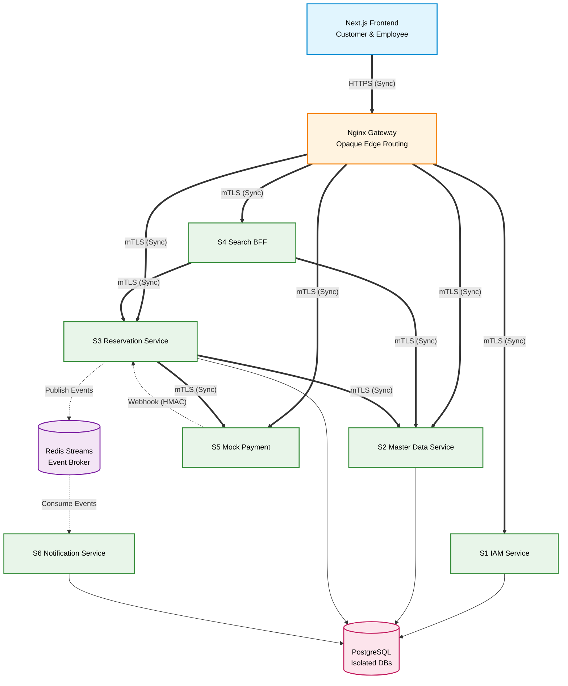
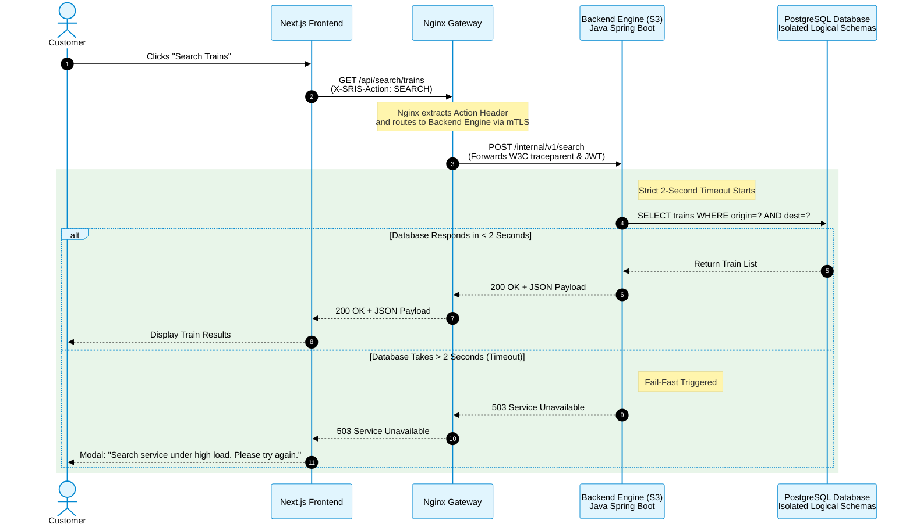
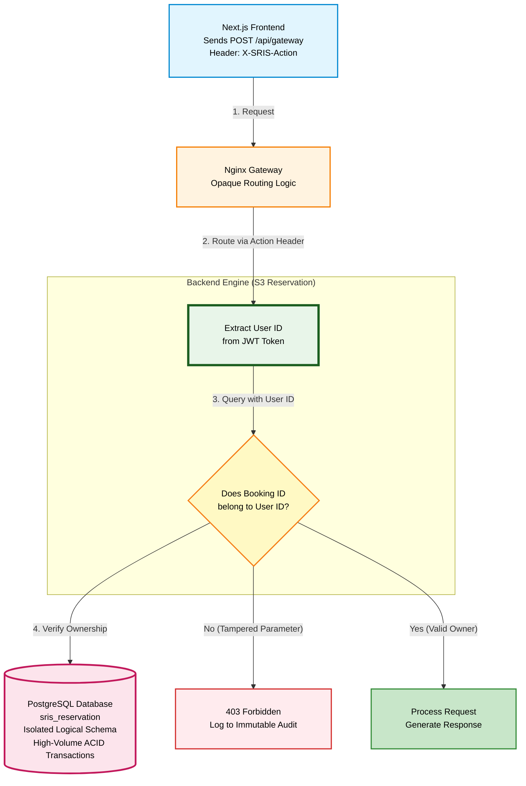
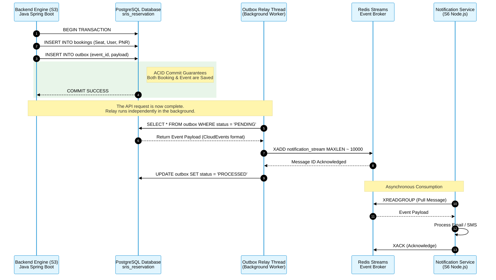
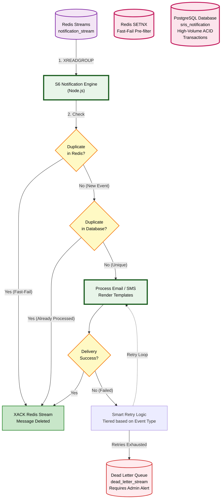
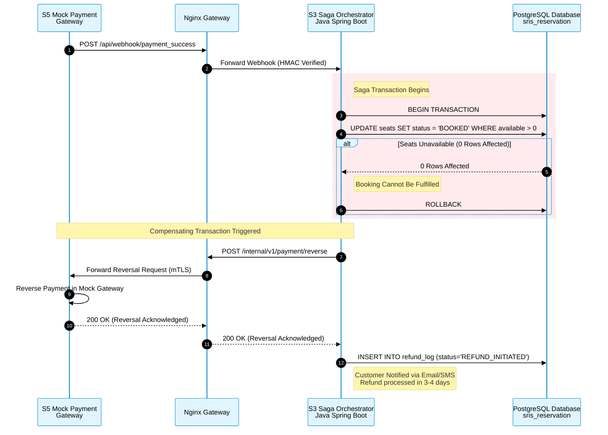
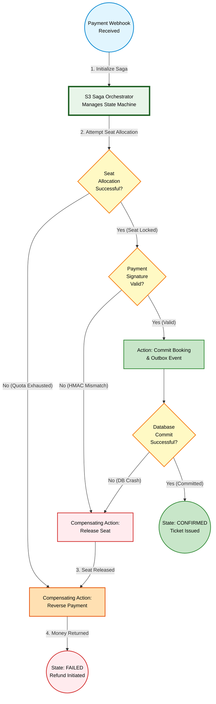
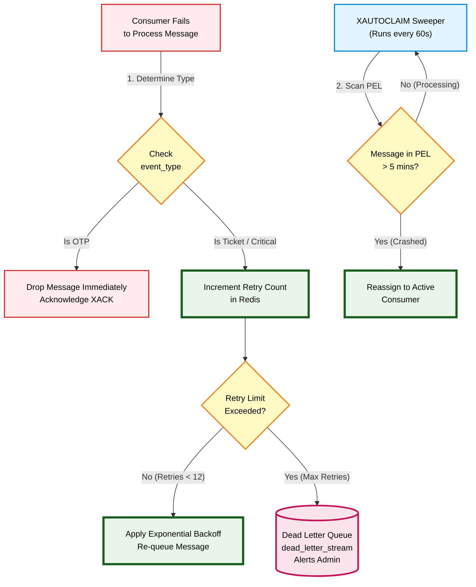

# Service Interaction and Communication Design

*SRIS — Sarathi Railway Information System*

*A Unified Railway Management Platform*

*Inspired by CRIS and IRCTC · Independent project*

> **Version:** 1.0 | **Date:** 2026-10-19 | **Document ID:** SRIS-P1-ARCH-009

| Field              | Value                                                             |
| ------------------ | ----------------------------------------------------------------- |
| Title              | Service Interaction and Communication Design                      |
| Software           | SRIS                                                              |
| Software Full Form | Sarathi Railway Information System                                |
| Team Codename      | Project Sarathi                                                   |
| Document ID        | SRIS-P1-ARCH-009                                                  |
| Task               | Define how services communicate, synchronously and asynchronously |
| Document Type      | Architecture Document                                             |
| Milestone          | Phase 1 Foundation                                                |
| Classification     | Internal                                                          |
| Version            | 1.0                                                               |
| Date               | 2026-10-19                                                        |
| Author             | Koushal Jha, Lead Architect                                       |
| Approved By        | Koushal Jha, Lead Architect                                       |
| Approval Date      | 2026-10-19                                                        |
| Supersedes         | None (first version)                                              |
| Related Documents  | See Appendix B                                                    |
| Affiliation        | Independent · Not affiliated with CRIS, IRCTC, or Indian Railways |

---

## Table of Contents

1. [Introduction](#1-introduction)
   - [1.1 Purpose](#11-purpose)
   - [1.2 Scope](#12-scope)
   - [1.3 Audience](#13-audience)
   - [1.4 Terminology and Conventions](#14-terminology-and-conventions)
2. [The 13 Locked Communication Rules](#2-the-13-locked-communication-rules)
   - [2.1 Hybrid Communication Model](#21-hybrid-communication-model)
   - [2.2 Fail-Fast Synchronous Timeouts](#22-fail-fast-synchronous-timeouts)
   - [2.3 Async Event Envelope and Tracing](#23-async-event-envelope-and-tracing)
   - [2.4 Database-Enforced Idempotency](#24-database-enforced-idempotency)
   - [2.5 Dual-Path SMS Gateway](#25-dual-path-sms-gateway)
   - [2.6 Internal Zero-Trust mTLS](#26-internal-zero-trust-mtls)
   - [2.7 Smart Retry and Bounded Streams](#27-smart-retry-and-bounded-streams)
   - [2.8 Immutable Audit and Fortress Vault](#28-immutable-audit-and-fortress-vault)
   - [2.9 Admin Dashboard Security](#29-admin-dashboard-security)
   - [2.10 Opaque Edge Routing and IDOR Defense](#210-opaque-edge-routing-and-idor-defense)
   - [2.11 Strict DTO Validation](#211-strict-dto-validation)
   - [2.12 Webhook Security and Fast Ack](#212-webhook-security-and-fast-ack)
   - [2.13 Strict Session and Saga Pattern](#213-strict-session-and-saga-pattern)
3. [High-Level Communication Topology](#3-high-level-communication-topology)
4. [Synchronous Communication Lifecycle](#4-synchronous-communication-lifecycle)
5. [Asynchronous Communication Lifecycle](#5-asynchronous-communication-lifecycle)
6. [Saga Orchestration and Rollback](#6-saga-orchestration-and-rollback)
7. [Smart Retry and Dead Letter Queue](#7-smart-retry-and-dead-letter-queue)
8. [Approval](#8-approval)

- [Revision History](#revision-history)
- [Appendix A: Not Applicable](#appendix-a-not-applicable)
- [Appendix B: Related Documents](#appendix-b-related-documents)

---

## 1. Introduction

### 1.1 Purpose

This document defines the exact communication patterns, rules, and protocols used by the 6 microservices of SRIS. While the System Architecture Document ([SRIS-P1-ARCH-003](./SRIS-P1-ARCH-003_SystemArchitectureDocument.md) — System Architecture Document) defines the *containers* and the Domain Model ([SRIS-P1-ARCH-005](./SRIS-P1-ARCH-005_DomainModelDocument.md) — Domain Model Document) defines the *data*, this document defines the *behaviour*. 

It serves as the definitive rulebook for developers writing APIs, configuring Nginx, and setting up Redis Streams. It ensures that the system remains highly resilient under extreme concurrency, survives network partitions, prevents double-booking, and fits strictly within the 5.1 GB RAM envelope.

### 1.2 Scope

**In scope**

- The 13 Locked Communication Rules (Sync vs. Async, Fail-Fast, CloudEvents, Idempotency).
- The high-level communication topology matrix.
- The synchronous and asynchronous request lifecycles.
- The Saga Orchestration and Compensating Transaction flows.
- The Smart Retry and Dead Letter Queue (DLQ) logic.
- Distributed tracing and Correlation ID propagation (W3C traceparent).
- Edge security routing and IDOR defense mechanisms.

**Out of scope**

- The physical deployment topology, which belongs to [SRIS-P1-ARCH-003](./SRIS-P1-ARCH-003_SystemArchitectureDocument.md) — System Architecture Document.
- The exact API endpoints, which belong to [SRIS-P1-API-001](./SRIS-P1-API-001_APIContractDocumentOpenAPI.md) — API Contract Document (OpenAPI).
- The event JSON schemas, which belong to [SRIS-P1-API-003](./SRIS-P1-API-003_EventSchemaDocumentAsyncAPI.md) — Event Schema Document (AsyncAPI).

### 1.3 Audience

- **Lead Architect:** maintains this document and is the authority on communication changes.
- **Backend developers:** must implement the exact Saga, Outbox, and Idempotency patterns defined here.
- **Frontend developers:** must implement the strict session gates and UI error handling.
- **DevOps engineer:** uses the Stream limits and Retry logic to configure Redis and Nginx.
- **Project supervisor and evaluator:** verifies that the distributed communication is mathematically sound and enterprise-grade.

### 1.4 Terminology and Conventions

Every term in this document has the meaning recorded in [SRIS-P1-REQ-001](../wave-1-requirements/SRIS-P1-REQ-001_GlossaryAndDomainDictionary.md) — Glossary and Domain Dictionary. The terms below carry the most weight in this document.

| Term | Meaning |
| :--- | :--- |
| Sync (REST) | Synchronous HTTP request/response where the caller blocks and waits. |
| Async (Events) | Asynchronous publish/subscribe where the caller moves on immediately. |
| TOCTOU | Time-of-Check to Time-of-Use. A race condition where a resource changes state between check and use. |
| Idempotency | The property that a repeated request has the exact same effect as a single request. |
| Saga | A sequence of local transactions coordinated by a central orchestrator with compensating transactions. |
| Outbox | A database table used to safely stage events before publishing to a message broker. |
| DLQ | Dead Letter Queue. A holding area for messages that failed all retries. |

This document follows the standards below.

- [SRIS-P1-GOV-002](../wave-0-project-foundation/SRIS-P1-GOV-002_DocumentTemplateStandard.md) — Document Template Standard.
- [SRIS-P1-GOV-003](../wave-0-project-foundation/SRIS-P1-GOV-003_DocumentIDAndCategoryScheme.md) — Document ID and Category Scheme.
- [SRIS-P1-GOV-004](../wave-0-project-foundation/SRIS-P1-GOV-004_DocumentCrossReferenceStandard.md) — Document Cross-Reference Standard.

---

## 2. The 13 Locked Communication Rules

To survive the 5.1 GB constraint and ensure absolute data integrity, the following 13 rules are strictly mandated. Any deviation requires a formal revision of this document.

### 2.1 Hybrid Communication Model
- **Rule:** Use Synchronous (REST) when a human is waiting on a screen (Login, Search, Payment Initiation). Use Asynchronous (Redis Streams) for background side-effects (Email, SMS, Audit Logs, Waitlist promotion).
- **Reason:** Sync provides immediate UX. Async prevents cascading failures across the system.

### 2.2 Fail-Fast Synchronous Timeouts
- **Rule:** Strict 2-second timeout on internal synchronous calls. NO automatic retries for user-facing endpoints. If a downstream service is slow, return 503 immediately.
- **Reason:** Prevent Thread Pool exhaustion. Automatic retries multiply server load and cause thundering herds.

### 2.3 Async Event Envelope and Tracing
- **Rule:** All Redis Stream messages use a CloudEvents JSON envelope (`event_id`, `event_type`, `timestamp`, `source`, `version`, `data`) and propagate the W3C `traceparent` header.
- **Reason:** Industry standard. Enables idempotency, distributed tracing, and future versioning without breaking consumers.

### 2.4 Database-Enforced Idempotency
- **Rule:** Redis `SETNX` is used ONLY as a fast-fail pre-filter. The absolute source of truth is a PostgreSQL Unique Constraint on the `event_id` inside the exact same ACID transaction as the business logic.
- **Reason:** Prevents TOCTOU race conditions and data corruption during crash recovery.

### 2.5 Dual-Path SMS Gateway
- **Rule:** OTPs use synchronous direct HTTP to the Android Gateway (fail-fast). Ticket/PDF notifications use asynchronous Redis Streams (queue).
- **Reason:** An OTP has a strict TTL (5 mins). Queuing it for a disconnected phone is useless. A PNR ticket can be queued for hours safely.

### 2.6 Internal Zero-Trust mTLS
- **Rule:** Native Application-Level mTLS using OpenSSL. Every service (S1-S6) has a cryptographic certificate that is verified on every internal request.
- **Reason:** Provides enterprise zero-trust security with zero RAM overhead, avoiding heavy service meshes like Istio.

### 2.7 Smart Retry and Bounded Streams
- **Rule:** Tiered retries based on event type. All `XADD` commands MUST use `MAXLEN ~ 10000`. A background `XAUTOCLAIM` sweeper recovers pending messages from crashed consumers.
- **Reason:** Prevents infinite memory bloat and OOM crashes within the 5.1 GB limit.

### 2.8 Immutable Audit and Fortress Vault
- **Rule:** Append-only PostgreSQL audit log. After 30 days, logs move to a Vault DB with a separate master password requiring 3-person Quorum access.
- **Reason:** Prevents insider threats and hackers from erasing their tracks.

### 2.9 Admin Dashboard Security
- **Rule:** High-risk actions (e.g., changing fares) require re-authentication (password + OTP) and Maker-Checker approval from a second admin.
- **Reason:** Prevents compromised admin accounts from causing damage.

### 2.10 Opaque Edge Routing and IDOR Defense
- **Rule:** NO API versioning in the public URL. Nginx routes based on custom headers (`X-SRIS-Action`). All sensitive data goes in the JSON body. Every DB query strictly verifies ownership via the `userId` extracted from the JWT, never trusting client-provided IDs.
- **Reason:** Prevents API mapping, IDOR attacks, and parameter tampering.

### 2.11 Strict DTO Validation
- **Rule:** Backend sanitization via strict Data Transfer Objects (DTOs). Nginx enforces a 2MB max body size.
- **Reason:** Blocks NoSQL/SQL injection and memory exhaustion.

### 2.12 Webhook Security and Fast Ack
- **Rule:** Payment webhooks secured via HMAC-SHA256. The webhook handler must immediately write to the Transactional Outbox and return 200 OK to prevent provider timeout retries.
- **Reason:** Zero-code migration to real gateways; prevents retry storms.

### 2.13 Strict Session and Saga Pattern
- **Rule A (Session):** Strict 15-minute JWT TTL with NO auto-refresh. The frontend uses a typewriter countdown and a 60-second proactive gate that blocks new payments if the session is about to expire.
- **Rule B (Saga):** A Saga Orchestrator handles distributed transactions. A Transactional Outbox pattern guarantees async event delivery without dual-write failures.
- **Reason:** Strict sessions prevent token hijacking. Saga/Outbox ensure absolute data consistency.

---

## 3. High-Level Communication Topology

The diagram below maps the exact communication paths between all services. It explicitly distinguishes between Synchronous (REST) calls and Asynchronous (Redis Streams) events, enforcing the Hybrid Communication Model. 

Notice that the databases are never accessed directly by the frontend, and internal service calls are secured via mTLS.

---

---

## 4. Synchronous Communication Lifecycle

Synchronous communication (REST over HTTP) is used strictly for user-wait actions (Login, Search, Payment Initiation). To protect the 5.1 GB RAM envelope and prevent thread pool exhaustion, we enforce a **Strict Fail-Fast Timeout**. We do not auto-retry. If a downstream service does not respond in time, the system sheds load immediately.

### 4.1 Synchronous Request Sequence

The sequence diagram below illustrates the exact interaction between the Frontend, the Nginx Gateway, and the Backend Engine (S3 Reservation Service), highlighting the 2-second timeout and the immediate 503 fallback.

### 4.2 Synchronous Flowchart: Opaque Edge Routing and IDOR Defense

While the Sequence Diagram (Section 4.1) shows the *timing* of a synchronous call, this flowchart illustrates the exact *decision logic* and security checks executed by the Nginx Gateway and the Backend Engine. 

It proves that the system is protected against API mapping (by hiding versions) and Insecure Direct Object Reference (IDOR) attacks (by verifying the JWT against the requested resource).

---

## 5. Asynchronous Communication Lifecycle

Asynchronous communication (via Redis Streams) is used for background side-effects that do not block the user's screen (Email, SMS, Audit Logs, Waitlist promotion). 

To guarantee zero data loss and solve the **Dual-Write Problem** (where a database commit succeeds but the event publish fails), we mandate the **Transactional Outbox Pattern**. The domain event is saved to a PostgreSQL `outbox` table within the *exact same ACID transaction* as the business logic. A lightweight background relay then securely pushes the event to Redis.

### 5.1 Asynchronous Event Sequence (Transactional Outbox)

The sequence diagram below illustrates how the Backend Engine safely commits a booking and guarantees that the notification event is reliably delivered to Redis Streams without risking a split-brain scenario.

### 5.2 Asynchronous Flowchart: Consumer Idempotency and Smart Retry

While the Sequence Diagram (Section 5.1) shows the Outbox Relay publishing to Redis, this flowchart illustrates the exact algorithmic logic executed by the **consumer** (e.g., S6 Notification Service) when it pulls a message from the Redis Stream.

It explicitly demonstrates the two-layer idempotency check (Redis fast-fail + PostgreSQL unique constraint) and the Tiered Smart Retry mechanism that guarantees no event is permanently lost.

### 5.3 Redis Stream Topics and Consumer Groups

To ensure the 5.1 GB RAM limit is respected and memory is never wasted on orphaned messages, we strictly define the exact Stream topics and the Consumer Groups that read from them.

| Redis Stream Topic | Publisher | Consumer Group | Consumers | DLQ Target |
| :--- | :--- | :--- | :--- | :--- |
| `sris.payment_webhooks` | Nginx (S5 Webhook) | `s3_group` | S3 Reservation (10 Threads) | `sris.dlq_payment` |
| `sris.booking_events` | S3 Reservation (Outbox Relay) | `s6_group` | S6 Notification | `sris.dlq_notification` |
| `sris.sms_queue` | S6 Notification | `sms_gateway_group` | Android SMS App | `sris.dlq_sms` |
| `sris.audit_events` | All Services | `audit_group` | S1 IAM (Audit Worker) | `sris.dlq_audit` |

**Rule:** Every consumer group must enforce `XREADGROUP` with a `BLOCK 5000` timeout to prevent infinite blocking threads. If a consumer crashes mid-process, the `XAUTOCLAIM` sweeper (Section 7) automatically reassigns the message to a healthy consumer after 60 seconds.
---

## 6. Saga Orchestration and Rollback

Because we use isolated microservices, we cannot use traditional two-phase commit (2PC) for distributed transactions. Instead, we mandate the **Saga Pattern (Orchestration)**. 

If a payment succeeds but the booking cannot be fulfilled (e.g., the last seat was grabbed by another thread, or all RAC/WL quotas are exhausted), the S3 Reservation Service acts as the Saga Orchestrator. It explicitly executes a **Compensating Transaction** to reverse the payment via S5.

### 6.1 Saga Rollback Sequence

The sequence diagram below demonstrates the failure path: a payment webhook arrives, the database allocation fails, and the Saga Orchestrator triggers an immediate, automated refund.

### 6.2 Saga Orchestration State Machine Flowchart

While the Sequence Diagram (Section 6.1) shows the chronological messages between services, this flowchart illustrates the exact **State Machine** managed by the S3 Saga Orchestrator. 

It proves that every distributed transaction has a definitive end state (either `CONFIRMED` or `FAILED`), and every failure path explicitly triggers a compensating action to release resources.

### 6.3 Booking Lifecycle State Machine

To ensure the Saga Orchestrator never loses track of a booking, the Booking aggregate (from ARCH-005) follows a strict state transition map. This map guarantees that the PostgreSQL database state and the Redis Stream event state are never split-brained.

| Current State | Event / Action | Next State | Compensating Action (If Failure) |
| :--- | :--- | :--- | :--- |
| `INITIATED` | Customer clicks "Pay" | `PENDING` | None (Session expires) |
| `PENDING` | Payment Webhook Received | `ALLOCATING` | None |
| `ALLOCATING` | Seat allocation successful | `CONFIRMED` | Release Seat |
| `ALLOCATING` | Seat allocation fails (Quota Full) | `WAITLISTED` | None |
| `ALLOCATING` | Seat allocation fails (No WL) | `CANCELLED` | Reverse Payment (Refund) |
| `PENDING` | Payment Webhook Timeout (No callback in 15 min) | `EXPIRED` | Release Seat (if held) |
| `CONFIRMED` | Customer requests cancellation | `CANCELLED` | Reverse Payment (Refund) |
| `CONFIRMED` | Chart Preparation completes | `LOCKED` | None |
| `CANCELLED` | Refund processed by Gateway | `REFUNDED` | None |

**Rule:** No booking may transition from `PENDING` directly to `CONFIRMED` without passing through `ALLOCATING`. This guarantees the Saga Orchestrator has executed the atomic seat lock before generating the PNR.
---

## 7. Smart Retry and Dead Letter Queue

In a distributed system, failures are inevitable. To prevent infinite retry loops from bloating the Redis Pending Entries List (PEL) and crashing the 5.1 GB RAM envelope, we mandate a **Smart Retry Mechanism**. 

This mechanism applies different retry policies based on the `event_type`. Highly time-sensitive events (OTPs) are dropped immediately on failure, while critical business events (Tickets/PDFs) are retried multiple times. If all retries fail, the message is safely moved to a Dead Letter Queue (DLQ) for administrative review. 

Additionally, a background `XAUTOCLAIM` sweeper runs every 60 seconds to recover messages stuck in the PEL (crashed consumers).

### 7.1 Smart Retry and DLQ Flowchart

The flowchart below illustrates the exact algorithmic decision logic executed by the consumer (e.g., S6 Notification Service) and the background sweeper.

---

## 8. Approval

| Role           | Name        | Decision | Date       |
| -------------- | ----------- | -------- | ---------- |
| Lead Architect | Koushal Jha | Approved | 2026-10-19 |

---

## Revision History

| Version | Date       | Author      | Change           |
| ------- | ---------- | ----------- | ---------------- |
| 1.0     | 2026-10-19 | Koushal Jha | Initial release. |

---

## Appendix A: Not Applicable

Not applicable.

---

## Appendix B: Related Documents

### B.1 Directly Referenced Documents

| Seq  | Document ID                                                                                                    | Document Name                                     | Wave | Pri | Tag     |
| ---- | -------------------------------------------------------------------------------------------------------------- | ------------------------------------------------- | ---- | --- | ------- |
| 0.1  | [SRIS-P1-GOV-002](../wave-0-project-foundation/SRIS-P1-GOV-002_DocumentTemplateStandard.md)                     | Document Template Standard                        | 0    | P0  | UNBLOCK |
| 0.2  | [SRIS-P1-GOV-003](../wave-0-project-foundation/SRIS-P1-GOV-003_DocumentIDAndCategoryScheme.md)                  | Document ID and Category Scheme                   | 0    | P1  | UNBLOCK |
| 0.3  | [SRIS-P1-GOV-004](../wave-0-project-foundation/SRIS-P1-GOV-004_DocumentCrossReferenceStandard.md)               | Document Cross-Reference Standard                 | 0    | P1  | UNBLOCK |
| 1.1  | [SRIS-P1-REQ-001](../wave-1-requirements/SRIS-P1-REQ-001_GlossaryAndDomainDictionary.md)                        | Glossary and Domain Dictionary                    | 1    | P0  | UNBLOCK |
| 2.3  | [SRIS-P1-ARCH-003](./SRIS-P1-ARCH-003_SystemArchitectureDocument.md)                                            | System Architecture Document                      | 2    | P0  | UNBLOCK |
| 2.5  | [SRIS-P1-ARCH-005](./SRIS-P1-ARCH-005_DomainModelDocument.md)                                                   | Domain Model Document                             | 2    | P0  | UNBLOCK |
| 3.14 | [SRIS-P1-API-001](./SRIS-P1-API-001_APIContractDocumentOpenAPI.md)                                              | API Contract Document (OpenAPI)                   | 3    | P0  | UNBLOCK |
| 3.16 | [SRIS-P1-API-003](./SRIS-P1-API-003_EventSchemaDocumentAsyncAPI.md)                                             | Event Schema Document (AsyncAPI)                  | 3    | P0  | UNBLOCK |

### B.2 Documents That Reference This Document

| Seq  | Document ID                                                                             | Document Name                                | Why It References                                                                 |
| ---- | --------------------------------------------------------------------------------------- | -------------------------------------------- | --------------------------------------------------------------------------------- |
| 3.14 | [SRIS-P1-API-001](./SRIS-P1-API-001_APIContractDocumentOpenAPI.md)                          | API Contract Document (OpenAPI)              | Implements the exact endpoints and DTOs defined in the routing rules              |
| 3.16 | [SRIS-P1-API-003](./SRIS-P1-API-003_EventSchemaDocumentAsyncAPI.md)                         | Event Schema Document (AsyncAPI)             | Implements the CloudEvents JSON envelopes and Redis Stream schemas                |
| 3.17 | [SRIS-P1-API-004](./SRIS-P1-API-004_IntegrationDesignDocument.md)                           | Integration Design Document                  | Details the exact mTLS handshake and webhook HMAC verification                    |
| 6.2  | [SRIS-P1-DEV-004](../wave-6-developer-standards/SRIS-P1-DEV-004_CodingStandardsAndConventions.md) | Coding Standards and Conventions             | Enforces the DTO validation and background relay implementation                   |

### B.3 Documents This Document Depends On (Upstream)

| Seq | Document ID                                                                                 | Document Name                          | Dependency Type |
| --- | ------------------------------------------------------------------------------------------- | -------------------------------------- | --------------- |
| 0.1 | [SRIS-P1-GOV-002](../wave-0-project-foundation/SRIS-P1-GOV-002_DocumentTemplateStandard.md)           | Document Template Standard             | Hard            |
| 0.3 | [SRIS-P1-GOV-004](../wave-0-project-foundation/SRIS-P1-GOV-004_DocumentCrossReferenceStandard.md)     | Document Cross-Reference Standard      | Hard            |
| 1.1 | [SRIS-P1-REQ-001](../wave-1-requirements/SRIS-P1-REQ-001_GlossaryAndDomainDictionary.md)                | Glossary and Domain Dictionary         | Hard            |
| 2.3 | [SRIS-P1-ARCH-003](./SRIS-P1-ARCH-003_SystemArchitectureDocument.md)                                    | System Architecture Document           | Hard            |
| 2.5 | [SRIS-P1-ARCH-005](./SRIS-P1-ARCH-005_DomainModelDocument.md)                                           | Domain Model Document                  | Hard            |

### B.4 Documents This Document Unblocks (Downstream)

| Seq  | Document ID                                                                             | Document Name                                | Blocked Until |
| ---- | --------------------------------------------------------------------------------------- | -------------------------------------------- | ------------- |
| 3.14 | [SRIS-P1-API-001](./SRIS-P1-API-001_APIContractDocumentOpenAPI.md)                          | API Contract Document (OpenAPI)              | This approved |
| 3.16 | [SRIS-P1-API-003](./SRIS-P1-API-003_EventSchemaDocumentAsyncAPI.md)                         | Event Schema Document (AsyncAPI)             | This approved |
| 3.17 | [SRIS-P1-API-004](./SRIS-P1-API-004_IntegrationDesignDocument.md)                           | Integration Design Document                  | This approved |
| 3.18 | [SRIS-P1-API-005](./SRIS-P1-API-005_IdempotencyAndRetryPolicySpecification.md)              | Idempotency and Retry Policy Specification   | This approved |
| 5.1  | [SRIS-P1-INF-001](../wave-5-devops-operations/SRIS-P1-INF-001_InfrastructureAndTechnologyDocument.md) | Infrastructure and Technology Document       | This approved |

### B.5 Master Documentation Index

The complete list of Phase 1 documents is in [SRIS-P1-GOV-001](../wave-0-project-foundation/SRIS-P1-GOV-001_DocumentationIndexAndNavigationMap.md) — Documentation Index and Navigation Map.

### B.6 External Reference Documents

| Reference Type | Where It Is Documented                                                                                                                                                                                                                                     |
| -------------- | ---------------------------------------------------------------------------------------------------------------------------------------------------------------------------------------------------------------------------------------------------------- |
| Standard       | W3C Trace Context. https://www.w3.org/TR/trace-context/. Referenced for the `traceparent` header standard.                                                                                                                                                |
| Standard       | CloudEvents Specification. https://cloudevents.io/. Referenced for the JSON event envelope structure.                                                                                                                                                    |
| Standard       | IETF RFC 9110 - HTTP Semantics. https://www.rfc-editor.org/rfc/rfc9110.html. Referenced for the prohibition of GET request bodies.                                                                                                                         |
| Standard       | NIST SP 800-63B - Digital Identity Guidelines. https://pages.nist.gov/800-63-3/sp800-63b.html. Referenced for the session management and authentication standards.                                                                                           |

### B.7 Document Conventions

The conventions for Priority and Tag values are defined in [Section 9](../wave-0-project-foundation/SRIS-P1-GOV-002_DocumentTemplateStandard.md#9-vocabulary-standards) of [SRIS-P1-GOV-002](../wave-0-project-foundation/SRIS-P1-GOV-002_DocumentTemplateStandard.md) — Document Template Standard.