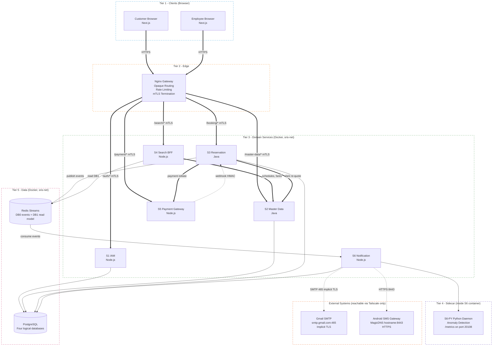
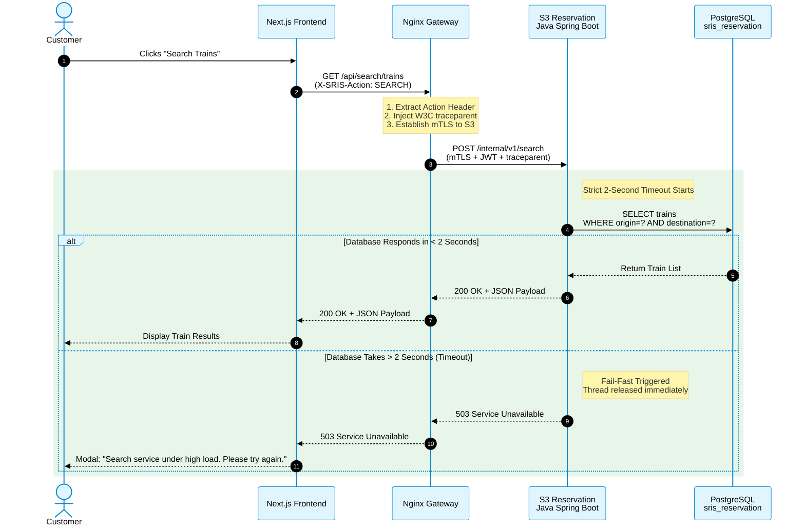
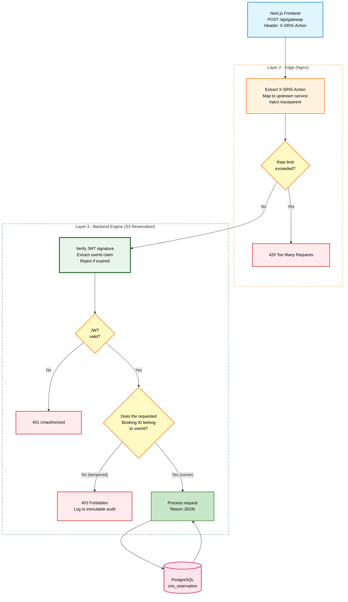
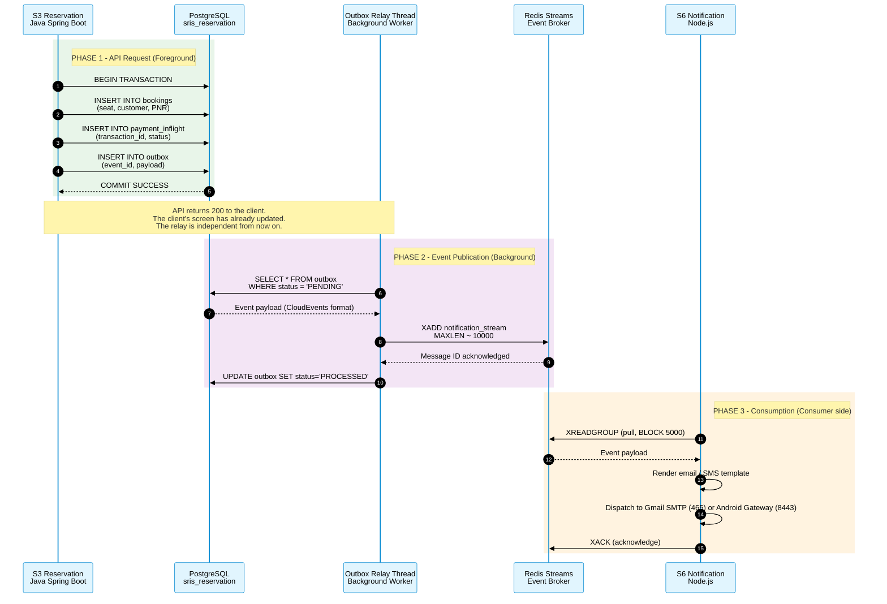
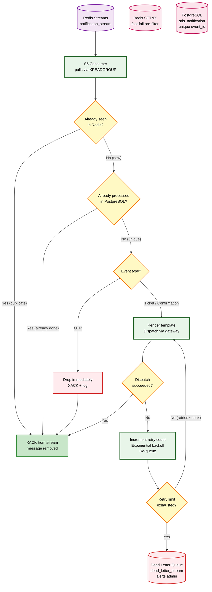
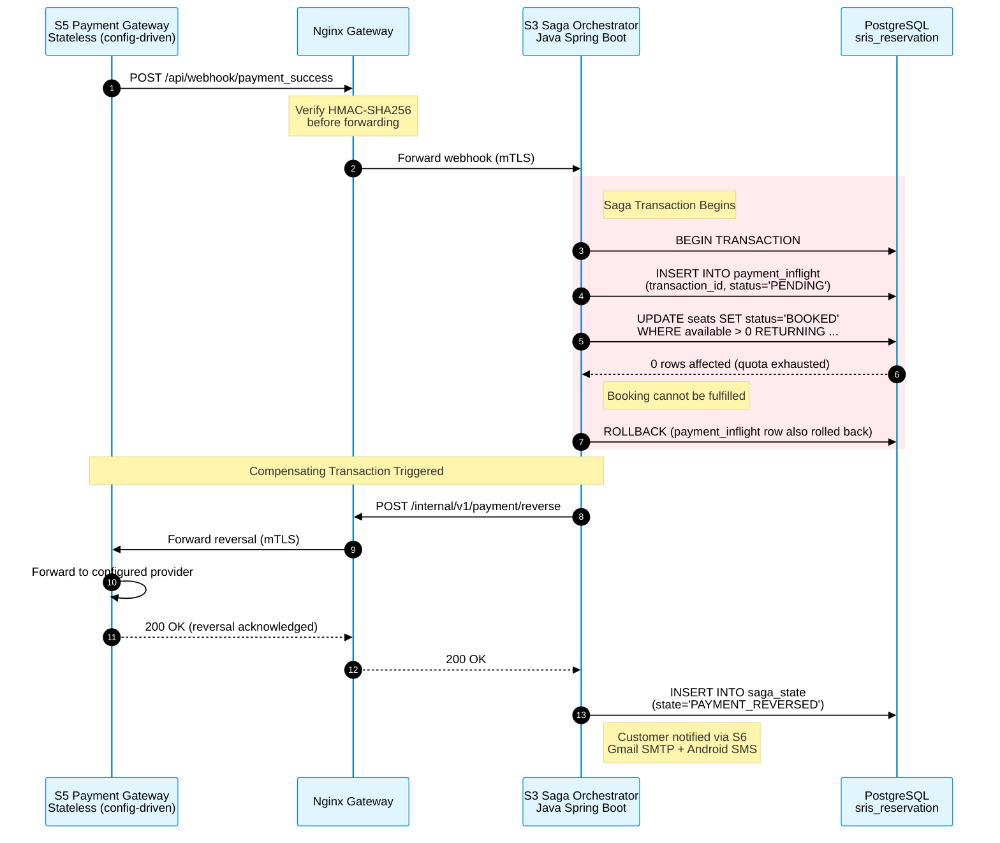

<div align="center">


</div>

# Service Interaction and Communication Design

*SRIS — Sarathi Railway Information System*

*A Unified Railway Management Platform*

*Inspired by CRIS and IRCTC · Independent project*

> **Version:** 1.1 | **Date:** 2026-10-22 | **Document ID:** SRIS-P1-ARCH-009

| Field              | Value                                                             |
| ------------------ | ----------------------------------------------------------------- |
| Title              | Service Interaction and Communication Design                      |
| Software           | SRIS                                                              |
| Software Full Form | Sarathi Railway Information System                                |
| Team Codename      | Project Sarathi                                                   |
| Document ID        | SRIS-P1-ARCH-009                                                  |
| Task               | Define how services communicate, synchronously and asynchronously |
| Document Type      | Architecture Document                                             |
| Milestone          | Phase 1 Foundation                                                |
| Classification     | Internal                                                          |
| Version            | 1.1                                                               |
| Date               | 2026-10-22                                                        |
| Author             | Koushal Jha, Lead Architect                                       |
| Approved By        | Koushal Jha, Lead Architect                                       |
| Approval Date      | 2026-10-22                                                        |
| Supersedes         | Version 1.0 of this document                                      |
| Related Documents  | See Appendix B                                                    |
| Affiliation        | Independent · Not affiliated with CRIS, IRCTC, or Indian Railways |

---

## Table of Contents

1. [Introduction](#1-introduction)
   - [1.1 Purpose](#11-purpose)
   - [1.2 Scope](#12-scope)
   - [1.3 Audience](#13-audience)
   - [1.4 Terminology and Conventions](#14-terminology-and-conventions)
2. [The 14 Locked Communication Rules](#2-the-14-locked-communication-rules)
   - [2.1 Hybrid Communication Model](#21-hybrid-communication-model)
   - [2.2 Fail-Fast Synchronous Timeouts](#22-fail-fast-synchronous-timeouts)
   - [2.3 Async Event Envelope and Tracing](#23-async-event-envelope-and-tracing)
   - [2.4 Database-Enforced Idempotency](#24-database-enforced-idempotency)
   - [2.5 Dual-Path SMS and Email Gateway](#25-dual-path-sms-and-email-gateway)
   - [2.6 Internal Zero-Trust mTLS](#26-internal-zero-trust-mtls)
   - [2.7 Smart Retry and Bounded Streams](#27-smart-retry-and-bounded-streams)
   - [2.8 Immutable Audit and Fortress Vault](#28-immutable-audit-and-fortress-vault)
   - [2.9 Admin Dashboard Security](#29-admin-dashboard-security)
   - [2.10 Opaque Edge Routing and IDOR Defense](#210-opaque-edge-routing-and-idor-defense)
   - [2.11 Strict DTO Validation](#211-strict-dto-validation)
   - [2.12 Webhook Security and Fast Ack](#212-webhook-security-and-fast-ack)
   - [2.13 Strict Session and Saga Pattern](#213-strict-session-and-saga-pattern)
   - [2.14 External Gateway TLS](#214-external-gateway-tls)
3. [High-Level Communication Topology](#3-high-level-communication-topology)
4. [Synchronous Communication Lifecycle](#4-synchronous-communication-lifecycle)
   - [4.1 Synchronous Request Sequence](#41-synchronous-request-sequence)
   - [4.2 Synchronous Flowchart: Opaque Edge Routing and IDOR Defense](#42-synchronous-flowchart-opaque-edge-routing-and-idor-defense)
5. [Asynchronous Communication Lifecycle](#5-asynchronous-communication-lifecycle)
   - [5.1 Asynchronous Event Sequence (Transactional Outbox)](#51-asynchronous-event-sequence-transactional-outbox)
   - [5.2 Asynchronous Flowchart: Consumer Idempotency and Smart Retry](#52-asynchronous-flowchart-consumer-idempotency-and-smart-retry)
   - [5.3 Redis Stream Topics and Consumer Groups](#53-redis-stream-topics-and-consumer-groups)
   - [5.4 Python Daemon Metrics](#54-python-daemon-metrics)
6. [Saga Orchestration and Rollback](#6-saga-orchestration-and-rollback)
   - [6.1 Saga Rollback Sequence](#61-saga-rollback-sequence)
   - [6.2 Saga Orchestration State Machine Flowchart](#62-saga-orchestration-state-machine-flowchart)
   - [6.3 Booking Lifecycle State Machine](#63-booking-lifecycle-state-machine)
7. [Smart Retry and Dead Letter Queue](#7-smart-retry-and-dead-letter-queue)
   - [7.1 Smart Retry and DLQ Flowchart](#71-smart-retry-and-dlq-flowchart)
8. [Approval](#8-approval)

- [Revision History](#revision-history)
- [Appendix A: Not Applicable](#appendix-a-not-applicable)
- [Appendix B: Related Documents](#appendix-b-related-documents)

---

## 1. Introduction

### 1.1 Purpose

This document defines the exact communication patterns, rules, and protocols used by the 6 microservices of SRIS. While the System Architecture Document ([SRIS-P1-ARCH-003](./SRIS-P1-ARCH-003_SystemArchitectureDocument.md) — System Architecture Document) defines the *containers* and the Domain Model ([SRIS-P1-ARCH-005](./SRIS-P1-ARCH-005_DomainModelDocument.md) — Domain Model Document) defines the *data*, this document defines the *behaviour*.

It serves as the definitive rulebook for developers writing APIs, configuring Nginx, and setting up Redis Streams. It ensures that the system remains highly resilient under extreme concurrency, survives network partitions, prevents double-booking, and fits strictly within the 5.1 GB RAM envelope.

Every rule in this document is a **binding rule**. A rule marked **Provisional** is a binding rule whose exact numeric values are pending a Wave 3 owner document. A provisional rule is cited, not overridden, by the owner document when that document is written.

### 1.2 Scope

**In scope**

- The 14 Locked Communication Rules (Sync vs. Async, Fail-Fast, CloudEvents, Idempotency, External Gateway TLS).
- The high-level communication topology matrix.
- The synchronous and asynchronous request lifecycles.
- The Saga Orchestration and Compensating Transaction flows.
- The Smart Retry and Dead Letter Queue (DLQ) logic.
- Distributed tracing and Correlation ID propagation (W3C traceparent).
- Edge security routing and IDOR defense mechanisms.
- The external integrations (Gmail SMTP, Android SMS Gateway) at the protocol level.

**Out of scope**

- The physical deployment topology, which belongs to [SRIS-P1-ARCH-003](./SRIS-P1-ARCH-003_SystemArchitectureDocument.md) — System Architecture Document.
- The exact API endpoints, which belong to [SRIS-P1-API-001](./SRIS-P1-API-001_APIContractDocumentOpenAPI.md) — API Contract Document (OpenAPI).
- The event JSON schemas, which belong to [SRIS-P1-API-003](./SRIS-P1-API-003_EventSchemaDocumentAsyncAPI.md) — Event Schema Document (AsyncAPI).
- The exact rate limits and retry counts for external gateways, which belong to [SRIS-P1-API-012](../wave-3-detailed-design/SRIS-P1-API-012_NotificationIntegrationDesign.md) — Notification Integration Design.
- The exact metric names emitted by the Python daemon, which belong to [SRIS-P1-ARCH-012](./SRIS-P1-ARCH-012_ObservabilityAndMonitoringDesignOTelW3C.md) — Observability and Monitoring Design (OTel/W3C).

### 1.3 Audience

- **Lead Architect:** maintains this document and is the authority on communication changes.
- **Backend developers:** must implement the exact Saga, Outbox, Idempotency, and TLS patterns defined here.
- **Frontend developers:** must implement the strict session gates and UI error handling.
- **DevOps engineer:** uses the Stream limits, Retry logic, and certificate provisioning to configure Redis, Nginx, and the external gateways.
- **Project supervisor and evaluator:** verifies that the distributed communication is mathematically sound and enterprise-grade.

### 1.4 Terminology and Conventions

Every term in this document has the meaning recorded in [SRIS-P1-REQ-001](../wave-1-requirements/SRIS-P1-REQ-001_GlossaryAndDomainDictionary.md) — Glossary and Domain Dictionary. The terms below carry the most weight in this document.

| Term | Meaning |
| :--- | :--- |
| Sync (REST) | Synchronous HTTP request/response where the caller blocks and waits. |
| Async (Events) | Asynchronous publish/subscribe where the caller moves on immediately. |
| TOCTOU | Time-of-Check to Time-of-Use. A race condition where a resource changes state between check and use. |
| Idempotency | The property that a repeated request has the exact same effect as a single request. |
| Saga | A sequence of local transactions coordinated by a central orchestrator with compensating transactions. |
| Outbox | A database table used to safely stage events before publishing to a message broker. |
| DLQ | Dead Letter Queue. A holding area for messages that failed all retries. |
| Implicit TLS | TLS where the handshake begins on connection open, before any application data. No cleartext phase. |
| STARTTLS | TLS where the client first connects in cleartext, then upgrades. Susceptible to downgrade attacks. |
| MagicDNS | Tailscale's DNS mechanism that assigns a stable fully-qualified hostname to every device on the tailnet. |
| Provisional | A rule that is binding but whose exact numeric values are pending an owner document in Wave 3. |

This document follows the standards below.

- [SRIS-P1-GOV-002](../wave-0-project-foundation/SRIS-P1-GOV-002_DocumentTemplateStandard.md) — Document Template Standard.
- [SRIS-P1-GOV-003](../wave-0-project-foundation/SRIS-P1-GOV-003_DocumentIDAndCategoryScheme.md) — Document ID and Category Scheme.
- [SRIS-P1-GOV-004](../wave-0-project-foundation/SRIS-P1-GOV-004_DocumentCrossReferenceStandard.md) — Document Cross-Reference Standard.

---

## 2. The 14 Locked Communication Rules

To survive the 5.1 GB constraint and ensure absolute data integrity, the following 14 rules are strictly mandated. Any deviation requires a formal revision of this document.

### 2.1 Hybrid Communication Model

- **Rule:** Use Synchronous (REST) when a human is waiting on a screen (Login, Search, Payment Initiation). Use Asynchronous (Redis Streams) for background side-effects (Email, SMS, Audit Logs, Waitlist promotion).
- **Reason:** Sync provides immediate UX. Async prevents cascading failures across the system.

### 2.2 Fail-Fast Synchronous Timeouts

- **Rule:** Strict 2-second timeout on internal synchronous calls. NO automatic retries for user-facing endpoints. If a downstream service is slow, return 503 immediately.
- **Reason:** Prevent Thread Pool exhaustion. Automatic retries multiply server load and cause thundering herds.

### 2.3 Async Event Envelope and Tracing

- **Rule:** All Redis Stream messages use a CloudEvents JSON envelope (`event_id`, `event_type`, `timestamp`, `source`, `version`, `data`) and propagate the W3C `traceparent` header.
- **Reason:** Industry standard. Enables idempotency, distributed tracing, and future versioning without breaking consumers.

### 2.4 Database-Enforced Idempotency

- **Rule:** Redis `SETNX` is used ONLY as a fast-fail pre-filter. The absolute source of truth is a PostgreSQL Unique Constraint on the `event_id` inside the exact same ACID transaction as the business logic.
- **Reason:** Prevents TOCTOU race conditions and data corruption during crash recovery.

### 2.5 Dual-Path SMS and Email Gateway

- **Rule:** Every outbound notification channel follows the same dual-path rule. **Synchronous (fail-fast) for time-sensitive one-time messages.** **Asynchronous (queued) for deliverable messages that can tolerate delay.** The specific channels are:

  | Channel | Synchronous path | Asynchronous path |
  | :--- | :--- | :--- |
  | Android SMS Gateway | OTP and login codes (strict 5-minute TTL) | Booking confirmations, ticket PDFs, cancellations, refund notices |
  | Gmail SMTP | (not used) | Booking confirmations, ticket PDFs, cancellations, refund notices, welcome emails, password reset links |

- **Reason:** An OTP has a strict TTL. Queuing it for a disconnected phone is useless. A confirmation email or a PNR ticket can be queued for hours safely.

- **Provisional — Gmail-specific caveat (finalised in API-012).** Gmail applies its own outbound rate limit (approximately 500 messages per day for a standard Google account, higher for Google Workspace). Retries for Gmail failures must be batched and staggered so that Google's sender reputation system does not throttle the account. The exact retry count, backoff schedule, and daily cap enforcement belong to [SRIS-P1-API-012](../wave-3-detailed-design/SRIS-P1-API-012_NotificationIntegrationDesign.md) — Notification Integration Design.

- **Provisional — Android-specific caveat (finalised in API-012).** The Android SMS Gateway is a single physical device on the Tailscale overlay. Delivery depends on the device being powered, online, and connected to the tailnet. A queued message waits until the device returns. The maximum age at which a queued message is abandoned (rather than delivered late) belongs to [SRIS-P1-API-012](../wave-3-detailed-design/SRIS-P1-API-012_NotificationIntegrationDesign.md) — Notification Integration Design.

### 2.6 Internal Zero-Trust mTLS

- **Rule:** Native Application-Level mTLS using OpenSSL. Every service (S1-S6) has a cryptographic certificate that is verified on every internal request. The S6 Python daemon sidecar does not run its own TLS listener; it is reachable only through the S6 container's own network namespace and is never exposed outside it.
- **Reason:** Provides enterprise zero-trust security with zero RAM overhead, avoiding heavy service meshes like Istio. The Python daemon is internal to S6 and inherits the container's network isolation.

### 2.7 Smart Retry and Bounded Streams

- **Rule:** Tiered retries based on event type. All `XADD` commands MUST use `MAXLEN ~ 10000`. A background `XAUTOCLAIM` sweeper recovers pending messages from crashed consumers.
- **Reason:** Prevents infinite memory bloat and OOM crashes within the 5.1 GB limit.

### 2.8 Immutable Audit and Fortress Vault

- **Rule:** Append-only PostgreSQL audit log. After 30 days, logs move to a Vault DB with a separate master password requiring 3-person Quorum access.
- **Reason:** Prevents insider threats and hackers from erasing their tracks.

- **Provisional — Phase 1 scope (finalised in SEC-002).** The Vault DB is a Phase 2 concern. In Phase 1, audit records are appended to the existing service databases (`sris_iam` for authentication audit, `sris_reservation` for booking audit). No separate audit database is provisioned in Phase 1. The separation-of-duties rule that prevents a Super Admin from erasing their own trail belongs to [SRIS-P1-SEC-002](../wave-3-detailed-design/SRIS-P1-SEC-002_RBACMatrix.md) — RBAC Matrix.

### 2.9 Admin Dashboard Security

- **Rule:** High-risk actions (e.g., changing fares) require re-authentication (password + OTP) and Maker-Checker approval from a second admin.
- **Reason:** Prevents compromised admin accounts from causing damage.

### 2.10 Opaque Edge Routing and IDOR Defense

- **Rule:** NO API versioning in the public URL. Nginx routes based on custom headers (`X-SRIS-Action`). All sensitive data goes in the JSON body. Every DB query strictly verifies ownership via the `userId` extracted from the JWT, never trusting client-provided IDs.
- **Reason:** Prevents API mapping, IDOR attacks, and parameter tampering.

### 2.11 Strict DTO Validation

- **Rule:** Backend sanitization via strict Data Transfer Objects (DTOs). Nginx enforces a 2MB max body size.
- **Reason:** Blocks NoSQL/SQL injection and memory exhaustion.

### 2.12 Webhook Security and Fast Ack

- **Rule:** Payment webhooks secured via HMAC-SHA256. The webhook handler must immediately write to the Transactional Outbox and return 200 OK to prevent provider timeout retries.
- **Reason:** Zero-code migration to real gateways; prevents retry storms.

- **Provisional — Malformed webhook behaviour (finalised in API-006).** A malformed or unverifiable webhook (bad HMAC signature, missing required fields, wrong content type) returns `400 Bad Request` and is logged as a security event. Only a valid webhook proceeds to the outbox. The webhook handler never returns `200` for a malformed payload, because a `200` would silence a legitimate retry from the provider. The exact error code and response shape belong to [SRIS-P1-API-006](../wave-3-detailed-design/SRIS-P1-API-006_APIErrorCodeCatalog.md) — API Error Code Catalog.

### 2.13 Strict Session and Saga Pattern

- **Rule A (Session):** Strict 15-minute JWT TTL with NO auto-refresh. The frontend uses a typewriter countdown and a 60-second proactive gate that blocks new payments if the session is about to expire.
- **Rule B (Saga):** A Saga Orchestrator handles distributed transactions. A Transactional Outbox pattern guarantees async event delivery without dual-write failures.
- **Reason:** Strict sessions prevent token hijacking. Saga/Outbox ensure absolute data consistency.

### 2.14 External Gateway TLS

- **Rule:** All external integrations (Gmail SMTP, Android SMS Gateway) use TLS with a valid certificate from a trusted authority. Self-signed certificates and the `NODE_TLS_REJECT_UNAUTHORIZED=0` runtime override are strictly forbidden.
- **Reason:** A self-signed certificate on the Android gateway would force the Node.js runtime to disable certificate validation globally, compromising every outbound TLS call that the service makes. The correct path is:
  - **Gmail SMTP** uses **implicit TLS on port 465**. The certificate is Google's, verified against Node.js's default trust store. RFC 8314 recommends implicit TLS over STARTTLS because it eliminates downgrade attacks.
  - **Android SMS Gateway** is reachable at `https://<hostname>.<tailnet>.ts.net:8443`. The hostname is a Tailscale MagicDNS fully-qualified name, stable across network changes. The certificate is provisioned either through the Tailscale admin console's HTTPS Certificates feature, or through Let's Encrypt DNS-01 using the tailnet's DNS. Either way, the certificate is a publicly trusted certificate bound to the MagicDNS hostname, verifiable against Node.js's default trust store.
  - Port 8443 is used because the Android operating system forbids binding any listener below port 1024 without root privileges. Port 8443 is the standard unprivileged HTTPS port and is the correct choice for a mobile device that must run in user space.

- **Reason (continued):** WireGuard (via Tailscale) provides transport-layer encryption, but it is not a substitute for application-layer TLS. Defence in depth requires both. Layer 4 (WireGuard) protects against network interception. Layer 7 (TLS with a valid certificate) protects against a compromised peer on the tailnet.

- **Provisional — Certificate provisioning procedure (finalised in API-012).** The exact steps to obtain and renew the Android gateway certificate, and the renewal frequency, belong to [SRIS-P1-API-012](../wave-3-detailed-design/SRIS-P1-API-012_NotificationIntegrationDesign.md) — Notification Integration Design. The Gmail SMTP certificate is managed by Google and requires no action from SRIS.

---

## 3. High-Level Communication Topology

The diagram below maps the exact communication paths between all processes. It distinguishes three kinds of edge:

- **Solid thick arrows** — Synchronous REST over mTLS (internal) or HTTPS (external).
- **Dashed thin arrows** — Asynchronous events over Redis Streams.
- **Dotted arrows** — Callbacks (webhooks) over HMAC.

The diagram groups processes into five tiers from top to bottom: clients, edge, services, sidecars, and data. Within the services tier, the six domain services are laid out in the same order as the port sequence in [SRIS-P1-ARCH-016](./SRIS-P1-ARCH-016_ServiceRegistryAndCatalog.md) — Service Registry and Catalog: S1, S4, S2, S3, S6, S5. The S6 Python daemon (S6-PY) is shown as a sidecar inside the S6 container. External systems (Gmail SMTP, Android SMS Gateway) sit outside the Docker network and are reached only through the Tailscale overlay.

The databases are never accessed directly by the frontend. Internal service calls are secured by mTLS. External calls are secured by TLS to a valid certificate (Rule 2.14).



---

## 4. Synchronous Communication Lifecycle

Synchronous communication (REST over HTTP) is used strictly for user-wait actions (Login, Search, Payment Initiation). To protect the 5.1 GB RAM envelope and prevent thread pool exhaustion, we enforce a **Strict Fail-Fast Timeout**. We do not auto-retry. If a downstream service does not respond in time, the system sheds load immediately.

### 4.1 Synchronous Request Sequence

The sequence diagram below illustrates the exact interaction between the Customer, the Next.js Frontend, the Nginx Gateway, and the Backend Engine (S3 Reservation Service), highlighting the 2-second timeout and the immediate 503 fallback. It also shows where the mTLS handshake happens (between Nginx and S3) and where the W3C `traceparent` header is injected and propagated.



### 4.2 Synchronous Flowchart: Opaque Edge Routing and IDOR Defense

While the Sequence Diagram (§4.1) shows the *timing* of a synchronous call, this flowchart shows the *decision logic and security checks* executed by the Nginx Gateway and the Backend Engine. It is drawn as a layered flow — routing at the edge, then identity, then authorisation, then business logic — so a reader can see exactly where each check happens.

It proves that the system is protected against API mapping (by hiding versions in the URL) and Insecure Direct Object Reference (IDOR) attacks (by verifying the JWT against the requested resource).



---

## 5. Asynchronous Communication Lifecycle

Asynchronous communication (via Redis Streams) is used for background side-effects that do not block the user's screen (Email, SMS, Audit Logs, Waitlist promotion).

To guarantee zero data loss and solve the **Dual-Write Problem** (where a database commit succeeds but the event publish fails), we mandate the **Transactional Outbox Pattern**. The domain event is saved to a PostgreSQL `outbox` table within the *exact same ACID transaction* as the business logic. A lightweight background relay then securely pushes the event to Redis.

### 5.1 Asynchronous Event Sequence (Transactional Outbox)

The sequence diagram below illustrates how the Backend Engine safely commits a booking and guarantees that the notification event is reliably delivered to Redis Streams without risking a split-brain scenario. It highlights the two-phase nature: **the API request commits and returns immediately; the relay publishes the event afterwards, in the background.**

Notice the `payment_inflight` record and the `outbox` record are written inside the same transaction as the booking itself. This is the atomicity guarantee that Option C (Conflict C-3 resolution) preserves: `payment_inflight` lives inside `sris_reservation`, not in a separate payment database.



### 5.2 Asynchronous Flowchart: Consumer Idempotency and Smart Retry

While the Sequence Diagram (§5.1) shows the Outbox Relay publishing to Redis, this flowchart shows the exact algorithmic logic executed by the **consumer** (e.g., S6 Notification Service) when it pulls a message from the Redis Stream.

It demonstrates two things at once. First, the **two-layer idempotency check**: Redis `SETNX` is a fast pre-filter, PostgreSQL unique constraint is the source of truth. Second, the **tiered retry mechanism**: time-sensitive events (OTPs) are dropped immediately on failure, while critical business events (tickets, confirmations) are retried on a bounded exponential schedule before moving to the Dead Letter Queue.

The distinction matters because an OTP that arrives five minutes late is worthless, while a booking confirmation that arrives ten minutes late is still useful.



### 5.3 Redis Stream Topics and Consumer Groups

To ensure the 5.1 GB RAM limit is respected and memory is never wasted on orphaned messages, we strictly define the exact Stream topics and the Consumer Groups that read from them.

| Redis Stream Topic | Publisher | Consumer Group | Consumers | DLQ Target |
| :--- | :--- | :--- | :--- | :--- |
| `sris.payment_webhooks` | Nginx (S5 Webhook) | `s3_group` | S3 Reservation (10 Threads) | `sris.dlq_payment` |
| `sris.booking_events` | S3 Reservation (Outbox Relay) | `s6_group` | S6 Notification | `sris.dlq_notification` |
| `sris.sms_queue` | S6 Notification | `sms_gateway_group` | Android SMS App | `sris.dlq_sms` |
| `sris.audit_events` | All Services | `audit_group` | S1 IAM (Audit Worker) | `sris.dlq_audit` |

**Rule:** Every consumer group must enforce `XREADGROUP` with a `BLOCK 5000` timeout to prevent infinite blocking threads. If a consumer crashes mid-process, the `XAUTOCLAIM` sweeper (§7) automatically reassigns the message to a healthy consumer after 60 seconds.

**Why Redis Streams and not Apache Kafka.** Redis Streams is chosen over Apache Kafka because the 5.1 GB envelope cannot accommodate Kafka's JVM footprint. [SRIS-P1-ARCH-008](./SRIS-P1-ARCH-008_TechnologyStackADR.md) — Technology Stack ADR §3.3 records the rejection: Kafka alone would consume 2 to 4 GB of the envelope before a single service runs. Streams provides At-Least-Once delivery with consumer groups, which is the minimum guarantee the notification, audit, and payment consumers require. Kafka's additional capabilities — partitioning, replication, exactly-once — are not needed for six services on one laptop.

### 5.4 Python Daemon Metrics

*Provisional — finalised in ARCH-012.*

The S6 container includes a Python Automation Daemon (S6-PY) that monitors CPU and memory usage and detects anomaly patterns. It is not a domain service and does not participate in the message bus. Its output goes to the observability stack, not to the business flow.

The daemon exposes its own `/metrics` endpoint on **port 20108** inside the S6 container network namespace, as catalogued in [SRIS-P1-ARCH-016](./SRIS-P1-ARCH-016_ServiceRegistryAndCatalog.md) — Service Registry and Catalog §3.1. Prometheus scrapes this endpoint directly. The separation from the Node.js `/metrics` on port 20107 is deliberate: if the Node.js event loop stalls or crashes, the host resource metrics that diagnose the failure must remain reachable.

The daemon emits three categories of metric:

- Host CPU and memory percentage, sampled every 10 seconds.
- Per-request anomaly score, derived from `scikit-learn` clustering over request timing and size.
- Circuit-breaker-adjacent counters, aggregated from the Node.js side of S6 for dashboard correlation.

The exact metric names, labels, and alert thresholds belong to [SRIS-P1-ARCH-012](./SRIS-P1-ARCH-012_ObservabilityAndMonitoringDesignOTelW3C.md) — Observability and Monitoring Design (OTel/W3C). This document records only that the endpoint exists, its port, and its separation from the Node.js side.

---

## 6. Saga Orchestration and Rollback

Because we use isolated microservices, we cannot use traditional two-phase commit (2PC) for distributed transactions. Instead, we mandate the **Saga Pattern (Orchestration)**.

If a payment succeeds but the booking cannot be fulfilled (e.g., the last seat was grabbed by another thread, or all RAC/WL quotas are exhausted), the S3 Reservation Service acts as the Saga Orchestrator. It explicitly executes a **Compensating Transaction** to reverse the payment via S5.

### 6.1 Saga Rollback Sequence

The sequence diagram below demonstrates the failure path: a payment webhook arrives, the database allocation fails, and the Saga Orchestrator triggers an immediate, automated refund.

Two things this diagram shows that are new since v1.0. First, the `payment_inflight` record inside `sris_reservation` is written atomically with the failed seat allocation, so the Saga has a durable record of the attempt even when it rolls back. Second, the reversal is issued to **S5 Payment Gateway** (formerly "Mock Payment Gateway"), which is stateless and simply forwards the reversal to whatever provider is configured.



### 6.2 Saga Orchestration State Machine Flowchart

While the Sequence Diagram (§6.1) shows the chronological messages between services, this flowchart shows the **State Machine** managed by the S3 Saga Orchestrator.

Every distributed transaction has a definitive end state: either `CONFIRMED` (with a PNR issued) or `FAILED` (with a compensating action executed). There is no third outcome. Every failure path explicitly triggers a compensating action to release the resources (seat, then payment) that the previous steps acquired.

```mermaid
%%{init: {
  "flowchart": {
    "nodeSpacing": 60,
    "rankSpacing": 90,
    "padding": 20,
    "curve": "basis",
    "htmlLabels": true
  },
  "themeVariables": {
    "fontSize": "15px",
    "fontFamily": "Segoe UI, Arial, sans-serif"
  }
}}%%
flowchart TD
    classDef startend fill:#E1F5FE,stroke:#0288D1,stroke-width:2px,color:#000;
    classDef engine fill:#E8F5E9,stroke:#1B5E20,stroke-width:3px,color:#000;
    classDef decision fill:#FFF9C4,stroke:#F57F17,stroke-width:2px,color:#000;
    classDef fail fill:#FFEBEE,stroke:#D32F2F,stroke-width:2px,color:#000;
    classDef success fill:#C8E6C9,stroke:#388E3C,stroke-width:2px,color:#000;
    classDef external fill:#FFE0B2,stroke:#E65100,stroke-width:2px,color:#000;

    Start(("Payment webhook<br/>received")):::startend
    HMAC{"HMAC<br/>valid?"}:::decision
    RejectHMAC["401 Unauthorized<br/>security event logged"]:::fail

    Saga["S3 Saga Orchestrator<br/>state = ALLOCATING"]:::engine
    SeatOK{"Seat<br/>allocated?"}:::decision
    WL{"Waitlist<br/>available?"}:::decision
    Waitlisted(("State: WAITLISTED<br/>PNR issued<br/>position assigned")):::success

    ReleaseSeat["Compensating:<br/>release any held segments"]:::fail
    Refund["Compensating:<br/>reverse payment via S5"]:::external
    RejectBooking(("State: FAILED<br/>money returned")):::fail

    Commit["Commit booking<br/>+ payment_inflight<br/>+ outbox event"]:::success
    Confirmed(("State: CONFIRMED<br/>PNR issued<br/>event published")):::success

    Start --> HMAC
    HMAC -->|"No"| RejectHMAC
    HMAC -->|"Yes"| Saga

    Saga --> SeatOK
    SeatOK -->|"Yes"| Commit
    SeatOK -->|"No"| WL
    WL -->|"Yes"| Waitlisted
    WL -->|"No"| ReleaseSeat

    ReleaseSeat --> Refund
    Refund --> RejectBooking
    Commit --> Confirmed
  ```

### 6.3 Booking Lifecycle State Machine

To ensure the Saga Orchestrator never loses track of a booking, the Booking aggregate (from [SRIS-P1-ARCH-005](./SRIS-P1-ARCH-005_DomainModelDocument.md) — Domain Model Document §7.1) follows a strict state transition map. This map guarantees that the PostgreSQL database state and the Redis Stream event state are never split-brained.

| Current State | Event / Action | Next State | Compensating Action (If Failure) |
| :--- | :--- | :--- | :--- |
| `INITIATED` | Customer clicks "Pay" | `PENDING` | None (session expires) |
| `PENDING` | Payment webhook received | `ALLOCATING` | None |
| `ALLOCATING` | Seat allocation successful | `CONFIRMED` | Release seat |
| `ALLOCATING` | Seat allocation fails (quota full) | `WAITLISTED` | None |
| `ALLOCATING` | Seat allocation fails (no waitlist) | `CANCELLED` | Reverse payment (refund) |
| `PENDING` | Payment webhook timeout (no callback in 15 min) | `EXPIRED` | Release seat (if held) |
| `CONFIRMED` | Customer requests cancellation | `CANCELLED` | Reverse payment (refund) |
| `CONFIRMED` | Chart preparation completes | `LOCKED` | None |
| `CANCELLED` | Refund processed by gateway | `REFUNDED` | None |

**Rule:** No booking may transition from `PENDING` directly to `CONFIRMED` without passing through `ALLOCATING`. This guarantees the Saga Orchestrator has executed the atomic seat lock before generating the PNR.

The `payment_inflight` record introduced in v1.1 sits alongside this map. Its own lifecycle (Initiated → Succeeded → Failed → Reversed) is the *payment-side* view. The Booking state machine is the *booking-side* view. The two are linked by the `booking_id` reference and updated in the same `@Transactional` boundary.

---

## 7. Smart Retry and Dead Letter Queue

In a distributed system, failures are inevitable. To prevent infinite retry loops from bloating the Redis Pending Entries List (PEL) and crashing the 5.1 GB RAM envelope, we mandate a **Smart Retry Mechanism**.

This mechanism applies different retry policies based on the `event_type`. Highly time-sensitive events (OTPs) are dropped immediately on failure, while critical business events (tickets, booking confirmations, refund notices) are retried multiple times. If all retries fail, the message is safely moved to a Dead Letter Queue (DLQ) for administrative review.

Additionally, a background `XAUTOCLAIM` sweeper runs every 60 seconds to recover messages stuck in the PEL (crashed consumers).

The retry count and backoff schedule differ by channel. Gmail SMTP retries must respect Google's daily sending cap (Rule 2.5), while Android SMS Gateway retries depend on the device being online. The exact values belong to [SRIS-P1-API-012](../wave-3-detailed-design/SRIS-P1-API-012_NotificationIntegrationDesign.md) — Notification Integration Design.

### 7.1 Smart Retry and DLQ Flowchart

The flowchart below illustrates the exact algorithmic decision logic executed by the consumer (e.g., S6 Notification Service) and the background `XAUTOCLAIM` sweeper. It shows two parallel tracks: the **consumer's retry decision** on the left, and the **sweeper's reclaim logic** on the right.

```mermaid
%%{init: {
  "flowchart": {
    "nodeSpacing": 60,
    "rankSpacing": 90,
    "padding": 20,
    "curve": "basis",
    "htmlLabels": true
  },
  "themeVariables": {
    "fontSize": "15px",
    "fontFamily": "Segoe UI, Arial, sans-serif"
  }
}}%%
flowchart LR
    classDef stream fill:#F3E5F5,stroke:#7B1FA2,stroke-width:2px,color:#000;
    classDef engine fill:#E8F5E9,stroke:#1B5E20,stroke-width:3px,color:#000;
    classDef db fill:#FCE4EC,stroke:#C2185B,stroke-width:2px,color:#000;
    classDef decision fill:#FFF9C4,stroke:#F57F17,stroke-width:2px,color:#000;
    classDef fail fill:#FFEBEE,stroke:#D32F2F,stroke-width:2px,color:#000;
    classDef success fill:#C8E6C9,stroke:#388E3C,stroke-width:2px,color:#000;
    classDef sweeper fill:#E1F5FE,stroke:#0288D1,stroke-width:2px,color:#000;

    subgraph Consumer ["Consumer Track"]
        direction TB
        Fail["Consumer fails<br/>to process"]:::fail
        Type{"Event<br/>type?"}:::decision
        Drop["Drop immediately<br/>XACK"]:::fail
        Count["Increment retry<br/>in Redis"]:::engine
        Limit{"Retry limit<br/>exceeded?"}:::decision
        Backoff["Exponential<br/>backoff<br/>Re-queue"]:::engine
        DLQ[("Dead Letter Queue<br/>alerts admin")]:::db
    end

    subgraph Sweeper ["XAUTOCLAIM Sweeper Track (every 60s)"]
        direction TB
        Scan["Scan pending<br/>entries list"]:::sweeper
        Idle{"Message idle<br/>> 5 min?"}:::decision
        Reassign["Reassign to<br/>active consumer"]:::engine
        Wait["Skip (still<br/>processing)"]:::success
    end

    Fail --> Type
    Type -->|"OTP"| Drop
    Type -->|"Ticket / Confirmation / Refund"| Count
    Count --> Limit
    Limit -->|"No"| Backoff
    Backoff --> Fail
    Limit -->|"Yes"| DLQ

    Scan --> Idle
    Idle -->|"Yes"| Reassign
    Idle -->|"No"| Wait
    Reassign --> Fail

    style Consumer fill:#FFFFFF,stroke:#7B1FA2,stroke-width:1px,stroke-dasharray:5 5
    style Sweeper fill:#FFFFFF,stroke:#0288D1,stroke-width:1px,stroke-dasharray:5 5
```

---

## 8. Approval

| Role           | Name        | Decision | Date       |
| -------------- | ----------- | -------- | ---------- |
| Lead Architect | Koushal Jha | Approved | 2026-10-22 |

---

## Revision History

| Version | Date       | Author      | Change           |
| ------- | ---------- | ----------- | ---------------- |
| 1.0     | 2026-10-19 | Koushal Jha | Initial release. |
| 1.1     | 2026-10-22 | Koushal Jha | Renamed S5 from "Mock Payment Gateway" to "Payment Gateway" throughout (§3, §6.1, and prose). Extended Rule 2.5 to cover Gmail SMTP in addition to the Android SMS Gateway, with two provisional notes on Gmail rate limits and Android availability. Added Rule 2.14 External Gateway TLS (implicit TLS on port 465 for Gmail, HTTPS on port 8443 with Tailscale MagicDNS certificates for the Android gateway; self-signed certificates and NODE_TLS_REJECT_UNAUTHORIZED=0 forbidden). Added provisional malformed-webhook behaviour to Rule 2.12 (400 Bad Request, never 200). Added provisional Phase 1 audit scope note to Rule 2.8 (audit records in sris_iam and sris_reservation; separate Vault DB deferred to Phase 2). Added Rule 2.6 clarification that the Python daemon inherits S6 network isolation. Added Kafka rejection rationale to §5.3. Added new §5.4 Python Daemon Metrics (port 20108, Prometheus scrape, three metric categories, ARCH-012 owns exact names). Redrew §3 topology diagram with five tiers (clients, edge, services, sidecar, data) plus external systems, and laid out services in the port-sequence order. Redrew §4.2 flowchart as a layered flow (edge routing → JWT validation → IDOR check → business logic). Reworded §5.1 sequence to highlight the two-phase nature (API commits and returns; relay publishes later) and to note that payment_inflight is written inside the same transaction as the booking. Reworded §6.1 to mention payment_inflight rollback and S5 as stateless. Split §7.1 flowchart into two parallel tracks (Consumer Track, Sweeper Track). Renumbered the locked rules from 13 to 14. Added provisional markers to every new item so a future reader sees that the item awaits its Wave 3 owner. |

---

## Appendix A: Not Applicable

Not applicable.

---

## Appendix B: Related Documents

### B.1 Directly Referenced Documents

| Seq  | Document ID                                                                                                    | Document Name                                     | Wave | Pri | Tag     |
| ---- | -------------------------------------------------------------------------------------------------------------- | ------------------------------------------------- | ---- | --- | ------- |
| 0.1  | [SRIS-P1-GOV-002](../wave-0-project-foundation/SRIS-P1-GOV-002_DocumentTemplateStandard.md)                     | Document Template Standard                        | 0    | P0  | UNBLOCK |
| 0.2  | [SRIS-P1-GOV-003](../wave-0-project-foundation/SRIS-P1-GOV-003_DocumentIDAndCategoryScheme.md)                  | Document ID and Category Scheme                   | 0    | P1  | UNBLOCK |
| 0.3  | [SRIS-P1-GOV-004](../wave-0-project-foundation/SRIS-P1-GOV-004_DocumentCrossReferenceStandard.md)               | Document Cross-Reference Standard                 | 0    | P1  | UNBLOCK |
| 1.1  | [SRIS-P1-REQ-001](../wave-1-requirements/SRIS-P1-REQ-001_GlossaryAndDomainDictionary.md)                        | Glossary and Domain Dictionary                    | 1    | P0  | UNBLOCK |
| 2.3  | [SRIS-P1-ARCH-003](./SRIS-P1-ARCH-003_SystemArchitectureDocument.md)                                            | System Architecture Document                      | 2    | P0  | UNBLOCK |
| 2.5  | [SRIS-P1-ARCH-005](./SRIS-P1-ARCH-005_DomainModelDocument.md)                                                   | Domain Model Document                             | 2    | P0  | UNBLOCK |
| 2.8  | [SRIS-P1-ARCH-008](./SRIS-P1-ARCH-008_TechnologyStackADR.md)                                                    | Technology Stack ADR                              | 2    | P0  | UNBLOCK |
| 2.12 | [SRIS-P1-ARCH-012](./SRIS-P1-ARCH-012_ObservabilityAndMonitoringDesignOTelW3C.md)                               | Observability and Monitoring Design (OTel/W3C)    | 2    | P0  | UNBLOCK |
| 2.16 | [SRIS-P1-ARCH-016](./SRIS-P1-ARCH-016_ServiceRegistryAndCatalog.md)                                             | Service Registry and Catalog                      | 2    | P0  | UNBLOCK |
| 3.14 | [SRIS-P1-API-001](./SRIS-P1-API-001_APIContractDocumentOpenAPI.md)                                              | API Contract Document (OpenAPI)                   | 3    | P0  | UNBLOCK |
| 3.16 | [SRIS-P1-API-003](./SRIS-P1-API-003_EventSchemaDocumentAsyncAPI.md)                                             | Event Schema Document (AsyncAPI)                  | 3    | P0  | UNBLOCK |
| 3.19 | [SRIS-P1-API-006](../wave-3-detailed-design/SRIS-P1-API-006_APIErrorCodeCatalog.md)                             | API Error Code Catalog                            | 3    | P1  | FOLLOW  |
| 3.25 | [SRIS-P1-API-012](../wave-3-detailed-design/SRIS-P1-API-012_NotificationIntegrationDesign.md)                   | Notification Integration Design                   | 3    | P1  | FOLLOW  |
| 3.40 | [SRIS-P1-SEC-002](../wave-3-detailed-design/SRIS-P1-SEC-002_RBACMatrix.md)                                       | RBAC Matrix                                       | 3    | P1  | FOLLOW  |

### B.2 Documents That Reference This Document

| Seq  | Document ID                                                                             | Document Name                                | Why It References                                                                 |
| ---- | --------------------------------------------------------------------------------------- | -------------------------------------------- | --------------------------------------------------------------------------------- |
| 2.11 | [SRIS-P1-ARCH-011](./SRIS-P1-ARCH-011_ErrorHandlingAndResilienceDesign.md)                  | Error Handling and Resilience Design         | Uses the fail-fast and circuit-breaker semantics defined here                     |
| 2.14 | [SRIS-P1-ARCH-014](./SRIS-P1-ARCH-014_DistributedConcurrencyAndLockingStrategy.md)          | Distributed Concurrency and Locking Strategy | Uses the idempotency and stream bounds defined here                               |
| 2.15 | [SRIS-P1-ARCH-015](./SRIS-P1-ARCH-015_DistributedTransactionAndSagaPatternDesign.md)        | Distributed Transaction and Saga Pattern Design | Expands the Saga Orchestration and Outbox pattern into a 15-state machine      |
| 3.14 | [SRIS-P1-API-001](./SRIS-P1-API-001_APIContractDocumentOpenAPI.md)                          | API Contract Document (OpenAPI)              | Implements the endpoints and DTOs defined in the routing rules                    |
| 3.16 | [SRIS-P1-API-003](./SRIS-P1-API-003_EventSchemaDocumentAsyncAPI.md)                         | Event Schema Document (AsyncAPI)             | Implements the CloudEvents envelopes and Redis Stream schemas                     |
| 3.17 | [SRIS-P1-API-004](./SRIS-P1-API-004_IntegrationDesignDocument.md)                           | Integration Design Document                  | Details the mTLS handshake and webhook HMAC verification                          |
| 3.25 | [SRIS-P1-API-012](../wave-3-detailed-design/SRIS-P1-API-012_NotificationIntegrationDesign.md) | Notification Integration Design              | Finalises the provisional Gmail, Android, and retry values                        |
| 6.2  | [SRIS-P1-DEV-004](../wave-6-developer-standards/SRIS-P1-DEV-004_CodingStandardsAndConventions.md) | Coding Standards and Conventions             | Enforces DTO validation and background relay implementation                       |

### B.3 Documents This Document Depends On (Upstream)

| Seq | Document ID                                                                                 | Document Name                          | Dependency Type |
| --- | ------------------------------------------------------------------------------------------- | -------------------------------------- | --------------- |
| 0.1 | [SRIS-P1-GOV-002](../wave-0-project-foundation/SRIS-P1-GOV-002_DocumentTemplateStandard.md)           | Document Template Standard             | Hard            |
| 0.3 | [SRIS-P1-GOV-004](../wave-0-project-foundation/SRIS-P1-GOV-004_DocumentCrossReferenceStandard.md)     | Document Cross-Reference Standard      | Hard            |
| 1.1 | [SRIS-P1-REQ-001](../wave-1-requirements/SRIS-P1-REQ-001_GlossaryAndDomainDictionary.md)                | Glossary and Domain Dictionary         | Hard            |
| 2.3 | [SRIS-P1-ARCH-003](./SRIS-P1-ARCH-003_SystemArchitectureDocument.md)                                    | System Architecture Document           | Hard            |
| 2.5 | [SRIS-P1-ARCH-005](./SRIS-P1-ARCH-005_DomainModelDocument.md)                                           | Domain Model Document                  | Hard            |
| 2.8 | [SRIS-P1-ARCH-008](./SRIS-P1-ARCH-008_TechnologyStackADR.md)                                            | Technology Stack ADR                   | Soft            |
| 2.16 | [SRIS-P1-ARCH-016](./SRIS-P1-ARCH-016_ServiceRegistryAndCatalog.md)                                    | Service Registry and Catalog           | Soft            |

### B.4 Documents This Document Unblocks (Downstream)

| Seq  | Document ID                                                                             | Document Name                                | Blocked Until |
| ---- | --------------------------------------------------------------------------------------- | -------------------------------------------- | ------------- |
| 2.15 | [SRIS-P1-ARCH-015](./SRIS-P1-ARCH-015_DistributedTransactionAndSagaPatternDesign.md)        | Distributed Transaction and Saga Pattern Design | This approved |
| 3.14 | [SRIS-P1-API-001](./SRIS-P1-API-001_APIContractDocumentOpenAPI.md)                          | API Contract Document (OpenAPI)              | This approved |
| 3.16 | [SRIS-P1-API-003](./SRIS-P1-API-003_EventSchemaDocumentAsyncAPI.md)                         | Event Schema Document (AsyncAPI)             | This approved |
| 3.17 | [SRIS-P1-API-004](./SRIS-P1-API-004_IntegrationDesignDocument.md)                           | Integration Design Document                  | This approved |
| 3.18 | [SRIS-P1-API-005](./SRIS-P1-API-005_IdempotencyAndRetryPolicySpecification.md)              | Idempotency and Retry Policy Specification   | This approved |
| 3.25 | [SRIS-P1-API-012](../wave-3-detailed-design/SRIS-P1-API-012_NotificationIntegrationDesign.md) | Notification Integration Design              | This approved |

### B.5 Master Documentation Index

The complete list of Phase 1 documents is in [SRIS-P1-GOV-001](../wave-0-project-foundation/SRIS-P1-GOV-001_DocumentationIndexAndNavigationMap.md) — Documentation Index and Navigation Map.

### B.6 External Reference Documents

| Reference Type | Where It Is Documented                                                                                                                                                                                                                                     |
| -------------- | ---------------------------------------------------------------------------------------------------------------------------------------------------------------------------------------------------------------------------------------------------------- |
| Standard       | W3C Trace Context. https://www.w3.org/TR/trace-context/. Referenced for the `traceparent` header standard.                                                                                                                                                |
| Standard       | CloudEvents Specification. https://cloudevents.io/. Referenced for the JSON event envelope structure.                                                                                                                                                    |
| Standard       | IETF RFC 9110 - HTTP Semantics. https://www.rfc-editor.org/rfc/rfc9110.html. Referenced for the prohibition of GET request bodies.                                                                                                                         |
| Standard       | NIST SP 800-63B - Digital Identity Guidelines. https://pages.nist.gov/800-63-3/sp800-63b.html. Referenced for the session management and authentication standards.                                                                                           |
| Standard       | IETF RFC 8314 - Cleartext Considered Obsolete: Use of TLS for Email Submission and Access. https://www.rfc-editor.org/rfc/rfc8314. Referenced for the Gmail implicit-TLS port 465 decision (Rule 2.14).                                                     |
| Website        | Tailscale Documentation - MagicDNS. https://tailscale.com/kb/1081/magicdns. Referenced for the Android gateway certificate provisioning (Rule 2.14).                                                                                                       |
| Website        | Tailscale Documentation - Enabling HTTPS. https://tailscale.com/kb/1153/enabling-https. Referenced for the Android gateway certificate acquisition path (Rule 2.14).                                                                                       |

### B.7 Document Conventions

The conventions for Priority and Tag values are defined in [Section 9](../wave-0-project-foundation/SRIS-P1-GOV-002_DocumentTemplateStandard.md#9-vocabulary-standards) of [SRIS-P1-GOV-002](../wave-0-project-foundation/SRIS-P1-GOV-002_DocumentTemplateStandard.md) — Document Template Standard.