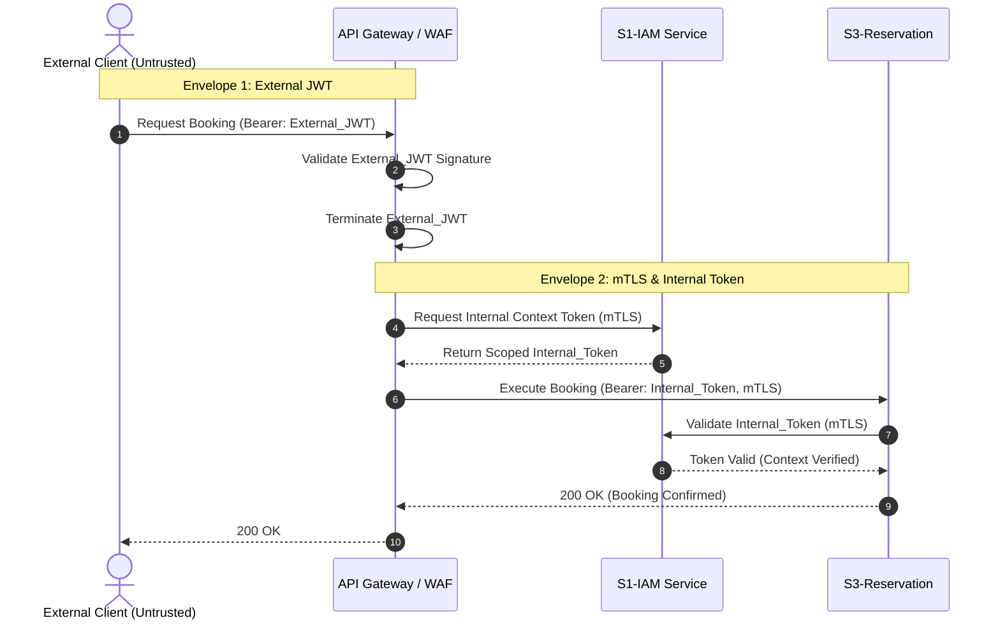

# Security Architecture Document

*SRIS — Sarathi Railway Information System*

*A Unified Railway Management Platform*

*Inspired by CRIS and IRCTC · Independent project*

> **Version:** 1.0 | **Date:** 2026-10-28 | **Document ID:** SRIS-P1-ARCH-010

| Field              | Value                                                             |
| ------------------ | ----------------------------------------------------------------- |
| Title              | Security Architecture Document                                    |
| Software           | SRIS                                                              |
| Software Full Form | Sarathi Railway Information System                                |
| Team Codename      | Project Sarathi                                                   |
| Document ID        | SRIS-P1-ARCH-010                                                  |
| Task               | Define the core security boundaries and defensive architecture    |
| Document Type      | Architecture Document                                             |
| Milestone          | Phase 1 Foundation                                                |
| Classification     | Internal                                                          |
| Version            | 1.0                                                               |
| Date               | 2026-10-28                                                        |
| Author             | Koushal Jha, Lead Architect                                       |
| Approved By        | Koushal Jha, Lead Architect                                       |
| Approval Date      | 2026-10-28                                                        |
| Supersedes         | None (first version)                                              |
| Related Documents  | See Appendix B                                                    |
| Affiliation        | Independent · Not affiliated with CRIS, IRCTC, or Indian Railways |

---

## 1. Introduction

### 1.1 Purpose
The purpose of this Security Architecture Document is to define the overarching security philosophy, defensive perimeters, and boundary protections for the SRIS platform (Phase 1). This document establishes the foundational security directives for KOSHIV VENTURES PRIVATED LIMITED, prioritizing defense-in-depth, strict isolation, and automated threat deterrence across all microservices, primarily driven by the **S1-IAM Service**.

### 1.2 Scope
This document covers:
*   The Double-Envelope Zero Trust networking model.
*   Frontend prohibition constraints regarding security logic.
*   Anti-Brute-Force and botnet mitigation strategies (Telescopic Time-Lock, Tarpitting, and Gaslighting).
*   Data privacy and the Crypto-Shredding architecture required for DPDP Act compliance.
*   High-level enterprise infrastructure hardening requirements (WAF, RLS, Encryption at Rest).

Detailed cryptographic signing, specific role matrices, and individual database schemas are deferred to Wave 3 (Detailed Design) `SEC-*` and `DATA-*` documents.

### 1.3 Audience
*   **Enterprise Security Engineers:** To validate the conceptual threat model and DPDP compliance strategy.
*   **DevOps Engineers:** To configure the API Gateway, mTLS meshes, and WAF rules.
*   **Backend Developers:** To implement the required middleware (Tarpitting, Crypto-shredding) within S1-IAM and other services.
*   **Lead Architect:** For baseline governance and approval.

---

## 2. Normative References and Terminology

### 2.1 Normative References
| Document ID | Title | Relevance |
|-------------|-------|-----------|
| `SRIS-P1-ARCH-001` | Microservices Identification | Establishes the bounded context for S1-IAM. |
| `SRIS-P1-REQ-004` | Software Requirements Specification | Defines the functional security constraints for the platform. |
| `DPDP Act 2023` | Digital Personal Data Protection Act | Legal framework governing the Right to Erasure implemented in Section 5. |

### 2.2 Terminology
*   **Crypto-Shredding:** The practice of deliberately deleting or destroying the cryptographic keys used to encrypt data, rendering the ciphertext permanently unreadable without deleting the physical database records.
*   **Tarpitting:** Deliberately delaying the server response to suspicious requests to exhaust the resources and time of automated botnets or brute-force scripts.
*   **Gaslighting (Security context):** Returning generic, non-actionable, or intentionally misleading error messages to attackers to prevent system reconnaissance and topology mapping.
*   **Telescopic Time-Lock:** An escalating account lockout protocol based on consecutive failures, independent of IP address.
*   **Double-Envelope Zero Trust:** An architecture where external credentials (Envelope 1) are verified and discarded at the edge, requiring internal services to use separate, context-scoped machine identities (Envelope 2) for communication.

---

## 3. Core Security Boundaries & Zero Trust Architecture

### 3.1 Frontend Prohibition
In SRIS, the frontend (e.g., React/Next.js SPA or mobile clients) is treated as fundamentally compromised and untrusted. 
*   **No Client-Side Security:** The frontend is strictly a presentation layer. It must not make independent security decisions. 
*   **Backend Enforcement:** All security validations—including Geo-fencing, Developer Mode detection, tampering checks, and role elevation—must occur exclusively at the API Gateway or within the backend microservices. The backend will never trust a claim solely because the frontend asserts it.

### 3.2 Double-Envelope Zero Trust Network
To prevent internal lateral movement in the event of an edge breach, SRIS implements a Double-Envelope Zero Trust model. The network does not grant implicit trust to any request, regardless of origin.

1.  **Envelope 1 (External Authentication):** The client application transmits the user's JWT to the API Gateway. The Gateway verifies the cryptographic signature of this external token.
2.  **Termination:** The API Gateway strictly terminates the external JWT. It is never forwarded into the internal service mesh.
3.  **Envelope 2 (Internal Identity via mTLS):** The Gateway (or the invoking internal service) establishes a mutually authenticated TLS (mTLS) connection with the target service (e.g., S1-IAM). A new, short-lived, context-scoped internal token is generated for the specific intra-service remote procedure call (RPC). 

If a threat actor compromises the API Gateway, they cannot simply replay external JWTs to bypass internal microservice boundaries.

### 3.3 Zero Trust Communication Flow

## 4. Authentication & Threat Mitigation Protocols

### 4.1 Account-Based Locking (Telescopic Time-Lock)
SRIS rejects traditional IP-based blocking as the primary defense against brute-force attacks. Given the prevalence of dynamic ISPs, Carrier-Grade NAT (CGNAT), and mobile networks, IP blocking risks denying service to legitimate users sharing the same public IP.

Instead, S1-IAM enforces a **Telescopic Time-Lock** based on the specific user account identity:
1.  **Attempts 1 to 3:** Standard cryptographic validation occurs (Argon2 hashing of the provided password against the database record).
2.  **Attempt 3 (Failed):** Upon the third consecutive failed attempt, the API Gateway's rate-limiting interceptor triggers an immediate 1-hour Account Lock managed in Redis, associated with the specific account identifier.
3.  **Attempt 4 (During Lock):** If any login request is received while the 1-hour lock is active, the request is rejected immediately, and the event is logged to the WORM audit trail. No cryptographic validation is performed during the lockout period.

### 4.2 Tarpitting & Gaslighting
To deter automated botnets, credential stuffing, and malicious actors (e.g., requests originating from known VPN exit nodes, rooted mobile devices, or clients with Developer Mode enabled), SRIS implements a combination of **Tarpitting** and **Gaslighting** at the backend.

*   **Tarpitting (Delay Injection):** When a request is flagged as malicious by the API Gateway or S1-IAM heuristics, the backend does not immediately return a `403 Forbidden` or `401 Unauthorized` response. Instead, the backend injects an artificial 15-second delay. During this time, the frontend displays a standard loading indicator. This intentionally exhausts the connection pool and execution time of automated attack scripts, making brute-force mathematically unfeasible.
*   **Gaslighting (Obfuscation):** After the tarpit delay expires, the system returns a generic, non-actionable error message (e.g., "Service temporarily unavailable" or "Invalid request parameters"). The system strictly avoids returning specific security denial codes that would allow an attacker to map the security topology or confirm the existence of a specific username.

---

## 5. Data Privacy & DPDP Compliance

### 5.1 Crypto-Shredding Architecture
To achieve strict compliance with the Digital Personal Data Protection (DPDP) Act of 2023, specifically the Right to Erasure, SRIS implements a **Crypto-Shredding** architecture. Standard "soft-delete" mechanisms (e.g., setting an `is_deleted` boolean flag in a database) are legally insufficient for PII destruction.

*   **Encryption Strategy:** All highly sensitive Personally Identifiable Information (PII) is encrypted at the application layer before being written to the database. Each user is assigned a unique cryptographic key, securely stored in the KMS Vault (managed by the Secrets Management Plan).
*   **Erasure Execution:** When a user revokes consent or requests account deletion, S1-IAM does not execute SQL `DELETE` commands across the distributed microservices (which would destroy referential integrity). Instead, S1-IAM permanently deletes the user's specific cryptographic key from the KMS Vault.
*   **Business Integrity Preservation:** Because the key is destroyed, all database records belonging to that user (such as historical PNRs in S3-Reservation) instantly become permanently anonymized ciphertext. The records remain physically present in the database to maintain statistical integrity and resolve financial or refund disputes, but the PII is irretrievably shredded, satisfying DPDP mandates.

---

## 6. Enterprise Infrastructure Hardening

### 6.1 Enterprise Context
SRIS is engineered as a high-availability, enterprise-grade product for **KOSHIV VENTURES PRIVATED LIMITED**. The infrastructure demands rigorous defense-in-depth to protect operational data and ensure continuous service availability.

### 6.2 Defense-in-Depth Mechanisms
1.  **Edge Layer (Nginx WAF):** A Web Application Firewall (WAF) operates at the Nginx edge layer, scrubbing all inbound traffic for OWASP Top 10 vulnerabilities (e.g., SQL injection, XSS payloads) before requests reach the internal API Gateway.
2.  **Database Layer (PostgreSQL RLS):** All PostgreSQL databases enforce strict Row-Level Security (RLS) policies. Even if a backend microservice is compromised and attempts to execute a broad `SELECT *` query, the database engine will only return rows explicitly associated with the context of the requesting internal token.
3.  **Storage Layer (Encryption at Rest):** All physical storage volumes containing operational data, databases, and backup archives are encrypted at rest using AES-256 encryption. Key management is strictly delegated to the centralized Secrets Management infrastructure.

## 7. Approval

| Role           | Name          | Decision | Date       |
| -------------- | ------------- | -------- | ---------- |
| Lead Architect | Koushal Jha   | Approved | 2026-10-28 |

---

## Revision History

| Version | Date       | Author      | Change           |
| ------- | ---------- | ----------- | ---------------- |
| 1.0     | 2026-10-28 | Koushal Jha | Initial release. |

---

## Appendix A: Not Applicable

Not applicable.

---

## Appendix B: Related Documents

### B.1 Directly Referenced Documents

| Seq  | Document ID      | Document Name                              | Wave | Pri | Tag     |
| ---- | ---------------- | ------------------------------------------ | ---- | --- | ------- |
| 2.1  | [SRIS-P1-ARCH-001](./SRIS-P1-ARCH-001_MicroservicesIdentification.md) | Microservices Identification               | 2    | P0  | UNBLOCK |
| 1.4  | [SRIS-P1-REQ-004](../wave-1-requirements/SRIS-P1-REQ-004_SoftwareRequirementsSpecificationSRS.md)  | Software Requirements Specification (SRS)  | 1    | P0  | UNBLOCK |

### B.2 Documents That Reference This Document

| Seq  | Document ID      | Document Name                                    | Why It References                                                              |
| ---- | ---------------- | ------------------------------------------------ | ------------------------------------------------------------------------------ |
| 3.44 | [SRIS-P1-SEC-006](../wave-3-detailed-design/SRIS-P1-SEC-006_DPDPActComplianceFrameworkPhase1Scoped.md)  | DPDP Act Compliance Framework (Phase 1 scoped)   | Implements the Crypto-Shredding architecture defined in this document.         |
| 3.39 | [SRIS-P1-SEC-001](../wave-3-detailed-design/SRIS-P1-SEC-001_AuthenticationAndAuthorizationDesign.md)  | Authentication and Authorization Design          | Detailed design of the Zero Trust and Time-Lock protocols defined here.        |

### B.3 Documents This Document Depends On (Upstream)

| Seq  | Document ID      | Document Name                              | Dependency Type |
| ---- | ---------------- | ------------------------------------------ | --------------- |
| 2.1  | [SRIS-P1-ARCH-001](./SRIS-P1-ARCH-001_MicroservicesIdentification.md) | Microservices Identification               | Hard            |
| 2.3  | [SRIS-P1-ARCH-003](./SRIS-P1-ARCH-003_SystemArchitectureDocument.md) | System Architecture Document               | Hard            |
| 1.4  | [SRIS-P1-REQ-004](../wave-1-requirements/SRIS-P1-REQ-004_SoftwareRequirementsSpecificationSRS.md)  | Software Requirements Specification (SRS)  | Hard            |

### B.4 Documents This Document Unblocks (Downstream)

| Seq  | Document ID      | Document Name                                    | Blocked Until |
| ---- | ---------------- | ------------------------------------------------ | ------------- |
| 3.44 | [SRIS-P1-SEC-006](../wave-3-detailed-design/SRIS-P1-SEC-006_DPDPActComplianceFrameworkPhase1Scoped.md)  | DPDP Act Compliance Framework (Phase 1 scoped)   | This approved |
| 3.39 | [SRIS-P1-SEC-001](../wave-3-detailed-design/SRIS-P1-SEC-001_AuthenticationAndAuthorizationDesign.md)  | Authentication and Authorization Design          | This approved |

### B.5 Master Documentation Index

The complete list of Phase 1 documents is in [SRIS-P1-GOV-001](../wave-0-project-foundation/SRIS-P1-GOV-001_DocumentationIndexAndNavigationMap.md) — Documentation Index and Navigation Map.

### B.6 External Reference Documents

| Title                   | Authority | Relevance                                                                 |
| ----------------------- | --------- | ------------------------------------------------------------------------- |
| Digital Personal Data Protection Act, 2023 | Government of India | Legal framework dictating Right to Erasure mandates handled via Crypto-Shredding. |

### B.7 Document Conventions

The conventions for Priority and Tag values are defined in Section 9 of [SRIS-P1-GOV-002](../wave-0-project-foundation/SRIS-P1-GOV-002_DocumentTemplateStandard.md) — Document Template Standard.