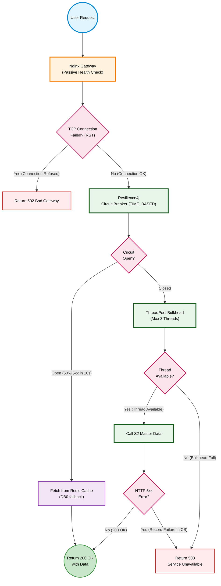
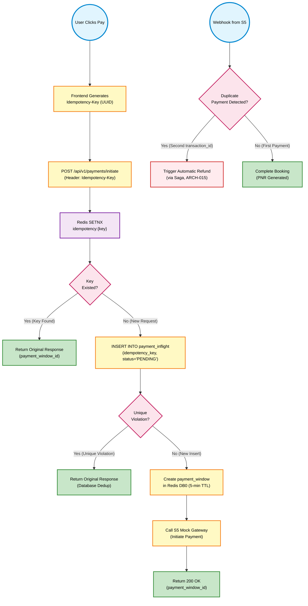

# Error Handling and Resilience Design

*SRIS — Sarathi Railway Information System*

*A Unified Railway Management Platform*

*Inspired by CRIS and IRCTC · Independent project*

> **Version:** 1.0 | **Date:** 2026-10-21 | **Document ID:** SRIS-P1-ARCH-011

| Field              | Value                                                             |
| ------------------ | ----------------------------------------------------------------- |
| Title              | Error Handling and Resilience Design                              |
| Software           | SRIS                                                              |
| Software Full Form | Sarathi Railway Information System                                |
| Team Codename      | Project Sarathi                                                   |
| Document ID        | SRIS-P1-ARCH-011                                                  |
| Task               | Define how the system fails gracefully and recovers from errors   |
| Document Type      | Architecture Document                                             |
| Milestone          | Phase 1 Foundation                                                |
| Classification     | Internal                                                          |
| Version            | 1.0                                                               |
| Date               | 2026-10-21                                                        |
| Author             | Koushal Jha, Lead Architect                                       |
| Approved By        | Koushal Jha, Lead Architect                                       |
| Approval Date      | 2026-10-21                                                        |
| Supersedes         | None (first version)                                              |
| Related Documents  | See Appendix B                                                    |
| Affiliation        | Independent · Not affiliated with CRIS, IRCTC, or Indian Railways |

---

## Table of Contents

1. [Introduction](#1-introduction)
   - [1.1 Purpose](#11-purpose)
   - [1.2 Scope](#12-scope)
   - [1.3 Audience](#13-audience)
   - [1.4 Terminology and Conventions](#14-terminology-and-conventions)
2. [The 8 Locked Resilience Rules](#2-the-8-locked-resilience-rules)
   - [2.1 Hybrid Circuit Breaker](#21-hybrid-circuit-breaker)
   - [2.2 Hybrid Bulkhead with Connection Bounds](#22-hybrid-bulkhead-with-connection-bounds)
   - [2.3 Idempotency and Retry Policy](#23-idempotency-and-retry-policy)
   - [2.4 Error-Rate-Based Circuit Breaking](#24-error-rate-based-circuit-breaking)
   - [2.5 Bounded DLQ with PostgreSQL Archival](#25-bounded-dlq-with-postgresql-archival)
   - [2.6 Financial Strictness on Fallbacks](#26-financial-strictness-on-fallbacks)
   - [2.7 Socket Disconnection and Query Timeout](#27-socket-disconnection-and-query-timeout)
   - [2.8 QoS Thread Pools and Kill Switch](#28-qos-thread-pools-and-kill-switch)
3. [The Hybrid Circuit Breaker and Bulkhead Flowchart](#3-the-hybrid-circuit-breaker-and-bulkhead-flowchart)
4. [The Idempotency and Retry Flowchart](#4-the-idempotency-and-retry-flowchart)
5. [The DLQ Archival and Kill Switch Flowchart](#5-the-dlq-archival-and-kill-switch-flowchart)
6. [Approval](#6-approval)

- [Revision History](#revision-history)
- [Appendix A: Not Applicable](#appendix-a-not-applicable)
- [Appendix B: Related Documents](#appendix-b-related-documents)

---

## 1. Introduction

### 1.1 Purpose

This document defines the exact failure handling and resilience patterns for SRIS. While the System Architecture ([SRIS-P1-ARCH-003](./SRIS-P1-ARCH-003_SystemArchitectureDocument.md) — System Architecture Document) defines the *containers* and the Service Interaction Design ([SRIS-P1-ARCH-009](./SRIS-P1-ARCH-009_ServiceInteractionAndCommunicationDesign.md) — Service Interaction and Communication Design) defines the *happy path*, this document defines what happens when things go wrong.

It answers the question: **"What happens when a service is slow, a network call fails, a database is locked, or a user double-clicks?"** It specifies the Circuit Breaker, Bulkhead, Retry, Timeout, DLQ, and Kill Switch patterns that every developer must implement in Week 3.

### 1.2 Scope

**In scope**

- The Hybrid Circuit Breaker (Nginx + Resilience4j/Opossum).
- The Hybrid Bulkhead with strict connection bounds.
- The Idempotency-Key retry policy and duplicate payment handling.
- The Error-Rate-Based Circuit Breaker (replacing latency-based tripping).
- The Bounded DLQ with PostgreSQL archival.
- Financial strictness on fallbacks (no stale fare).
- The TCP socket disconnection detection and JDBC query timeout.
- The QoS thread pools and the Kill Switch with TTL.

**Out of scope**

- The concurrency locking primitives, which belong to [SRIS-P1-ARCH-014](./SRIS-P1-ARCH-014_DistributedConcurrencyAndLockingStrategy.md) — Distributed Concurrency and Locking Strategy.
- The Saga orchestration logic, which belongs to [SRIS-P1-ARCH-015](./SRIS-P1-ARCH-015_DistributedTransactionAndSagaPatternDesign.md) — Distributed Transaction and Saga Pattern Design.
- The exact error codes and RFC 7807 payload shapes, which belong to [SRIS-P1-API-006](./SRIS-P1-API-006_APIErrorCodeCatalog.md) — API Error Code Catalog.
- The Grafana dashboard configuration, which belongs to [SRIS-P1-ARCH-012](./SRIS-P1-ARCH-012_ObservabilityAndMonitoringDesignOTelW3C.md) — Observability and Monitoring Design (OTel/W3C).

### 1.3 Audience

- **Lead Architect:** maintains this document and is the authority on resilience changes.
- **Backend developers:** must implement every pattern described here. This is the Week 3 playbook.
- **DevOps engineer:** configures Nginx, Prometheus Pushgateway, and the Load Balancer health checks per Section 2.
- **QA engineers:** designs chaos tests based on the failure paths described here.
- **Project supervisor and evaluator:** verifies that failure handling is mathematically sound.

### 1.4 Terminology and Conventions

Every term in this document has the meaning recorded in [SRIS-P1-REQ-001](../wave-1-requirements/SRIS-P1-REQ-001_GlossaryAndDomainDictionary.md) — Glossary and Domain Dictionary. The terms below carry the most weight in this document.

| Term | Meaning |
| :--- | :--- |
| Circuit Breaker | A pattern that stops calling a failing dependency after a threshold is reached. |
| Bulkhead | A pattern that isolates resources (threads or semaphores) per dependency. |
| Idempotency Key | A unique identifier that ensures a repeated request has the same effect as a single request. |
| Sliding Window | A time-based or count-based window used by the Circuit Breaker to calculate failure rates. |
| DLQ | Dead Letter Queue. A holding area for messages that failed all retries. |
| QoS | Quality of Service. Priority-based resource allocation. |
| Kill Switch | An administrative override to force a circuit breaker state. |
| TCP RST | TCP Reset. A packet that signals a dropped connection. |
| UPSERT | An INSERT that updates on conflict (`ON CONFLICT DO NOTHING`). |

This document follows the standards below.

- [SRIS-P1-GOV-002](../wave-0-project-foundation/SRIS-P1-GOV-002_DocumentTemplateStandard.md) — Document Template Standard.
- [SRIS-P1-GOV-003](../wave-0-project-foundation/SRIS-P1-GOV-003_DocumentIDAndCategoryScheme.md) — Document ID and Category Scheme.
- [SRIS-P1-GOV-004](../wave-0-project-foundation/SRIS-P1-GOV-004_DocumentCrossReferenceStandard.md) — Document Cross-Reference Standard.

---

## 2. The 8 Locked Resilience Rules

To survive the 5.1 GB constraint and guarantee graceful failure handling, the following 8 rules are strictly mandated. Every developer must implement these in Week 3. Any deviation requires a formal revision of this document.

### 2.1 Hybrid Circuit Breaker

- **Rule:** Implement a two-layer Circuit Breaker. Nginx handles network-level failures. Resilience4j (Java) and Opossum (Node.js) handle semantic failures.
- **Nginx Configuration:**
  - `max_fails=3` (TCP connection failures only)
  - `fail_timeout=10s`
  - **Explicitly ignore HTTP 5xx responses** for Nginx passive health checks. Nginx must never unilaterally sever a route based on application-level errors.
- **Resilience4j / Opossum Configuration:**
  - **Sliding Window:** `TIME_BASED` (not `COUNT_BASED`). Duration: 10 seconds.
  - **Failure Rate Threshold:** 50%.
  - **Minimum Calls:** 10.
  - **Open State Duration:** 30 seconds.
  - **Half-Open State:** 3 test calls.
  - **Trips On:** HTTP 5xx errors and connection timeouts. **Never trips on latency.**
- **Reason:** Gemini's review revealed that Nginx and Resilience4j would fight each other if both handled HTTP 5xx. Nginx must only respond to TCP failures. Resilience4j must be the sole arbiter of semantic errors. `TIME_BASED` windows are mandatory because `COUNT_BASED` windows in low-traffic periods would fail to close the circuit promptly.

### 2.2 Hybrid Bulkhead with Connection Bounds

- **Rule:** Isolate concurrent calls per dependency. Java uses ThreadPool. Node.js uses Semaphore. Both must be strictly bounded.
- **Java (Spring Boot - S3):**
  - **Max Concurrent Calls:** `HikariCP_Pool_Size - 2`. Since HikariCP is capped at 5 connections, the ThreadPool Bulkhead max is **3 threads**.
  - **Background jobs** (Outbox Relay, SagaRecoveryJob) must NEVER share the same thread pool as synchronous API calls.
- **Node.js (S1, S4, S5, S6):**
  - **Max Concurrent Calls:** 20 per dependency.
  - **Rejection Behaviour:** When the semaphore is saturated, the service MUST immediately close the TCP socket or return `503 Service Unavailable` **without allocating memory for the request body**.
- **Reason:** Gemini revealed that a ThreadPool size of 10 with HikariCP size of 5 causes thread starvation and freezes the service. The (HikariCP - 2) rule guarantees that external calls can never exhaust the database connection pool. Node.js must reject immediately to prevent V8 heap OOM accumulation.

### 2.3 Idempotency and Retry Policy

- **Rule:** All state-changing requests (POST) must carry an `Idempotency-Key` header. Retries are allowed ONLY with idempotency.
- **Implementation:**
  - Frontend generates UUID per request.
  - Backend checks Redis `SETNX` (fast-fail pre-filter) and PostgreSQL unique constraint (source of truth).
  - Duplicate requests return the original response.
  - Duplicate payments (two transaction_ids) trigger automatic refund via the Saga (ARCH-015).
- **Reason:** Blind retries would cause double-bookings and double-charges. Idempotency-Key + Database Unique Constraint guarantees exact-once processing.

### 2.4 Error-Rate-Based Circuit Breaking

- **Rule:** The Circuit Breaker trips on **error rates only**, never on latency.
- **Threshold:** 50% of calls returning HTTP 5xx within a 10-second sliding window.
- **Latency Tolerance:** Legitimate slow traffic during Tatkal-like surges does NOT trip the circuit.
- **Fallback for Read Operations:** Return cached data from Redis.
- **Fallback for Financial Writes:** Return `503 Service Unavailable`. **Never use stale fare.**
- **Reason:** Gemini revealed that latency-based tripping causes false positives during peak load. Error-rate-based tripping is mathematically immune to natural CPU scheduling delays.

### 2.5 Bounded DLQ with PostgreSQL Archival

- **Rule:** The Dead Letter Queue MUST be bounded. Infinite retries are strictly forbidden.
- **Redis DLQ Stream:** `MAXLEN ~ 1000` (caps memory at approximately 3 MB).
- **Archival Cron Job:**
  - Runs every 1 hour.
  - Queries `sris.dlq_payment` for messages older than 24 hours.
  - Inserts into PostgreSQL `dead_letter_archive` table with `ON CONFLICT DO NOTHING` (UPSERT).
  - After successful INSERT, sends `XDEL` to remove from Redis.
  - Pushes `sris_dlq_archival_last_success_timestamp` to Prometheus Pushgateway.
- **Alert Rule:** If `sris_dlq_archival_last_success_timestamp` is older than 25 hours, fire a critical Grafana alert.
- **Reason:** Gemini revealed that infinite retries in a 128 MB Redis would cause OOM. The `ON CONFLICT DO NOTHING` clause prevents duplicate archival if the cron crashes between INSERT and XDEL.

### 2.6 Financial Strictness on Fallbacks

- **Rule:** Circuit Breaker fallbacks for **financial writes** (fare re-quotes, payment initiation) MUST return `503 Service Unavailable`. No stale cached data is ever used for financial transactions.
- **Only read-only operations** (train search, PNR retrieval) may use Redis cache fallback.
- **Reason:** Gemini revealed that serving a stale fare from Redis cache would cause ledger reconciliation failures. This is a compliance violation.

### 2.7 Socket Disconnection and Query Timeout

- **Rule:** Backend must detect premature client disconnection and release resources immediately.
- **Spring Boot Configuration:**
  - Set `spring.transaction.default-timeout=2` at the JDBC level.
  - Monitor TCP socket state. If the client disconnects, interrupt the executing Java thread gracefully.
- **Reason:** Gemini revealed that if a mobile user enters a tunnel, the socket silently dies without sending a TCP RST. Relying only on socket disconnection detection is insufficient. The JDBC query timeout guarantees ghost threads are killed even if the TCP socket hangs silently.

### 2.8 QoS Thread Pools and Kill Switch

- **Rule:** Critical operations must have priority over background operations. Administrators must have manual override capability.
- **QoS Thread Pools:**
  - **Critical Pool:** Saga compensating transactions (refunds) and booking confirmation. Reserved HikariCP connections.
  - **Background Pool:** Notifications (S6), audit logs, DLQ archival. Separate threads, separate connections.
  - **No sharing** between the pools.
- **Kill Switch:**
  - Spring Boot Actuator endpoints: `/actuator/circuitbreakers`
  - Exposed ONLY via Tailscale VPN.
  - **Requires a `ttl_seconds` parameter (max 30 minutes).**
  - After TTL expires, the circuit automatically reverts to standard error-rate-based evaluation.
  - Allowed states: `DISABLED` (always closed, always allows traffic), `FORCED_OPEN` (always fails fast).
- **Load Balancer Health Check:**
  - The Load Balancer MUST query `/health/liveness` (basic process health).
  - The Load Balancer MUST NOT query `/health` (which includes circuit breaker state). Otherwise, an open circuit would mark the pod as "dead" and the Load Balancer would kill the only container.
- **Reason:** Gemini revealed that without QoS, critical refunds are delayed by low-priority notifications. Without a Kill Switch TTL, an admin could leave the system in an "open" state indefinitely. Without proper LB health checks, a graceful degradation would become a total outage.

---

## 3. The Hybrid Circuit Breaker and Bulkhead Flowchart

The diagram below illustrates the exact decision logic executed by the Nginx Gateway and the Application layer (S4 Search BFF) when calling a downstream dependency (e.g., S2 Master Data).

It proves the **two-layer Circuit Breaker plus a bounded Bulkhead**:

1. **Nginx (Layer 1):** Only trips on TCP connection failures (not HTTP 5xx).
2. **Resilience4j (Layer 2):** The sole arbiter of HTTP 5xx errors. Uses a `TIME_BASED` sliding window.
3. **Bulkhead (Layer 3):** Strictly bounded to `HikariCP_Pool_Size - 2` threads. If saturated, it rejects immediately.

---

## 4. The Idempotency and Retry Flowchart

The diagram below illustrates the exact decision logic executed by the Payment Initiation endpoint (S3) when a user clicks "Pay" and the request is retried.

It proves the **Idempotency-Key** mechanism:

1. The frontend sends a unique UUID with every request.
2. The backend uses Redis SETNX as a fast pre-filter.
3. The backend uses a PostgreSQL unique constraint as the absolute source of truth.
4. Duplicate payments (two separate transaction IDs) are detected and automatically refunded.

---

## 5. The DLQ Archival and Kill Switch Flowchart

The diagram below illustrates how the Kill Switch administrative override and the DLQ archival pipeline interact as one causal chain. The Kill Switch forces a circuit open; downstream calls then fail fast; those failed messages accumulate in a bounded DLQ; the archival cron drains them to PostgreSQL; and in parallel the TTL counts down until the circuit auto-reverts to standard error-rate evaluation.

It proves three properties:

1. Every Kill Switch override is TTL-bounded (maximum 30 minutes) and auto-reverts, so no administrative action can leave the system permanently degraded.
2. Failed messages produced during any circuit-open window are captured in a bounded Redis Stream (`MAXLEN ~ 1000`, approximately 3 MB), and archival to PostgreSQL is idempotent (`ON CONFLICT DO NOTHING`), so a cron crash between `INSERT` and `XDEL` cannot produce duplicate rows.
3. The archival pipeline reports its own liveness through a Prometheus Pushgateway timestamp; a staleness of more than 25 hours triggers a critical Grafana alert, so a silently dead cron job is caught within one alert cycle.

```mermaid
%%{init: {
  "flowchart": {
    "nodeSpacing": 55,
    "rankSpacing": 70,
    "padding": 20,
    "curve": "basis",
    "htmlLabels": true
  },
  "themeVariables": {
    "fontSize": "13px",
    "fontFamily": "Segoe UI, Arial, sans-serif"
  }
}}%%
flowchart TD
    classDef startEnd fill:#E1F5FE,stroke:#0288D1,stroke-width:3px,color:#000;
    classDef gateway fill:#FFF3E0,stroke:#F57C00,stroke-width:3px,color:#000;
    classDef action fill:#FFF9C4,stroke:#F57F17,stroke-width:2px,color:#000;
    classDef decision fill:#FCE4EC,stroke:#C2185B,stroke-width:2px,color:#000;
    classDef success fill:#C8E6C9,stroke:#388E3C,stroke-width:2px,color:#000;
    classDef fail fill:#FFEBEE,stroke:#D32F2F,stroke-width:2px,color:#000;
    classDef db fill:#F3E5F5,stroke:#7B1FA2,stroke-width:2px,color:#000;

    Admin(("Super Admin")):::startEnd
    Vpn["Tailscale VPN<br/>private overlay"]:::gateway
    Post["POST /actuator/circuitbreakers/{name}<br/>state=FORCED_OPEN<br/>ttl_seconds=1800"]:::action
    TtlValid{"0 < ttl_seconds<br/>≤ 1800?"}:::decision
    Reject["Return 400<br/>Bad Request"]:::fail
    Forced["Circuit FORCED_OPEN<br/>(max 30 minutes)"]:::fail

    FailFast["Downstream calls fail fast<br/>HTTP 503 returned to clients"]:::fail
    Exhaust["Messages exhaust<br/>all retry attempts"]:::fail
    Xadd["XADD sris.dlq_payment<br/>MAXLEN ~ 1000"]:::action
    RedisDlq[("Redis Stream<br/>sris.dlq_payment<br/>~3 MB cap")]:::db
    Cron["Hourly Python Cron<br/>SELECT messages older than 24h"]:::action
    Upsert["INSERT INTO dead_letter_archive<br/>ON CONFLICT DO NOTHING"]:::action
    Pg[("PostgreSQL<br/>dead_letter_archive")]:::db
    Xdel["XDEL from Redis<br/>frees stream capacity"]:::action
    Push["Pushgateway:<br/>sris_dlq_archival_last_success_timestamp"]:::action
    Stale{"Timestamp<br/>older than 25h?"}:::decision
    Alert["Grafana Critical Alert"]:::fail
    Healthy["DLQ Archival Healthy"]:::success

    TtlCheck{"TTL<br/>Expired?"}:::decision
    Revert["Auto-revert to<br/>Error-Rate Evaluation"]:::success
    Resume["Normal traffic resumed"]:::success

    Admin --> Vpn
    Vpn --> Post
    Post --> TtlValid
    TtlValid -->|"Invalid"| Reject
    TtlValid -->|"Valid"| Forced

    Forced -->|"while forced open"| FailFast
    FailFast --> Exhaust
    Exhaust --> Xadd
    Xadd --> RedisDlq
    RedisDlq --> Cron
    Cron --> Upsert
    Upsert --> Pg
    Pg --> Xdel
    Xdel --> Push
    Upsert --> Push
    Push --> Stale
    Stale -->|"Yes"| Alert
    Stale -->|"No"| Healthy

    Forced -.->|"parallel: TTL countdown"| TtlCheck
    TtlCheck -->|"No (still forced)"| Forced
    TtlCheck -->|"Yes"| Revert
    Revert --> Resume
```

---

## 6. Approval

| Role           | Name        | Decision | Date       |
| -------------- | ----------- | -------- | ---------- |
| Lead Architect | Koushal Jha | Approved | 2026-10-21 |

---

## Revision History

| Version | Date       | Author      | Change           |
| ------- | ---------- | ----------- | ---------------- |
| 1.0     | 2026-10-21 | Koushal Jha | Initial release. |

---

## Appendix A: Not Applicable

Not applicable.

---

## Appendix B: Related Documents

### B.1 Directly Referenced Documents

| Seq  | Document ID                                                                                                    | Document Name                                     | Wave | Pri | Tag     |
| ---- | -------------------------------------------------------------------------------------------------------------- | ------------------------------------------------- | ---- | --- | ------- |
| 0.1  | [SRIS-P1-GOV-002](../wave-0-project-foundation/SRIS-P1-GOV-002_DocumentTemplateStandard.md)                     | Document Template Standard                        | 0    | P0  | UNBLOCK |
| 0.2  | [SRIS-P1-GOV-003](../wave-0-project-foundation/SRIS-P1-GOV-003_DocumentIDAndCategoryScheme.md)                  | Document ID and Category Scheme                   | 0    | P1  | UNBLOCK |
| 0.3  | [SRIS-P1-GOV-004](../wave-0-project-foundation/SRIS-P1-GOV-004_DocumentCrossReferenceStandard.md)               | Document Cross-Reference Standard                 | 0    | P1  | UNBLOCK |
| 1.1  | [SRIS-P1-REQ-001](../wave-1-requirements/SRIS-P1-REQ-001_GlossaryAndDomainDictionary.md)                        | Glossary and Domain Dictionary                    | 1    | P0  | UNBLOCK |
| 2.3  | [SRIS-P1-ARCH-003](./SRIS-P1-ARCH-003_SystemArchitectureDocument.md)                                            | System Architecture Document                      | 2    | P0  | UNBLOCK |
| 2.9  | [SRIS-P1-ARCH-009](./SRIS-P1-ARCH-009_ServiceInteractionAndCommunicationDesign.md)                              | Service Interaction and Communication Design      | 2    | P0  | UNBLOCK |
| 2.12 | [SRIS-P1-ARCH-012](./SRIS-P1-ARCH-012_ObservabilityAndMonitoringDesignOTelW3C.md)                               | Observability and Monitoring Design (OTel/W3C)    | 2    | P0  | UNBLOCK |
| 2.14 | [SRIS-P1-ARCH-014](./SRIS-P1-ARCH-014_DistributedConcurrencyAndLockingStrategy.md)                              | Distributed Concurrency and Locking Strategy      | 2    | P0  | UNBLOCK |
| 2.15 | [SRIS-P1-ARCH-015](./SRIS-P1-ARCH-015_DistributedTransactionAndSagaPatternDesign.md)                            | Distributed Transaction and Saga Pattern Design   | 2    | P0  | UNBLOCK |
| 3.19 | [SRIS-P1-API-006](../wave-3-detailed-design/SRIS-P1-API-006_APIErrorCodeCatalog.md)                             | API Error Code Catalog                            | 3    | P1  | FOLLOW  |

### B.2 Documents That Reference This Document

| Seq  | Document ID                                                                                    | Document Name                                | Why It References                                                                 |
| ---- | ---------------------------------------------------------------------------------------------- | -------------------------------------------- | --------------------------------------------------------------------------------- |
| 2.12 | [SRIS-P1-ARCH-012](./SRIS-P1-ARCH-012_ObservabilityAndMonitoringDesignOTelW3C.md)                   | Observability and Monitoring Design (OTel/W3C) | Uses the circuit breaker, bulkhead, and DLQ metrics defined here for Grafana panels and alerting rules. |
| 3.14 | [SRIS-P1-API-001](../wave-3-detailed-design/SRIS-P1-API-001_APIContractDocumentOpenAPI.md)           | API Contract Document (OpenAPI)              | Defines the 503 fallback response shape required by Section 2.4 and Section 2.6.  |
| 3.18 | [SRIS-P1-API-005](../wave-3-detailed-design/SRIS-P1-API-005_IdempotencyAndRetryPolicySpecification.md) | Idempotency and Retry Policy Specification   | Uses the Idempotency-Key retry policy from Section 2.3 and the DLQ retry constraints from Section 2.5. |
| 3.19 | [SRIS-P1-API-006](../wave-3-detailed-design/SRIS-P1-API-006_APIErrorCodeCatalog.md)                 | API Error Code Catalog                       | Defines the error codes emitted by circuit breaker fallbacks and bulkhead rejections. |
| 4.3  | [SRIS-P1-TEST-003](../wave-4-testing/SRIS-P1-TEST-003_TestCasesFunctional.md)                        | Test Cases (Functional)                      | Designs chaos tests for circuit breaker, bulkhead saturation, and DLQ archival based on the failure paths here. |
| 5.1  | [SRIS-P1-INF-001](../wave-5-devops-operations/SRIS-P1-INF-001_InfrastructureAndTechnologyDocument.md) | Infrastructure and Technology Document       | Configures the Nginx passive health checks, HikariCP pool bounds, Prometheus Pushgateway, Tailscale VPN, and Load Balancer health-check rules specified in Sections 2.1, 2.2, 2.5, and 2.8. |

### B.3 Documents This Document Depends On (Upstream)

| Seq  | Document ID                                                                                                     | Document Name                                   | Dependency Type |
| ---- | --------------------------------------------------------------------------------------------------------------- | ----------------------------------------------- | --------------- |
| 0.1  | [SRIS-P1-GOV-002](../wave-0-project-foundation/SRIS-P1-GOV-002_DocumentTemplateStandard.md)                      | Document Template Standard                      | Hard            |
| 0.2  | [SRIS-P1-GOV-003](../wave-0-project-foundation/SRIS-P1-GOV-003_DocumentIDAndCategoryScheme.md)                   | Document ID and Category Scheme                 | Hard            |
| 0.3  | [SRIS-P1-GOV-004](../wave-0-project-foundation/SRIS-P1-GOV-004_DocumentCrossReferenceStandard.md)                | Document Cross-Reference Standard               | Hard            |
| 1.1  | [SRIS-P1-REQ-001](../wave-1-requirements/SRIS-P1-REQ-001_GlossaryAndDomainDictionary.md)                         | Glossary and Domain Dictionary                  | Hard            |
| 2.1  | [SRIS-P1-ARCH-001](./SRIS-P1-ARCH-001_MicroservicesIdentification.md)                                             | Microservices Identification                    | Hard            |
| 2.2  | [SRIS-P1-ARCH-002](./SRIS-P1-ARCH-002_ArchitecturePrinciples.md)                                                  | Architecture Principles                         | Hard            |
| 2.3  | [SRIS-P1-ARCH-003](./SRIS-P1-ARCH-003_SystemArchitectureDocument.md)                                              | System Architecture Document                    | Hard            |
| 2.5  | [SRIS-P1-ARCH-005](./SRIS-P1-ARCH-005_DomainModelDocument.md)                                                     | Domain Model Document                           | Soft            |
| 2.8  | [SRIS-P1-ARCH-008](./SRIS-P1-ARCH-008_TechnologyStackADR.md)                                                      | Technology Stack ADR                            | Hard            |
| 2.9  | [SRIS-P1-ARCH-009](./SRIS-P1-ARCH-009_ServiceInteractionAndCommunicationDesign.md)                                | Service Interaction and Communication Design    | Hard            |
| 2.14 | [SRIS-P1-ARCH-014](./SRIS-P1-ARCH-014_DistributedConcurrencyAndLockingStrategy.md)                                | Distributed Concurrency and Locking Strategy    | Hard            |
| 2.15 | [SRIS-P1-ARCH-015](./SRIS-P1-ARCH-015_DistributedTransactionAndSagaPatternDesign.md)                              | Distributed Transaction and Saga Pattern Design | Hard            |

### B.4 Documents This Document Unblocks (Downstream)

| Seq  | Document ID                                                                                                     | Document Name                                   | Blocked Until |
| ---- | --------------------------------------------------------------------------------------------------------------- | ----------------------------------------------- | ------------- |
| 2.12 | [SRIS-P1-ARCH-012](./SRIS-P1-ARCH-012_ObservabilityAndMonitoringDesignOTelW3C.md)                                | Observability and Monitoring Design (OTel/W3C)  | This approved |
| 3.14 | [SRIS-P1-API-001](../wave-3-detailed-design/SRIS-P1-API-001_APIContractDocumentOpenAPI.md)                        | API Contract Document (OpenAPI)                 | This approved |
| 3.18 | [SRIS-P1-API-005](../wave-3-detailed-design/SRIS-P1-API-005_IdempotencyAndRetryPolicySpecification.md)            | Idempotency and Retry Policy Specification      | This approved |
| 3.19 | [SRIS-P1-API-006](../wave-3-detailed-design/SRIS-P1-API-006_APIErrorCodeCatalog.md)                               | API Error Code Catalog                          | This approved |
| 4.3  | [SRIS-P1-TEST-003](../wave-4-testing/SRIS-P1-TEST-003_TestCasesFunctional.md)                                     | Test Cases (Functional)                         | This approved |
| 5.1  | [SRIS-P1-INF-001](../wave-5-devops-operations/SRIS-P1-INF-001_InfrastructureAndTechnologyDocument.md)             | Infrastructure and Technology Document          | This approved |

### B.5 Master Documentation Index

The complete list of Phase 1 documents is in [SRIS-P1-GOV-001](../wave-0-project-foundation/SRIS-P1-GOV-001_DocumentationIndexAndNavigationMap.md) — Documentation Index and Navigation Map.

### B.6 External Reference Documents

| Reference Type | Where It Is Documented                                                                                                                                                                                                                                     |
| -------------- | ---------------------------------------------------------------------------------------------------------------------------------------------------------------------------------------------------------------------------------------------------------- |
| Book           | Nygard, M. "Release It!" Pragmatic Bookshelf, 2nd edition, 2018. Referenced for the Circuit Breaker and Bulkhead patterns applied in Sections 2.1 and 2.2.                                                                                              |
| Book           | Richardson, Chris. "Microservices Patterns." Manning Publications, 2018. Referenced for the Idempotency-Key pattern in Section 2.3 and the bounded DLQ archival pattern in Section 2.5.                                                                  |
| Standard       | RFC 7807 — Problem Details for HTTP APIs, IETF. Referenced for the 503 fallback response shape mandated in Sections 2.4 and 2.6.                                                                                                                          |

### B.7 Document Conventions

The conventions for Priority and Tag values are defined in [Section 9](../wave-0-project-foundation/SRIS-P1-GOV-002_DocumentTemplateStandard.md#9-vocabulary-standards) of [SRIS-P1-GOV-002](../wave-0-project-foundation/SRIS-P1-GOV-002_DocumentTemplateStandard.md) — Document Template Standard.