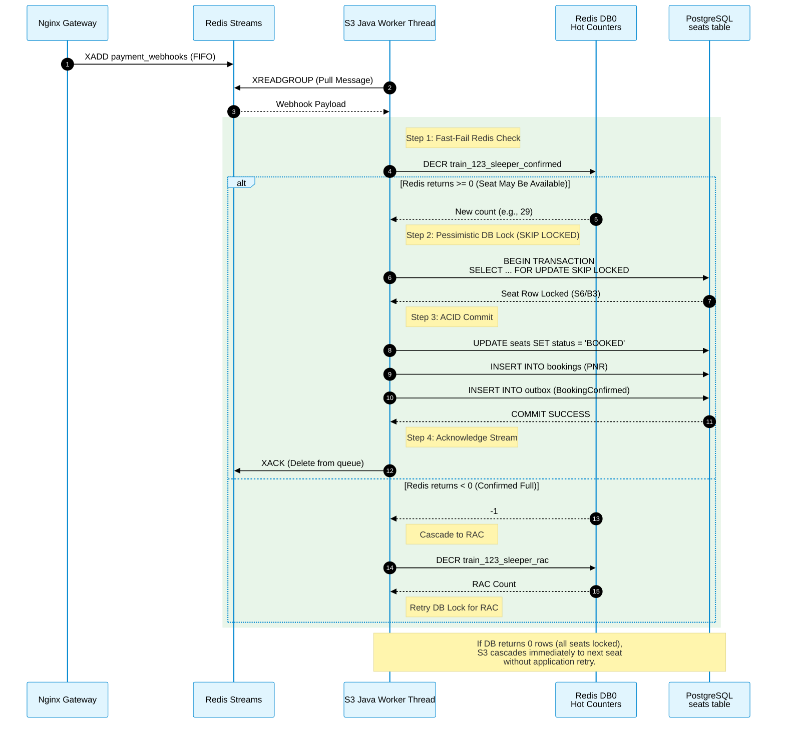
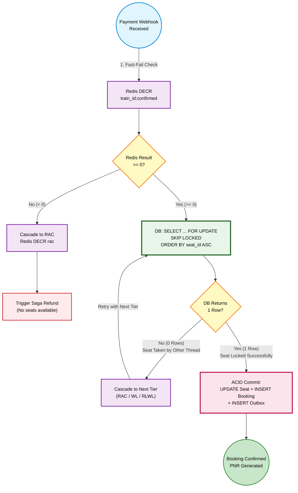

<div align="center">


</div>

# Distributed Concurrency and Locking Strategy

*SRIS — Sarathi Railway Information System*

*A Unified Railway Management Platform*

*Inspired by CRIS and IRCTC · Independent project*

> **Version:** 1.0 | **Date:** 2026-10-21 | **Document ID:** SRIS-P1-ARCH-014

| Field              | Value                                                             |
| ------------------ | ----------------------------------------------------------------- |
| Title              | Distributed Concurrency and Locking Strategy                     |
| Software           | SRIS                                                              |
| Software Full Form | Sarathi Railway Information System                                |
| Team Codename      | Project Sarathi                                                   |
| Document ID        | SRIS-P1-ARCH-014                                                  |
| Task               | Define how the system prevents race conditions and double-booking |
| Document Type      | Architecture Document                                             |
| Milestone          | Phase 1 Foundation                                                |
| Classification     | Internal                                                          |
| Version            | 1.0                                                               |
| Date               | 2026-10-21                                                        |
| Author             | Koushal Jha, Lead Architect                                       |
| Approved By        | Koushal Jha, Lead Architect                                       |
| Approval Date      | 2026-10-21                                                        |
| Supersedes         | None (first version)                                              |
| Related Documents  | See Appendix B                                                    |
| Affiliation        | Independent · Not affiliated with CRIS, IRCTC, or Indian Railways |

---

## Table of Contents

1. [Introduction](#1-introduction)
   - [1.1 Purpose](#11-purpose)
   - [1.2 Scope](#12-scope)
   - [1.3 Audience](#13-audience)
   - [1.4 Terminology and Conventions](#14-terminology-and-conventions)
2. [The 8 Locked Concurrency Rules](#2-the-8-locked-concurrency-rules)
   - [2.1 Pessimistic Seat Discovery (SKIP LOCKED)](#21-pessimistic-seat-discovery-skip-locked)
   - [2.2 Ordered Lock Acquisition](#22-ordered-lock-acquisition)
   - [2.3 Atomic Redis Commands](#23-atomic-redis-commands)
   - [2.4 Event-Driven Seat Release + TTL Sweeper](#24-event-driven-seat-release--ttl-sweeper)
   - [2.5 Optimistic Version Column for Booking State](#25-optimistic-version-column-for-booking-state)
   - [2.6 Strict Session Timeout Gate](#26-strict-session-timeout-gate)
   - [2.7 Redis DB0/DB1 Isolation](#27-redis-db0db1-isolation)
   - [2.8 No Global Reconciliation](#28-no-global-reconciliation)
3. [Seat Allocation Sequence](#3-seat-allocation-sequence)
4. [Concurrency Control Flowchart](#4-concurrency-control-flowchart)
5. [Concurrency at Scale (Phase 2 Roadmap)](#5-concurrency-at-scale-phase-2-roadmap)
6. [Approval](#6-approval)

- [Revision History](#revision-history)
- [Appendix A: Not Applicable](#appendix-a-not-applicable)
- [Appendix B: Related Documents](#appendix-b-related-documents)

---

## 1. Introduction

### 1.1 Purpose

This document defines the exact concurrency and locking mechanisms used by the SRIS Phase 1 architecture to guarantee that a seat is never sold twice. 

Under the stress of a railway booking system (e.g., 700 users clicking "Pay" at the exact same millisecond for the same train), multiple threads will attempt to modify the same database rows. Without a mathematically sound locking strategy, this leads to race conditions, retry storms, deadlocks, and ultimately system crashes (Exit Code 137). 

This document is the definitive rulebook. It explains why we use `SKIP LOCKED` instead of naive atomic updates, why we ban global polling, and how we prevent deadlocks without starving the connection pool. It is written so that any developer in Phase 2 can understand exactly how to handle concurrent writes.

### 1.2 Scope

**In scope**

- The pessimistic seat discovery mechanism (`SELECT ... FOR UPDATE SKIP LOCKED`).
- The deadlock-prevention rule (ordered lock acquisition).
- The Redis atomic operations for inventory counters.
- The event-driven seat release and its TTL sweeper backstop.
- The optimistic version column for booking state transitions.
- The 60-second session expiry gate.
- The Redis DB0/DB1 isolation for CQRS.
- The rationale for eradicating the global reconciliation job.
- The Phase 2 scaling roadmap (read replicas, partitioning, WAF).

**Out of scope**

- The physical deployment topology, which belongs to [SRIS-P1-ARCH-003](./SRIS-P1-ARCH-003_SystemArchitectureDocument.md) — System Architecture Document.
- The exact database indexes and constraints, which belong to [SRIS-P1-DATA-006](./SRIS-P1-DATA-006_IndexAndConstraintSpecification.md) — Index and Constraint Specification.
- The Saga Orchestration logic, which belongs to [SRIS-P1-ARCH-015](./SRIS-P1-ARCH-015_DistributedTransactionAndSagaPatternDesign.md) — Distributed Transaction and Saga Pattern Design.
- The full WAF/DDoS strategy, which belongs to [SRIS-P1-SEC-004](./SRIS-P1-SEC-004_ThreatModel.md) — Threat Model.

### 1.3 Audience

- **Lead Architect:** maintains this document and is the authority on concurrency changes.
- **Backend developers:** must implement the exact SQL patterns and locking rules defined here.
- **Database developers:** use the `SKIP LOCKED` and partial-index patterns described in Sections 2.1, 2.2, and 2.4.
- **QA engineers:** use the scenarios described here to design concurrency tests.
- **Project supervisor and evaluator:** verifies that the concurrency model is mathematically sound.

### 1.4 Terminology and Conventions

Every term in this document has the meaning recorded in [SRIS-P1-REQ-001](../wave-1-requirements/SRIS-P1-REQ-001_GlossaryAndDomainDictionary.md) — Glossary and Domain Dictionary. The terms below carry the most weight in this document.

| Term | Meaning |
| :--- | :--- |
| SKIP LOCKED | A PostgreSQL clause that bypasses rows locked by other transactions without waiting. |
| Retry Storm | A phenomenon where multiple threads retry a failed atomic update simultaneously, causing cascading load. |
| Deadlock | A state where two or more transactions wait indefinitely for locks held by each other. |
| TTL Sweeper | A background job that periodically reclaims resources (e.g., seats) whose hold has expired. |
| Partial Index | A PostgreSQL index that only indexes a subset of rows (e.g., `WHERE status = 'HELD'`), saving memory. |
| TOCTOU | Time-of-Check to Time-of-Use. A race condition where state changes between check and use. |
| Optimistic Locking | A concurrency strategy that checks for conflicts at write time rather than locking upfront. |

This document follows the standards below.

- [SRIS-P1-GOV-002](../wave-0-project-foundation/SRIS-P1-GOV-002_DocumentTemplateStandard.md) — Document Template Standard.
- [SRIS-P1-GOV-003](../wave-0-project-foundation/SRIS-P1-GOV-003_DocumentIDAndCategoryScheme.md) — Document ID and Category Scheme.
- [SRIS-P1-GOV-004](../wave-0-project-foundation/SRIS-P1-GOV-004_DocumentCrossReferenceStandard.md) — Document Cross-Reference Standard.

---

## 2. The 8 Locked Concurrency Rules

To survive the 5.1 GB constraint and guarantee the "never sold twice" invariant, the following 8 rules are strictly mandated. Any deviation requires a formal revision of this document.

### 2.1 Pessimistic Seat Discovery (SKIP LOCKED)

- **Rule:** All initial seat allocation queries MUST use `SELECT ... FOR UPDATE SKIP LOCKED`.
- **Reason:** Under high concurrency (700 users paying at once), a naive `UPDATE ... WHERE available > 0` causes the Retry Storm. All 700 transactions read the same seat ID. One wins. 699 block, wake up, get `0 rows`, and retry, causing a cascade that exhausts the 5-connection HikariCP pool. `SKIP LOCKED` pushes resolution to the database engine: locked rows are instantly skipped. 700 threads claim 700 distinct seats in a single pass. Zero application retries. Zero connection starvation.
- **The exact pattern:**
  ```sql
  UPDATE seats SET status = 'BOOKED', booking_id = ?
  WHERE id = (
    SELECT id FROM seats
    WHERE train_id = ? AND class = ? AND quota = ?
      AND status = 'AVAILABLE'
    ORDER BY seat_id ASC
    LIMIT 1
    FOR UPDATE SKIP LOCKED
  )
  RETURNING seat_number;
  ```

### 2.2 Ordered Lock Acquisition

- **Rule:** All multi-seat allocation queries MUST use `ORDER BY seat_id ASC` combined with `SKIP LOCKED`.
- **Reason:** If Thread A books seats 1 and 2, and Thread B books seats 2 and 1, they deadlock. By ordering by `seat_id ASC`, Thread A always acquires Seat 1 first. Thread B also acquires Seat 1 first. Thread B's query skips Seat 1 (locked by Thread A) and acquires Seat 2 directly. Deadlocks are mathematically impossible. This also guarantees **contiguous seat allocation** for families.

### 2.3 Atomic Redis Commands

- **Rule:** All Redis operations MUST use single atomic commands (`DECR`, `INCR`, `SETNX`, `SPOP`). Any check-then-act pattern in Java code (e.g., `if (redis.get(k) > 0) { redis.decr(k); }`) is strictly FORBIDDEN.
- **Reason:** Redis single commands are atomic. `DECR` returning `>= 0` means a seat is available. `DECR` returning `< 0` triggers the cascade to RAC. This is the first line of defense and protects the database from unnecessary queries.

### 2.4 Event-Driven Seat Release + TTL Sweeper

- **Rule:** When a seat is released (payment failure, Saga rollback, or hold expiry), S3 MUST:
  1. Publish a `SeatReleased` event to Redis Streams (via the Transactional Outbox).
  2. A background TTL sweeper MUST run every 30-60 seconds to reclaim orphaned holds that were not released by the event flow.
- **The TTL Sweeper Query:**
  ```sql
  UPDATE seats SET status = 'AVAILABLE', hold_by = NULL
  WHERE status = 'HELD' AND hold_expires_at < NOW();
  ```

  Supported by a partial index: `CREATE INDEX idx_held_seats ON seats (hold_expires_at) WHERE status = 'HELD';`
- **Reason:** Event-driven release handles 99% of cases instantly. But if a webhook is silently dropped or an app crashes mid-transaction, the seat would be stranded. The sweeper is the ultimate backstop, guaranteeing zero inventory waste. The partial index keeps the sweeper query sub-millisecond, protecting the 512 MB PostgreSQL buffer cache.

### 2.5 Optimistic Version Column for Booking State

- **Rule:** The `bookings` table MUST have a `version` column. Every state transition MUST use the following SQL pattern: `UPDATE bookings SET status = ?, version = version + 1 WHERE id = ? AND version = ?;`. If the update returns `0 rows`, the thread MUST abort with a `409 Conflict`.
- **Reason:** Prevents TOCTOU race conditions. If a payment webhook tries to transition a booking to `CONFIRMED` at the same moment a user cancels, the version column ensures only one succeeds. The loser is aborted and triggers the Saga compensating transaction (refund).

### 2.6 Strict Session Timeout Gate

- **Rule:** The 15-minute JWT TTL is enforced at BOTH layers:
  1. **Frontend:** The UI blocks the "Pay" button if less than 60 seconds remain on the session.
  2. **Backend:** S3 validates the JWT expiry timestamp on every request. Expired tokens return `401 Unauthorized`.
- **Reason:** Prevents payment on expired sessions. Protects against token hijacking. If the user ignores both warnings, the Saga Orchestrator handles the refund (3-4 days).

### 2.7 Redis DB0/DB1 Isolation

- **Rule:** S3 uses **Redis DB0** for hot counters. S4 (Search BFF) uses **Redis DB1** for its CQRS materialized view. Strict TTLs on all keys prevent OOM.
- **Reason:** Enforces data sovereignty between S3 and S4 while sharing the physical Redis container. S4 owns its read model, and S3 can evolve its cache keys without breaking S4.

### 2.8 No Global Reconciliation

- **Rule:** The 1-second global `GROUP BY` polling job is strictly FORBIDDEN. Global polling must never be used to reconcile Redis and PostgreSQL.
- **Reason:** Under a 5.1 GB envelope, a global polling job every 1 second would evict the entire 512 MB PostgreSQL shared buffer cache and starve the CPU. The Transactional Outbox pattern (ARCH-009 Rule 2.12) already guarantees eventual consistency without brute-force polling. Any manual reconciliation must be a low-priority, off-peak maintenance job (documented in DATA-011 or OPS-002), not a real-time loop.

---

## 3. Seat Allocation Sequence

The sequence diagram below illustrates the exact concurrency flow when a payment webhook arrives and 700 users are competing for a small number of seats. It proves the `SKIP LOCKED` pattern and the atomic Redis `DECR` working together to prevent retry storms and guarantee that no seat is sold twice.



---

## 4. Concurrency Control Flowchart

While the Sequence Diagram (Section 3) shows the chronological order of operations, this Flowchart illustrates the exact **decision logic** executed by the Java Worker. It proves how `SKIP LOCKED` eliminates the retry storm and how the deadlock prevention rule (ordered acquisition) guarantees contiguous seat allocation for families.



---

## 5. Concurrency at Scale (Phase 2 Roadmap)

Phase 1 is designed for approximately **500 concurrent users** within the strict 5.1 GB RAM envelope. As SRIS scales in Phase 2, the following concurrency enhancements will be necessary. They are documented here as architectural commitments to ensure that Phase 2 planning does not require a redesign of the Core Domain.

### 5.1 Read Replicas

- Phase 1 uses a single PostgreSQL container with four isolated logical databases.
- Phase 2 will add PostgreSQL streaming read replicas to offload read-heavy operations (PNR retrieval, search queries) from the primary database.
- The primary will continue to handle all transactional writes (seat allocation, bookings).

### 5.2 Horizontal Database Partitioning

- When the `bookings` and `seats` tables exceed **10 million rows**, horizontal partitioning by `train_id` will be introduced.
- Each partition will hold the bookings and seats for a single train, drastically reducing index size and improving query performance.

### 5.3 Distributed Redis Cluster

- Phase 1 uses a single Redis container with DB0 (S3 hot counters) and DB1 (S4 CQRS read model).
- Phase 2 will migrate to a **Redis Cluster** with at least 3 shards, distributed across shard-aware keys (`train:{trainId}`).
- This ensures the hot counters scale with traffic while preserving the `DECR` atomicity guarantee.

### 5.4 Virtual Queue UX

- Phase 1 uses the **Fail-Fast 503** strategy: under extreme load, the system returns a 503 error to protect thread pools.
- Phase 2 will introduce a **Virtual Queue UX** (e.g., "You are in position 1,245, estimated wait: 2 minutes") to improve user experience during Tatkal-like surges.
- This UX implementation is owned by [SRIS-P1-UI-008](./SRIS-P1-UI-008_UIErrorAndNotificationDisplayRules.md) — UI Error and Notification Display Rules.

### 5.5 Bot Defense Escalation

- Phase 1 uses the 4-layer defense (Behavioral Biometrics, Nginx Rate Limiting, Opaque Edge Routing, Strict Sessions).
- Phase 2 will add **AWS WAF or Cloudflare** in front of Nginx to mitigate L7 DDoS attacks and advanced botnets.
- ML-based behavioral scoring will be added.
- This strategy is owned by [SRIS-P1-SEC-004](./SRIS-P1-SEC-004_ThreatModel.md) — Threat Model.

### 5.6 Indexing Strategy

- The specific indexes for email, PNR, train_id, and other high-query columns will be defined in [SRIS-P1-DATA-006](./SRIS-P1-DATA-006_IndexAndConstraintSpecification.md) — Index and Constraint Specification.
- Phase 1 already mandates a partial index on `seats (hold_expires_at) WHERE status = 'HELD'` for the TTL sweeper (Section 2.4).
- Phase 2 will add covering indexes for the `bookings` and `users` tables to support 10x the current traffic.

---

## 6. Approval

| Role           | Name        | Decision | Date       |
| -------------- | ----------- | -------- | ---------- |
| Lead Architect | Koushal Jha | Approved | 2026-10-21 |

---

## Revision History

| Version | Date       | Author      | Change           |
| ------- | ---------- | ----------- | ---------------- |
| 1.0     | 2026-10-21 | Koushal Jha | Initial release. |

---

## Appendix A: Not Applicable

Not applicable.

---

## Appendix B: Related Documents

### B.1 Directly Referenced Documents

| Seq  | Document ID                                                                                                    | Document Name                                     | Wave | Pri | Tag     |
| ---- | -------------------------------------------------------------------------------------------------------------- | ------------------------------------------------- | ---- | --- | ------- |
| 0.1  | [SRIS-P1-GOV-002](../wave-0-project-foundation/SRIS-P1-GOV-002_DocumentTemplateStandard.md)                     | Document Template Standard                        | 0    | P0  | UNBLOCK |
| 0.2  | [SRIS-P1-GOV-003](../wave-0-project-foundation/SRIS-P1-GOV-003_DocumentIDAndCategoryScheme.md)                  | Document ID and Category Scheme                   | 0    | P1  | UNBLOCK |
| 0.3  | [SRIS-P1-GOV-004](../wave-0-project-foundation/SRIS-P1-GOV-004_DocumentCrossReferenceStandard.md)               | Document Cross-Reference Standard                 | 0    | P1  | UNBLOCK |
| 1.1  | [SRIS-P1-REQ-001](../wave-1-requirements/SRIS-P1-REQ-001_GlossaryAndDomainDictionary.md)                        | Glossary and Domain Dictionary                    | 1    | P0  | UNBLOCK |
| 2.3  | [SRIS-P1-ARCH-003](./SRIS-P1-ARCH-003_SystemArchitectureDocument.md)                                            | System Architecture Document                      | 2    | P0  | UNBLOCK |
| 2.9  | [SRIS-P1-ARCH-009](./SRIS-P1-ARCH-009_ServiceInteractionAndCommunicationDesign.md)                              | Service Interaction and Communication Design      | 2    | P0  | UNBLOCK |
| 2.15 | [SRIS-P1-ARCH-015](./SRIS-P1-ARCH-015_DistributedTransactionAndSagaPatternDesign.md)                            | Distributed Transaction and Saga Pattern Design   | 2    | P0  | UNBLOCK |
| 3.2  | [SRIS-P1-DATA-002](./SRIS-P1-DATA-002_LogicalDataModelPerService.md)                                            | Logical Data Model (per service)                  | 3    | P0  | UNBLOCK |
| 3.6  | [SRIS-P1-DATA-006](./SRIS-P1-DATA-006_IndexAndConstraintSpecification.md)                                       | Index and Constraint Specification                | 3    | P1  | FOLLOW  |
| 3.29 | [SRIS-P1-UI-008](./SRIS-P1-UI-008_UIErrorAndNotificationDisplayRules.md)                                        | UI Error and Notification Display Rules           | 3    | P1  | FOLLOW  |
| 3.42 | [SRIS-P1-SEC-004](./SRIS-P1-SEC-004_ThreatModel.md)                                                             | Threat Model                                      | 3    | P1  | FOLLOW  |

### B.2 Documents That Reference This Document

| Seq  | Document ID                                                                             | Document Name                                | Why It References                                                                 |
| ---- | --------------------------------------------------------------------------------------- | -------------------------------------------- | --------------------------------------------------------------------------------- |
| 2.15 | [SRIS-P1-ARCH-015](./SRIS-P1-ARCH-015_DistributedTransactionAndSagaPatternDesign.md)        | Distributed Transaction and Saga Pattern Design | Uses the optimistic version column for Saga state transitions                   |
| 3.2  | [SRIS-P1-DATA-002](./SRIS-P1-DATA-002_LogicalDataModelPerService.md)                        | Logical Data Model (per service)             | Implements the partial index and version columns                                 |
| 3.6  | [SRIS-P1-DATA-006](./SRIS-P1-DATA-006_IndexAndConstraintSpecification.md)                   | Index and Constraint Specification           | Implements the indexes for the seat allocation queries                            |
| 3.42 | [SRIS-P1-SEC-004](./SRIS-P1-SEC-004_ThreatModel.md)                                          | Threat Model                                 | Uses the concurrency boundaries to analyse attack surfaces                        |

### B.3 Documents This Document Depends On (Upstream)

| Seq | Document ID                                                                                 | Document Name                          | Dependency Type |
| --- | ------------------------------------------------------------------------------------------- | -------------------------------------- | --------------- |
| 0.1 | [SRIS-P1-GOV-002](../wave-0-project-foundation/SRIS-P1-GOV-002_DocumentTemplateStandard.md)           | Document Template Standard             | Hard            |
| 2.3 | [SRIS-P1-ARCH-003](./SRIS-P1-ARCH-003_SystemArchitectureDocument.md)                                 | System Architecture Document           | Hard            |
| 2.9 | [SRIS-P1-ARCH-009](./SRIS-P1-ARCH-009_ServiceInteractionAndCommunicationDesign.md)                    | Service Interaction and Communication Design | Hard       |

### B.4 Documents This Document Unblocks (Downstream)

| Seq  | Document ID                                                                             | Document Name                                | Blocked Until |
| ---- | --------------------------------------------------------------------------------------- | -------------------------------------------- | ------------- |
| 2.15 | [SRIS-P1-ARCH-015](./SRIS-P1-ARCH-015_DistributedTransactionAndSagaPatternDesign.md)        | Distributed Transaction and Saga Pattern Design | This approved |
| 3.2  | [SRIS-P1-DATA-002](./SRIS-P1-DATA-002_LogicalDataModelPerService.md)                        | Logical Data Model (per service)             | This approved |
| 3.6  | [SRIS-P1-DATA-006](./SRIS-P1-DATA-006_IndexAndConstraintSpecification.md)                   | Index and Constraint Specification           | This approved |
| 3.16 | [SRIS-P1-API-003](./SRIS-P1-API-003_EventSchemaDocumentAsyncAPI.md)                         | Event Schema Document (AsyncAPI)             | This approved |

### B.5 Master Documentation Index

The complete list of Phase 1 documents is in [SRIS-P1-GOV-001](../wave-0-project-foundation/SRIS-P1-GOV-001_DocumentationIndexAndNavigationMap.md) — Documentation Index and Navigation Map.

### B.6 External Reference Documents

| Reference Type | Where It Is Documented                                                                                                                                                                                                                                     |
| -------------- | ---------------------------------------------------------------------------------------------------------------------------------------------------------------------------------------------------------------------------------------------------------- |
| Website        | PostgreSQL Documentation — Explicit Locking. https://www.postgresql.org/docs/current/explicit-locking.html. Referenced for the `SKIP LOCKED` semantics.                                                                                                    |
| Website        | PostgreSQL Documentation — Partial Indexes. https://www.postgresql.org/docs/current/indexes-partial.html. Referenced for the TTL sweeper partial index strategy.                                                                                            |
| Website        | Redis Documentation — Transactions. https://redis.io/docs/manual/transactions/. Referenced for the atomic command semantics.                                                                                                                              |

### B.7 Document Conventions

The conventions for Priority and Tag values are defined in [Section 9](../wave-0-project-foundation/SRIS-P1-GOV-002_DocumentTemplateStandard.md#9-vocabulary-standards) of [SRIS-P1-GOV-002](../wave-0-project-foundation/SRIS-P1-GOV-002_DocumentTemplateStandard.md) — Document Template Standard.