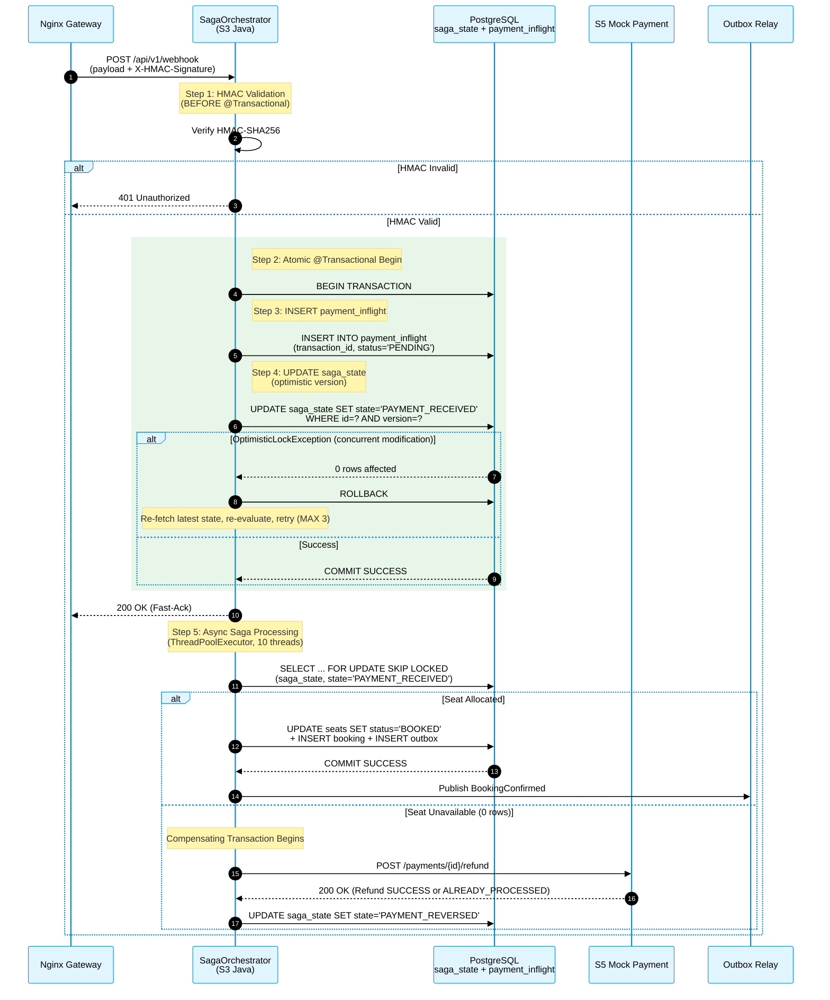
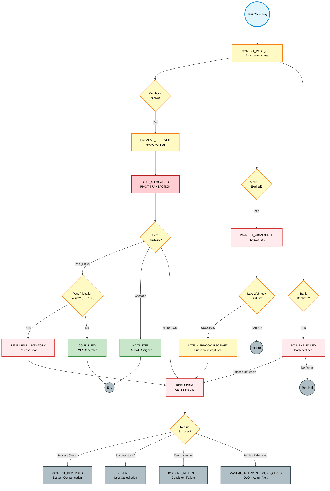
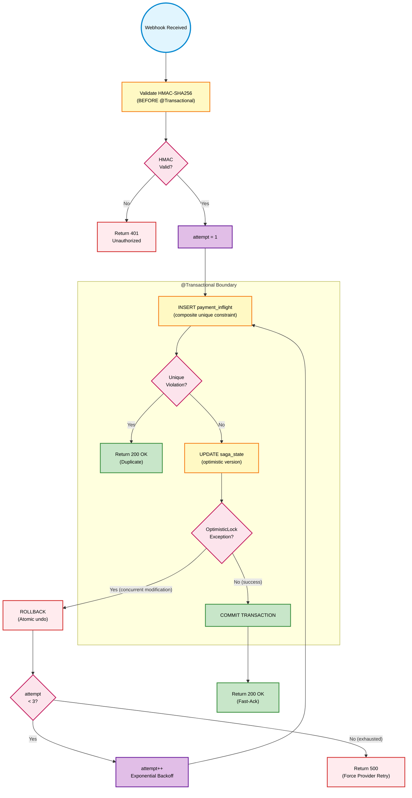
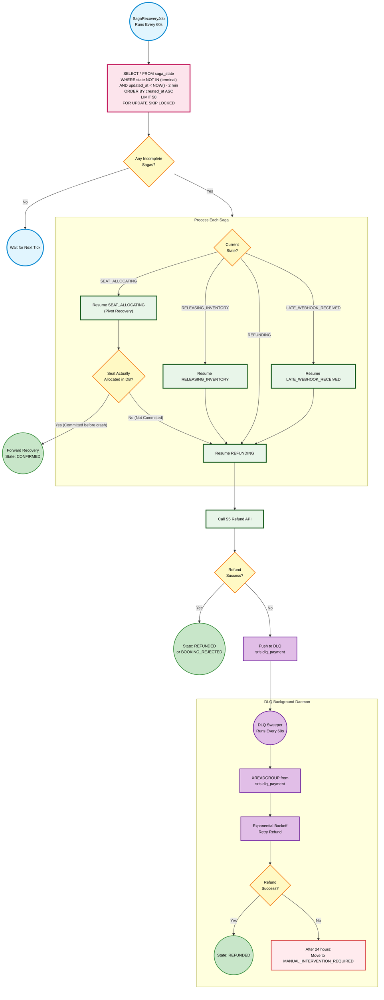
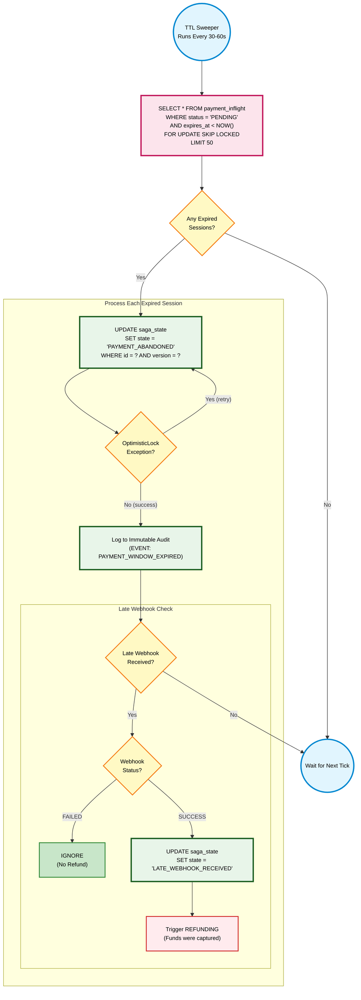

# Distributed Transaction and Saga Pattern Design

*SRIS — Sarathi Railway Information System*

*A Unified Railway Management Platform*

*Inspired by CRIS and IRCTC · Independent project*

> **Version:** 1.0 | **Date:** 2026-10-21 | **Document ID:** SRIS-P1-ARCH-015

| Field              | Value                                                             |
| ------------------ | ----------------------------------------------------------------- |
| Title              | Distributed Transaction and Saga Pattern Design                  |
| Software           | SRIS                                                              |
| Software Full Form | Sarathi Railway Information System                                |
| Team Codename      | Project Sarathi                                                   |
| Document ID        | SRIS-P1-ARCH-015                                                  |
| Task               | Define how distributed transactions are coordinated and reversed |
| Document Type      | Architecture Document                                             |
| Milestone          | Phase 1 Foundation                                                |
| Classification     | Internal                                                          |
| Version            | 1.0                                                               |
| Date               | 2026-10-21                                                        |
| Author             | Koushal Jha, Lead Architect                                       |
| Approved By        | Koushal Jha, Lead Architect                                       |
| Approval Date      | 2026-10-21                                                        |
| Supersedes         | None (first version)                                              |
| Related Documents  | See Appendix B                                                    |
| Affiliation        | Independent · Not affiliated with CRIS, IRCTC, or Indian Railways |

---

## Table of Contents

1. [Introduction](#1-introduction)
   - [1.1 Purpose](#11-purpose)
   - [1.2 Scope](#12-scope)
   - [1.3 Audience](#13-audience)
   - [1.4 Terminology and Conventions](#14-terminology-and-conventions)
2. [The 15-State Saga State Machine](#2-the-15-state-saga-state-machine)
   - [2.1 Why Orchestration](#21-why-orchestration)
   - [2.2 The Complete State Table](#22-the-complete-state-table)
   - [2.3 The Three Transaction Categories](#23-the-three-transaction-categories)
3. [The Saga Sequence Diagram](#3-the-saga-sequence-diagram)
4. [The Saga State Machine Flowchart](#4-the-saga-state-machine-flowchart)
5. [The Webhook Ingestion Flowchart](#5-the-webhook-ingestion-flowchart)
6. [The Crash Recovery and DLQ Flowchart](#6-the-crash-recovery-and-dlq-flowchart)
7. [The TTL Sweeper Flowchart](#7-the-ttl-sweeper-flowchart)
8. [Approval](#8-approval)

- [Revision History](#revision-history)
- [Appendix A: Not Applicable](#appendix-a-not-applicable)
- [Appendix B: Related Documents](#appendix-b-related-documents)

---

## 1. Introduction

### 1.1 Purpose

This document defines the exact mechanism by which SRIS coordinates distributed transactions across microservices (specifically S3 Reservation and S5 Mock Payment Gateway). It implements the **Saga Pattern (Orchestration)** as mandated by the Distributed Concurrency and Locking Strategy ([SRIS-P1-ARCH-014](./SRIS-P1-ARCH-014_DistributedConcurrencyAndLockingStrategy.md) — Distributed Concurrency and Locking Strategy).

The document answers the single most critical question in the SRIS architecture: **"What happens when a payment succeeds but the booking cannot be fulfilled?"** It defines the 15-state Saga state machine, the exact compensating transaction order, the retry policy, and the crash recovery mechanism. It is written so that any developer can implement the exact byte-by-byte flow without ambiguity.

### 1.2 Scope

**In scope**

- The 15-state Saga state machine.
- The orchestration placement (SagaOrchestrator class inside S3).
- The compensating transaction order (release seat first, then refund).
- The Webhook Ingestion Flow with atomic `@Transactional` boundary and bounded retry loop.
- The Crash Recovery mechanism (`saga_state` table + `LIMIT 50 FOR UPDATE SKIP LOCKED`).
- The TTL Sweeper for orphaned holds.
- The Nightly Pruning Cron with PII anonymization.
- The distinguishing of `PAYMENT_REVERSED` vs `REFUNDED` for ledger compliance.
- The HMAC validation timing (before `@Transactional`).
- The retry loop placement (outside Spring proxy).

**Out of scope**

- The concurrency locking primitives, which belong to [SRIS-P1-ARCH-014](./SRIS-P1-ARCH-014_DistributedConcurrencyAndLockingStrategy.md) — Distributed Concurrency and Locking Strategy.
- The event schema definitions, which belong to [SRIS-P1-API-003](./SRIS-P1-API-003_EventSchemaDocumentAsyncAPI.md) — Event Schema Document (AsyncAPI).
- The API endpoint contracts, which belong to [SRIS-P1-API-001](./SRIS-P1-API-001_APIContractDocumentOpenAPI.md) — API Contract Document (OpenAPI).
- The booking aggregate rules, which belong to [SRIS-P1-ARCH-005](./SRIS-P1-ARCH-005_DomainModelDocument.md) — Domain Model Document.

### 1.3 Audience

- **Lead Architect:** maintains this document and is the authority on the Saga changes.
- **Backend developers:** must implement the exact `@Transactional` boundaries, retry loops, and state transitions defined here.
- **QA engineers:** use the state machine table to design edge-case tests.
- **Project supervisor and evaluator:** verifies that the distributed transaction logic is mathematically sound.

### 1.4 Terminology and Conventions

Every term in this document has the meaning recorded in [SRIS-P1-REQ-001](../wave-1-requirements/SRIS-P1-REQ-001_GlossaryAndDomainDictionary.md) — Glossary and Domain Dictionary. The terms below carry the most weight in this document.

| Term | Meaning |
| :--- | :--- |
| Saga | A sequence of local transactions coordinated by a central orchestrator with compensating transactions. |
| Orchestration | A Saga pattern where a central entity commands each step and manages state. |
| Compensating Transaction | An operation that semantically reverses a previously committed local transaction. |
| Pivot Transaction | The point of no return. Once passed, all subsequent steps must succeed (retryable). |
| Semantic Lock | An application-level lock (via version column) that prevents external mutations during compensation. |
| PII | Personally Identifiable Information. |
| DLQ | Dead Letter Queue. A holding area for messages that failed all retries. |

This document follows the standards below.

- [SRIS-P1-GOV-002](../wave-0-project-foundation/SRIS-P1-GOV-002_DocumentTemplateStandard.md) — Document Template Standard.
- [SRIS-P1-GOV-003](../wave-0-project-foundation/SRIS-P1-GOV-003_DocumentIDAndCategoryScheme.md) — Document ID and Category Scheme.
- [SRIS-P1-GOV-004](../wave-0-project-foundation/SRIS-P1-GOV-004_DocumentCrossReferenceStandard.md) — Document Cross-Reference Standard.

---

## 2. The 15-State Saga State Machine

### 2.1 Why Orchestration

SRIS uses **Orchestration** (not Choreography) for the booking Saga. A central `SagaOrchestrator` class inside S3 (Reservation) explicitly commands each step. 

- **Rejected: Choreography.** Failure logic scattered across 4 services. Debugging requires reading 4 log files. Cyclic dependencies form.
- **Rejected: Hybrid.** Inconsistent patterns confuse developers.
- **Selected: Orchestration.** Single source of truth for the Saga state. Explicit compensating transactions. Easy to audit.

### 2.2 The Complete State Table

The Saga Orchestrator manages exactly **15 states**. Every state is unambiguous and every terminal state is truly terminal.

| # | State | Meaning | Valid Transitions |
| :--- | :--- | :--- | :--- |
| 1 | `PAYMENT_PAGE_OPEN` | User is on the payment page. 5-minute window starts. | → `PAYMENT_ABANDONED` / → `PAYMENT_RECEIVED` / → `PAYMENT_FAILED` |
| 2 | `PAYMENT_ABANDONED` | Timer expired. No payment received. | → `LATE_WEBHOOK_RECEIVED` (only if webhook status = SUCCESS) |
| 3 | `PAYMENT_FAILED` | Bank declined the payment. | → `REFUNDING` (only if funds captured in anomaly) / Terminal if declined |
| 4 | `PAYMENT_RECEIVED` | Webhook received and HMAC-verified. | → `SEAT_ALLOCATING` |
| 5 | `SEAT_ALLOCATING` | Attempting to lock seat via `SKIP LOCKED`. | → `CONFIRMED` / → `WAITLISTED` / → `REFUNDING` (if 0 rows) |
| 6 | `CONFIRMED` | Seat locked, PNR generated. | Terminal. |
| 7 | `WAITLISTED` | Cascaded to RAC/WL. | Terminal. |
| 8 | `RELEASING_INVENTORY` | Compensation: releasing a locked seat. | → `REFUNDING` |
| 9 | `REFUNDING` | Compensation: calling S5 refund API. | → `REFUNDED` / → `PAYMENT_REVERSED` / → `BOOKING_REJECTED` / → `MANUAL_INTERVENTION_REQUIRED` |
| 10 | `REFUNDED` | User-initiated cancellation refund succeeded. | Terminal. |
| 11 | `PAYMENT_REVERSED` | System-initiated compensation succeeded. | Terminal. |
| 12 | `BOOKING_REJECTED` | Booking failed, refund succeeded (consistent failure). | Terminal. |
| 13 | `MANUAL_INTERVENTION_REQUIRED` | Refund failed after all retries. DLQ. Admin alert. | Terminal until manually resolved. |
| 14 | `LATE_WEBHOOK_RECEIVED` | Late SUCCESS webhook received after abandonment. | → `REFUNDING` |
| 15 | `PAYMENT_REVERSED` | (duplicate of 11 — see note) | Terminal. |

**Note on `PAYMENT_REVERSED` vs `REFUNDED`:** Both represent returned money. `REFUNDED` is for user-initiated cancellations (from a `CONFIRMED` booking). `PAYMENT_REVERSED` is for system-initiated compensations (from a Saga rollback). They belong in different ledger categories for end-of-day reconciliation and audit compliance.

### 2.3 The Three Transaction Categories

Every step in the Saga is classified into one of three categories. This classification determines how failures are handled.

| Category | Definition | Examples in SRIS | Failure Handling |
| :--- | :--- | :--- | :--- |
| **Compensatable** | Can be safely undone. | Seat locking, PNR generation. | Compensating transaction (release seat). |
| **Pivot** | The point of no return. | `SEAT_ALLOCATING` (seat is committed). | Once passed, all steps are retryable forward. |
| **Retryable** | Must succeed to complete the Saga. | `REFUNDING`, `RELEASING_INVENTORY`. | Infinite retries via DLQ. |

---

## 3. The Saga Sequence Diagram

The sequence diagram below illustrates the exact chronological flow of a booking Saga from the moment the payment webhook arrives. It proves the **atomic @Transactional boundary** (HMAC verification before transaction, INSERT + UPDATE together), the **bounded retry loop**, and the **compensating transaction order** (release seat first, then refund).

Notice that the HMAC validation occurs **before** the transaction begins. This is critical: it prevents holding database connections open during CPU-intensive cryptographic work.

---

## 4. The Saga State Machine Flowchart

While the Sequence Diagram (Section 3) shows the chronological flow, this Flowchart illustrates the **complete state machine** of the Saga Orchestrator. It proves that every possible failure path (payment declined, seat unavailable, refund failure, late webhook) has a deterministic terminal state. 

It also highlights the **pivot transaction** (`SEAT_ALLOCATING`), after which all steps are retryable forward. Once the pivot is passed, the system can only succeed or compensate — it can never roll back.

---

## 5. The Webhook Ingestion Flowchart

While the Sequence Diagram (Section 3) shows the chronological flow, this Flowchart illustrates the **exact decision logic** executed by the Webhook Ingestion endpoint. It proves the atomic `@Transactional` boundary, the bounded retry loop (MAX 3 attempts), and the safe handling of concurrent `OptimisticLockException` and duplicate webhooks.

---

## 6. The Crash Recovery and DLQ Flowchart

In a distributed system, crashes are expected. The Saga Orchestrator must be able to resume incomplete transactions after a server restart. This Flowchart illustrates the exact logic of the `SagaRecoveryJob` (runs every 60 seconds) and the DLQ-based infinite retry for failed refunds.

It proves that **no user money is ever orphaned**: if the server crashes mid-transaction, the SagaRecoveryJob will pick up the pending Saga on restart and either complete it or refund it. If the refund fails, the DLQ retries indefinitely until success.

---

## 7. The TTL Sweeper Flowchart

While the Saga Orchestrator handles active transactions, it cannot detect sessions that are silently abandoned. This Flowchart illustrates the **TTL Sweeper** (runs every 30-60 seconds) that reclaims expired payment windows from PostgreSQL. It proves the strict rules that guarantee no user funds are ever orphaned.

Notice the critical branching: if a late webhook arrives with a FAILED status, it is ignored (no refund is triggered). If it arrives with a SUCCESS status, the funds are captured and must be refunded via LATE_WEBHOOK_RECEIVED.

---

## 8. Approval

| Role           | Name        | Decision | Date       |
| -------------- | ----------- | -------- | ---------- |
| Lead Architect | Koushal Jha | Approved | 2026-10-21 |

---

## Revision History

| Version | Date       | Author      | Change           |
| ------- | ---------- | ----------- | ---------------- |
| 1.0     | 2026-10-21 | Koushal Jha | Initial release. |

---

## Appendix A: Not Applicable

Not applicable.

---

## Appendix B: Related Documents

### B.1 Directly Referenced Documents

| Seq  | Document ID                                                                                                    | Document Name                                     | Wave | Pri | Tag     |
| ---- | -------------------------------------------------------------------------------------------------------------- | ------------------------------------------------- | ---- | --- | ------- |
| 0.1  | [SRIS-P1-GOV-002](../wave-0-project-foundation/SRIS-P1-GOV-002_DocumentTemplateStandard.md)                     | Document Template Standard                        | 0    | P0  | UNBLOCK |
| 0.2  | [SRIS-P1-GOV-003](../wave-0-project-foundation/SRIS-P1-GOV-003_DocumentIDAndCategoryScheme.md)                  | Document ID and Category Scheme                   | 0    | P1  | UNBLOCK |
| 0.3  | [SRIS-P1-GOV-004](../wave-0-project-foundation/SRIS-P1-GOV-004_DocumentCrossReferenceStandard.md)               | Document Cross-Reference Standard                 | 0    | P1  | UNBLOCK |
| 1.1  | [SRIS-P1-REQ-001](../wave-1-requirements/SRIS-P1-REQ-001_GlossaryAndDomainDictionary.md)                        | Glossary and Domain Dictionary                    | 1    | P0  | UNBLOCK |
| 2.3  | [SRIS-P1-ARCH-003](./SRIS-P1-ARCH-003_SystemArchitectureDocument.md)                                            | System Architecture Document                      | 2    | P0  | UNBLOCK |
| 2.5  | [SRIS-P1-ARCH-005](./SRIS-P1-ARCH-005_DomainModelDocument.md)                                                   | Domain Model Document                             | 2    | P0  | UNBLOCK |
| 2.9  | [SRIS-P1-ARCH-009](./SRIS-P1-ARCH-009_ServiceInteractionAndCommunicationDesign.md)                              | Service Interaction and Communication Design      | 2    | P0  | UNBLOCK |
| 2.14 | [SRIS-P1-ARCH-014](./SRIS-P1-ARCH-014_DistributedConcurrencyAndLockingStrategy.md)                              | Distributed Concurrency and Locking Strategy      | 2    | P0  | UNBLOCK |
| 3.14 | [SRIS-P1-API-001](./SRIS-P1-API-001_APIContractDocumentOpenAPI.md)                                              | API Contract Document (OpenAPI)                   | 3    | P0  | UNBLOCK |
| 3.16 | [SRIS-P1-API-003](./SRIS-P1-API-003_EventSchemaDocumentAsyncAPI.md)                                             | Event Schema Document (AsyncAPI)                  | 3    | P0  | UNBLOCK |

### B.2 Documents That Reference This Document

| Seq  | Document ID                                                                             | Document Name                                | Why It References                                                                 |
| ---- | --------------------------------------------------------------------------------------- | -------------------------------------------- | --------------------------------------------------------------------------------- |
| 2.12 | [SRIS-P1-ARCH-012](./SRIS-P1-ARCH-012_ObservabilityAndMonitoringDesignOTelW3C.md)           | Observability and Monitoring Design          | Uses the Saga states to define alerting rules for MANUAL_INTERVENTION_REQUIRED    |
| 3.14 | [SRIS-P1-API-001](./SRIS-P1-API-001_APIContractDocumentOpenAPI.md)                          | API Contract Document (OpenAPI)              | Defines the webhook endpoint and payment initiation contracts                     |
| 3.16 | [SRIS-P1-API-003](./SRIS-P1-API-003_EventSchemaDocumentAsyncAPI.md)                         | Event Schema Document (AsyncAPI)             | Defines the CloudEvents schemas for SeatReleased and BookingConfirmed             |
| 3.17 | [SRIS-P1-API-004](./SRIS-P1-API-004_IntegrationDesignDocument.md)                           | Integration Design Document                  | Details the S5 API contract for the refund request                                |
| 3.18 | [SRIS-P1-API-005](./SRIS-P1-API-005_IdempotencyAndRetryPolicySpecification.md)              | Idempotency and Retry Policy Specification   | Defines the DLQ retry policy for infinite refund retries                          |

### B.3 Documents This Document Depends On (Upstream)

| Seq | Document ID                                                                                 | Document Name                          | Dependency Type |
| --- | ------------------------------------------------------------------------------------------- | -------------------------------------- | --------------- |
| 0.1 | [SRIS-P1-GOV-002](../wave-0-project-foundation/SRIS-P1-GOV-002_DocumentTemplateStandard.md)           | Document Template Standard             | Hard            |
| 2.3 | [SRIS-P1-ARCH-003](./SRIS-P1-ARCH-003_SystemArchitectureDocument.md)                                 | System Architecture Document           | Hard            |
| 2.5 | [SRIS-P1-ARCH-005](./SRIS-P1-ARCH-005_DomainModelDocument.md)                                         | Domain Model Document                  | Hard            |
| 2.9 | [SRIS-P1-ARCH-009](./SRIS-P1-ARCH-009_ServiceInteractionAndCommunicationDesign.md)                    | Service Interaction and Communication Design | Hard       |
| 2.14 | [SRIS-P1-ARCH-014](./SRIS-P1-ARCH-014_DistributedConcurrencyAndLockingStrategy.md)                   | Distributed Concurrency and Locking Strategy | Hard       |

### B.4 Documents This Document Unblocks (Downstream)

| Seq  | Document ID                                                                             | Document Name                                | Blocked Until |
| ---- | --------------------------------------------------------------------------------------- | -------------------------------------------- | ------------- |
| 2.12 | [SRIS-P1-ARCH-012](./SRIS-P1-ARCH-012_ObservabilityAndMonitoringDesignOTelW3C.md)           | Observability and Monitoring Design          | This approved |
| 3.14 | [SRIS-P1-API-001](./SRIS-P1-API-001_APIContractDocumentOpenAPI.md)                          | API Contract Document (OpenAPI)              | This approved |
| 3.16 | [SRIS-P1-API-003](./SRIS-P1-API-003_EventSchemaDocumentAsyncAPI.md)                         | Event Schema Document (AsyncAPI)             | This approved |
| 3.17 | [SRIS-P1-API-004](./SRIS-P1-API-004_IntegrationDesignDocument.md)                           | Integration Design Document                  | This approved |
| 3.18 | [SRIS-P1-API-005](./SRIS-P1-API-005_IdempotencyAndRetryPolicySpecification.md)              | Idempotency and Retry Policy Specification   | This approved |
| 3.3  | [SRIS-P1-DATA-003](./SRIS-P1-DATA-003_PhysicalDatabaseSchemaDocument.md)                    | Physical Database Schema Document            | This approved |

### B.5 Master Documentation Index

The complete list of Phase 1 documents is in [SRIS-P1-GOV-001](../wave-0-project-foundation/SRIS-P1-GOV-001_DocumentationIndexAndNavigationMap.md) — Documentation Index and Navigation Map.

### B.6 External Reference Documents

| Reference Type | Where It Is Documented                                                                                                                                                                                                                                     |
| -------------- | ---------------------------------------------------------------------------------------------------------------------------------------------------------------------------------------------------------------------------------------------------------- |
| Book           | Garcia-Molina, H., Salem, K. "Sagas." ACM SIGMOD Record, 1987. Referenced for the foundational definition of the Saga pattern and compensating transactions.                                                                                              |
| Book           | Richardson, Chris. "Microservices Patterns." Manning Publications, 2018. Referenced for the orchestration vs. choreography comparison and the Transactional Outbox pattern.                                                                               |

### B.7 Document Conventions

The conventions for Priority and Tag values are defined in [Section 9](../wave-0-project-foundation/SRIS-P1-GOV-002_DocumentTemplateStandard.md#9-vocabulary-standards) of [SRIS-P1-GOV-002](../wave-0-project-foundation/SRIS-P1-GOV-002_DocumentTemplateStandard.md) — Document Template Standard.