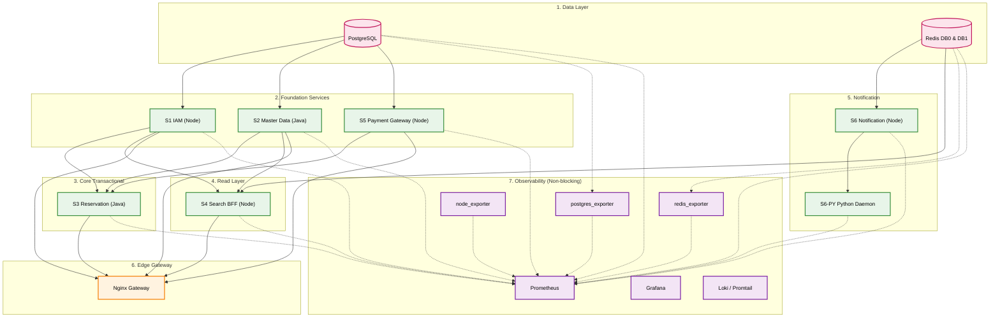
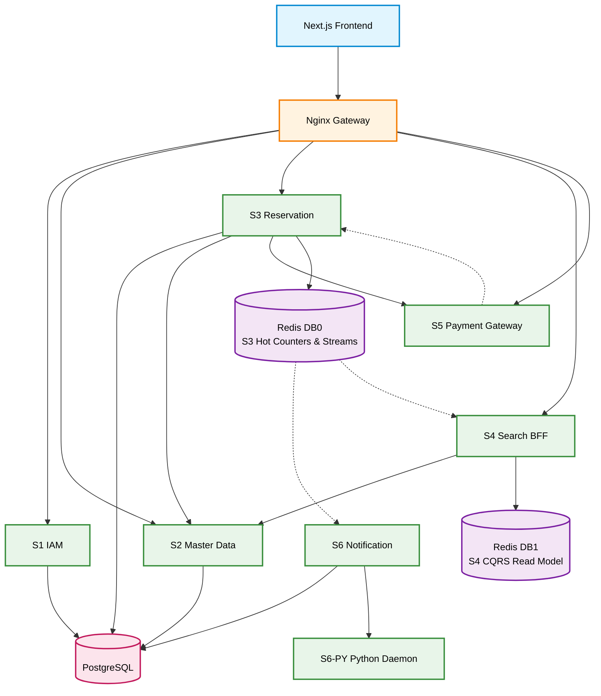

# Service Registry and Catalog

*SRIS — Sarathi Railway Information System*

*A Unified Railway Management Platform*

*Inspired by CRIS and IRCTC · Independent project*

> **Version:** 1.1 | **Date:** 2026-10-22 | **Document ID:** SRIS-P1-ARCH-016

| Field              | Value                                                             |
| ------------------ | ----------------------------------------------------------------- |
| Title              | Service Registry and Catalog                                      |
| Software           | SRIS                                                              |
| Software Full Form | Sarathi Railway Information System                                |
| Team Codename      | Project Sarathi                                                   |
| Document ID        | SRIS-P1-ARCH-016                                                  |
| Task               | Define the static catalog of services, ports, and dependencies    |
| Document Type      | Architecture Document                                             |
| Milestone          | Phase 1 Foundation                                                |
| Classification     | Internal                                                          |
| Version            | 1.1                                                               |
| Date               | 2026-10-22                                                        |
| Author             | Koushal Jha, Lead Architect                                       |
| Approved By        | Koushal Jha, Lead Architect                                       |
| Approval Date      | 2026-10-22                                                        |
| Supersedes         | Version 1.0 of this document                                      |
| Related Documents  | See Appendix B                                                    |
| Affiliation        | Independent · Not affiliated with CRIS, IRCTC, or Indian Railways |

---

## Table of Contents

1. [Introduction](#1-introduction)
   - [1.1 Purpose](#11-purpose)
   - [1.2 Scope](#12-scope)
   - [1.3 Audience](#13-audience)
   - [1.4 Terminology and Conventions](#14-terminology-and-conventions)
2. [Catalog Structure and Authority](#2-catalog-structure-and-authority)
   - [2.1 What the Catalog Owns and What It Defers](#21-what-the-catalog-owns-and-what-it-defers)
   - [2.2 Field Definitions](#22-field-definitions)
   - [2.3 How Conflicts With Other Documents Are Resolved](#23-how-conflicts-with-other-documents-are-resolved)
3. [The Service Catalog](#3-the-service-catalog)
   - [3.1 Service Catalog](#31-service-catalog)
   - [3.2 Bounded Context Map](#32-bounded-context-map)
4. [Service Discovery](#4-service-discovery)
   - [4.1 Docker Internal DNS](#41-docker-internal-dns)
   - [4.2 Configuration Sourcing for Ports and Hosts](#42-configuration-sourcing-for-ports-and-hosts)
5. [Startup Dependency Order](#5-startup-dependency-order)
   - [5.1 The Health Gate Rule](#51-the-health-gate-rule)
   - [5.2 The Startup Sequence](#52-the-startup-sequence)
6. [The Service Dependency Diagram](#6-the-service-dependency-diagram)
7. [Contract Ownership and References](#7-contract-ownership-and-references)
8. [Catalog Maintenance](#8-catalog-maintenance)
   - [8.1 Port or Path Change Procedure](#81-port-or-path-change-procedure)
   - [8.2 When a Service Is Added or Removed](#82-when-a-service-is-added-or-removed)
9. [Approval](#9-approval)

- [Revision History](#revision-history)
- [Appendix A: External Systems](#appendix-a-external-systems)
- [Appendix B: Related Documents](#appendix-b-related-documents)

---

## 1. Introduction

### 1.1 Purpose

This document is the definitive Service Registry and Catalog for Phase 1 of SRIS. It provides a single, static, authoritative reference for every operational detail a Week 3 developer needs: which services exist, what ports they expose, what base paths Nginx routes to them, which health and metrics endpoints they publish, and the exact order in which they must start.

It also serves as the operational contract for the Deployment Architecture ([SRIS-P1-ARCH-013](./SRIS-P1-ARCH-013_DeploymentArchitectureDocument.md) — Deployment Architecture Document) and the Environment Variables Reference ([SRIS-P1-INF-011](../wave-5-devops-operations/SRIS-P1-INF-011_EnvironmentVariablesAndConfigurationReference.md) — Environment Variables and Configuration Reference).

### 1.2 Scope

**In scope**

- The static Service Catalog (one row per running process) containing ports, base paths, health endpoints, and metrics paths.
- The Python Automation Daemon sidecar row within S6.
- The three monitoring exporters (postgres_exporter, redis_exporter, node_exporter) that feed the central dashboard.
- The 8-row Bounded Context Map (one row per context) summarising the DDD classification from [SRIS-P1-ARCH-004](./SRIS-P1-ARCH-004_BoundedContextMap.md) — Bounded Context Map.
- Service discovery via Docker internal DNS.
- The strict startup dependency order, governed by health checks.
- The runtime call graph showing which service talks to which.
- The contract ownership references (which document owns which interface).
- The catalog maintenance procedure for port changes or service additions.

**Out of scope**

- The technology stack choice (languages, frameworks, databases), which belongs to [SRIS-P1-ARCH-008](./SRIS-P1-ARCH-008_TechnologyStackADR.md) — Technology Stack ADR.
- The physical deployment topology and Docker Compose files, which belong to [SRIS-P1-ARCH-013](./SRIS-P1-ARCH-013_DeploymentArchitectureDocument.md) — Deployment Architecture Document.
- The detailed API contracts, which belong to [SRIS-P1-API-001](./SRIS-P1-API-001_APIContractDocumentOpenAPI.md) — API Contract Document (OpenAPI) and [SRIS-P1-API-003](./SRIS-P1-API-003_EventSchemaDocumentAsyncAPI.md) — Event Schema Document (AsyncAPI).
- The full environment variable list, which belongs to [SRIS-P1-INF-011](../wave-5-devops-operations/SRIS-P1-INF-011_EnvironmentVariablesAndConfigurationReference.md) — Environment Variables and Configuration Reference.
- Capacity planning or memory headroom beyond the Phase 1 5.1 GB ceiling, which belongs to [SRIS-P1-INF-010](../wave-5-devops-operations/SRIS-P1-INF-010_CapacityPlanningDocument.md) — Capacity Planning Document.

### 1.3 Audience

- **Backend and Frontend developers:** use the catalog to configure their local Docker environment, routing, and API calls.
- **DevOps engineer:** uses the port assignments and startup order to write the Docker Compose files.
- **QA engineers:** use the health and metrics paths to set up monitoring and integration tests.
- **Project supervisor and evaluator:** verifies that the service topology is fully documented and conflict-free.

### 1.4 Terminology and Conventions

Every term in this document has the meaning recorded in [SRIS-P1-REQ-001](../wave-1-requirements/SRIS-P1-REQ-001_GlossaryAndDomainDictionary.md) — Glossary and Domain Dictionary. The terms below carry the most weight in this document.

| Term | Meaning |
| :--- | :--- |
| Service Catalog | The operational table listing every running process, its port, its base path, and its dependencies. |
| Bounded Context | A boundary within which a domain model and its vocabulary are consistent. |
| Liveness Check | A health endpoint confirming the process is alive (used by Load Balancer / Docker). |
| Docker DNS | The internal mechanism that allows containers to resolve each other by name. |
| CQRS | Command Query Responsibility Segregation (write to DB0, read from DB1). |
| Sidecar | A process that runs inside the same container as its parent, sharing the network namespace. |
| Exporter | A small Prometheus-compatible agent that exposes the metrics of a system that does not natively emit them. |
| Port Sequence | A contiguous top-down numbering scheme (20100 to 20118) in which each port carries a fixed architectural role. |

This document follows the standards below.

- [SRIS-P1-GOV-002](../wave-0-project-foundation/SRIS-P1-GOV-002_DocumentTemplateStandard.md) — Document Template Standard.
- [SRIS-P1-GOV-003](../wave-0-project-foundation/SRIS-P1-GOV-003_DocumentIDAndCategoryScheme.md) — Document ID and Category Scheme.
- [SRIS-P1-GOV-004](../wave-0-project-foundation/SRIS-P1-GOV-004_DocumentCrossReferenceStandard.md) — Document Cross-Reference Standard.

---

## 2. Catalog Structure and Authority

### 2.1 What the Catalog Owns and What It Defers

To prevent conflict and drift, this document operates under the **Single-Owner-Per-Field** rule.

| Field | Owner |
| :--- | :--- |
| Container port, host port, base path, health endpoint, metrics path | **ARCH-016 (This Document)** |
| Service and container names (short form used in Compose, DNS, ports) | **ARCH-016 (This Document)** |
| Language, runtime, framework, ORM, database engine | [SRIS-P1-ARCH-008](./SRIS-P1-ARCH-008_TechnologyStackADR.md) — Technology Stack ADR |
| Bounded context classification (Core/Supporting/Generic) | [SRIS-P1-ARCH-004](./SRIS-P1-ARCH-004_BoundedContextMap.md) — Bounded Context Map |
| Environment variable values (DATABASE_URL, etc.) | [SRIS-P1-INF-011](../wave-5-devops-operations/SRIS-P1-INF-011_EnvironmentVariablesAndConfigurationReference.md) — Environment Variables and Configuration Reference |

### 2.2 Field Definitions

| Field | Definition |
| :--- | :--- |
| Service ID | The identifier (S1 to S6, or — for non-domain processes) assigned in ARCH-001 or in this document. |
| Language | The runtime (Node.js, Java, Python, Go, or — for non-application processes). |
| Container Port | The internal port the process listens on inside the Docker network. |
| Host Port | The port mapped to the host machine (can vary per environment, defined in INF-011). |
| Base Path | The Nginx routing prefix (e.g., `/booking/*`). |
| Health Liveness | The path Nginx and Docker use to check if the process is alive. |
| Health Detailed | The path Prometheus uses to scrape circuit-breaker and dependency states. |
| Metrics | The path Prometheus uses to scrape performance metrics. |
| Contract | The Document ID that owns the OpenAPI/AsyncAPI schema. |
| Category | The DDD classification (from ARCH-004). |
| Depends On | The services required for this process to function. |

### 2.3 How Conflicts With Other Documents Are Resolved

- **Port and Path Conflicts:** If ARCH-008 or any other document specifies a different port or path, **ARCH-016 wins**. This document is the operational truth for Week 3.
- **Technology Conflicts:** If this document accidentally lists a different language or database than ARCH-008, **ARCH-008 wins**. This document must be amended to match.
- **DDD Classification Conflicts:** If this document and ARCH-004 disagree on context naming, **ARCH-004 wins**.

---

## 3. The Service Catalog

### 3.1 Service Catalog

The table below is the authoritative operational record for all running processes in the Phase 1 environment. A dash (—) indicates the field does not apply to that process.

The port numbers follow a **contiguous top-down sequence from 20100 to 20118**, arranged by architectural layer: edge, frontend, security, BFF, backend domain services, backend sidecar, external simulator, data, and observability. The sequence has no gaps. A new process in a layer appends at the end of that layer's block, or, if the layer is complete, at the end of the observability block. No port number in the sequence is reused or reassigned.

| ID | Service | Language | Container Port | Host Port | Base Path | Health Liveness | Health Detailed | Metrics | Contract | Category | Depends On |
| :--- | :--- | :--- | :--- | :--- | :--- | :--- | :--- | :--- | :--- | :--- | :--- |
| — | Nginx (HTTP) | — | 20100 | 20100 | — | `/health/liveness` | — | — | — | — | S1, S2, S3, S4, S5 (upstreams) |
| — | Nginx (HTTPS) | — | 20101 | 20101 | — | `/health/liveness` | — | — | — | — | S1, S2, S3, S4, S5 (upstreams) |
| — | Next.js Frontend | Node.js | 20102 | 20102 | — | — | — | — | — | — | Nginx (reverse proxy) |
| S1 | IAM Service | Node.js | 20103 | 20103 | `/auth/*` | `/health/liveness` | `/health` | `/metrics` | [API-001](./SRIS-P1-API-001_APIContractDocumentOpenAPI.md) | Generic | PostgreSQL (sris_iam) |
| S4 | Search BFF | Node.js | 20104 | 20104 | `/search/*` | `/health/liveness` | `/health` | `/metrics` | [API-001](./SRIS-P1-API-001_APIContractDocumentOpenAPI.md) | Supporting | S1, S2, Redis DB1 (CQRS) |
| S2 | Master Data & Pricing | Java | 20105 | 20105 | `/master-data/*` | `/health/liveness` | `/health` | `/actuator/prometheus` | [API-001](./SRIS-P1-API-001_APIContractDocumentOpenAPI.md) | Supporting | PostgreSQL (sris_master_data), S1 (Token) |
| S3 | Reservation | Java | 20106 | 20106 | `/booking/*` | `/health/liveness` | `/health` | `/actuator/prometheus` | [API-001](./SRIS-P1-API-001_APIContractDocumentOpenAPI.md) | Core | PostgreSQL (sris_reservation), S1, S2, S5, Redis |
| S6 | Notification | Node.js | 20107 | 20107 | — | `/health/liveness` | `/health` | `/metrics` | [API-003](./SRIS-P1-API-003_EventSchemaDocumentAsyncAPI.md) | Generic | Redis DB0 (Streams), PostgreSQL (sris_notification) |
| S6-PY | Python Automation Daemon (sidecar in S6) | Python | 20108 | — | — | `/health/liveness` | `/health` | `/metrics` | — | Internal only | S6 (shares network namespace) |
| S5 | Payment Gateway | Node.js | 20109 | 20109 | `/payment/*` | `/health/liveness` | `/health` | `/metrics` | [API-001](./SRIS-P1-API-001_APIContractDocumentOpenAPI.md) | External Simulator | S1 only (stateless; no database role) |
| — | PostgreSQL | — | 20110 | 20110 | — | — | — | — | — | — | — |
| — | Redis | — | 20111 | 20111 | — | — | — | — | — | — | — |
| — | Prometheus | — | 20112 | 20112 | — | — | — | `/metrics` | — | — | Scrapes all `/metrics` endpoints |
| — | Grafana | — | 20113 | 20113 | `/grafana/*` | `/api/health` | — | `/metrics` | — | — | Prometheus, Loki |
| — | Loki | — | 20114 | 20114 | — | `/ready` | — | `/metrics` | — | — | Promtail (push) |
| — | Promtail | — | 20115 | 20115 | — | — | — | `/metrics` | — | — | Loki (push) |
| — | postgres_exporter | — | 20116 | 20116 | — | — | — | `/metrics` | — | — | PostgreSQL |
| — | redis_exporter | — | 20117 | 20117 | — | — | — | `/metrics` | — | — | Redis |
| — | node_exporter | — | 20118 | 20118 | — | — | — | `/metrics` | — | — | Host OS |

**Note on S6:** S6 is an event-driven consumer. It does not expose an inbound HTTP base path. Its health and metrics endpoints are still required for Docker and Prometheus to monitor the process.

**Note on S6-PY Python Daemon:** The S6 container includes an embedded Python daemon (the SRIS Autonomous Operations Engine) that monitors CPU/RAM usage and detects anomaly patterns per the Technology Stack ADR ([SRIS-P1-ARCH-008](./SRIS-P1-ARCH-008_TechnologyStackADR.md) — Technology Stack ADR). Because Prometheus uses a pull-based model, the Python daemon exposes its own `/metrics` endpoint on port **20108**, separate from the Node.js side of S6 (20107). This separation ensures that host resource telemetry remains accessible to Prometheus even if the Node.js event loop becomes unresponsive. The daemon requires no host port; it is internal to the Docker network only. The S6 container's memory limit must account for both runtimes.

**Note on S4 ↔ S3:** Per the approved architecture ([SRIS-P1-ARCH-004](./SRIS-P1-ARCH-004_BoundedContextMap.md) — Bounded Context Map), S4 does not make synchronous calls to S3. It depends on S2 (sync) and Redis DB1 (CQRS materialized view). This supersedes the synchronous edge shown in ARCH-001 §6.4.

**Note on Redis DB0/DB1:** The single Redis container hosts DB0 (S3 internal hot counters) and DB1 (S4 CQRS materialized view).

**Note on Nginx Metrics:** In Phase 1, Nginx does not expose a native Prometheus metrics endpoint. Passive health checks (`max_fails`, `fail_timeout`) are configured per the Error Handling and Resilience Design ([SRIS-P1-ARCH-011](./SRIS-P1-ARCH-011_ErrorHandlingAndResilienceDesign.md) — Error Handling and Resilience Design). In Phase 2, the `nginx-prometheus-exporter` sidecar will expose Nginx metrics on `/metrics` for Prometheus to scrape.

**Note on Monitoring Exporters:** The three exporters (postgres_exporter on 20116, redis_exporter on 20117, node_exporter on 20118) expose the internal state of PostgreSQL, Redis, and the host OS to Prometheus, so that the central dashboard (Grafana) can display database query load, connection counts, cache hit ratios, and host resource utilisation. Without them, the dashboard would show only container-level CPU and memory, not the internal state of the data layer.

**Note on Port Sequence Extension:** A future process is added by appending to its layer's block, or, if the layer is complete, at the end of the sequence (starting at 20119). A port is never renumbered to make room for a new process, and is never reassigned to a different process. When a process is retired, its port is marked **retired** in a future revision of this document and is never reassigned. A change to the port of an existing process is governed by §8.1 and requires a new revision of this document.

### 3.2 Bounded Context Map

The table below summarises the 8 bounded contexts and their owning services, as defined in [SRIS-P1-ARCH-004](./SRIS-P1-ARCH-004_BoundedContextMap.md) — Bounded Context Map. This table is for quick reference only; ARCH-004 remains the authoritative source for DDD classification.

| Context | Category | Owning Service | Responsibility |
| :--- | :--- | :--- | :--- |
| Identity and Access | Generic | S1 | Authenticate and authorize users. |
| Railway Master Data | Supporting | S2 | Stations, routes, trains, schedules. |
| Fare and Pricing | Supporting | S2 | Tariff rules, concessions, fare quotes. |
| Inventory and Quota | Core | S3 (Inventory module) | Seat matrix, availability, allocation. |
| Booking and Ticketing | Core | S3 (Booking module) | Booking lifecycle, PNR, waitlist. |
| Payment | External System Boundary | S3 (tracking) + S5 (gateway) | Payment processing and callback. |
| Search and Discovery | Supporting | S4 | Unified search composition. |
| Notification | Generic | S6 | Email, SMS, event consumer. |

---

## 4. Service Discovery

### 4.1 Docker Internal DNS

Within the Docker Compose network, services resolve each other by their **container name** (e.g., `http://s2-master-data:20105`). There are no hardcoded IP addresses, no `/etc/hosts` entries, and no runtime service registries.

This mechanism satisfies [SRIS-P1-REQ-005](../wave-1-requirements/SRIS-P1-REQ-005_NonFunctionalRequirementsISO25010.md) — Non-Functional Requirements (ISO 25010) NFR-070 ("no hardcoded hostnames or ports").

### 4.2 Configuration Sourcing for Ports and Hosts

All container ports follow the sequence in §3.1 and are fixed in this catalog. The **host ports** (the ports exposed to the developer's laptop) default to the same value as the container port and can be overridden via the `.env` file for a specific deployment. The exact environment variables are owned by [SRIS-P1-INF-011](../wave-5-devops-operations/SRIS-P1-INF-011_EnvironmentVariablesAndConfigurationReference.md) — Environment Variables and Configuration Reference.

The port sequence (20100 to 20118) is the default for every process in the environment. Application services (S1 to S6, the S6-PY sidecar, Nginx, and Next.js) read their listening port from a `PORT` environment variable at container start. Third-party engines (PostgreSQL, Redis, Prometheus, Grafana, Loki, Promtail) and the three monitoring exporters (postgres_exporter, redis_exporter, node_exporter) read their listening port from their own configuration directives — `PGPORT` for PostgreSQL, `--port` for Redis, `--web.listen-address` for Prometheus and the exporters, `GF_SERVER_HTTP_PORT` for Grafana, and `-server.http-listen-port` for Loki and Promtail. The exact form of those directives is recorded in [SRIS-P1-INF-006](../wave-5-devops-operations/SRIS-P1-INF-006_ContainerizationAndImageBuildGuide.md) — Containerization and Image Build Guide, when that document is written.

A developer may override any host port in `.env` without changing the container port, and without changing this document. A permanent change to the sequence itself requires a new revision of this document under §8.1.

---

## 5. Startup Dependency Order

### 5.1 The Health Gate Rule

A service is considered "ready" only when its `/health/liveness` endpoint returns a `200 OK`. Docker Compose's `depends_on` directive with `condition: service_healthy` enforces this rule. A service that fails its liveness check will block the startup of its dependents, preventing partial-boot chaos.

### 5.2 The Startup Sequence

The services must start in the following order:

1. **Data Layer:** PostgreSQL, Redis
2. **Foundation Services:** S1 IAM, S2 Master Data (can start in parallel), S5 Payment Gateway
3. **Core Transactional:** S3 Reservation (depends on S1, S2, S5, PostgreSQL, Redis)
4. **Read Layer:** S4 Search BFF (depends on S1, S2, Redis DB1)
5. **Notification:** S6 Notification (depends on Redis DB0), and its Python sidecar S6-PY
6. **Edge Gateway:** Nginx (depends on S1, S2, S3, S4, S5)
7. **Observability:** Prometheus, Grafana, Loki, Promtail, postgres_exporter, redis_exporter, node_exporter (do not block services)

**Mermaid diagram showing the exact startup dependency order (top-to-bottom).**

---

## 6. The Service Dependency Diagram

While Section 5 showed the startup order, this diagram shows the **runtime call graph**. It answers the question: *"When a request is processed, which service talks to which service?"*

**Critical Note:** S4 (Search BFF) does **not** make synchronous calls to S3 (Reservation) at runtime. Per [SRIS-P1-ARCH-004](./SRIS-P1-ARCH-004_BoundedContextMap.md) — Bounded Context Map §5.5, S4 depends on S2 (sync) and Redis DB1 (CQRS materialized view). S6 consumes events from Redis DB0. S3 publishes events to Redis DB0 via the Transactional Outbox.

---

## 7. Contract Ownership and References

Every service interface is owned by a specific Wave 3 document. This table ensures developers know exactly where to find the schema.

| Service | Contract Type | Owning Document |
| :--- | :--- | :--- |
| S1 IAM | REST (OpenAPI) | [SRIS-P1-API-001](./SRIS-P1-API-001_APIContractDocumentOpenAPI.md) — API Contract Document (OpenAPI) |
| S2 Master Data | REST (OpenAPI) | [SRIS-P1-API-001](./SRIS-P1-API-001_APIContractDocumentOpenAPI.md) |
| S3 Reservation | REST (OpenAPI) | [SRIS-P1-API-001](./SRIS-P1-API-001_APIContractDocumentOpenAPI.md) |
| S4 Search BFF | REST (OpenAPI) | [SRIS-P1-API-001](./SRIS-P1-API-001_APIContractDocumentOpenAPI.md) |
| S5 Payment Gateway | REST (OpenAPI) | [SRIS-P1-API-001](./SRIS-P1-API-001_APIContractDocumentOpenAPI.md) |
| S6 Notification | Async (AsyncAPI) | [SRIS-P1-API-003](./SRIS-P1-API-003_EventSchemaDocumentAsyncAPI.md) — Event Schema Document (AsyncAPI) |
| Booking Events | Async (AsyncAPI) | [SRIS-P1-API-003](./SRIS-P1-API-003_EventSchemaDocumentAsyncAPI.md) |
| Payment Events | Async (AsyncAPI) | [SRIS-P1-API-003](./SRIS-P1-API-003_EventSchemaDocumentAsyncAPI.md) |

---

## 8. Catalog Maintenance

This catalog is normative for Week 3 developers, but it must remain agile. The following procedures apply.

### 8.1 Port or Path Change Procedure

If a service port or base path needs to change during Phase 1:

1. The Lead Architect amends this document (ARCH-016) with a new Revision History row and bumps the minor version (e.g., v1.1 to v1.2).
2. The DevOps engineer updates the `docker-compose.yml` and `.env` files.
3. The Nginx configuration (`nginx.conf`) is updated to match the new base path.
4. The affected service's health check and metrics scrape targets are updated in Prometheus.
5. The change is communicated to the team via the standard channel.

### 8.2 When a Service Is Added or Removed

If a new service is introduced in a later phase (Phase 2 or Phase 3):

1. The Lead Architect must first issue an amendment to [SRIS-P1-ARCH-001](./SRIS-P1-ARCH-001_MicroservicesIdentification.md) — Microservices Identification to justify the new boundary and update the 6-service count.
2. This catalog (ARCH-016) is amended to include the new row, port assignment, and base path.
3. The Deployment Architecture ([SRIS-P1-ARCH-013](./SRIS-P1-ARCH-013_DeploymentArchitectureDocument.md) — Deployment Architecture Document) is amended to add the new container.
4. The Environment Variables Reference ([SRIS-P1-INF-011](../wave-5-devops-operations/SRIS-P1-INF-011_EnvironmentVariablesAndConfigurationReference.md) — Environment Variables and Configuration Reference) is amended to add the new service's required environment variables.

No service may be added to the running environment without completing all four steps.

---

## 9. Approval

| Role           | Name        | Decision | Date       |
| -------------- | ----------- | -------- | ---------- |
| Lead Architect | Koushal Jha | Approved | 2026-10-22 |

---

## Revision History

| Version | Date       | Author      | Change           |
| ------- | ---------- | ----------- | ---------------- |
| 1.0     | 2026-10-21 | Koushal Jha | Initial release. |
| 1.1     | 2026-10-22 | Koushal Jha | Introduced a contiguous top-down port sequence from 20100 to 20118 (§3.1). Renumbered all container ports to the sequence: Nginx 20100/20101, Next.js 20102, S1 20103, S4 20104, S2 20105, S3 20106, S6 20107, S6-PY 20108, S5 20109, PostgreSQL 20110, Redis 20111, Prometheus 20112, Grafana 20113, Loki 20114, Promtail 20115, postgres_exporter 20116, redis_exporter 20117, node_exporter 20118. Added the S6-PY Python Automation Daemon as its own row (§3.1). Added three monitoring exporters (§3.1). Renamed S5 to "Payment Gateway" throughout (§3.1, §3.2, §5.2, §6, §7). Removed `sris_payment` from S5's dependency (§3.1). Added the "Service and container names" ownership row to §2.1. Updated Docker DNS example to `http://s2-master-data:20105` (§4.1). Added Gmail SMTP row to Appendix A. Updated Android SMS Gateway row in Appendix A to state port 8443 and TLS provisioning. Added INF-006 to Appendix B.1 as a directly referenced document (§4.2 citation). Clarified the Note on Port Sequence Extension (§3.1) to distinguish port addition, port retirement, and port change under §8.1. |

---

## Appendix A: External Systems

The following systems are outside the Docker Compose network but are part of the Phase 1 environment. They are not microservices and do not have container ports or Nginx base paths. Their ports are configuration values owned by [SRIS-P1-INF-011](../wave-5-devops-operations/SRIS-P1-INF-011_EnvironmentVariablesAndConfigurationReference.md) — Environment Variables and Configuration Reference, and are recorded here only to describe the protocol and the direction of the connection.

| System | Protocol | Calling Service | Purpose |
| :--- | :--- | :--- | :--- |
| Gmail SMTP | SMTPS (Implicit TLS, Port 465) | S6 Notification | Dispatch booking alerts and OTP emails to customers. |
| Android SMS Gateway | HTTPS (Port 8443, TLS certificate provisioned via Tailscale MagicDNS or Let's Encrypt DNS-01) | S6 Notification | Dispatch SMS to customers over the Tailscale overlay. |
| Tailscale VPN | WireGuard | — | Zero-Trust administrative access to the host. |

These are documented here so that a Week 3 developer understands what S6 calls when it sends an email or an SMS, but they are not part of the Docker Compose network. The port values (465 for Gmail, 8443 for Android) live in `.env` as environment variables, not in the container port table.

---

## Appendix B: Related Documents

### B.1 Directly Referenced Documents

| Seq  | Document ID                                                                                                    | Document Name                                     | Wave | Pri | Tag     |
| ---- | -------------------------------------------------------------------------------------------------------------- | ------------------------------------------------- | ---- | --- | ------- |
| 0.1  | [SRIS-P1-GOV-002](../wave-0-project-foundation/SRIS-P1-GOV-002_DocumentTemplateStandard.md)                     | Document Template Standard                        | 0    | P0  | UNBLOCK |
| 0.2  | [SRIS-P1-GOV-003](../wave-0-project-foundation/SRIS-P1-GOV-003_DocumentIDAndCategoryScheme.md)                  | Document ID and Category Scheme                   | 0    | P1  | UNBLOCK |
| 0.3  | [SRIS-P1-GOV-004](../wave-0-project-foundation/SRIS-P1-GOV-004_DocumentCrossReferenceStandard.md)               | Document Cross-Reference Standard                 | 0    | P1  | UNBLOCK |
| 1.1  | [SRIS-P1-REQ-001](../wave-1-requirements/SRIS-P1-REQ-001_GlossaryAndDomainDictionary.md)                        | Glossary and Domain Dictionary                    | 1    | P0  | UNBLOCK |
| 1.5  | [SRIS-P1-REQ-005](../wave-1-requirements/SRIS-P1-REQ-005_NonFunctionalRequirementsISO25010.md)                   | Non-Functional Requirements (ISO 25010)           | 1    | P0  | UNBLOCK |
| 2.1  | [SRIS-P1-ARCH-001](./SRIS-P1-ARCH-001_MicroservicesIdentification.md)                                           | Microservices Identification                      | 2    | P0  | UNBLOCK |
| 2.4  | [SRIS-P1-ARCH-004](./SRIS-P1-ARCH-004_BoundedContextMap.md)                                                     | Bounded Context Map                               | 2    | P0  | UNBLOCK |
| 2.8  | [SRIS-P1-ARCH-008](./SRIS-P1-ARCH-008_TechnologyStackADR.md)                                                    | Technology Stack ADR                              | 2    | P0  | UNBLOCK |
| 2.11 | [SRIS-P1-ARCH-011](./SRIS-P1-ARCH-011_ErrorHandlingAndResilienceDesign.md)                                      | Error Handling and Resilience Design              | 2    | P1  | FOLLOW  |
| 2.13 | [SRIS-P1-ARCH-013](./SRIS-P1-ARCH-013_DeploymentArchitectureDocument.md)                                        | Deployment Architecture Document                  | 2    | P1  | FOLLOW  |
| 3.14 | [SRIS-P1-API-001](./SRIS-P1-API-001_APIContractDocumentOpenAPI.md)                                              | API Contract Document (OpenAPI)                   | 3    | P0  | UNBLOCK |
| 3.16 | [SRIS-P1-API-003](./SRIS-P1-API-003_EventSchemaDocumentAsyncAPI.md)                                             | Event Schema Document (AsyncAPI)                  | 3    | P0  | UNBLOCK |
| 5.6  | [SRIS-P1-INF-006](../wave-5-devops-operations/SRIS-P1-INF-006_ContainerizationAndImageBuildGuide.md)             | Containerization and Image Build Guide            | 5    | P1  | FOLLOW  |
| 5.10 | [SRIS-P1-INF-010](../wave-5-devops-operations/SRIS-P1-INF-010_CapacityPlanningDocument.md)                       | Capacity Planning Document                        | 5    | P2  | FOLLOW  |
| 5.11 | [SRIS-P1-INF-011](../wave-5-devops-operations/SRIS-P1-INF-011_EnvironmentVariablesAndConfigurationReference.md)  | Environment Variables and Configuration Reference | 5    | P0  | UNBLOCK |

### B.2 Documents That Reference This Document

| Seq  | Document ID                                                                             | Document Name                                | Why It References                                                                 |
| ---- | --------------------------------------------------------------------------------------- | -------------------------------------------- | --------------------------------------------------------------------------------- |
| 2.13 | [SRIS-P1-ARCH-013](./SRIS-P1-ARCH-013_DeploymentArchitectureDocument.md)                    | Deployment Architecture Document             | Uses the port assignments and startup order to build Compose files                |
| 5.11 | [SRIS-P1-INF-011](../wave-5-devops-operations/SRIS-P1-INF-011_EnvironmentVariablesAndConfigurationReference.md) | Environment Variables and Configuration Reference | Uses the catalog to define PORT and SERVICE_NAME variables per service       |
| 3.14 | [SRIS-P1-API-001](./SRIS-P1-API-001_APIContractDocumentOpenAPI.md)                          | API Contract Document (OpenAPI)              | Uses the base paths to define endpoint URLs                                       |
| 3.16 | [SRIS-P1-API-003](./SRIS-P1-API-003_EventSchemaDocumentAsyncAPI.md)                         | Event Schema Document (AsyncAPI)             | Uses the S6 catalog entry to define async contracts                               |

### B.3 Documents This Document Depends On (Upstream)

| Seq | Document ID                                                                                 | Document Name                          | Dependency Type |
| --- | ------------------------------------------------------------------------------------------- | -------------------------------------- | --------------- |
| 0.1 | [SRIS-P1-GOV-002](../wave-0-project-foundation/SRIS-P1-GOV-002_DocumentTemplateStandard.md)           | Document Template Standard             | Hard            |
| 2.1 | [SRIS-P1-ARCH-001](./SRIS-P1-ARCH-001_MicroservicesIdentification.md)                                 | Microservices Identification           | Hard            |
| 2.4 | [SRIS-P1-ARCH-004](./SRIS-P1-ARCH-004_BoundedContextMap.md)                                           | Bounded Context Map                    | Hard            |
| 2.8 | [SRIS-P1-ARCH-008](./SRIS-P1-ARCH-008_TechnologyStackADR.md)                                          | Technology Stack ADR                   | Hard            |
| 2.11 | [SRIS-P1-ARCH-011](./SRIS-P1-ARCH-011_ErrorHandlingAndResilienceDesign.md)                            | Error Handling and Resilience Design   | Soft            |
| 1.5 | [SRIS-P1-REQ-005](../wave-1-requirements/SRIS-P1-REQ-005_NonFunctionalRequirementsISO25010.md)          | Non-Functional Requirements (ISO 25010) | Soft           |

### B.4 Documents This Document Unblocks (Downstream)

| Seq  | Document ID                                                                             | Document Name                                | Blocked Until |
| ---- | --------------------------------------------------------------------------------------- | -------------------------------------------- | ------------- |
| 2.13 | [SRIS-P1-ARCH-013](./SRIS-P1-ARCH-013_DeploymentArchitectureDocument.md)                    | Deployment Architecture Document             | This approved |
| 5.11 | [SRIS-P1-INF-011](../wave-5-devops-operations/SRIS-P1-INF-011_EnvironmentVariablesAndConfigurationReference.md) | Environment Variables and Configuration Reference | This approved |
| 3.14 | [SRIS-P1-API-001](./SRIS-P1-API-001_APIContractDocumentOpenAPI.md)                          | API Contract Document (OpenAPI)              | This approved |
| 3.16 | [SRIS-P1-API-003](./SRIS-P1-API-003_EventSchemaDocumentAsyncAPI.md)                         | Event Schema Document (AsyncAPI)             | This approved |

### B.5 Master Documentation Index

The complete list of Phase 1 documents is in [SRIS-P1-GOV-001](../wave-0-project-foundation/SRIS-P1-GOV-001_DocumentationIndexAndNavigationMap.md) — Documentation Index and Navigation Map.

### B.6 External Reference Documents

| Reference Type | Where It Is Documented                                                                                                                                                                                                                                     |
| -------------- | ---------------------------------------------------------------------------------------------------------------------------------------------------------------------------------------------------------------------------------------------------------- |
| Website        | Docker Documentation — Networking. https://docs.docker.com/network/. Referenced for the internal DNS resolution mechanism between containers.                                                                                                            |
| Website        | Docker Documentation — Compose depends_on. https://docs.docker.com/compose/compose-file/05-services/#depends_on. Referenced for the health-gated startup order.                                                                                           |
| Website        | Tailscale Documentation — MagicDNS. https://tailscale.com/kb/1081/magicdns. Referenced for the Android SMS Gateway's TLS certificate provisioning path (Appendix A).                                                                                       |
| Website        | RFC 8314 — Cleartext Considered Obsolete: Use of Transport Layer Security (TLS) for Email Submission and Access. https://www.rfc-editor.org/rfc/rfc8314. Referenced for the Gmail SMTP protocol choice in Appendix A.                                       |

### B.7 Document Conventions

The conventions for Priority and Tag values are defined in [Section 9](../wave-0-project-foundation/SRIS-P1-GOV-002_DocumentTemplateStandard.md#9-vocabulary-standards) of [SRIS-P1-GOV-002](../wave-0-project-foundation/SRIS-P1-GOV-002_DocumentTemplateStandard.md) — Document Template Standard.