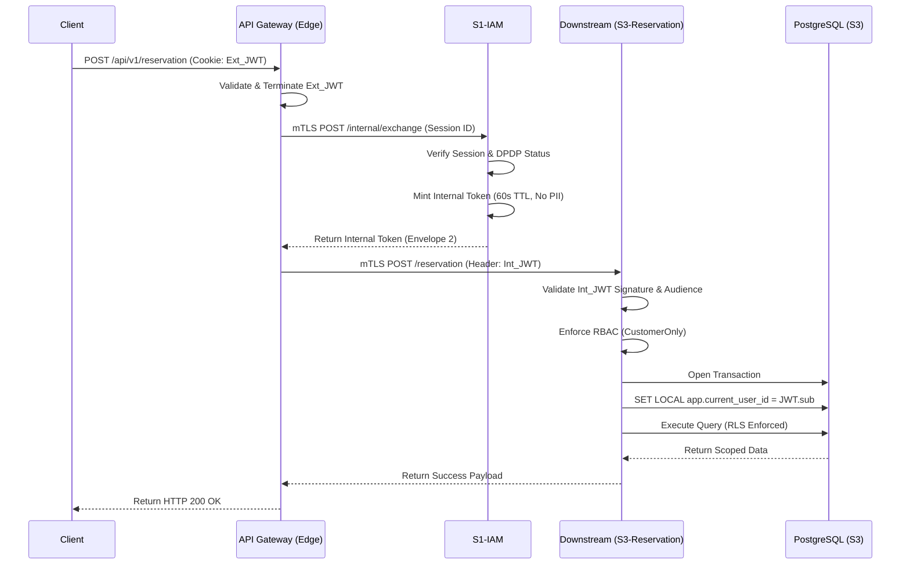

<div align="center">


</div>

# Authentication and Authorization Design

*SRIS — Sarathi Railway Information System*

*A Unified Railway Management Platform*

*Inspired by CRIS and IRCTC · Independent project*

> **Version:** 1.0 | **Date:** 2026-10-29 | **Document ID:** SRIS-P1-SEC-001

| Field              | Value                                                             |
| ------------------ | ----------------------------------------------------------------- |
| Title              | Authentication and Authorization Design                           |
| Software           | SRIS                                                              |
| Software Full Form | Sarathi Railway Information System                                |
| Team Codename      | Project Sarathi                                                   |
| Document ID        | SRIS-P1-SEC-001                                                   |
| Task               | Define detailed authentication, authorization, and zero-trust logic |
| Document Type      | Detailed Design Document                                          |
| Milestone          | Phase 1 Foundation                                                |
| Classification     | Internal                                                          |
| Version            | 1.0                                                               |
| Date               | 2026-10-29                                                        |
| Author             | Koushal Jha, Lead Architect                                       |
| Approved By        | Koushal Jha, Lead Architect                                       |
| Approval Date      | 2026-10-29                                                        |
| Supersedes         | None (first version)                                              |
| Related Documents  | See Appendix B                                                    |
| Affiliation        | Independent · Not affiliated with CRIS, IRCTC, or Indian Railways |

---

#### Table of Contents

1. [Introduction](#1-introduction)
    * [1.1 Purpose](#11-purpose)
    * [1.2 Scope](#12-scope)
    * [1.3 Audience](#13-audience)
2. [Normative References and Terminology](#2-normative-references-and-terminology)
    * [2.1 Normative References](#21-normative-references)
    * [2.2 Terminology](#22-terminology)
3. [Registration Flow & Zero-Plaintext OTP Architecture](#3-registration-flow--zero-plaintext-otp-architecture)
    * [3.1 Data Minimization Intake & SQLi/Bot Defense](#31-data-minimization-intake--sqlibot-defense)
    * [3.2 Redis Key Structure & Hard 90-Second Sequential TTL](#32-redis-key-structure--hard-90-second-sequential-ttl)
    * [3.3 Zero-Plaintext OTP Storage & 3-Attempt Limit](#33-zero-plaintext-otp-storage--3-attempt-limit)
    * [3.4 Dual-Channel Delivery (SMTP & Custom Android SMS Gateway)](#34-dual-channel-delivery-smtp--custom-android-sms-gateway)
    * [3.5 Registration Flow Sequence Diagram](#35-registration-flow-sequence-diagram)
4. [Login Sequence & Argon2id Cryptographic Validation](#4-login-sequence--argon2id-cryptographic-validation)
    * [4.1 Step-by-Step Zero Trust Login Flow](#41-step-by-step-zero-trust-login-flow)
    * [4.2 Argon2id Configuration Table](#42-argon2id-configuration-table)
5. [Telescopic Time-Lock Protocol (Redis Architecture)](#5-telescopic-time-lock-protocol-redis-architecture)
    * [5.1 Account-Scoped Locking Rationale](#51-account-scoped-locking-rationale)
    * [5.2 Redis Key Structures & TTL Mechanics](#52-redis-key-structures--ttl-mechanics)
    * [5.3 Attempt 4+ Pre-Database Interception](#53-attempt-4-pre-database-interception)
6. [Active Defense — Tarpitting & Gaslighting](#6-active-defense--tarpitting--gaslighting)
    * [6.1 Three Exact Heuristic Triggers](#61-three-exact-heuristic-triggers)
    * [6.2 15-Second Non-Blocking Asynchronous Delay Mechanism (Tarpitting)](#62-15-second-non-blocking-asynchronous-delay-mechanism-tarpitting)
    * [6.3 Gaslighting Error Payloads](#63-gaslighting-error-payloads)
7. [Authorization (RBAC) & Double-Envelope Zero Trust Internal Token Minting](#7-authorization-rbac--double-envelope-zero-trust-internal-token-minting)
    * [7.1 Envelope 1 Termination & mTLS Handshake](#71-envelope-1-termination--mtls-handshake)
    * [7.2 Context-Scoped Internal Token Minting (Envelope 2)](#72-context-scoped-internal-token-minting-envelope-2)
    * [7.3 Internal Token Claims & PostgreSQL RLS Injection](#73-internal-token-claims--postgresql-rls-injection)
    * [7.4 RBAC Guard Enforcement, Stateful JTI Anti-Replay & Denial Auditing](#74-rbac-guard-enforcement-stateful-jti-anti-replay--denial-auditing)
    * [7.5 Zero Trust Token Exchange Flow](#75-zero-trust-token-exchange-flow)
8. [Post-Authentication Lifecycle, Recovery & Operational Guards](#8-post-authentication-lifecycle-recovery--operational-guards)
    * [8.1 Multi-Step Registration & Uniqueness Checks](#81-multi-step-registration--uniqueness-checks)
    * [8.2 Refresh Token Rotation & Replay Family Revocation](#82-refresh-token-rotation--replay-family-revocation)
    * [8.3 Logout & Global Session Invalidation](#83-logout--global-session-invalidation)
    * [8.4 Split-Recovery Flow (Self-Service vs. Head-Approval)](#84-split-recovery-flow-self-service-vs-head-approval)
    * [8.5 Operational Guards](#85-operational-guards)
    * [8.6 Strict Session, Device & Timeout Policies](#86-strict-session-device--timeout-policies)
9. [Approval](#9-approval)
* [Revision History](#revision-history)
* [Appendix A: Not Applicable](#appendix-a-not-applicable)
* [Appendix B: Related Documents](#appendix-b-related-documents)

---

## 1. Introduction

### 1.1 Purpose
This document specifies the detailed authentication (AuthN), authorization (AuthZ), active defense, and Double-Envelope Zero Trust internal token exchange design for the `S1-IAM` microservice (`services/node/s1-iam`). It operationalizes the overarching security boundaries established in [SRIS-P1-ARCH-010](../../wave-2-architecture/SRIS-P1-ARCH-010_SecurityArchitectureDocument.md) for the **SRIS** Core Team.

### 1.2 Scope
**In Scope (Phase 1):**
*   Data-minimized 6-field registration flow with Honeypot integration.
*   90-second zero-plaintext OTP generation and dual-channel delivery (SMTP & custom Android SMS Gateway).
*   Strict 3-attempt OTP verification limit.
*   Argon2id password hashing configuration and validation sequence.
*   Redis-backed Telescopic Time-Lock (3 failed attempts = 1-hour account lock).
*   Active Defense heuristics (15-second non-blocking Tarpitting & Gaslighting).
*   Role-Based Access Control (RBAC) enforcement mechanisms.
*   Double-Envelope Zero Trust internal token minting (mTLS, 60-second TTL, and PostgreSQL RLS context injection).

**Out of Scope:**
*   Biometric hardware authentication for web clients (reserved for the Desktop Launcher subsystem per [SRIS-P1-INF-018](../../wave-5-devops-operations/SRIS-P1-INF-018_BiometricSubsystemDesign.md)).
*   C4 restricted government ID (Aadhaar/PAN) verification during registration.

### 1.3 Audience
*   Lead Architect
*   Security Engineers
*   Backend Developers (`s1-iam`, `s2-master-data`, `s3-reservation`, `s4-search-bff`, `s5-payment-gateway`, `s6-notification`)
*   Database Administrators
*   QA Engineers

---

## 2. Normative References and Terminology

### 2.1 Normative References
| Document ID | Title |
|-------------|-------|
| [SRIS-P1-ARCH-001](../../wave-2-architecture/SRIS-P1-ARCH-001_MicroservicesIdentification.md) | Microservices Identification |
| [SRIS-P1-ARCH-010](../../wave-2-architecture/SRIS-P1-ARCH-010_SecurityArchitectureDocument.md) | Security Architecture Document |
| [SRIS-P1-SEC-002](./SRIS-P1-SEC-002_RBACMatrix.md) | RBAC Matrix |
| [SRIS-P1-SEC-003](./SRIS-P1-SEC-003_JWTTokenDesignAndClaims.md) | JWT Token Design and Claims |
| [SRIS-P1-SEC-006](./SRIS-P1-SEC-006_DPDPActComplianceFrameworkPhase1Scoped.md) | DPDP Act Compliance Framework (Phase 1 scoped) |
| [SRIS-P1-SEC-007](./SRIS-P1-SEC-007_ConsentManagementDataModelPhase1Scoped.md) | Consent Management Data Model (Phase 1 scoped) |
| [SRIS-P1-SEC-008](./SRIS-P1-SEC-008_SecretsManagementPlan.md) | Secrets Management Plan |
| [SRIS-P1-SEC-009](./SRIS-P1-SEC-009_PasswordAndCredentialPolicy.md) | Password and Credential Policy |
| [SRIS-P1-INF-007](../../wave-5-devops-operations/SRIS-P1-INF-007_RepositoryStructureAndNaming.md) | Repository Structure and Naming |

### 2.2 Terminology
*   **Double-Envelope Zero Trust:** An architecture where external JWTs are terminated at the API Gateway (Envelope 1), and internal services exclusively use mutually authenticated TLS (mTLS) with short-lived, context-scoped internal tokens (Envelope 2).
*   **Telescopic Time-Lock:** An account-based (not IP-based) locking mechanism that enforces a strict 1-hour authentication block immediately upon 3 consecutive failed login attempts.
*   **Tarpitting:** Injecting an intentional, non-blocking 15-second delay into malicious or heuristic-flagged requests to exhaust attacker automation resources.
*   **Gaslighting:** Returning standard, obfuscated error messages (e.g., `503 Service Unavailable`) after a tarpit delay to prevent attackers from mapping the security topology.
*   **Argon2id:** The hybrid password hashing algorithm chosen for its resistance to both GPU cracking and side-channel timing attacks.
*   **RLS Context Injection:** The process of taking the `account_uuid` from an internal token and injecting it into PostgreSQL via `SET LOCAL app.current_user_id` to enforce data isolation at the database engine layer.

---

## 3. Registration Flow & Zero-Plaintext OTP Architecture

### 3.1 Data Minimization Intake & SQLi/Bot Defense
In strict alignment with [SRIS-P1-SEC-006](./SRIS-P1-SEC-006_DPDPActComplianceFrameworkPhase1Scoped.md), the `s1-iam` registration endpoint (`register.dto.ts`) is heavily locked down:
1.  **6-Field Intake:** The endpoint strictly accepts only Full Name, Mobile Number, Email Address, Date of Birth (DOB), State of Residence, and the ephemeral 6-digit OTP.
2.  **NestJS Validation Pipe:** To proactively prevent SQL Injection (SQLi) and XSS, the global NestJS Validation Pipe aggressively sanitizes and validates all payload data types and lengths before the request reaches the controller logic.
3.  **Honeypot Anti-Bot Defense:** The registration form payload requires a designated, hidden Honeypot field (e.g., `middle_initial`). If an automated bot fills this field, the backend interceptor silently drops the request and returns a `200 OK` (Gaslighting) without ever opening a PostgreSQL connection.

### 3.2 Redis Key Structure & Hard 90-Second Sequential TTL
To uphold the Anonymization Mandate and prevent PII leakage in Redis keyspace scans, S1-IAM generates an ephemeral session UUID (`reg_session_uuid`) upon initial submission.
*   **Keys:** `otp:email:{reg_session_uuid}`, `reg:progress:{reg_session_uuid}`, and `otp:mobile:{reg_session_uuid}`
*   **Sequential Atomic Expiry (TRAI SIM Defense):** As detailed in Section 8.1, OTP keys are strictly sequential rather than simultaneous. Step 1 creates `otp:email:{reg_session_uuid}` using an atomic `SET ... EX 90` command (**90-second TTL**). Only after Email OTP verification succeeds does S1-IAM record progression in `reg:progress:{reg_session_uuid}` (`EX 300`) and generate `otp:mobile:{reg_session_uuid}` with its own independent **90-second TTL** (`SET ... EX 90`). If either OTP is not verified within its 90-second window, the key is automatically evicted from memory.

### 3.3 Zero-Plaintext OTP Storage & 3-Attempt Limit
Under no circumstances are OTP values persisted in plaintext in Redis, PostgreSQL, or application logs.
*   **HMAC-SHA256 Storage:** When the 6-digit OTP is generated, it is hashed using a KMS-managed pepper: `HMAC-SHA256(KMS_Pepper, reg_session_uuid || OTP_Plaintext)`. Only this hash is stored in Redis.
*   **Constant-Time Validation:** Verification in `auth.service.ts` uses `crypto.timingSafeEqual()` to prevent timing side-channel attacks. 
*   **Strict 3-Attempt Limit (Atomic Pre-Validation Decrement):** The Redis hash payload tracks `attempts_remaining` (initialized to `3`). To prevent HTTP/2 parallel race conditions (TOCTOU) where a hacker sends multiple requests simultaneously, `s1-iam` executes an atomic Redis Lua script (`EVAL`) that decrements `attempts_remaining` *prior* to `crypto.timingSafeEqual()` evaluation. On the 3rd failed attempt (`attempts_remaining == 0`), or upon successful verification, the script atomically executes `DEL` on `otp:{channel}:{reg_session_uuid}` and `reg:progress:{reg_session_uuid}`, preventing intra-window replay and parallel brute-forcing.

### 3.4 Dual-Channel Delivery (SMTP & Custom Android SMS Gateway)
*   **Email Delivery (Standard SMTP):** Outbound email events are pushed to `s6-notification`, passed through `email-validator.ts` and `pii-masker.ts` (redacting to `u***@domain.com`), and dispatched via standard SMTP (`email-sender.service.ts`).
*   **SMS Delivery (Custom Android Gateway):** SRIS deliberately avoids paid third-party APIs (like Twilio) for Phase 1. Instead:
    1.  `s1-iam` pushes the SMS payload to the Redis Stream monitored by `s6-notification` (`sms-sender.service.ts`).
    2.  The payload crosses the Tailscale Zero-Trust mesh via mTLS to reach the embedded Kotlin HTTPS server (`clients/mobile/android-sms-gateway`).
    3.  The Android application (`SmsQueueWorker.kt`), secured by APK signature checks and root detection, queues the payload into a local Room SQLite database and physically transmits the SMS using the host device's SIM card (`LocalSmsProvider.kt`), returning a hardware delivery receipt to the backend with zero PII logging.
    4.  **SMS Gateway Circuit Breaker, DLQ Backpressure & OOM Prevention:** To handle scenarios where the Android device loses cellular connectivity, runs out of battery, or crashes during peak traffic, `s6-notification` enforces a strict **120-second SMS Gateway Circuit Breaker timeout**. If no hardware delivery acknowledgment is received within 120 seconds, the message is routed to a Dead-Letter Queue (DLQ), and the client UI presents a secure fallback option to resend the OTP via standard SMTP or trigger an automated voice OTP gateway. To prevent OOM (Out-Of-Memory) memory exhaustion during prolonged gateway outages, Redis Stream queues enforce a strict **`MAXLEN ~ 50000`** cap with automatic trimming and a 3-retry limit before routing unacknowledged messages to a persistent object-storage DLQ.

### 3.5 Registration Flow Sequence Diagram

```mermaid
sequenceDiagram
    participant C as Client
    participant W as Nginx Edge WAF
    participant S1 as S1-IAM
    participant R as Redis
    participant S6 as S6-Notification
    participant AG as Android Gateway (SIM)

    C->>W: POST /register/init (6 Fields + Honeypot)
    W->>S1: Forward Request`
    S1->>S1: Validation Pipe (SQLi) & Honeypot Check
    S1->>S1: Generate Email OTP & HMAC-SHA256
    S1->>R: SET otp:email:{reg_uuid} Hash EX 90
    S1->>S6: Publish Email OTP Event (SMTP)
    S6-->>C: Deliver Email OTP
    C->>W: POST /verify-email-otp
    W->>S1: Forward Email OTP Verification
    S1->>R: GET otp:email:{reg_uuid} & timingSafeEqual()
    S1->>R: DEL otp:email:{reg_uuid} & SET reg:progress:{reg_uuid} EX 300
    S1->>S1: Generate Mobile OTP & HMAC-SHA256
    S1->>R: SET otp:mobile:{reg_uuid} Hash EX 90
    S1->>S6: Publish SMS OTP Dispatch Event
    S6->>AG: mTLS POST /send-sms
    AG->>AG: Enqueue in SQLite & Transmit via Host SIM
    AG-->>C: Deliver SMS to User Phone
    C->>W: POST /verify-mobile-otp
    W->>S1: Forward Mobile OTP Verification
    S1->>R: GET otp:mobile:{reg_uuid}
    S1->>S1: crypto.timingSafeEqual()
    alt Verification Success
        S1->>R: DEL otp:mobile:{reg_uuid}
        S1->>S1: Complete DB Registration (V1__create_users.sql)
    else Verification Failure
        S1->>R: Decrement attempts_remaining
        opt Attempts == 0
            S1->>R: DEL otp:mobile:{reg_uuid} (Session Destroyed)
        end
    end
````

## 4. Login Sequence & Argon2id Cryptographic Validation

### 4.1 Step-by-Step Zero Trust Login Flow
The authentication sequence for `s1-iam` enforces strict, defense-in-depth principles, validating requests securely prior to any database queries:

1.  **Edge Nginx WAF Scrubbing:** The client submits a payload (`POST /api/v1/auth/login`) bound to `login.dto.ts`. The Edge Nginx WAF inspects this payload for SQL Injection, Cross-Site Scripting (XSS), and malformed headers prior to reaching the backend.
2.  **Pre-Database Redis Lockout Check:** The API Gateway and S1-IAM's `rate-limit.interceptor.ts` compute a deterministic KMS-peppered HMAC of the normalized login identifier (`account_id_hash = HMAC-SHA256(KMS_Pepper, lower(trim(identifier)))`). They check Redis for an active lockout key (`auth:lockout:{account_id_hash}`) and evaluate heuristic threat flags. If a lockout is active, the request is short-circuited in memory (see Section 5).
3.  **Parameterized Record Lookup:** `auth.controller.ts` invokes `auth.service.ts`, which queries the PostgreSQL database via `user.repository.ts`. It utilizes strict parameterized Prepared Statements against `V1__create_users.sql` to retrieve `user.entity.ts` and `password-hash.vo.ts`.
4.  **Argon2id Verification & Constant-Time Dummy Hash Execution:** `password-hasher.service.ts` verifies the plaintext password input against the stored, peppered PHC hash string. **Constant-Time Anti-Enumeration Rule:** If `user.repository.ts` returns `null` (indicating the username does not exist in `V1__create_users.sql`), `password-hasher.service.ts` must still execute `argon2.verify()` against a pre-generated in-memory dummy PHC hash (`m=65536, t=3, p=4`) before returning `SRIS-AUTH-4010`. This equalizes backend response latency (~250–350 ms) across valid and non-existent accounts, neutralizing timing side-channel username enumeration.
5.  **DPDP Active Consent Gate:** Upon password verification, `consent.guard.ts` queries `V4__create_consent_records.sql` and `V9__add_consent_versioning.sql` ([SRIS-P1-SEC-007](./SRIS-P1-SEC-007_ConsentManagementDataModelPhase1Scoped.md)) to confirm active consent status. If consent is missing or revoked, token issuance is halted via `consent-required.exception.ts`.
6.  **Session & Token Issuance:** `session.service.ts` registers an active session in `V3__create_sessions.sql` and caches `session:active:{sid}` in Redis. `refresh-token-rotator.service.ts` persists a single-use refresh token in `V2__create_refresh_tokens.sql`, and `token-signer.service.ts` mints the external JWT, setting it in an `HttpOnly; Secure; SameSite=Strict` cookie.

---

### 4.2 Argon2id Configuration Table
In accordance with Rule 103 (Secure Coding) and Rule 115 (Secrets Management), `password-hasher.service.ts` enforces the Argon2id (`v=19`) algorithm with the following parameters:

| Parameter | Configuration Value | Architectural Rationale |
| :--- | :--- | :--- |
| **Variant** | `Argon2id` | Combines Argon2d (GPU resistance) and Argon2i (side-channel resistance). |
| **Memory Cost (`m`)** | `65536 KiB` (64 MB) | Thwarts parallel GPU arrays by forcing high RAM allocation per hash. |
| **Time Cost / Iterations (`t`)** | `3` | Optimized for ~250–350 ms verification latency on S1-IAM nodes. |
| **Parallelism (`p`)** | `4` lanes | Aligned with the vCPU thread allocation for `s1-iam` Docker containers. |
| **Salt Length** | `16 bytes` (128-bit) | CSPRNG salt generated per write/rotation (`V8__add_password_rotation_columns.sql`). |
| **Output Tag Length** | `32 bytes` (256-bit) | Digest length stored in `password-hash.vo.ts`. |
| **KMS Secret Pepper** | `256-bit HMAC Key` | Injected via Vault/KMS; prevents offline brute-forcing of SQL dumps. |

---

## 5. Telescopic Time-Lock Protocol (Redis Architecture)

### 5.1 Account-Scoped Locking Rationale
SRIS strictly rejects IP-based rate limiting as a primary defense. Due to Carrier-Grade NAT (CGNAT) and dynamic ISPs across India, IP blocking can inadvertently deny service to thousands of legitimate users sharing a public IP. Instead, the locking mechanism is exclusively scoped to the `account_uuid`.

### 5.2 Redis Key Structures & TTL Mechanics
The Telescopic Time-Lock is managed by `rate-limit.interceptor.ts` and employs two distinct Redis keys, indexed by a deterministic KMS-peppered HMAC of the login identifier (`account_id_hash = HMAC-SHA256(KMS_Pepper, lower(trim(identifier)))`) to allow pre-database interception without exposing plaintext PII:

1.  **Failure Counter Key:**
    *   **Key:** `auth:fail_count:{account_id_hash}`
    *   **Value:** Integer (`1`, `2`, `3`)
    *   **TTL:** `900` seconds (A 15-minute sliding observation window. Reset via `DEL` upon a successful login before Attempt 4).

2.  **Account Lockout Key (The 1-Hour Lock):**
    *   **Key:** `auth:lockout:{account_id_hash}`
    *   **Value:** JSON metadata containing a composite fingerprint hash and lock timestamp.
    *   **TTL:** Strictly **`3600` seconds (1 Hour)**. Triggered immediately upon the 3rd failed attempt.

### 5.3 Attempt 4+ Pre-Database Interception
The Telescopic Time-Lock operates via the following state transitions:

*   **Attempts 1 to 3 (Standard Validation):** Cryptographic verification executes normally. Failed attempts increment the `auth:fail_count:{account_id_hash}` key.
*   **Attempt 3 (Failed):** Upon the third failure, the interceptor triggers an atomic Redis pipeline. It sets the `auth:lockout:{account_id_hash}` key with a 3600-second TTL, deletes the failure counter, and writes a PII-masked audit event to `V6__create_audit_log.sql` (Rule 114).
*   **Attempt 4 (During Lock):** When a request arrives during an active 1-hour lock, `rate-limit.interceptor.ts` queries `GET auth:lockout:{account_id_hash}` at the NestJS interceptor layer. Because Redis confirms the lock in `< 1 ms`, the request is rejected immediately. This short-circuit completely prevents S1-IAM from opening a PostgreSQL connection or executing Argon2id hashing, protecting the backend from credential stuffing. To prevent targeted Denial-of-Service ("Lockout Sniping") against known usernames, a legitimate user locked out by third-party failed attempts can clear `auth:lockout` out-of-band by completing the verified Mobile OTP Split-Recovery flow (Section 8.4).

## 6. Active Defense — Tarpitting & Gaslighting

### 6.1 Three Exact Heuristic Triggers
In strict adherence to the Frontend Prohibition mandate (zero client-side security enforcement), all heuristic threat evaluation occurs exclusively at the Edge WAF and the `s1-iam` backend. The system monitors for three specific triggers:

1.  **Trigger 1 — Anomalous Network Origin (Geo-Fence & Proxy Violation):** The Edge Nginx WAF or upstream network intelligence layer flags the inbound IP address as belonging to a known commercial VPN exit node, Tor relay, anonymous datacenter ASN, or a non-Indian IP range, violating sovereign routing policies.
2.  **Trigger 2 — Compromised Host / Device Attestation Failure:** The request originates from a mobile client or desktop launcher environment that fails hardware/APK cryptographic attestation or triggers root, jailbreak, or rootkit detection protocols.
3.  **Trigger 3 — Client Tampering & Lockout Abuse:** Backend telemetry inspection detects active Developer Mode or ADB Debugging flags, headless browser automation signatures (e.g., Playwright/Selenium/cURL header mismatches), or a repeated request targeted against an account that is already in an active 1-hour Telescopic Time-Lock.

### 6.2 15-Second Non-Blocking Asynchronous Delay Mechanism (Tarpitting)
If any of the three heuristic triggers are activated, `rate-limit.interceptor.ts` executes a Tarpitting protocol to exhaust attacker resources. 

*   **Event-Loop Safety:** Because `s1-iam` runs on a single-threaded Node.js (NestJS) event loop, executing a synchronous CPU sleep would starve legitimate railway passengers. Instead, the interceptor shunts the request into a non-blocking asynchronous state:
    ```typescript
    await new Promise<void>((resolve) => setTimeout(resolve, 15000));
    ```
*   **Execution Profile:** Node.js delegates the 15,000 ms timer handle to the OS asynchronous I/O demultiplexer (epoll). This holds the client connection open—forcing the attacker's script to wait—without consuming a Node.js worker thread or a PostgreSQL connection pool slot.
*   **CGNAT-Safe Semaphore Cap:** To prevent a botnet from exhausting sockets or causing collateral Denial-of-Service to legitimate passengers sharing an Indian CGNAT IPv4 subnet, Nginx and Redis enforce an isolated **Tarpit Pool Cap** (`tarpit:sockets:{subnet}`) that applies *exclusively* to connections that have tripped Heuristic Triggers 1–3. Excess heuristic-flagged connections beyond the cap skip the 15-second wait and are immediately dropped (`444 No Response`), while unflagged passenger traffic on the same subnet flows unimpeded.

### 6.3 Gaslighting Error Payloads
Following the expiration of the 15-second tarpit timer, `response-envelope.interceptor.ts` returns a standard, obfuscated JSON response. These payloads reveal absolutely zero information regarding whether the account exists, whether a password was correct, or which heuristic rule triggered the defense.

**Standard Auth/Login Gaslight Payload (`HTTP 401 Unauthorized`):**
```json
{
  "errorCode": "SRIS-AUTH-4010",
  "message": "Unable to process authentication request with the provided parameters. Please verify your details and try again.",
  "traceId": "<w3c-trace-uuid>"
}
```

**High-Velocity / Environment Tamper Gaslight Payload (`HTTP 503 Service Unavailable`):**
```json
{
  "errorCode": "SRIS-SYS-5030",
  "message": "Service temporarily unavailable due to routine synchronization. Please try again shortly.",
  "traceId": "<w3c-trace-uuid>"
}
```

## 7. Authorization (RBAC) & Double-Envelope Zero Trust Internal Token Minting

### 7.1 Envelope 1 Termination & mTLS Handshake
SRIS operates on a strict Double-Envelope Zero Trust architecture. The external JWT supplied by the client (stored in an `HttpOnly` cookie) is considered Envelope 1. 

1.  **Termination:** The external JWT is intercepted and completely terminated at the Edge API Gateway. It is never forwarded into the internal microservice mesh.
2.  **Mutual TLS (mTLS):** To exchange the terminated token for internal access, the API Gateway initiates a mutually authenticated TLS 1.3 (mTLS) handshake with `s1-iam`. Both services present X.509 workload certificates provisioned by the internal Vault Certificate Authority. `s1-iam` explicitly verifies the Gateway’s client certificate signature and Subject Alternative Name (`spiffe://sris.internal/service/api-gateway`).

### 7.2 Context-Scoped Internal Token Minting (Envelope 2)
Upon a successful mTLS handshake, `token-signer.service.ts` within `s1-iam` verifies that the requested session ID is active in the database and that the user's cryptographic KMS key has not been crypto-shredded. 

`s1-iam` then mints an asymmetric internal token (Envelope 2) using an internal EdDSA/RS256 private key. This token is highly ephemeral, carrying a strict **60-second Time-To-Live (TTL)** (`exp = iat + 60`). The token self-destructs immediately after the synchronous internal network call completes. To account for microsecond NTP jitter across distributed container nodes, downstream verifiers enforce a mandatory **5-second clock skew leeway window** (`leeway: 5`) during token validation.

### 7.3 Internal Token Claims & PostgreSQL RLS Injection
To comply with data minimization and privacy mandates, the internal token contains zero plaintext PII (no names or phone numbers). It carries only the precise context required for downstream routing and database isolation:

| Claim Key | Example Value | Security & Architectural Purpose |
| :--- | :--- | :--- |
| `iss` | `"urn:sris:s1-iam:internal"` | Identifies `s1-iam` as the authoritative internal issuer. |
| `sub` | `"550e8400-e29b-41d4-a716-446655440000"` | **Account UUID**. Downstream services inject this into PostgreSQL via `SET LOCAL app.current_user_id` to enforce Row-Level Security (RLS). |
| `aud` | `"urn:sris:service:s3-reservation"` | Strict audience binding preventing lateral token replay across different microservices. |
| `role` | `"CUSTOMER"` | Enforced downstream by RBAC guards (`CustomerOnly.java`, `EmployeeOnly.java`). |
| `scp` | `"reservation:book"` | Granular, route-specific permission scope. |
| `sid` | `"9b1deb4d-3b7d..."` | Active Session ID binding. |
| `cns_ver` | `"v1.0.0"` | Verified active DPDP consent policy version. |
| `trace_id` | `"4bf92f3577b3..."` | W3C OpenTelemetry Trace ID for distributed logging. |
| `jti` | `"c9a646d3-9c61..."` | Unique nonce to block intra-window (60s) replay attacks. |

### 7.4 RBAC Guard Enforcement, Stateful JTI Anti-Replay & Denial Auditing
Downstream authorization is decentralized but standardized. `internal-token-verifier.service.ts` (for Node.js) and `InternalAuthFilter.java` (for Java/Spring Boot) validate the internal token's asymmetric signature, audience (`aud`), and claims.

*   **Stateful `jti` Replay Prevention (One-Time-Use Mutation Guard):** To prevent an attacker or compromised internal container from replaying a captured Envelope 2 token within its 60-second validity window, `InternalAuthFilter.java` and `internal-token-verifier.service.ts` enforce a stateful nonce check on all state-mutating operations (`POST`, `PUT`, `PATCH`, `DELETE`). The verifier executes an atomic Redis command: `SET internal:jti:{jti} 1 NX EX 60`. If Redis returns `nil` (indicating the `jti` nonce was already consumed), the request is immediately rejected as an intra-window replay attack and logged to the WORM audit trail.
*   **Local RBAC & Denial Auditing:** Role verification and user context extraction are enforced locally by decorators and annotations (`@Roles()`, `@CurrentUser()` via `current-user.decorator.ts`, `@CustomerOnly`, and `@EmployeeOnly`). If a valid internal token attempts to access an endpoint outside its authorized `role` or `scp`, the request is blocked, and the violation is immediately dispatched to `role-denial-audit.service.ts` to be written to `V6__create_audit_log.sql`.

---

### 7.5 Zero Trust Token Exchange Flow



## 8. Post-Authentication Lifecycle, Recovery & Operational Guards

### 8.1 Multi-Step Registration & Uniqueness Checks
The SRIS registration flow is designed as a rigorous, multi-step process that enforces data minimalism, protects physical SMS gateway hardware from carrier quota exhaustion, and guarantees absolute uniqueness across the platform.

1.  **Inverted Multi-Step UI Flow (TRAI SIM Quota Defense):** To prevent automated botnets from exhausting the daily carrier SMS limit on the physical host SIM card (`clients/mobile/android-sms-gateway`), registration strictly enforces an **Email-First** verification sequence: **Email OTP (SMTP) -> Mobile OTP (Android SIM) -> Complete**.
    *   *Step 1 (Email OTP):* Upon initial submission, `s1-iam` generates `otp:email:{reg_session_uuid}` with an independent **90-second TTL** (`EX 90`) and dispatches the code via free SMTP (`email-sender.service.ts`).
    *   *Step 2 (Progression Gate & Mobile OTP):* Once the Email OTP is verified, `s1-iam` deletes the email OTP key, writes a progression state key `reg:progress:{reg_session_uuid}` (`EX 300`) recording `{"email_verified": true}`, and **only then** generates `otp:mobile:{reg_session_uuid}` with a fresh, independent **90-second TTL** (`EX 90`) for dispatch through the Android SMS Gateway (further guarded by `RequestRateLimiter.kt`).
    *   *Step 3 (Completion):* Once the Mobile OTP is verified, `reg:progress:{reg_session_uuid}` is updated to `{"email_verified": true, "mobile_verified": true}`. In accordance with the Frontend Prohibition mandate (Rule 050), the frontend completion action remains disabled until the backend confirms both flags in `reg:progress:{reg_session_uuid}`.
2.  **Absolute Uniqueness Constraints (Anti-Enumeration Gaslighting):** The backend strictly rejects any registration payload containing a duplicate Username, Mobile Number, or Email Address. To prevent account enumeration via registration, duplicate Email or Mobile submissions return the identical HTTP 200 OK gaslight response to the caller ("OTP dispatched") while silently dispatching a private alert to the existing account owner. All new passwords must pass `password-strength.validator.ts` prior to Argon2id hashing.
3.  **Auto-Generated Username & Persistent Customization Flag:** Upon final registration commit, `s1-iam` automatically generates a cryptographically unique username, sets `is_username_customized = FALSE` in `V1__create_users.sql`, and dispatches the username via both Email (SMTP) and the Android SMS Gateway. On every subsequent login where `is_username_customized == FALSE`, the user is routed to a mandatory prompt (`profile.controller.ts` / `update-profile.dto.ts`) to set their custom username, ensuring connection drops during first login never trap the user with a system-generated handle.

---

### 8.2 Refresh Token Rotation & Replay Family Revocation
To mitigate token theft, SRIS completely abandons static, long-lived refresh tokens. `refresh-token-rotator.service.ts` enforces a strict One-Time-Use protocol:

*   **Rotation:** Every time a client exchanges a valid refresh token for a new access token (Envelope 2), `s1-iam` invalidates the used refresh token in `V2__create_refresh_tokens.sql` and issues a brand-new refresh token to the client.
*   **Family Revocation (Theft Detection):** If a malicious actor steals a refresh token and attempts to use it *after* the legitimate client has already rotated it, `s1-iam` throws `token-reused.exception.ts`. The system assumes the entire session family is compromised, immediately revoking all associated refresh tokens in `V2` and the master session in `V3__create_sessions.sql`, forcing all devices attached to that session to re-authenticate.

### 8.3 Logout & Global Session Invalidation
In a stateless JWT architecture, deleting the token on the client side is insufficient. `s1-iam` enforces authoritative backend session termination.

*   When a client submits `POST /logout` (`logout.dto.ts`), `session.service.ts` updates `V3__create_sessions.sql` to mark the session as terminated.
*   It immediately deletes the active session key in Redis (`session:active:{sid}`).
*   It clears the `HttpOnly` cookie.
*   Consequently, the API Gateway is instantly prevented from minting any further 60-second Envelope 2 internal tokens for that session ID, guaranteeing true global logout across all microservices.

### 8.4 Split-Recovery Flow (Self-Service vs. Head-Approval)
SRIS implements a bifurcated account recovery architecture (`V5__create_password_reset_tokens.sql` and `password-reset.controller.ts`) tailored to the user's role authorization level, preventing lateral escalation attacks against privileged accounts.

*   **Zero Account Enumeration (Gaslighting):** All recovery request endpoints return an identical `HTTP 200 OK` response whether the provided identifier exists or not, preventing attackers from harvesting valid usernames or mobile numbers.
*   **Customer & Mid-Level Employee Self-Service:**
    *   *Forgot Password:* The user submits their Username -> Receives an ephemeral OTP via Mobile -> Submits OTP -> Sets a new password -> The system automatically logs them in and purges all previous `V2` and `V3` sessions.
    *   *Forgot Username:* The user submits their Mobile Number -> Receives an ephemeral OTP via Mobile -> Sets a new Username -> The system automatically logs them in.
*   **High-Level Admin Recovery Lock:** Accounts designated with high-level administrative roles (`ADMIN`, `STATION_MASTER`) are strictly prohibited from utilizing self-service recovery endpoints. If an admin initiates a recovery request, the system routes the request to a manual approval queue. The System Head (Lead Architect) must manually review, approve, and cryptographically trigger the reset token generation before the admin can regain access.

### 8.5 Operational Guards
`s1-iam` relies on a defense-in-depth perimeter consisting of six core operational guards:

1.  **Default-Deny Guard Architecture:** `jwt-auth.guard.ts` is registered globally as an `APP_GUARD`. All routes are secured by default. Only endpoints explicitly decorated with `@Public()` (e.g., `/login`, `/register/init`, `/verify-email-otp`, `/verify-mobile-otp`, and internal Docker-network-scoped `health.controller.ts` / `metrics.controller.ts` probes) bypass JWT verification. Every guard execution also verifies the `user-status.enum.ts` to ensure the account is not `LOCKED` or `SHREDDED`.
2.  **Idempotency Checks:** To protect against double OTP dispatch or false token-reuse lockouts caused by moving trains and packet drops, `idempotency.interceptor.ts` guards all state-mutating auth requests (`/register`, `/refresh`, `/password-reset`) using `idempotency-header.schema.yaml`.
3.  **Maintenance Admin Bypass:** When `maintenance.interceptor.ts` is active, standard `CUSTOMER` traffic is blocked (`maintenance-response.schema.yaml`). However, internal tokens bearing the `ADMIN` role or `sris-launcher` provenance bypass this block to administer the system.
4.  **Redis, mTLS & PostgreSQL Fail-Safe (Fail-Closed):** If the Redis cluster suffers a network partition (`redis.health-indicator.ts` fails), an mTLS/SPIFFE certificate verification fails, or a PostgreSQL connection failure/pool exhaustion occurs during session validation in `token-signer.service.ts`, the system prevents brute-force bypassing and thread starvation by **failing closed**. The `/login`, `/register`, and `/internal/exchange` endpoints, along with stateful `jti` mutation guards (`POST`, `PUT`, `PATCH`, `DELETE`), return a `503 Service Unavailable` (SRIS-SYS-5030) gaslight envelope until services are restored. Furthermore, Redis clusters strictly enforce `min-replicas-to-write 1` and `min-replicas-max-lag 10` combined with Sentinel fencing to reject writes during split-brain partitions, ensuring absolute consistency. A local in-memory `throttler.config.ts` fallback is used strictly for read-only operations.
5.  **Zero-Downtime Key Rotation (`kid`):** To prevent token validation failures during Vault asymmetric key rotation, `token-signer.service.ts` embeds a Key ID (`kid`) in the JWT header. Downstream verifiers utilize a 5-minute Dual-Key Verification Window (`CURRENT_KEY` + `PREVIOUS_KEY`) to ensure seamless in-flight request processing.
6.  **Extensive WORM Audit Chaining & Migrations:** Storage (7 TB) is not considered a constraint, but memory must be preserved by writing directly to disk. Every authentication event (OTP dispatched, login failed, password reset, lockout triggered) is PII-masked (`log-masker.ts`) and appended directly to `V6__create_audit_log.sql`. The log enforces a WORM (Write-Once-Read-Many) hash chain: `current_entry_hash = SHA256(prev_entry_hash || payload || timestamp)`, ensuring absolute tamper evidence for enterprise audits. Furthermore, database migrations strictly reference `V7__add_retention_indexes.sql` for automated token purging, the `U1__drop_users.sql`–`U9__drop_consent_versioning.sql` rollback scripts (Rule 053), the bootstrap process via `09-create-initial-admin.sql`, and the Prisma ORM schema (`services/node/s1-iam/prisma/schema.prisma`).

### 8.6 Strict Session, Device & Timeout Policies

To further fortify the S1-IAM zero-trust perimeter, the following critical session management policies are enforced across all client surfaces:

1.  **SINGLE ACTIVE SESSION POLICY (Atomic Multi-Layer Device Lock):**
    S1-IAM strictly enforces a single active session per user account to prevent concurrent credential exploitation and eliminate "Zombie Refresh" ping-pong loops between competing devices. If a user successfully authenticates on Device B while an active session (`sid_A`) exists for Device A, `session.service.ts` executes an atomic, three-layer teardown of Device A:
    *   **Redis Layer:** Executes `DEL session:active:{sid_A}` to immediately block API Gateway internal token exchanges.
    *   **PostgreSQL Session Layer (`V3__create_sessions.sql`):** Executes `UPDATE sessions SET status = 'SUPERSEDED_BY_NEW_DEVICE' WHERE session_id = sid_A`.
    *   **PostgreSQL Refresh Token Layer (`V2__create_refresh_tokens.sql`):** Executes `UPDATE refresh_tokens SET is_revoked = TRUE WHERE session_id = sid_A`, preventing Device A's frontend interceptor from silently refreshing its dead session.
    When Device A attempts its next request or token refresh, the API Gateway terminates the call with `HTTP 401 Unauthorized`, and the frontend displays the exact prompt: *"Your ID is logged in on another device. Please re-login."* To guard against Redis master-replica replication lag in clustered environments, the API Gateway executes a **dual-check validation** during `/internal/exchange`: if Redis returns a cache hit for `session:active:{sid}`, the gateway must explicitly verify that the session status in PostgreSQL (`V3__create_sessions.sql`) is not marked `SUPERSEDED_BY_NEW_DEVICE` or `TERMINATED`.

2.  **15-MINUTE SLIDING IDLE AUTO-LOGOUT:**
    To mitigate the risk of unattended device hijacking while avoiding premature disconnects for active users, S1-IAM enforces a **15-minute sliding inactivity Time-To-Live (TTL)** on all `session:active:{sid}` keys in Redis. Every successful authenticated request routed through `/internal/exchange` resets the idle timer in Redis via `EXPIRE session:active:{sid} 900` (bounded by the absolute maximum session lifetime in `V3__create_sessions.sql`). If no authenticated request is made within 15 consecutive minutes, the Redis key expires silently, rendering the `HttpOnly` cookie invalid and forcing re-authentication.

3.  **CRITICAL ACTION GUARD (1-Minute Absolute Expiry Check & In-Modal Step-Up):**
    Before executing high-value state mutations—specifically the `s3-reservation` Payment Checkout flow—the API Gateway and client inspect the **absolute cryptographic expiration (`exp` claim)** of the user's external session/token (rather than the sliding idle TTL). If the session has less than **60 seconds** of absolute validity remaining, the system blocks immediate payment dispatch and prompts: *"Session expiring. Please re-login to secure your transaction."* This triggers an in-modal Step-Up Password/OTP re-authentication that rotates the session credentials in-place **without** destroying the user's active booking context or releasing their `s3-reservation` seat locks (`V12__add_seat_lock_columns.sql`).

## 9. Approval

| Role           | Name          | Decision | Date       |
| -------------- | ------------- | -------- | ---------- |
| Lead Architect | Koushal Jha   | Approved | 2026-10-29 |

---

## Revision History

| Version | Date       | Author      | Change           |
| ------- | ---------- | ----------- | ---------------- |
| 1.0     | 2026-10-29 | Koushal Jha | Initial release. |

---

## Appendix A: Not Applicable

Not applicable.

---

## Appendix B: Related Documents

### B.1 Directly Referenced Documents

| Seq  | Document ID      | Document Name                              | Wave | Pri | Tag     |
| ---- | ---------------- | ------------------------------------------ | ---- | --- | ------- |
| 2.10 | [SRIS-P1-ARCH-010](../../wave-2-architecture/SRIS-P1-ARCH-010_SecurityArchitectureDocument.md) | Security Architecture Document             | 2    | P1  | FOLLOW  |
| 3.44 | [SRIS-P1-SEC-006](./SRIS-P1-SEC-006_DPDPActComplianceFrameworkPhase1Scoped.md) | DPDP Act Compliance Framework (Phase 1)    | 3    | P0  | UNBLOCK |
| 3.45 | [SRIS-P1-SEC-007](./SRIS-P1-SEC-007_ConsentManagementDataModelPhase1Scoped.md) | Consent Management Data Model              | 3    | P0  | UNBLOCK |
| 5.7  | [SRIS-P1-INF-007](../../wave-5-devops-operations/SRIS-P1-INF-007_RepositoryStructureAndNaming.md) | Repository Structure and Naming            | 5    | P1  | FOLLOW  |

### B.2 Documents That Reference This Document

| Seq  | Document ID      | Document Name                                    | Why It References                                                              |
| ---- | ---------------- | ------------------------------------------------ | ------------------------------------------------------------------------------ |
| 3.40 | [SRIS-P1-SEC-002](./SRIS-P1-SEC-002_RBACMatrix.md) | RBAC Matrix                                      | Depends on the mTLS and Zero Trust boundaries established here.                |
| 3.41 | [SRIS-P1-SEC-003](./SRIS-P1-SEC-003_JWTTokenDesignAndClaims.md) | JWT Token Design and Claims                      | Relies on the internal token claims and PostgreSQL RLS context mapping.        |
| 3.20 | [SRIS-P1-API-007](../api/SRIS-P1-API-007_APIAuthenticationAndHeaderRules.md) | API Authentication and Header Rules              | References the API Gateway external JWT termination and internal header rules. |

### B.3 Documents This Document Depends On (Upstream)

| Seq  | Document ID      | Document Name                              | Dependency Type |
| ---- | ---------------- | ------------------------------------------ | --------------- |
| 0.0  | [SRIS-P1-GOV-001](../../wave-0-project-foundation/SRIS-P1-GOV-001_DocumentationIndexAndNavigationMap.md) | Documentation Index and Navigation Map     | Soft            |
| 2.10 | [SRIS-P1-ARCH-010](../../wave-2-architecture/SRIS-P1-ARCH-010_SecurityArchitectureDocument.md) | Security Architecture Document             | Hard            |
| 3.44 | [SRIS-P1-SEC-006](./SRIS-P1-SEC-006_DPDPActComplianceFrameworkPhase1Scoped.md) | DPDP Act Compliance Framework (Phase 1)    | Hard            |

### B.4 Documents This Document Unblocks (Downstream)

| Seq  | Document ID      | Document Name                                    | Blocked Until |
| ---- | ---------------- | ------------------------------------------------ | ------------- |
| 3.40 | [SRIS-P1-SEC-002](./SRIS-P1-SEC-002_RBACMatrix.md) | RBAC Matrix                                      | This approved |
| 3.41 | [SRIS-P1-SEC-003](./SRIS-P1-SEC-003_JWTTokenDesignAndClaims.md) | JWT Token Design and Claims                      | This approved |

### B.5 Master Documentation Index

The complete list of Phase 1 documents is in [SRIS-P1-GOV-001](../../wave-0-project-foundation/SRIS-P1-GOV-001_DocumentationIndexAndNavigationMap.md) — Documentation Index and Navigation Map.

### B.6 External Reference Documents

| Title                   | Authority | Relevance                                                                 |
| ----------------------- | --------- | ------------------------------------------------------------------------- |
| Argon2 Specification    | IETF RFC 9106 | Cryptographic standard for the password hashing algorithm applied in S1-IAM. |
| DPDP Act, 2023          | Government of India | Legal framework dictating data minimization during the 6-field registration. |

### B.7 Document Conventions

The conventions for Priority and Tag values are defined in Section 9 of [SRIS-P1-GOV-002](../../wave-0-project-foundation/SRIS-P1-GOV-002_DocumentTemplateStandard.md) — Document Template Standard.