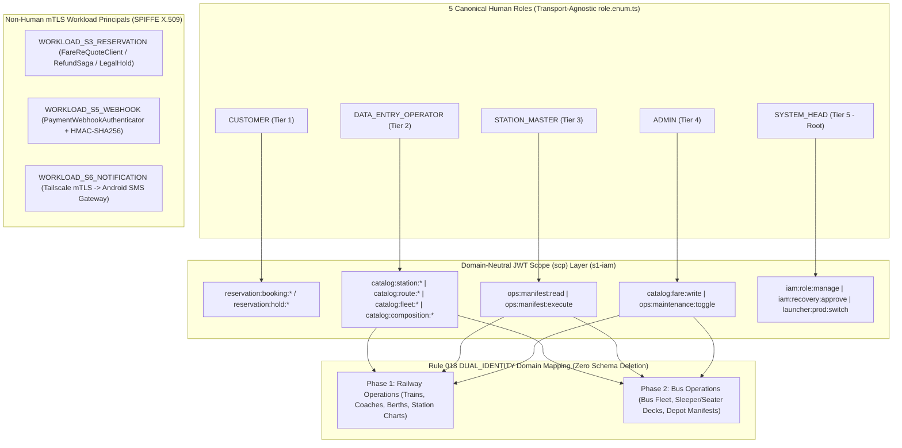
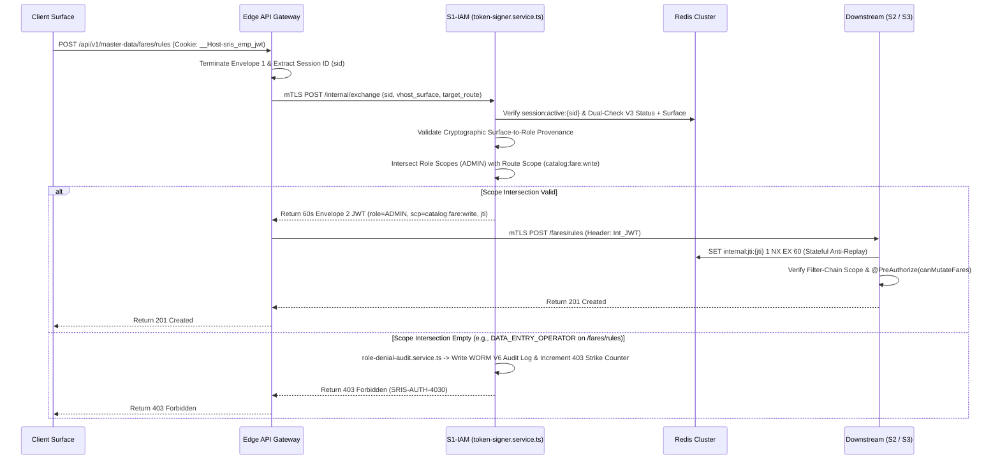

# RBAC Matrix

*SRIS — Sarathi Railway Information System*

*A Unified Railway Management Platform*

*Inspired by CRIS and IRCTC · Independent project*

> **Version:** 1.0 | **Date:** 2026-10-30 | **Document ID:** SRIS-P1-SEC-002

| Field              | Value                                                                                      |
| ------------------ | ------------------------------------------------------------------------------------------ |
| Title              | RBAC Matrix                                                                                |
| Software           | SRIS                                                                                       |
| Software Full Form | Sarathi Railway Information System                                                         |
| Team Codename      | Project Sarathi                                                                            |
| Document ID        | SRIS-P1-SEC-002                                                                            |
| Task               | Define granular role-based access control, workload principals, scope claims, and guards   |
| Document Type      | Detailed Design Document                                                                   |
| Milestone          | Phase 1 Foundation                                                                         |
| Classification     | Internal                                                                                   |
| Version            | 1.0                                                                                        |
| Date               | 2026-10-30                                                                                 |
| Author             | Koushal Jha, Lead Architect                                                                |
| Approved By        | Koushal Jha, Lead Architect                                                                |
| Approval Date      | 2026-10-30                                                                                 |
| Supersedes         | None (first version)                                                                       |
| Related Documents  | See Appendix B                                                                             |
| Affiliation        | Independent · Not affiliated with CRIS, IRCTC, or Indian Railways                          |

---

#### Table of Contents

1. [Introduction](#1-introduction)
    * [1.1 Purpose](#11-purpose)
    * [1.2 Scope](#12-scope)
    * [1.3 Audience](#13-audience)
2. [Normative References and Terminology](#2-normative-references-and-terminology)
    * [2.1 Normative References](#21-normative-references)
    * [2.2 Terminology](#22-terminology)
3. [Human Actor Roles, Non-Human Workload Principals & Phase 2 Continuity](#3-human-actor-roles-non-human-workload-principals--phase-2-continuity)
    * [3.1 The 5 Canonical Human Roles](#31-the-5-canonical-human-roles)
    * [3.2 Non-Human mTLS Workload Principals (Service-to-Service Zero Trust)](#32-non-human-mtls-workload-principals-service-to-service-zero-trust)
    * [3.3 Phase 2 Continuity Strategy (Zero-Deletion Train to Bus Scalability)](#33-phase-2-continuity-strategy-zero-deletion-train-to-bus-scalability)
    * [3.4 Phase 2 Continuity & Workload Principal Architecture Diagram](#34-phase-2-continuity--workload-principal-architecture-diagram)
4. [Granular CRUD Permissions Matrix Across Microservices](#4-granular-crud-permissions-matrix-across-microservices)
    * [4.1 Matrix Legend & Access Control Modifiers](#41-matrix-legend--access-control-modifiers)
    * [4.2 Comprehensive Microservice-by-Microservice CRUD Matrix](#42-comprehensive-microservice-by-microservice-crud-matrix)
    * [4.3 Critical Domain Separation Rules (Maker/Checker, PNR Privacy & Anti-Scalping)](#43-critical-domain-separation-rules-makerchecker-pnr-privacy--anti-scalping)
5. [JWT Claim Mapping & Dynamic Scope Intersection](#5-jwt-claim-mapping--dynamic-scope-intersection)
    * [5.1 Authoritative Session & Surface-to-Role Provenance Check](#51-authoritative-session--surface-to-role-provenance-check)
    * [5.2 Dynamic Least-Privilege Scope Intersection Algorithm](#52-dynamic-least-privilege-scope-intersection-algorithm)
    * [5.3 Role-to-Scope Claim Mapping Table & Sequence Diagram](#53-role-to-scope-claim-mapping-table--sequence-diagram)
6. [Guard Enforcement Logic (Node.js NestJS & Java Spring Boot)](#6-guard-enforcement-logic-nodejs-nestjs--java-spring-boot)
    * [6.1 Node.js / NestJS Guard Enforcement (S1, S4, S5, S6)](#61-nodejs--nestjs-guard-enforcement-s1-s4-s5-s6)
    * [6.2 Java / Spring Boot Guard Enforcement (S2 & S3)](#62-java--spring-boot-guard-enforcement-s2--s3)
    * [6.3 PostgreSQL Row-Level Security (RLS) Context Injection](#63-postgresql-row-level-security-rls-context-injection)
    * [6.4 Cross-Service Denial Auditing (WORM 403 Logging)](#64-cross-service-denial-auditing-worm-403-logging)
7. [Zero-Plaintext Bootstrap & Seed Data Strategy](#7-zero-plaintext-bootstrap--seed-data-strategy)
    * [7.1 Deterministic, Idempotent Role & Scope Seeding](#71-deterministic-idempotent-role--scope-seeding)
    * [7.2 Zero-Plaintext Initial Admin Bootstrap](#72-zero-plaintext-initial-admin-bootstrap)
    * [7.3 Database-Level Privilege Lock](#73-database-level-privilege-lock)
8. [RBAC Verification & Contract Testing Mapping](#8-rbac-verification--contract-testing-mapping)
    * [8.1 Unit, Integration & E2E RBAC Test Mapping](#81-unit-integration--e2e-rbac-test-mapping)
9. [Approval](#9-approval)
* [Revision History](#revision-history)
* [Appendix A: Not Applicable](#appendix-a-not-applicable)
* [Appendix B: Related Documents](#appendix-b-related-documents)

---

## 1. Introduction

### 1.1 Purpose
This document defines the authoritative Role-Based Access Control (RBAC) Matrix, non-human workload principal boundaries, context-scoped permission (`scp`) intersection rules, and code-level guard enforcement architecture for the **SRIS** platform developed for **KOSHIV VENTURES PRIVATED LIMITED**. It operationalizes the Double-Envelope Zero Trust authorization model established in [SRIS-P1-ARCH-010](../../wave-2-architecture/SRIS-P1-ARCH-010_SecurityArchitectureDocument.md) and [SRIS-P1-SEC-001](./SRIS-P1-SEC-001_AuthenticationAndAuthorizationDesign.md) across all six foundational microservices (`s1-iam` through `s6-notification`), the `s6-py-daemon` telemetry engine, web/mobile client surfaces (`customer-portal`, `employee-portal`, `message-app`), and the `sris-launcher` root governance subsystem.

### 1.2 Scope
**In Scope (Phase 1):**
*   Definition of the 5 canonical human actor roles (`CUSTOMER`, `DATA_ENTRY_OPERATOR`, `STATION_MASTER`, `ADMIN`, `SYSTEM_HEAD`) mapped to `services/node/s1-iam/src/domain/enums/role.enum.ts` and `role.entity.ts`.
*   Definition of the 3 non-human mTLS workload principals (`WORKLOAD_S3_RESERVATION`, `WORKLOAD_S5_WEBHOOK`, `WORKLOAD_S6_NOTIFICATION`) enforcing strict service-to-service Zero Trust isolation.
*   Phase 2 Continuity Strategy (Rule 018 `DUAL_IDENTITY`), establishing a transport-mode-agnostic scope (`scp`) taxonomy that transitions from Railway operations (Phase 1) to Bus Terminal/Depot operations (Phase 2) with zero code or schema deletions.
*   Granular Create/Read/Update/Delete/Execute (`C/R/U/D/X`) permissions matrix across all controllers, services, and Flyway database tables in [SRIS-P1-INF-007](../../wave-5-devops-operations/SRIS-P1-INF-007_RepositoryStructureAndNaming.md).
*   Envelope 2 internal JWT `role` and `scp` claim intersection logic executed during `/internal/exchange`.
*   Declarative and programmatic guard enforcement in Node.js/NestJS (`roles.guard.ts`, `jwt-auth.guard.ts`) and Java/Spring Boot (`InternalAuthFilter.java`, `RoleChecker.java`, `@CustomerOnly`, `@EmployeeOnly`), coupled with PostgreSQL Row-Level Security (RLS) injection and WORM denial auditing.
*   Zero-plaintext database role seeding (`iam-roles-seed.sql`), Vault-injected admin bootstrapping (`09-create-initial-admin.sql`), and database privilege locks (`04-grant-privileges.sql`).

**Out of Scope:**
*   Primary authentication flows, OTP generation, Argon2id hashing parameters, and Telescopic Time-Lock mechanics (governed by [SRIS-P1-SEC-001](./SRIS-P1-SEC-001_AuthenticationAndAuthorizationDesign.md)).
*   Complete cryptographic wire structure, header parameters, and JSON Schema definitions of external and internal JWTs (governed by [SRIS-P1-SEC-003](./SRIS-P1-SEC-003_JWTTokenDesignAndClaims.md)).

### 1.3 Audience
*   Lead Architect (`SYSTEM_HEAD`)
*   Security Engineers & Compliance Auditors
*   Backend Developers (`s1-iam`, `s2-master-data`, `s3-reservation`, `s4-search-bff`, `s5-payment-gateway`, `s6-notification`, `s6-py-daemon`)
*   Frontend & Mobile Developers (`customer-portal`, `employee-portal`, `message-app`, `android-sms-gateway`, `sris-launcher`)
*   Database Administrators & QA Engineers

---

## 2. Normative References and Terminology

### 2.1 Normative References

| Document ID | Title |
|-------------|-------|
| [SRIS-P1-GOV-001](../../wave-0-project-foundation/SRIS-P1-GOV-001_DocumentationIndexAndNavigationMap.md) | Documentation Index and Navigation Map |
| [SRIS-P1-ARCH-001](../../wave-2-architecture/SRIS-P1-ARCH-001_MicroservicesIdentification.md) | Microservices Identification |
| [SRIS-P1-ARCH-010](../../wave-2-architecture/SRIS-P1-ARCH-010_SecurityArchitectureDocument.md) | Security Architecture Document |
| [SRIS-P1-DATA-012](../data/SRIS-P1-DATA-012_SeedDataAndReferenceDataSpecification.md) | Seed Data and Reference Data Specification |
| [SRIS-P1-API-007](../api/SRIS-P1-API-007_APIAuthenticationAndHeaderRules.md) | API Authentication and Header Rules |
| [SRIS-P1-API-014](../api/SRIS-P1-API-014_MaintenanceModeContract.md) | Maintenance Mode Contract |
| [SRIS-P1-API-015](../api/SRIS-P1-API-015_LauncherBridgeContract.md) | Launcher Bridge Contract |
| [SRIS-P1-API-016](../api/SRIS-P1-API-016_LauncherLocalHttpAPI.md) | Launcher Local HTTP API |
| [SRIS-P1-SEC-001](./SRIS-P1-SEC-001_AuthenticationAndAuthorizationDesign.md) | Authentication and Authorization Design |
| [SRIS-P1-SEC-003](./SRIS-P1-SEC-003_JWTTokenDesignAndClaims.md) | JWT Token Design and Claims |
| [SRIS-P1-SEC-006](./SRIS-P1-SEC-006_DPDPActComplianceFrameworkPhase1Scoped.md) | DPDP Act Compliance Framework (Phase 1 scoped) |
| [SRIS-P1-SEC-007](./SRIS-P1-SEC-007_ConsentManagementDataModelPhase1Scoped.md) | Consent Management Data Model (Phase 1 scoped) |
| [SRIS-P1-SEC-008](./SRIS-P1-SEC-008_SecretsManagementPlan.md) | Secrets Management Plan |
| [SRIS-P1-INF-007](../../wave-5-devops-operations/SRIS-P1-INF-007_RepositoryStructureAndNaming.md) | Repository Structure and Naming |
| [SRIS-P1-INF-018](../../wave-5-devops-operations/SRIS-P1-INF-018_BiometricSubsystemDesign.md) | Biometric Subsystem Design |

### 2.2 Terminology
*   **Human Role (`role.enum.ts`):** One of five coarse-grained organizational authority tiers (`CUSTOMER`, `DATA_ENTRY_OPERATOR`, `STATION_MASTER`, `ADMIN`, `SYSTEM_HEAD`) assigned to an authenticated human principal in `s1-iam`.
*   **Context-Scoped Permission (`scp`):** A fine-grained, transport-agnostic capability string (`<domain>:<resource>:<action>[:<modifier>]`, e.g., `reservation:booking:write` or `catalog:station:write`) dynamically intersected and minted into an ephemeral 60-second Envelope 2 internal JWT for a single downstream call.
*   **mTLS Workload Principal (SPIFFE ID):** A cryptographic machine identity (`spiffe://sris.internal/service/<service-name>`) embedded in a Vault-issued X.509 certificate, authorizing synchronous inter-service calls or hardware gateway bridges that no human user may invoke directly.
*   **Surface-to-Role Provenance:** The zero-trust binding that restricts which human roles can authenticate or mint tokens from a given client application surface (`customer-portal`, `employee-portal`, `message-app`, or `sris-launcher`).
*   **Maker/Checker Catalog Segregation:** The strict separation of duties in `s2-master-data` (Rule 081) where `DATA_ENTRY_OPERATOR` maintains physical transit infrastructure (`V1`–`V4`) while commercial fare rules, quotas, and concessions (`V5`–`V7`) are restricted exclusively to `ADMIN` and `SYSTEM_HEAD`.
*   **RLS Context Binding:** The execution of `SET LOCAL app.current_user_id = '<JWT.sub>'` and `SET LOCAL app.current_user_role = '<JWT.role>'` inside every PostgreSQL transaction (Rule 093) so row-level data isolation is enforced by the database engine even if application filter logic is bypassed.

---

## 3. Human Actor Roles, Non-Human Workload Principals & Phase 2 Continuity

### 3.1 The 5 Canonical Human Roles
Based on the physical file structure in `services/node/s1-iam/src/domain/enums/role.enum.ts`, `services/node/s1-iam/src/domain/entities/role.entity.ts`, and the client surface split across `clients/web/customer-portal`, `clients/web/employee-portal`, `clients/mobile/message-app`, and `sris-launcher` in [SRIS-P1-INF-007](../../wave-5-devops-operations/SRIS-P1-INF-007_RepositoryStructureAndNaming.md), SRIS enforces strict privilege separation across five human tiers:

| Role Code (`role.enum.ts`) | Authority Tier | Allowed Client Surface(s) | Core Operational Boundary & Security Constraints |
| :--- | :--- | :--- | :--- |
| **`CUSTOMER`** | Tier 1 (Public Passenger) | `clients/web/customer-portal` | **External Passenger Account.** Permitted to search schedules/availability (`s4-search-bff`), acquire ephemeral seat holds (`HoldController.java`), initiate bookings (`BookingController.java`), query own or masked PNRs (`PnrController.java`), cancel own tickets (`CancellationController.java`), and manage own profile and DPDP consent (`profile.controller.ts`, `consent.controller.ts`). **Strictly isolated via PostgreSQL RLS** (`SET LOCAL app.current_user_id = JWT.sub`) so a customer can never query or mutate another passenger's bookings. Uses Self-Service OTP Recovery ([SRIS-P1-SEC-001](./SRIS-P1-SEC-001_AuthenticationAndAuthorizationDesign.md) Section 8.4). |
| **`DATA_ENTRY_OPERATOR`** | Tier 2 (Catalog Staff) | `clients/web/employee-portal` (`/stations`, `/routes`, `/trains`, `/schedules`, `/coaches`) | **Master Catalog Operator.** Responsible for day-to-day insertion and maintenance (`C/R/U`) of physical transport infrastructure in `s2-master-data` (`StationController.java`, `RouteController.java`, `TrainController.java`, `ScheduleController.java`, `CoachController.java` across tables `V1`–`V4`). **Explicitly Prohibited From:** mutating commercial fare rules (`FareController.java`), executing chart preparation in `s3-reservation`, holding/booking passenger seats, or viewing passenger PII. Uses Self-Service OTP Recovery. |
| **`STATION_MASTER`** | Tier 3 (Field Supervisor) | `clients/web/employee-portal` (`/operations/chart-preparation`, `/operations/bookings`, `/operations/cancellations`) | **Terminal / Station Operations Supervisor.** Executes departure Chart Preparation and automated waitlist clearing (`ChartPreparationService.java`, `V15__add_chart_preparation_table.sql`), inspects station operational booking/waitlist manifests (`BookingQueryService.java`), and triggers operational or train-disruption bulk cancellations (`CancellationController.java`). Holds Read-Only (`R`) access to `s2-master-data`. **Subject to High-Level Admin Recovery Lock:** prohibited from self-service password reset; requires manual cryptographic approval from `SYSTEM_HEAD` per [SRIS-P1-SEC-001](./SRIS-P1-SEC-001_AuthenticationAndAuthorizationDesign.md) Section 8.4. |
| **`ADMIN`** | Tier 4 (Platform & Commercial Admin) | `clients/web/employee-portal` (`/fares`, `/monitoring`), `clients/mobile/message-app` | **Commercial & Operational Administrator.** Manages versioned commercial fare rules, travel classes, quotas, and concessions (`FareController.java`, `V5__create_classes_quotas.sql`, `V6__create_fare_rules.sql`, `V7__create_fare_rule_versions.sql`), manages notification templates and DLQ retries (`s6-notification`, `message-app`), monitors host/container telemetry (`s6-py-daemon`), and toggles service Maintenance Mode (`maintenance.controller.ts`, `InternalMaintenanceController.java`). **Subject to High-Level Admin Recovery Lock.** |
| **`SYSTEM_HEAD`** | Tier 5 (Root Sovereign Authority) | `sris-launcher` (Java UI + Python Engine) & `employee-portal` Root Governance | **Lead Architect / Root Sovereign Authority (Rule 075 & Rule 082).** Authenticates via hardware-bound machine fingerprint, TOTP, and biometric verification (`launcher_auth_service.py`, `totp_service.py`, `biometric_verifier.py` per [SRIS-P1-INF-018](../../wave-5-devops-operations/SRIS-P1-INF-018_BiometricSubsystemDesign.md)). Sole authority capable of: (1) approving `ADMIN` and `STATION_MASTER` account recovery requests, (2) provisioning or revoking staff roles in `s1-iam`, (3) executing Shamir Secret Sharing / Root of Trust recovery (`shamir.py`, `recovery_orchestrator.py`), and (4) authorizing production environment switches (`ConfirmProdModal.java`, `dangerous_operation_guard.py`). |

---

### 3.2 Non-Human mTLS Workload Principals (Service-to-Service Zero Trust)
In accordance with Rule 118 (API Gateway & Service Mesh mTLS) and [SRIS-P1-ARCH-010](../../wave-2-architecture/SRIS-P1-ARCH-010_SecurityArchitectureDocument.md), internal saga transitions, pricing re-quotes, webhook ingestions, and hardware SMS dispatches must **never** be callable by any human role—not even `ADMIN`—from a web or mobile client. Instead, these endpoints authenticate exclusively via non-human mTLS Workload Principals presenting Vault-provisioned X.509 workload certificates:

1.  **`WORKLOAD_S3_RESERVATION` (`spiffe://sris.internal/service/s3-reservation`):**
    *   **Authorized Target Endpoints:** Authenticates via mTLS 1.3 to `s2-master-data` (`FareReQuoteClient.java` to verify authoritative pricing prior to PNR commit), to `s5-payment-gateway` (`PaymentGatewayAdapter.java` for payment session creation and `RefundSaga.java` for automated refund execution), and responds to `s1-iam` synchronous Smart Deletion Legal Hold queries ([SRIS-P1-SEC-006](./SRIS-P1-SEC-006_DPDPActComplianceFrameworkPhase1Scoped.md) Section 5.1).
    *   **Security Constraint:** Carries zero human session context (`sid = null`); authorized strictly by X.509 client certificate SAN verification and service-scoped internal tokens.
2.  **`WORKLOAD_S5_WEBHOOK` (`spiffe://sris.internal/service/s5-payment-gateway`):**
    *   **Authorized Target Endpoints:** Authenticates asynchronous payment state callbacks dispatched by `s5-payment-gateway` (`webhook-signer.service.ts`) into `s3-reservation` (`PaymentCallbackController.java` guarded by `PaymentWebhookAuthenticator.java`).
    *   **Security Constraint:** Requires dual verification: a valid `spiffe://sris.internal/service/s5-payment-gateway` mTLS client certificate **plus** a constant-time verified `HMAC-SHA256` payload signature header (`X-SRIS-Webhook-Signature`) with a 300-second replay timestamp window. All human JWTs are rejected with `HTTP 403 Forbidden`.
3.  **`WORKLOAD_S6_NOTIFICATION` (`spiffe://sris.internal/service/s6-notification`):**
    *   **Authorized Target Endpoints:** Authenticates `s6-notification` (`sms-sender.service.ts`) across the Tailscale Zero-Trust mesh (`TailscaleChecker.kt`, `PeerVerifier.kt`, `RequestAuthenticator.kt`) to the embedded Kotlin HTTPS server on the Android SMS Gateway (`clients/mobile/android-sms-gateway` -> `SendSmsRouteHandler.kt`, `StatusRouteHandler.kt`, and `HealthRouteHandler.kt`).
    *   **Security Constraint:** Enforces Tailscale peer node identity, mTLS certificate pinning, and per-request HMAC authentication before queuing any SMS payload into Room SQLite (`SmsQueueWorker.kt`).

---

### 3.3 Phase 2 Continuity Strategy (Zero-Deletion Train to Bus Scalability)
Per **Rule 018 (`DUAL_IDENTITY`)**, SRIS presents externally as a Railway Information System in Phase 1 while its internal domain and authorization architecture are engineered from day one for a seamless switch to a **Bus Information System** in Phase 2 upon explicit Lead Architect (`SYSTEM_HEAD`) instruction—without deleting database tables, rewriting RBAC guards, or migrating role enums:

*   **Why the 5 Human Role Identifiers Are Already Phase-2 Ready:** The five canonical role identifiers in `role.enum.ts` (`CUSTOMER`, `DATA_ENTRY_OPERATOR`, `STATION_MASTER`, `ADMIN`, `SYSTEM_HEAD`) deliberately exclude railway-specific nouns (such as `TRAIN_CLERK` or `RAILWAY_ADMIN`). In Phase 2, `STATION_MASTER` naturally governs Bus Boarding Terminals and Regional Depots without renaming `role.enum.ts` or altering `database/seed/iam-roles-seed.sql`.
*   **Transport-Mode-Agnostic Scope (`scp`) Taxonomy:** Rather than hardcoding railway-specific nouns like `train:create` or `coach:update` inside JWT `scp` claims and database seed tables, `s1-iam` and `iam-roles-seed.sql` standardize **domain-neutral scope identifiers** that map cleanly across both transport modes:

| Canonical Scope (`scp`) Pattern | Assigned Human Role(s) | Phase 1 Domain Mapping (Railway Operations) | Phase 2 Domain Mapping (Bus Operations) |
| :--- | :--- | :--- | :--- |
| `catalog:station:read` / `catalog:station:write` | `DATA_ENTRY_OPERATOR`, `SYSTEM_HEAD` (`write`); All Staff (`read`) | Railway Stations & Junctions (`StationController.java`, `V1__create_stations.sql`) | Bus Boarding Terminals, Depots & Stops |
| `catalog:route:read` / `catalog:route:write` | `DATA_ENTRY_OPERATOR`, `SYSTEM_HEAD` (`write`); All Staff (`read`) | Railway Routes & Intermediate Halts (`RouteController.java`, `V2__create_routes_stops.sql`) | Highway Corridors, Expressways & Boarding Points |
| `catalog:fleet:read` / `catalog:fleet:write` | `DATA_ENTRY_OPERATOR`, `SYSTEM_HEAD` (`write`); All Staff (`read`) | Trains & Rake Numbers (`TrainController.java`, `V3__create_trains_schedules.sql`) | Bus Fleet, Vehicle Registration & Coach Types |
| `catalog:schedule:read` / `catalog:schedule:write` | `DATA_ENTRY_OPERATOR`, `SYSTEM_HEAD` (`write`); All Staff (`read`) | Train Departure/Arrival Timetables (`ScheduleController.java`, `V3`) | Bus Trip Schedules & Shift Departures |
| `catalog:composition:read` / `catalog:composition:write` | `DATA_ENTRY_OPERATOR`, `SYSTEM_HEAD` (`write`); All Staff (`read`) | Coach Compositions & Berth Layouts (`CoachController.java`, `V4__create_coach_compositions.sql`) | Bus Seater / Sleeper Deck & Seat Layouts (`2+1`, `2+2`) |
| `catalog:fare:read` / `catalog:fare:write` | `ADMIN`, `SYSTEM_HEAD` (`write`); Staff (`read`) | Travel Classes, Quotas & Telescopic Fare Rules (`FareController.java`, `V5`–`V7`) | Bus Ticket Tiers (AC Sleeper/Volvo), Quotas & Per-Km Fares |
| `ops:manifest:read` / `ops:manifest:execute` | `STATION_MASTER`, `SYSTEM_HEAD` | Train Reservation Chart Preparation & Waitlist Clearing (`ChartPreparationService.java`, `V15`) | Bus Boarding Manifest Finalization & Standby Seat Assignment |

*   **Configuration-Driven Phase 2 RAC & Quota Transition:** In `s2-master-data` (`V5__create_classes_quotas.sql`), travel class and quota definitions carry transport-mode metadata flags (`allow_rac_allocation BOOLEAN`, `layout_topology VARCHAR`). When `SYSTEM_HEAD` authorizes the Phase 2 Bus switch (Rule 018), `ADMIN` updates the class catalog via `catalog:fare:write` to disable shared-berth `RAC` allocations and activate deck/seater layouts without dropping database columns or modifying RBAC guards.

---

### 3.4 Phase 2 Continuity & Workload Principal Architecture Diagram

---

## 4. Granular CRUD Permissions Matrix Across Microservices

### 4.1 Matrix Legend & Access Control Modifiers
The permissions matrix in Section 4.2 governs all human and machine access across the SRIS microservice mesh. Every operation is evaluated using the following access control modifiers:

*   **`C` (Create):** Permitted to execute state-creating `POST` operations against the target controller and persist new records in the underlying Flyway schema.
*   **`R` (Read):** Permitted to execute `GET` queries to retrieve domain entities, projections, or audit trails.
*   **`U` (Update):** Permitted to execute state-mutating `PUT` or `PATCH` operations against existing records (guarded by optimistic concurrency control columns where applicable).
*   **`D` (Delete / Deactivate):** Permitted to execute `DELETE` or soft-deactivation/crypto-shredding operations.
*   **`X` (Execute Action):** Permitted to trigger non-CRUD domain state transitions, sagas, or operational workflows (e.g., login, OTP verification, chart preparation, refund saga dispatch, or maintenance mode toggling).
*   **`OWN` (PostgreSQL RLS Scoped):** Access is strictly restricted to records where the owning account identifier matches the caller's authenticated `sub` claim (`account_uuid`), enforced at both the service guard layer and the PostgreSQL engine layer via `SET LOCAL app.current_user_id = JWT.sub` (Rule 093).
*   **`—` (Strictly Denied):** Any attempt by the specified role to invoke the endpoint is intercepted and rejected in memory with `HTTP 403 Forbidden` (`SRIS-AUTH-4030`), triggering an immediate, PII-masked violation entry in the WORM audit log (`role-denial-audit.service.ts` in Node.js or `AuditFilter.java` in Spring Boot).

---

### 4.2 Comprehensive Microservice-by-Microservice CRUD Matrix
The table below maps every foundational microservice (`s1-iam` through `s6-notification`), the `s6-py-daemon` telemetry engine, and their physical controllers and Flyway migrations in [SRIS-P1-INF-007](../../wave-5-devops-operations/SRIS-P1-INF-007_RepositoryStructureAndNaming.md) across all five canonical human roles:

| Service & Physical Controller / Module (`INF-007`) | Resource / Operation & DB Table | `CUSTOMER` | `DATA_ENTRY_OPERATOR` | `STATION_MASTER` | `ADMIN` | `SYSTEM_HEAD` |
| :--- | :--- | :---: | :---: | :---: | :---: | :---: |
| **`S1-IAM`** (`auth.controller.ts`) | Public Auth (`/register/*`, `/login`, `/verify-email-otp`, `/verify-mobile-otp`, `/logout`, `/refresh`) | `C / X` | `X` *(Login/Logout)* | `X` *(Login/Logout)* | `X` *(Login/Logout)* | `X` *(Login/Logout)* |
| **`S1-IAM`** (`profile.controller.ts`) | Profile View, Username Customization & DPDP Smart Deletion (`V1__create_users.sql`) | `R / U / D (OWN)` | `R / U (OWN)` | `R / U (OWN)` | `R / U (OWN)` | `R / U (ALL)` |
| **`S1-IAM`** (`consent.controller.ts`) | DPDP Consent Grant / WORM Revocation (`V4__create_consent_records.sql`, `V9__add_consent_versioning.sql`) | `C / R (OWN)` | `C / R (OWN)` | `C / R (OWN)` | `R (AUDIT)` | `C / R (ALL)` |
| **`S1-IAM`** (`password-reset.controller.ts`) | Self-Service OTP Password / Username Recovery (`V5__create_password_reset_tokens.sql`) | `C / X (OWN)` | `C / X (OWN)` | `—` *(Locked)* | `—` *(Locked)* | `—` *(Hardware)* |
| **`S1-IAM`** (`password-reset.controller.ts`) | High-Level Admin Recovery Approval Queue (`V5__create_password_reset_tokens.sql`) | `—` | `—` | `C` *(Request)* | `C` *(Request)* | **`X` *(Approve/Reject)*** |
| **`S1-IAM`** (`role.entity.ts` / Staff Provisioning) | Employee Account Creation & Role Assignment (`V1__create_users.sql`) | `—` | `—` | `—` | `R` | **`C / R / U / D`** |
| **`S2-Master-Data`** (`StationController.java`) | Stations / Terminals (`V1__create_stations.sql`) | `R` *(via S4)* | **`C / R / U`** | `R` | `R` | `C / R / U / D` |
| **`S2-Master-Data`** (`RouteController.java`) | Routes & Route Stops (`V2__create_routes_stops.sql`) | `R` *(via S4)* | **`C / R / U`** | `R` | `R` | `C / R / U / D` |
| **`S2-Master-Data`** (`TrainController.java`) | Fleet / Trains (`V3__create_trains_schedules.sql`) | `R` *(via S4)* | **`C / R / U`** | `R` | `R` | `C / R / U / D` |
| **`S2-Master-Data`** (`ScheduleController.java`) | Schedules (`V3__create_trains_schedules.sql`) | `R` *(via S4)* | **`C / R / U`** | `R` | `R` | `C / R / U / D` |
| **`S2-Master-Data`** (`CoachController.java`) | Coach & Berth Layouts (`V4__create_coach_compositions.sql`) | `R` *(via S4)* | **`C / R / U`** | `R` | `R` | `C / R / U / D` |
| **`S2-Master-Data`** (`FareController.java`) | Classes, Quotas, Fare Rules & Versions (`V5__create_classes_quotas.sql`, `V6__create_fare_rules.sql`, `V7__create_fare_rule_versions.sql`) | `—` | `R` | `R` | **`C / R / U`** | **`C / R / U / D`** |
| **`S3-Reservation`** (`AvailabilityController.java`) | Segment Inventory & Seat Matrix Lookup (`V1__create_seat_matrix.sql`, `V2__create_quota_allocations.sql`) | `R` | `R` | `R` | `R` | `R` |
| **`S3-Reservation`** (`HoldController.java`) | Ephemeral Seat Lock (`V12__add_seat_lock_columns.sql`) | **`C / D (OWN)`** | `—` | `—` | `—` | `—` |
| **`S3-Reservation`** (`BookingController.java`) | Ticket Booking Creation (`V3__create_bookings.sql`, `V4__create_passengers.sql`, `V5__create_pnrs.sql`, `V6__create_waitlist.sql`, `V11__add_partition_indexes.sql`, `V13__add_optimistic_version_columns.sql`) | **`C / R (OWN)`** | `—` | `R` *(Manifest)* | `R` *(Audit)* | `R` *(All)* |
| **`S3-Reservation`** (`PnrController.java`) | PNR Status Inquiry & Timeline (`V5__create_pnrs.sql`) | **`R (OWN / Masked)`** | `—` | **`R (Full Station)`** | **`R (Full Audit)`** | **`R (Full)`** |
| **`S3-Reservation`** (`CancellationController.java`) | Ticket Cancellation & Refund Trigger (`V7__create_cancellations_refunds.sql`, `RefundSaga.java`) | **`C / X (OWN)`** | `—` | **`X` *(Ops/Disruption)*** | `R` *(Audit)* | `X` *(Override)* |
| **`S3-Reservation`** (`ChartPreparationService.java`) | Finalize Reservation Chart & Waitlist Clearing (`V15__add_chart_preparation_table.sql`) | `—` | `—` | **`C / R / X`** | `R` | `C / R / X` |
| **`S3-Reservation`** (`PaymentCallbackController.java`) | Webhook Ingestion (`PaymentWebhookAuthenticator.java`) | `—` | `—` | `—` | `—` | `—` *(mTLS S5 Only)* |
| **`S3-Reservation`** (`OutboxDeadLetterHandler.java`) | Saga State, Transactional Outbox & DLQ (`V8__create_saga_state.sql`, `V9__create_outbox_events.sql`, `V14__add_outbox_dead_letter.sql`) | `—` | `—` | `—` | **`R` *(DLQ Inspect)*** | **`R / X` *(Saga Re-Drive)*** |
| **`S4-Search-BFF`** (`search.controller.ts`) | High-Speed Redis Read-Model Search & Autocomplete | **`R` (`@PublicSearch`)** | `R` | `R` | `R` | `R` |
| **`S5-Payment-Gateway`** (`payment.controller.ts`) | Payment Checkout Session / Status Verification | **`C / R (OWN)`** | `—` | `—` | `R` *(Metrics/Mode)* | `R / U` *(Provider Swap)* |
| **`S5-Payment-Gateway`** (`refund.service.ts`) | Automated Refund Execution (`refund.dto.ts`) | `—` *(Via S3 Saga)* | `—` | `—` *(Via S3 Saga)* | `R` *(Retry Store)* | `X` *(DLQ Reconcile)* |
| **`S6-Notification`** (In-App Feed & Preferences) | User In-App Notifications & Preferences (`V3__create_in_app_notifications.sql`, `V4__create_notification_preferences.sql`) | **`R / U (OWN)`** | **`R / U (OWN)`** | **`R / U (OWN)`** | **`R / U (OWN)`** | **`R / U (OWN)`** |
| **`S6-Notification`** (`template.service.ts` / `message-app`) | Templates (`V1__create_templates.sql`), Delivery Logs (`V2__create_delivery_log.sql`), DLQ Resend (`V5__create_dlq.sql`) | `—` | `—` | `—` | **`C / R / U / X`** | **`C / R / U / D / X`** |
| **`S6-Py-Daemon`** (`sris_ops_engine/api/*`) | Host/Container Anomaly, OOM Guard & Telemetry | `—` | `—` | `—` | **`R`** | **`R / U / X`** |
| **`SRIS-Launcher`** (`sris_launcher_engine` / Bridge API) | Host Preflight Autofix, Shamir Recovery, Prod Switch & 3-Attempt Anti-Theft ([SRIS-P1-API-015](../api/SRIS-P1-API-015_LauncherBridgeContract.md), [SRIS-P1-API-016](../api/SRIS-P1-API-016_LauncherLocalHttpAPI.md)) | `—` | `—` | `—` | `R` *(Diagnostics Only)* | **`C / R / U / X` *(Root + Biometric)*** |
| **All Services** (`*MaintenanceController*`) | Platform Maintenance Mode Toggle ([SRIS-P1-API-014](../api/SRIS-P1-API-014_MaintenanceModeContract.md)) | `—` *(Blocked)* | `—` *(Blocked)* | `—` *(Blocked)* | **`R / X` *(Bypass)*** | **`R / X` *(Bypass)*** |

---

### 4.3 Critical Domain Separation Rules (Maker/Checker, PNR Privacy & Anti-Scalping)
To prevent insider fraud, unauthorized price tampering, passenger PII harvesting, and employee quota hoarding, the permissions matrix enforces three non-negotiable domain boundaries:

1.  **Master Data Segregation (Infrastructure vs. Commercial Pricing — Maker/Checker Rule 081):**
    *   **Physical Infrastructure Master Data:** Stations (`V1__create_stations.sql`), Routes and Intermediate Stops (`V2__create_routes_stops.sql`), Trains/Vehicles and Schedules (`V3__create_trains_schedules.sql`), and Coach/Berth Compositions (`V4__create_coach_compositions.sql`) are created and updated (`C / R / U`) by `DATA_ENTRY_OPERATOR` (and `SYSTEM_HEAD`) via `s2-master-data`. Note that hard deletion (`D`) of master catalog records is restricted solely to `SYSTEM_HEAD` to prevent accidental cascade failures across active schedules. Furthermore, once a Route (`V2`), Schedule (`V3`), or Coach Composition (`V4`) is published, a `DATA_ENTRY_OPERATOR` cannot directly modify commercial-affecting attributes (`cumulative_distance_km`, `class_code`, `service_tier_code`, or `total_berth_count`)—such edits enter a `PENDING_ADMIN_CHECKER` state requiring cryptographic approval from an `ADMIN` (`catalog:fare:write`) before taking effect in `FareCalculatorService.java`.
    *   **Commercial & Pricing Master Data:** Travel Classes, Quotas (`V5__create_classes_quotas.sql`), Telescopic Fare Rules (`V6__create_fare_rules.sql`), Immutable Fare Rule Versions (`V7__create_fare_rule_versions.sql`), and Concessions are strictly segregated and restricted to **`ADMIN`** (`C / R / U`) and **`SYSTEM_HEAD`** (`C / R / U / D`) via `FareController.java`. This enforces a strict Maker/Checker separation of duties so a catalog data-entry clerk can never manipulate ticket pricing or quota percentages.
2.  **PNR Visibility & Multi-Tier PII Redaction (Rule 093 & Rule 173):**
    *   **`CUSTOMER`:** Can view full details for all PNRs booked by their own account (`BookingController.java` / `use-my-bookings.ts`), enforced at the database layer by PostgreSQL RLS (`booker_user_id = current_setting('app.current_user_id')::uuid`). When querying an arbitrary 10-digit PNR via the public PNR Status Inquiry endpoint (`PnrController.java` / `pnr-search-form.tsx`), the response returns only journey status, coach/berth numbers, and booking state (`CNF`, `RAC`, `WL`) with all passenger names and ages **cryptographically masked**.
    *   **`STATION_MASTER`:** Can view unmasked operational PNR manifests and waitlist queues strictly for trains/vehicles under their operational supervision (`/operations/bookings/[id]` and `/operations/chart-preparation/[trainId]`) to execute departure charting and platform verification.
    *   **`ADMIN` & `SYSTEM_HEAD`:** Can inspect complete PNR lifecycles, immutable Booker Identity UUID snapshots ([SRIS-P1-SEC-006](./SRIS-P1-SEC-006_DPDPActComplianceFrameworkPhase1Scoped.md) Section 7.2), and WORM audit trails (`V10__create_audit_log.sql`) for financial dispute resolution and anti-scalping investigations.
    *   **`DATA_ENTRY_OPERATOR`:** Strictly prohibited (`HTTP 403 Forbidden`) from invoking any PNR query, passenger manifest, or reservation endpoint in `s3-reservation`.
3.  **Refund Execution Isolation & Anti-Scalping Employee Booking Prohibition:**
    *   **Zero Direct Browser-to-S5 Refund Calls:** No human role is permitted to call `s5-payment-gateway` (`refund.service.ts`) directly from any web or mobile client.
    *   **Customer-Initiated Cancellation Refund:** A `CUSTOMER` invokes `POST /api/v1/reservations/{pnr}/cancel` on `s3-reservation` (`CancellationController.java`) for their own booking (verified via PostgreSQL RLS). `CancellationService.java` transitions the booking state (`BookingStateMachine.java`), releases the segment inventory (`SeatAllocationService.java`), and triggers `RefundSaga.java`, which executes an internal mTLS workload call (`WORKLOAD_S3_RESERVATION`) to `s5-payment-gateway` (`refund.service.ts`).
    *   **Operational / Train-Cancellation Bulk Refund:** A `STATION_MASTER` triggers an operational cancellation (e.g., train/bus cancelled or diverted) via `clients/web/employee-portal/src/app/operations/cancellations/page.tsx` -> `CancellationController.java`, which orchestrates full-fare `RefundSaga.java` executions across all affected PNRs.
    *   **Dead-Letter / Ambiguous Payment Reconciliation:** Only `ADMIN` (read/retry inspection) and `SYSTEM_HEAD` (manual override execution) can inspect and re-drive stuck refund sagas via `OutboxDeadLetterHandler.java` (`V14__add_outbox_dead_letter.sql`) and `webhook-retry.service.ts`.
    *   **Anti-Scalping Employee Booking Prohibition:** Both `HoldController.java` and customer booking endpoints in `s3-reservation` are guarded by `@CustomerOnly` (`CustomerOnly.java`). Staff accounts (`DATA_ENTRY_OPERATOR`, `STATION_MASTER`, `ADMIN`, `SYSTEM_HEAD`) are **strictly blocked (`HTTP 403 Forbidden`)** from using employee credentials to acquire seat locks or book passenger tickets, eliminating insider quota hoarding during high-demand booking windows.

---

## 5. JWT Claim Mapping & Dynamic Scope Intersection

### 5.1 Authoritative Session & Surface-to-Role Provenance Check
As established in [SRIS-P1-SEC-001](./SRIS-P1-SEC-001_AuthenticationAndAuthorizationDesign.md) (Sections 7.2 and 7.3), the Edge API Gateway terminates the external `HttpOnly` cookie JWT (Envelope 1) and initiates a mutually authenticated TLS 1.3 (mTLS) exchange (`POST /internal/exchange`) with `s1-iam` (`token-signer.service.ts`) to mint a **60-second Context-Scoped Internal Token (Envelope 2)**. Before signing any internal token, `s1-iam` executes two authoritative verification gates:

1.  **Authoritative Session & Account State Lookup:** `s1-iam` loads the active session record from Redis (`session:active:{sid}`) with dual-check verification against `V3__create_sessions.sql` and confirms that the account status in `V1__create_users.sql` (`user-status.enum.ts`) is strictly `ACTIVE` (neither `LOCKED` nor `SHREDDED`) and that the user's KMS Data Encryption Key (DEK) is intact.
2.  **Surface-to-Role Provenance Check (Anti-Lateral Escalation):** To prevent compromised staff credentials from being used on public passenger portals—or passenger tokens from probing administrative routes—`s1-iam` validates the originating client surface header against the authenticated user's assigned role (`role.enum.ts`):
    *   **Customer Portal Provenance (`clients/web/customer-portal`):** `s1-iam` asserts `role == 'CUSTOMER'`. Any attempt to authenticate or exchange a token using an employee credential (`DATA_ENTRY_OPERATOR`, `STATION_MASTER`, `ADMIN`, `SYSTEM_HEAD`) on the customer portal is immediately rejected with `SRIS-AUTH-4010` and logged to `V6__create_audit_log.sql`.
    *   **Employee Portal Provenance (`clients/web/employee-portal`):** `s1-iam` asserts `role IN ('DATA_ENTRY_OPERATOR', 'STATION_MASTER', 'ADMIN', 'SYSTEM_HEAD')`. Any `CUSTOMER` session attempting to exchange a token for an employee portal route is rejected with `HTTP 403 Forbidden` (`SRIS-AUTH-4030`).
    *   **Desktop Launcher Provenance (`sris-launcher`):** `s1-iam` asserts `role == 'SYSTEM_HEAD'` (or authorized `ADMIN` for read-only diagnostics) **plus** a verified hardware machine fingerprint attestation (`machine_fingerprint_service.py`), TOTP verification (`totp_service.py`), and biometric check (`biometric_verifier.py` per [SRIS-P1-INF-018](../../wave-5-devops-operations/SRIS-P1-INF-018_BiometricSubsystemDesign.md)).
    *   **Cryptographic Session-to-Surface Binding (`srf` Claim), SNI-to-Host Guard & `__Host-` Cookie Isolation:** To prevent domain fronting or virtual-host header spoofing, the Edge Nginx WAF enforces strict TLS SNI-to-HTTP `Host`/`:authority` equality (`$ssl_server_name == $host`), rejecting mismatches with `HTTP 421 Misdirected Request`, and strips any client-supplied surface headers. At login, `s1-iam` embeds an immutable `"srf"` (Surface) claim in the Envelope 1 JWT, persists `origin_surface` inside `V3__create_sessions.sql`, and issues surface-isolated `HttpOnly` cookies using the RFC 6265bis `__Host-` prefix (`__Host-sris_cust_jwt` vs. `__Host-sris_emp_jwt`, with `Path=/; Secure; HttpOnly; SameSite=Strict` and no `Domain` attribute). During `/internal/exchange`, `token-signer.service.ts` enforces a 3-way equality check (`Envelope1.srf == V3.origin_surface == Gateway_vhost_surface`).

---

### 5.2 Dynamic Least-Privilege Scope Intersection Algorithm
Rather than stuffing 50+ static permissions into every internal JWT (which would bloat internal HTTP headers and increase blast radius if an internal container is compromised), `token-signer.service.ts` computes the **dynamic least-privilege intersection** for each individual request:

1.  **Role Capability Set Lookup:** `s1-iam` retrieves the caller's role definition from the in-memory cached `role.entity.ts` table (seeded via `database/seed/iam-roles-seed.sql`), which contains the array of canonical scopes (`default_scopes_json`) granted to that role.
2.  **Target Route Requirement Resolution:** The API Gateway's `/internal/exchange` request specifies the target downstream microservice (`target_service`) and the requested HTTP method and route template (e.g., `POST /api/v1/reservations/hold` -> required scope `reservation:hold:write`).
3.  **Set Intersection Calculation:** `token-signer.service.ts` evaluates:
    *   `minted_scp = Role_Allowed_Scopes ∩ Route_Required_Scopes`
4.  **Fail-Closed Denial at Minting:** If `minted_scp` is empty (`∅`), `s1-iam` refuses to mint the Envelope 2 token, dispatches a denial event to `role-denial-audit.service.ts` (`V6__create_audit_log.sql`), and returns `HTTP 403 Forbidden` (`SRIS-AUTH-4030`) to the API Gateway before the downstream microservice is ever contacted.
5.  **Context-Scoped Signing:** If the intersection succeeds, `token-signer.service.ts` mints the 60-second EdDSA/RS256 Envelope 2 JWT containing only the exact intersected `scp` string, strict downstream `aud` URI, caller `sub` (`account_uuid`), `role`, `sid`, `cns_ver`, W3C `trace_id`, and a unique one-time-use `jti` nonce ([SRIS-P1-SEC-003](./SRIS-P1-SEC-003_JWTTokenDesignAndClaims.md)).
6.  **Instant Session Teardown on Role Mutation:** Whenever `SYSTEM_HEAD` modifies or revokes a user's role or status in `s1-iam`, `session.service.ts` atomically executes `DEL session:active:{sid}` in Redis, updates `V3__create_sessions.sql` to `TERMINATED_BY_ROLE_CHANGE`, and revokes all `V2__create_refresh_tokens.sql` tokens, eliminating any 15-minute privilege persistence window.
7.  **Lateral Probing Velocity Trap (Deduplicated 3-Strike `403` Kill-Switch):** To neutralize automated privilege-escalation scanners without locking out legitimate users who accidentally click a restricted link or trigger React Query `GET` retries, `s1-iam` tracks unauthorized requests in a 60-second Redis Set (`SADD rbac:strikes:{sid} "{method}:{route_template}"` with `EX 60`). Repeated `GET`/`HEAD` requests to the same route template count as a single strike and return standard `HTTP 403 Forbidden`. However, if a session triggers **3 state-mutating `403` denials (`POST`, `PUT`, `PATCH`, `DELETE`)** or probes **3 distinct unauthorized route templates / cross-surface boundaries** within 60 seconds, `s1-iam` immediately terminates `session:active:{sid}`, triggers a 1-hour `auth:lockout:{account_id_hash}`, and engages the 15-second Tarpit + Gaslighting delay ([SRIS-P1-SEC-001](./SRIS-P1-SEC-001_AuthenticationAndAuthorizationDesign.md) Section 6).

---

### 5.3 Role-to-Scope Claim Mapping Table & Sequence Diagram
The table below illustrates how `s1-iam` maps incoming API Gateway requests across all five human roles into strictly scoped 60-second Envelope 2 internal tokens:

| Actor Role | Inbound Request at API Gateway | Minted `aud` Claim | Minted `role` Claim | Minted `scp` Claim (Context-Scoped) |
| :--- | :--- | :--- | :--- | :--- |
| **`CUSTOMER`** | `POST /api/v1/reservations/hold` | `"urn:sris:service:s3-reservation"` | `"CUSTOMER"` | `"reservation:hold:write"` |
| **`CUSTOMER`** | `POST /api/v1/reservations/book` | `"urn:sris:service:s3-reservation"` | `"CUSTOMER"` | `"reservation:booking:write"` |
| **`CUSTOMER`** | `GET /api/v1/reservations/pnr/8429104821` | `"urn:sris:service:s3-reservation"` | `"CUSTOMER"` | `"reservation:pnr:read:own"` |
| **`DATA_ENTRY_OPERATOR`** | `POST /api/v1/master-data/stations` | `"urn:sris:service:s2-master-data"` | `"DATA_ENTRY_OPERATOR"` | `"catalog:station:write"` |
| **`DATA_ENTRY_OPERATOR`** | `PUT /api/v1/master-data/coaches/{id}` | `"urn:sris:service:s2-master-data"` | `"DATA_ENTRY_OPERATOR"` | `"catalog:composition:write"` |
| **`STATION_MASTER`** | `POST /api/v1/reservations/charts/{id}/prepare` | `"urn:sris:service:s3-reservation"` | `"STATION_MASTER"` | `"ops:manifest:execute"` |
| **`STATION_MASTER`** | `POST /api/v1/reservations/ops/bulk-cancel` | `"urn:sris:service:s3-reservation"` | `"STATION_MASTER"` | `"ops:cancellation:execute"` |
| **`ADMIN`** | `POST /api/v1/master-data/fares/rules` | `"urn:sris:service:s2-master-data"` | `"ADMIN"` | `"catalog:fare:write"` |
| **`ADMIN`** | `POST /api/v1/notifications/dlq/{id}/retry` | `"urn:sris:service:s6-notification"` | `"ADMIN"` | `"notification:dlq:execute"` |
| **`SYSTEM_HEAD`** | `POST /api/v1/iam/password-reset/admin-approve` | `"urn:sris:service:s1-iam"` | `"SYSTEM_HEAD"` | `"iam:recovery:approve"` |
| **`SYSTEM_HEAD`** | `POST /api/v1/iam/roles/assign` | `"urn:sris:service:s1-iam"` | `"SYSTEM_HEAD"` | `"iam:role:manage"` |

---

## 6. Guard Enforcement Logic (Node.js NestJS & Java Spring Boot)

### 6.1 Node.js / NestJS Guard Enforcement (S1, S4, S5, S6)
Every Node.js microservice (`s1-iam`, `s4-search-bff`, `s5-payment-gateway`, and `s6-notification`) independently validates the Envelope 2 internal token in memory before opening a database transaction:

1.  **Global Default-Deny Authentication Guard (`jwt-auth.guard.ts`):**
    *   Registered globally as an `APP_GUARD` in `s1-iam`, `s4-search-bff`, `s5-payment-gateway`, and `s6-notification`.
    *   Inspects the target controller method via the NestJS `Reflector` for explicit public bypass decorators: `@Public()` (`services/node/s1-iam/src/security/decorators/public.decorator.ts`) or `@PublicSearch()` (`services/node/s4-search-bff/src/security/decorators/public-search.decorator.ts`).
    *   For all non-public routes, invokes `internal-token-verifier.service.ts` to verify the EdDSA/RS256 asymmetric signature (supporting the 5-minute `kid` dual-key rotation window), 60-second `exp` (with 5-second NTP clock skew leeway), service-specific `aud` URI, and stateful Redis `jti` anti-replay lock (`SET internal:jti:{jti} 1 NX EX 60` on `POST`, `PUT`, `PATCH`, `DELETE`).
2.  **Declarative Role & Scope Guard (`roles.decorator.ts` & `roles.guard.ts`):**
    *   Controllers annotate protected endpoints with `@Roles(Role.ADMIN, Role.SYSTEM_HEAD)` (`services/node/s1-iam/src/security/decorators/roles.decorator.ts`) and required scope metadata.
    *   `roles.guard.ts` (`services/node/s1-iam/src/security/guards/roles.guard.ts`, unit-tested by `services/node/s1-iam/src/test/unit/roles.guard.spec.ts`) compares the verified JWT's `role` and `scp` claims against the route's required metadata.
    *   If either the `role` or `scp` check fails, `roles.guard.ts` immediately invokes `role-denial-audit.service.ts` and throws `ForbiddenException` (`SRIS-AUTH-4030`).

---

### 6.2 Java / Spring Boot Guard Enforcement (S2 & S3)
In the Java 21 / Spring Boot 3 microservices (`s2-master-data` and `s3-reservation`), authorization is enforced via custom servlet filters, Spring Security authority converters, and declarative method security annotations mapped in [SRIS-P1-INF-007](../../wave-5-devops-operations/SRIS-P1-INF-007_RepositoryStructureAndNaming.md):

1.  **Filter-Chain Token Extraction (`InternalAuthFilter.java` & `JwtAuthoritiesConverter.java`):**
    *   In both `s2-master-data` and `s3-reservation`, `SecurityConfig.java` registers `InternalAuthFilter.java` ahead of `UsernamePasswordAuthenticationFilter`.
    *   `InternalAuthFilter.java` verifies the Envelope 2 JWT signature, target audience (`urn:sris:service:s2-master-data` or `urn:sris:service:s3-reservation`), 5-second clock skew leeway, and stateful Redis `jti` nonce on mutating requests.
    *   `JwtAuthoritiesConverter.java` maps the JWT `role` claim to a Spring Security `SimpleGrantedAuthority("ROLE_" + jwt.getRole())` and maps each scope in `scp` to `SimpleGrantedAuthority("SCOPE_" + scope)`.
2.  **`s2-master-data` Guards (`EmployeeOnly.java` & `RoleChecker.java`):**
    *   **`@EmployeeOnly` (`services/java/s2-master-data/.../security/EmployeeOnly.java`):** A custom Spring meta-annotation applied at the class level on the five physical infrastructure controllers (`StationController.java`, `RouteController.java`, `TrainController.java`, `ScheduleController.java`, and `CoachController.java`). It enforces `@PreAuthorize("!hasRole('CUSTOMER')")`, immediately rejecting any passenger token at the controller perimeter.
    *   **`RoleChecker.java` (`services/java/s2-master-data/.../security/RoleChecker.java`):** A Spring security component invoked via `@PreAuthorize("@roleChecker.canMutateCatalog(authentication)")` or `@PreAuthorize("@roleChecker.canMutateFares(authentication)")`:
        *   `canMutateCatalog`: Grants write access (`POST`, `PUT`, `PATCH`) strictly to `ROLE_DATA_ENTRY_OPERATOR` and `ROLE_SYSTEM_HEAD` bearing `SCOPE_catalog:*:write`, while restricting `ROLE_STATION_MASTER` and `ROLE_ADMIN` to `GET` (Read-Only) on physical transit infrastructure (`V1`–`V4`).
        *   `canMutateFares`: Grants write access (`POST`, `PUT`, `PATCH`) strictly to `ROLE_ADMIN` and `ROLE_SYSTEM_HEAD` bearing `SCOPE_catalog:fare:write` on `FareController.java` (`V5`–`V7`), blocking `DATA_ENTRY_OPERATOR` and `STATION_MASTER`.
    *   **Filter-Chain + Method-Level Lock on `FareController.java` & DTO Isolation:** Unlike the infrastructure controllers, `FareController.java` enforces `@PreAuthorize("@roleChecker.canAccessFares(authentication)")` at the class level **and** a strict `SecurityFilterChain` URL-matcher in `SecurityConfig.java` requiring `hasAuthority('SCOPE_catalog:fare:write')` on all `POST/PUT/PATCH/DELETE /api/v1/master-data/fares/**` routes. Furthermore, controllers bind strictly to flat Java `record` DTOs with `DeserializationFeature.FAIL_ON_UNKNOWN_PROPERTIES = true`, and JPA entities in `V1`–`V4` prohibit `CascadeType.PERSIST` or `CascadeType.MERGE` toward `V5`–`V7` entities, preventing nested-DTO mass-assignment or indirect fare tampering by a `DATA_ENTRY_OPERATOR`.
3.  **`s3-reservation` Guards (`CustomerOnly.java` & Operational Manifest Checks):**
    *   **`@CustomerOnly` (`services/java/s3-reservation/.../security/CustomerOnly.java`):** A custom meta-annotation (`@PreAuthorize("hasRole('CUSTOMER') and hasAuthority('SCOPE_reservation:booking:write')")`) placed on `HoldController.java` and customer booking endpoints in `BookingController.java`. Guarantees that only `CUSTOMER` accounts can hold or book passenger inventory, enforcing the anti-scalping employee booking prohibition.
    *   **Operational & Chart Preparation Enforcement:** Endpoints in `ChartPreparationService.java` and operational disruption endpoints in `CancellationController.java` enforce `@PreAuthorize("hasAnyRole('STATION_MASTER', 'SYSTEM_HEAD') and hasAuthority('SCOPE_ops:manifest:execute')")`.

---

### 6.3 PostgreSQL Row-Level Security (RLS) Context Injection
To guarantee defense-in-depth data isolation at the database storage engine layer (Rule 093), passing the application-layer NestJS or Spring Security guard is necessary but not sufficient. Every database transaction in `s1-iam`, `s2-master-data`, and `s3-reservation` binds the caller's cryptographic identity directly into PostgreSQL session-local variables:

1.  **Transaction-Local Variable Injection:** Upon opening a database transaction, the Prisma client extension (`services/node/s1-iam/src/data/prisma/prisma.service.ts`) and the Spring/HikariCP transaction interceptor (`JpaConfig.java` / `HikariConfig.java` in `s2-master-data` and `s3-reservation`) execute parameterized `SET LOCAL` statements before running any application SQL:
    *   `SET LOCAL app.current_user_id = '<JWT.sub>';`
    *   `SET LOCAL app.current_user_role = '<JWT.role>';`
2.  **Automatic Transaction Scope Reset:** Because `SET LOCAL` is strictly scoped to the current PostgreSQL transaction block (`BEGIN ... COMMIT/ROLLBACK`), the context variables are automatically cleared by PostgreSQL the instant the transaction completes, preventing cross-request context leakage across pooled HikariCP or Prisma connections.
3.  **Fail-Closed RLS Policy Enforcement & `FORCE ROW LEVEL SECURITY`:** All RLS-protected tables in `database/iam/` (`V1`, `V3`, `V4`), `database/reservation/` (`V3`, `V5`, `V7`, `V12`), and `database/notification/` (`V3`, `V4`) execute both `ENABLE ROW LEVEL SECURITY` and `FORCE ROW LEVEL SECURITY`, while runtime database accounts (`sris_iam_app`, `sris_master_app`, `sris_reservation_app`, `sris_notification_app`) are provisioned with `NOBYPASSRLS` in `04-grant-privileges.sql`. Every RLS `USING` and `WITH CHECK` policy is written as a **Fail-Closed `CASE` predicate**: if `SET LOCAL` fails or `current_setting('app.current_user_id', true)` is `NULL` or empty (`''`), the policy evaluates to `FALSE` (returning zero rows) rather than failing open.

---

### 6.4 Cross-Service Denial Auditing (WORM 403 Logging)
In compliance with Rule 114 (Audit Log Immutability) and Rule 055 (Zero PII in Logs), every authorization failure (`HTTP 403 Forbidden` / `SRIS-AUTH-4030`) across the platform is recorded as a tamper-evident security event:

*   **Node.js Services (`s1-iam`, `s4`, `s5`, `s6`):** When `roles.guard.ts` or `token-signer.service.ts` denies a request, it dispatches the event to `role-denial-audit.service.ts` (`services/node/s1-iam/src/security/role-denial-audit.service.ts`). Sensitive parameters are scrubbed via `log-masker.ts`, and a hash-chained WORM record (`current_entry_hash = SHA256(prev_entry_hash || payload || timestamp)`) is appended to `V6__create_audit_log.sql`.
*   **Java Services (`s2-master-data` & `s3-reservation`):** Any Spring Security `AccessDeniedException` thrown by `@EmployeeOnly`, `@CustomerOnly`, or `RoleChecker.java` is intercepted by `GlobalExceptionHandler.java` and passed to `AuditFilter.java` and `AuditLogRepository.java`, which append a hash-chained WORM denial record to `V8__create_audit_log.sql` (`database/master-data/`) or `V10__create_audit_log.sql` (`database/reservation/`) before returning the standardized `SRIS-AUTH-4030` error envelope.

---

## 7. Zero-Plaintext Bootstrap & Seed Data Strategy

### 7.1 Deterministic, Idempotent Role & Scope Seeding
In [SRIS-P1-INF-007](../../wave-5-devops-operations/SRIS-P1-INF-007_RepositoryStructureAndNaming.md), canonical role and permission bootstrapping is governed by `database/seed/iam-roles-seed.sql` (orchestrated via `database/seed/seed-all.sh` and documented in [SRIS-P1-DATA-012](../data/SRIS-P1-DATA-012_SeedDataAndReferenceDataSpecification.md)):

1.  **Deterministic UUIDv5 Identifiers & Immutable Role Codes:** `iam-roles-seed.sql` seeds the five canonical human roles (`CUSTOMER`, `DATA_ENTRY_OPERATOR`, `STATION_MASTER`, `ADMIN`, `SYSTEM_HEAD`) into the `roles` table (`role.entity.ts` in `V1__create_users.sql`) using deterministic UUIDv5 primary keys generated from the `urn:sris:iam:role:` namespace. This guarantees that role foreign keys remain identical across `dev`, `test`, and `prod` environments.
2.  **Idempotent Upsert Semantics:** The seed script utilizes strict `INSERT INTO roles (role_id, role_code, display_name, hierarchy_level, default_scopes_json, is_self_service_recovery_allowed, created_at_utc) VALUES (...) ON CONFLICT (role_code) DO UPDATE SET default_scopes_json = EXCLUDED.default_scopes_json, is_self_service_recovery_allowed = EXCLUDED.is_self_service_recovery_allowed` semantics. Re-running migrations or seed scripts never duplicates rows or corrupts existing user-to-role foreign key mappings.
3.  **Built-In Split-Recovery Policy Flag:** The `roles` schema persists `is_self_service_recovery_allowed = TRUE` for `CUSTOMER` and `DATA_ENTRY_OPERATOR`, and `is_self_service_recovery_allowed = FALSE` for `STATION_MASTER`, `ADMIN`, and `SYSTEM_HEAD`. `password-reset.controller.ts` queries this column directly to enforce the Split-Recovery Flow defined in [SRIS-P1-SEC-001](./SRIS-P1-SEC-001_AuthenticationAndAuthorizationDesign.md) Section 8.4.

---

### 7.2 Zero-Plaintext Initial Admin Bootstrap
In strict compliance with **Rule 021 (No Hardcoded Secrets)**, **Rule 103 (Secure Coding)**, **Rule 125 (Secure Registration)**, and **Rule 162 (Credential Category Forbidden)**, `database/initdb/09-create-initial-admin.sql` **never** contains a plaintext password or a static default password hash in the Git repository:

1.  **Vault / Ephemeral Secret Hash Injection:** During initial database provisioning (`database/initdb/00-run-init.sh`), `09-create-initial-admin.sql` reads the bootstrap `SYSTEM_HEAD` and `ADMIN` Argon2id PHC hash string (`$argon2id$v=19$m=65536,t=3,p=4$...`) and KMS-encrypted PII ciphertext exclusively from ephemeral Vault/Docker secrets (`SRIS_BOOTSTRAP_ADMIN_HASH` and `SRIS_BOOTSTRAP_ADMIN_PII_CIPHERTEXT`), never from hardcoded SQL literals. If the ephemeral secret variable is unset or empty, the script aborts with a fatal PostgreSQL `RAISE EXCEPTION`.
2.  **Mandatory First-Login Rotation & Biometric Enrollment (`V8__add_password_rotation_columns.sql`):** Every bootstrap record inserted by `09-create-initial-admin.sql` is initialized with `must_rotate_password = TRUE`, `is_username_customized = FALSE`, and `password_expires_at_utc = NOW()`. Upon first login, `s1-iam` blocks normal Envelope 2 token exchange and forces the `SYSTEM_HEAD` / `ADMIN` principal through a mandatory credential rotation, custom username assignment, and hardware/biometric enrollment flow (`sris-launcher` / [SRIS-P1-INF-018](../../wave-5-devops-operations/SRIS-P1-INF-018_BiometricSubsystemDesign.md)).

---

### 7.3 Database-Level Privilege Lock & Table-Owner Separation
To prevent runtime privilege escalation, RLS bypass, or audit tampering even in the event of an application-layer vulnerability, `database/initdb/04-grant-privileges.sql` enforces strict PostgreSQL engine-level privilege locks and role separation:

*   **Strict DDL-Owner vs. Runtime-DML Role Separation (Defeating Table-Owner RLS Bypass):** In PostgreSQL, a table owner holds implicit DDL authority to disable `FORCE ROW LEVEL SECURITY` or drop RLS policies. Therefore, `04-grant-privileges.sql` provisions two distinct roles per service: a migration owner role (`sris_{svc}_migrator`, used exclusively by Flyway during deployment to own tables and policies) and a runtime connection pool role (`sris_iam_app`, `sris_master_app`, `sris_reservation_app`, `sris_notification_app`) created with `NOSUPERUSER NOCREATEDB NOCREATEROLE NOINHERIT NOBYPASSRLS`. Because the runtime role is neither the table owner nor a member of the migrator role, it cannot execute `ALTER TABLE` or `DROP POLICY` and is unconditionally bound by `FORCE ROW LEVEL SECURITY`.
*   **Read-Only Lock on `roles` Table:** The runtime PostgreSQL user utilized by the `s1-iam` Prisma pool (`sris_iam_app`) is granted `SELECT` only on the `roles` table. `INSERT`, `UPDATE`, `DELETE`, `TRUNCATE`, and `DROP` privileges on `roles` are revoked from the application runtime account and restricted exclusively to `sris_iam_migrator`.
*   **Append-Only WORM Lock on Audit & Consent Ledgers (Rule 114):** Runtime service database accounts (`sris_iam_app`, `sris_master_app`, `sris_reservation_app`, `sris_notification_app`) are granted strictly `INSERT, SELECT` on `V4__create_consent_records.sql`, `V6__create_audit_log.sql` (`database/iam/`), `V8__create_audit_log.sql` (`database/master-data/`), `V10__create_audit_log.sql` (`database/reservation/`), and `V2__create_delivery_log.sql` (`database/notification/`). `UPDATE`, `DELETE`, and `TRUNCATE` privileges are revoked at the PostgreSQL catalog level, mathematically guaranteeing WORM immutability.

---

## 8. RBAC Verification & Contract Testing Mapping

### 8.1 Unit, Integration & E2E RBAC Test Mapping
In accordance with **Rule 020 (QA Testing Mandate)** and **Rule 027 (Traceability)**, every role boundary, scope intersection, and guard defined in this specification is verified by physical automated test suites in [SRIS-P1-INF-007](../../wave-5-devops-operations/SRIS-P1-INF-007_RepositoryStructureAndNaming.md):

| Test Layer | Physical Test File Path (`SRIS-P1-INF-007`) | RBAC Verification Scope |
| :--- | :--- | :--- |
| **Node.js Unit Test** | `services/node/s1-iam/src/test/unit/roles.guard.spec.ts` | Verifies `roles.guard.ts` allow/deny matrix across all 5 roles, `scp` mismatch rejection, and `role-denial-audit.service.ts` invocation. |
| **Node.js Integration Test** | `services/node/s1-iam/src/test/integration/auth-flow.int-spec.ts` | Verifies `/internal/exchange` Surface-to-Role Provenance checks, dynamic `scp` intersection, and `SRIS-AUTH-4030` WORM audit persistence in Testcontainers PostgreSQL + Redis. |
| **Java Integration Test (S2)** | `services/java/s2-master-data/src/test/java/.../StationControllerIntegrationTest.java` | Verifies `@EmployeeOnly` and `RoleChecker.java` (`DATA_ENTRY_OPERATOR` allowed on stations/trains; blocked with `403` on `FareController.java`; `CUSTOMER` blocked on all write routes). |
| **Java Integration Test (S3)** | `services/java/s3-reservation/src/test/java/.../BookingControllerIntegrationTest.java` | Verifies `@CustomerOnly` anti-scalping employee booking block, `STATION_MASTER` chart preparation authorization, and PostgreSQL RLS `app.current_user_id` isolation. |
| **Frontend Unit Test** | `clients/web/employee-portal/src/tests/unit/lib/roles.test.ts` | Verifies client-side navigation visibility helpers for `DATA_ENTRY_OPERATOR`, `STATION_MASTER`, `ADMIN`, and `SYSTEM_HEAD` (backed by strict server-side enforcement per Rule 050). |
| **End-to-End (E2E) Spec** | `clients/web/employee-portal/src/tests/e2e/specs/employee-rbac.spec.ts` | Playwright E2E suite verifying cross-role route isolation, Maker/Checker fare vs. catalog separation, and `403 Forbidden` handling across the employee portal. |

---

## 9. Approval

| Role           | Name          | Decision | Date       |
| -------------- | ------------- | -------- | ---------- |
| Lead Architect | Koushal Jha   | Approved | 2026-10-30 |

---

## Revision History

| Version | Date       | Author      | Change           |
| ------- | ---------- | ----------- | ---------------- |
| 1.0     | 2026-10-30 | Koushal Jha | Initial release. |

---

## Appendix A: Not Applicable

Not applicable.

---

## Appendix B: Related Documents

### B.1 Directly Referenced Documents

| Seq  | Document ID      | Document Name                              | Wave | Pri | Tag     |
| ---- | ---------------- | ------------------------------------------ | ---- | --- | ------- |
| 2.1  | [SRIS-P1-ARCH-001](../../wave-2-architecture/SRIS-P1-ARCH-001_MicroservicesIdentification.md) | Microservices Identification | 2 | P0 | UNBLOCK |
| 2.10 | [SRIS-P1-ARCH-010](../../wave-2-architecture/SRIS-P1-ARCH-010_SecurityArchitectureDocument.md) | Security Architecture Document | 2 | P1 | FOLLOW |
| 3.12 | [SRIS-P1-DATA-012](../data/SRIS-P1-DATA-012_SeedDataAndReferenceDataSpecification.md) | Seed Data and Reference Data Specification | 3 | P2 | FOLLOW |
| 3.20 | [SRIS-P1-API-007](../api/SRIS-P1-API-007_APIAuthenticationAndHeaderRules.md) | API Authentication and Header Rules | 3 | P1 | FOLLOW |
| 3.39 | [SRIS-P1-SEC-001](./SRIS-P1-SEC-001_AuthenticationAndAuthorizationDesign.md) | Authentication and Authorization Design | 3 | P1 | FOLLOW |
| 3.41 | [SRIS-P1-SEC-003](./SRIS-P1-SEC-003_JWTTokenDesignAndClaims.md) | JWT Token Design and Claims | 3 | P1 | FOLLOW |
| 3.44 | [SRIS-P1-SEC-006](./SRIS-P1-SEC-006_DPDPActComplianceFrameworkPhase1Scoped.md) | DPDP Act Compliance Framework (Phase 1 scoped) | 3 | P0 | UNBLOCK |
| 3.45 | [SRIS-P1-SEC-007](./SRIS-P1-SEC-007_ConsentManagementDataModelPhase1Scoped.md) | Consent Management Data Model (Phase 1 scoped) | 3 | P0 | UNBLOCK |
| 3.46 | [SRIS-P1-SEC-008](./SRIS-P1-SEC-008_SecretsManagementPlan.md) | Secrets Management Plan | 3 | P1 | FOLLOW |
| 5.7  | [SRIS-P1-INF-007](../../wave-5-devops-operations/SRIS-P1-INF-007_RepositoryStructureAndNaming.md) | Repository Structure and Naming | 5 | P1 | FOLLOW |
| 5.18 | [SRIS-P1-INF-018](../../wave-5-devops-operations/SRIS-P1-INF-018_BiometricSubsystemDesign.md) | Biometric Subsystem Design | 5 | P1 | FOLLOW |
| 3.20 | [SRIS-P1-API-007](../api/SRIS-P1-API-007_APIAuthenticationAndHeaderRules.md) | API Authentication and Header Rules | 3 | P1 | FOLLOW |
| 3.21 | [SRIS-P1-API-014](../api/SRIS-P1-API-014_MaintenanceModeContract.md) | Maintenance Mode Contract | 3 | P1 | FOLLOW |
| 3.22 | [SRIS-P1-API-015](../api/SRIS-P1-API-015_LauncherBridgeContract.md) | Launcher Bridge Contract | 3 | P1 | FOLLOW |
| 3.23 | [SRIS-P1-API-016](../api/SRIS-P1-API-016_LauncherLocalHttpAPI.md) | Launcher Local HTTP API | 3 | P1 | FOLLOW |

### B.2 Documents That Reference This Document

| Seq  | Document ID      | Document Name                                    | Why It References                                                              |
| ---- | ---------------- | ------------------------------------------------ | ------------------------------------------------------------------------------ |
| 3.41 | [SRIS-P1-SEC-003](./SRIS-P1-SEC-003_JWTTokenDesignAndClaims.md) | JWT Token Design and Claims | Serializes the `role` and context-scoped `scp` claims defined in Section 5. |
| 3.20 | [SRIS-P1-API-007](../api/SRIS-P1-API-007_APIAuthenticationAndHeaderRules.md) | API Authentication and Header Rules | Enforces the Gateway-to-Service mTLS and RBAC header propagation rules. |
| 3.30 | [SRIS-P1-UI-004](../ui/SRIS-P1-UI-004_WireframesEmployeeAdminFlow.md) | Wireframes: Employee and Admin Flow | Binds employee portal screens to `DATA_ENTRY_OPERATOR`, `STATION_MASTER`, `ADMIN`, and `SYSTEM_HEAD`. |
| 3.37 | [SRIS-P1-UI-011](../ui/SRIS-P1-UI-011_FrontendRoutingAndPageMap.md) | Frontend Routing and Page Map | Maps role-guarded client routes across `customer-portal` and `employee-portal`. |
| 4.5  | [SRIS-P1-TEST-005](../../wave-4-testing/SRIS-P1-TEST-005_TestCasesAPI.md) | Test Cases (API) | Derives positive and negative (`403 Forbidden`) API test cases from Section 4.2. |
| 4.15 | [SRIS-P1-SEC-011](../../wave-4-testing/SRIS-P1-SEC-011_SecurityTestingPlan.md) | Security Testing Plan | Audits BOLA/BFLA, RLS isolation, and Maker/Checker privilege boundaries. |

### B.3 Documents This Document Depends On (Upstream)

| Seq  | Document ID      | Document Name                              | Dependency Type |
| ---- | ---------------- | ------------------------------------------ | --------------- |
| 0.0  | [SRIS-P1-GOV-001](../../wave-0-project-foundation/SRIS-P1-GOV-001_DocumentationIndexAndNavigationMap.md) | Documentation Index and Navigation Map | Soft |
| 2.1  | [SRIS-P1-ARCH-001](../../wave-2-architecture/SRIS-P1-ARCH-001_MicroservicesIdentification.md) | Microservices Identification | Hard |
| 2.10 | [SRIS-P1-ARCH-010](../../wave-2-architecture/SRIS-P1-ARCH-010_SecurityArchitectureDocument.md) | Security Architecture Document | Hard |
| 3.39 | [SRIS-P1-SEC-001](./SRIS-P1-SEC-001_AuthenticationAndAuthorizationDesign.md) | Authentication and Authorization Design | Hard |
| 3.44 | [SRIS-P1-SEC-006](./SRIS-P1-SEC-006_DPDPActComplianceFrameworkPhase1Scoped.md) | DPDP Act Compliance Framework (Phase 1 scoped) | Hard |

### B.4 Documents This Document Unblocks (Downstream)

| Seq  | Document ID      | Document Name                                    | Blocked Until |
| ---- | ---------------- | ------------------------------------------------ | ------------- |
| 3.41 | [SRIS-P1-SEC-003](./SRIS-P1-SEC-003_JWTTokenDesignAndClaims.md) | JWT Token Design and Claims | This approved |
| 3.30 | [SRIS-P1-UI-004](../ui/SRIS-P1-UI-004_WireframesEmployeeAdminFlow.md) | Wireframes: Employee and Admin Flow | This approved |
| 3.37 | [SRIS-P1-UI-011](../ui/SRIS-P1-UI-011_FrontendRoutingAndPageMap.md) | Frontend Routing and Page Map | This approved |
| 4.15 | [SRIS-P1-SEC-011](../../wave-4-testing/SRIS-P1-SEC-011_SecurityTestingPlan.md) | Security Testing Plan | This approved |

### B.5 Master Documentation Index

The complete list of Phase 1 documents is in [SRIS-P1-GOV-001](../../wave-0-project-foundation/SRIS-P1-GOV-001_DocumentationIndexAndNavigationMap.md) — Documentation Index and Navigation Map.

### B.6 External Reference Documents

| Title                   | Authority | Relevance                                                                 |
| ----------------------- | --------- | ------------------------------------------------------------------------- |
| ANSI/INCITS 359-2012    | NIST / INCITS | Standard for Role-Based Access Control (RBAC) hierarchy and separation of duties. |
| SPIFFE / SPIRE Standard | CNCF | Cryptographic workload identity standard (`spiffe://`) for non-human mTLS principals. |
| OWASP API Security Top 10 (2023) | OWASP Foundation | Mitigates API1:2023 (Broken Object Level Authorization via PostgreSQL RLS) and API5:2023 (Broken Function Level Authorization via `RoleChecker.java` & `roles.guard.ts`). |
| Digital Personal Data Protection Act, 2023 | Government of India | Legal framework governing PII masking, RLS isolation, and consent audit access. |

### B.7 Document Conventions

The conventions for Priority and Tag values are defined in Section 9 of [SRIS-P1-GOV-002](../../wave-0-project-foundation/SRIS-P1-GOV-002_DocumentTemplateStandard.md) — Document Template Standard.