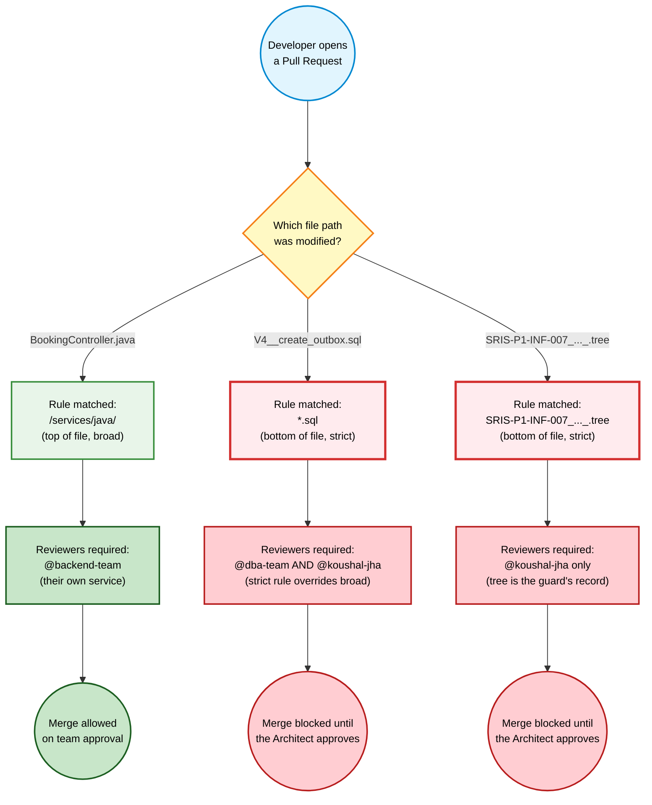
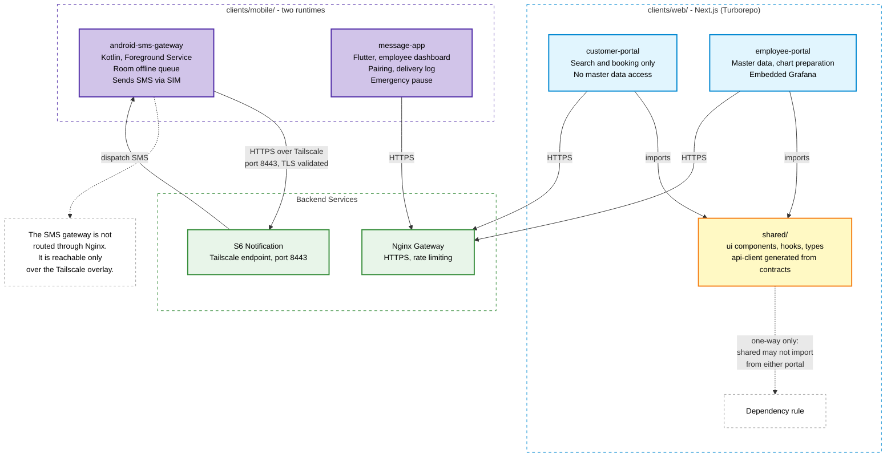
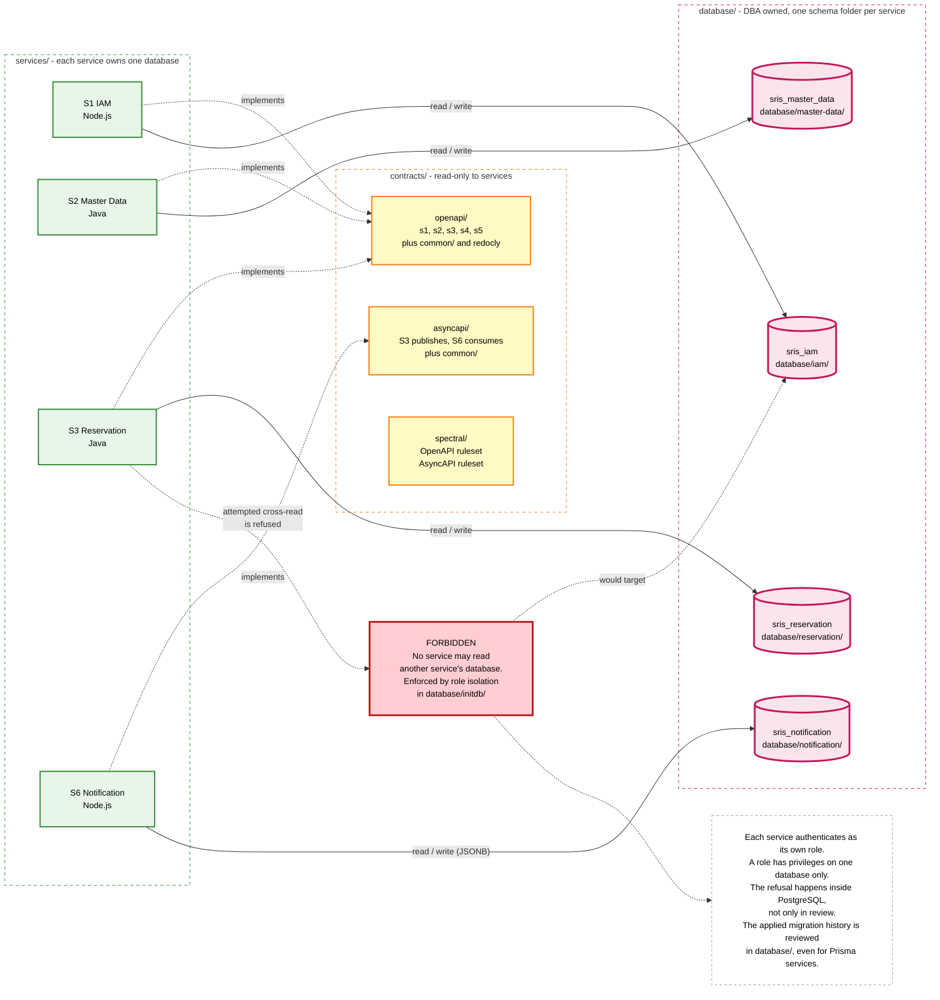
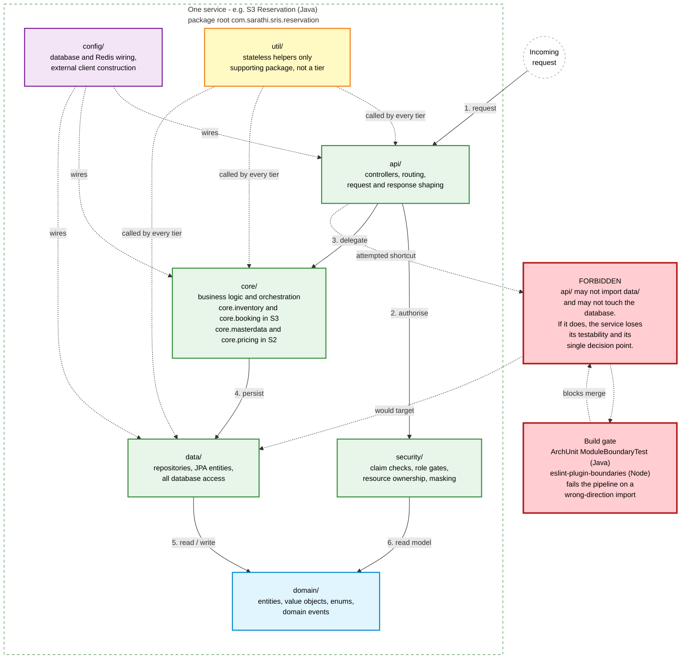
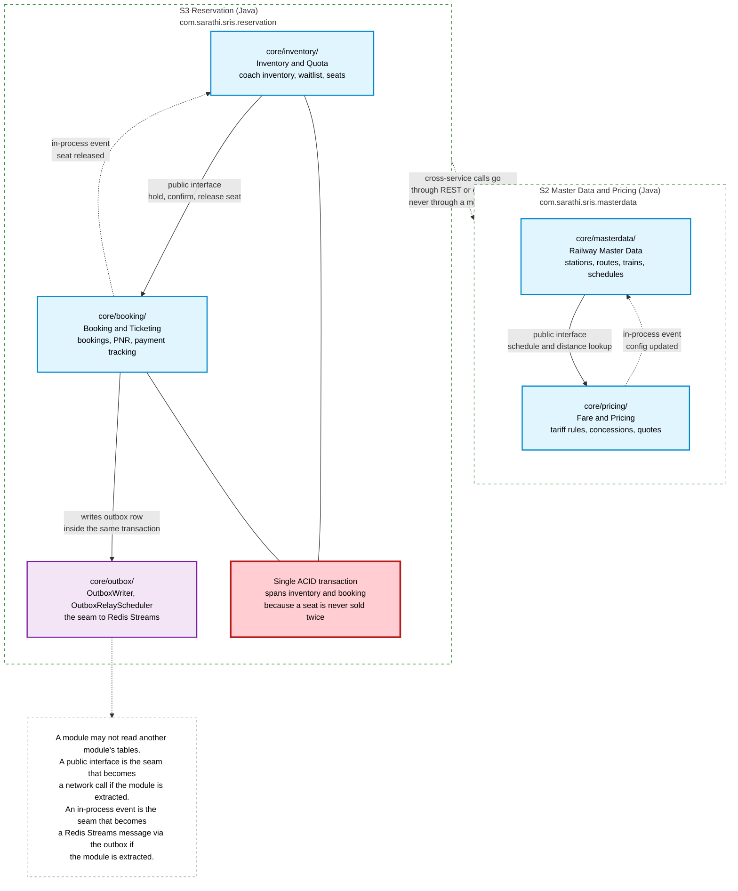

<div align="center">


</div>

# Repository Structure and Naming

*SRIS — Sarathi Railway Information System*

*A Unified Railway Management Platform*

*Inspired by CRIS and IRCTC · Independent project*

> **Version:** 1.0 | **Date:** 2026-10-23 | **Document ID:** SRIS-P1-INF-007

| Field              | Value                                                             |
| ------------------ | ----------------------------------------------------------------- |
| Title              | Repository Structure and Naming                                   |
| Software           | SRIS                                                              |
| Software Full Form | Sarathi Railway Information System                                |
| Team Codename      | Project Sarathi                                                   |
| Document ID        | SRIS-P1-INF-007                                                   |
| Task               | Define the monorepo layout, naming conventions, and boundaries    |
| Document Type      | Infrastructure Document                                           |
| Milestone          | Phase 1 Foundation                                                |
| Classification     | Internal                                                          |
| Version            | 1.0                                                               |
| Date               | 2026-10-23                                                        |
| Author             | Koushal Jha, Lead Architect                                       |
| Approved By        | Pending                                                           |
| Approval Date      | Pending                                                           |
| Supersedes         | None (first version)                                              |
| Related Documents  | See Appendix B                                                    |
| Affiliation        | Independent · Not affiliated with CRIS, IRCTC, or Indian Railways |

---

## Table of Contents

1. [Introduction](#1-introduction)
   - [1.1 Purpose](#11-purpose)
   - [1.2 Scope](#12-scope)
   - [1.3 Audience](#13-audience)
   - [1.4 Terminology and Conventions](#14-terminology-and-conventions)
2. [The Ten-Root Monorepo Taxonomy](#2-the-ten-root-monorepo-taxonomy)
   - [2.1 Why a Multi-Root Taxonomy](#21-why-a-multi-root-taxonomy)
   - [2.2 Top-Level Directory Map](#22-top-level-directory-map)
   - [2.3 Separation of Duties](#23-separation-of-duties)
   - [2.4 Root-Level Files](#24-root-level-files)
3. [Governance and CI/CD Enforcement](#3-governance-and-cicd-enforcement)
   - [3.1 The Boundary Guard](#31-the-boundary-guard)
   - [3.2 The CODEOWNERS Bottom-Up Rule](#32-the-codeowners-bottom-up-rule)
4. [Client Interfaces](#4-client-interfaces)
   - [4.1 Web Applications (Next.js)](#41-web-applications-nextjs)
   - [4.2 Mobile Applications (Kotlin & Flutter)](#42-mobile-applications-kotlin--flutter)
5. [Contracts and Database](#5-contracts-and-database)
   - [5.1 API and Event Contracts](#51-api-and-event-contracts)
   - [5.2 Database and Migrations](#52-database-and-migrations)
6. [Backend Microservices](#6-backend-microservices)
   - [6.1 Language Separation](#61-language-separation)
   - [6.2 The 6-Tier Architecture](#62-the-6-tier-architecture)
   - [6.3 Bounded Context Isolation](#63-bounded-context-isolation)
7. [Infrastructure and Deployment](#7-infrastructure-and-deployment)
   - [7.1 The Two-Tier Compose Hierarchy](#71-the-two-tier-compose-hierarchy)
   - [7.2 Container Configuration](#72-container-configuration)
8. [The Hybrid Launcher](#8-the-hybrid-launcher)
   - [8.1 JavaFX UI and Python Engine](#81-javafx-ui-and-python-engine)
   - [8.2 Security and Root of Trust](#82-security-and-root-of-trust)
9. [Scripts and Testing](#9-scripts-and-testing)
   - [9.1 Automation Scripts](#91-automation-scripts)
   - [9.2 Cross-Service Testing](#92-cross-service-testing)
10. [Naming Conventions](#10-naming-conventions)
    - [10.1 General Rules](#101-general-rules)
    - [10.2 Language-Specific Conventions](#102-language-specific-conventions)
    - [10.3 Infrastructure Conventions](#103-infrastructure-conventions)
11. [Repository Maintenance](#11-repository-maintenance)
    - [11.1 Adding a New File](#111-adding-a-new-file)
    - [11.2 Changing the Tree](#112-changing-the-tree)
12. [Approval](#12-approval)

- [Revision History](#revision-history)
- [Appendix A: The Complete Static Tree](#appendix-a-the-complete-static-tree)
- [Appendix B: Related Documents](#appendix-b-related-documents)

---

## 1. Introduction

### 1.1 Purpose

This document defines the definitive repository structure, folder boundaries, and file naming conventions for Phase 1 of SRIS. It acts as the single source of truth for where every file lives and who is allowed to modify it.

The architecture of SRIS is a polyglot, multi-service system. Without a strict, heavily enforced structural standard, the repository would devolve into a "big ball of mud" where frontend code mixes with backend code, database migrations are buried inside application folders, and infrastructure configurations are scattered randomly. This document prevents that failure mode by locking a precise, enterprise-grade monorepo taxonomy.

The taxonomy it records is already locked. Every folder and file in the Phase 1 tree has been reviewed and approved by the Lead Architect, and the tree is frozen at 2,707 files across 443 folders. This document does not propose changes to that taxonomy. It records it, explains the rules that produced it, and states how the rules are enforced.

### 1.2 Scope

**In scope**

- The ten-root top-level taxonomy of the monorepo.
- The strict separation of frontend (Web and Mobile) and backend (Java, Node.js, Python).
- The exact 6-tier architecture mandated for every backend microservice.
- The isolation of database migrations and API contracts.
- The two-tier Docker Compose hierarchy.
- The enforcement rules via CI/CD (the `.github/workflows/ci-boundary-guard.yml` guard and the wider guard family in [Section 3.1](#31-the-boundary-guard)) and GitHub `CODEOWNERS`.
- The master naming conventions for directories, files, and variables.

**Out of scope**

- The specific content of the application code (e.g., how the Saga Orchestrator is implemented), which belongs to the respective Detailed Design documents in Wave 3.
- The contents of the `docker-compose.yml` files, which belong to [SRIS-P1-INF-006](./SRIS-P1-INF-006_ContainerizationAndImageBuildGuide.md) — Containerization and Image Build Guide.
- The values of environment variables, which belong to [SRIS-P1-INF-011](./SRIS-P1-INF-011_EnvironmentVariablesAndConfigurationReference.md) — Environment Variables and Configuration Reference.
- The specific technologies chosen for the stack, which belong to [SRIS-P1-ARCH-008](./SRIS-P1-ARCH-008_TechnologyStackADR.md) — Technology Stack ADR.

### 1.3 Audience

- **Lead Architect:** maintains this document and is the sole authority on structural changes.
- **All Developers (Frontend, Backend, Database, DevOps):** must create and modify files strictly according to this document. A violation will be blocked by CI.
- **Project supervisor and evaluator:** verifies that the repository follows enterprise-grade separation of concerns.

### 1.4 Terminology and Conventions

Every term in this document has the meaning recorded in [SRIS-P1-REQ-001](./SRIS-P1-REQ-001_GlossaryAndDomainDictionary.md) — Glossary and Domain Dictionary. The terms below carry the most weight in this document.

| Term | Meaning |
| :--- | :--- |
| Monorepo | A single repository containing multiple independent projects (services, clients, infra). |
| Boundary Guard | The CI pipeline that blocks any PR introducing a file not listed in the companion tree file. |
| Turborepo | The build system used to manage the shared Next.js applications. |
| 6-Tier Architecture | The mandatory folder structure for backend services (api, core, data, domain, security, config). |
| Compose Hierarchy | The split of Docker Compose files into `modules/` (what) and `environments/` (how). |
| ACL | Anti-Corruption Layer. |
| BFF | Backend-For-Frontend. |

This document follows the standards below.

- [SRIS-P1-GOV-002](./SRIS-P1-GOV-002_DocumentTemplateStandard.md) — Document Template Standard.
- [SRIS-P1-GOV-003](./SRIS-P1-GOV-003_DocumentIDAndCategoryScheme.md) — Document ID and Category Scheme.
- [SRIS-P1-GOV-004](./SRIS-P1-GOV-004_DocumentCrossReferenceStandard.md) — Document Cross-Reference Standard.

---

## 2. The Ten-Root Monorepo Taxonomy

### 2.1 Why a Multi-Root Taxonomy

In a standard tutorial or a small project, it is common to place everything inside a single `/src` directory. In an enterprise system with a polyglot backend (Java, Node.js, Python), multiple distinct frontends (Web and Mobile), and a fully automated CI/CD pipeline, a monolithic `/src` folder is an anti-pattern.

SRIS enforces a **Multi-Root Taxonomy**. This solves four critical problems:
1. **Access Boundaries:** A frontend developer should never accidentally commit a database migration. By separating the roots, `CODEOWNERS` can deterministically block access.
2. **Docker Build Contexts:** When Docker builds S3 (Java), it should not tar and transfer gigabytes of React `node_modules`. A separated root makes Docker builds hermetic and fast.
3. **IDE Memory:** Opening the entire repository in an IDE triggers the Java language server, the TypeScript server, and the Python server simultaneously. This consumes gigabytes of RAM. The multi-root approach allows developers to open only the sub-tree they are working in.
4. **CI/CD Path Filtering:** GitHub Actions can use path filters (e.g., "if `services/java/**` changed, run the Java pipeline"). A unified `/src` makes these filters brittle and complex.

### 2.2 Top-Level Directory Map

The repository is partitioned into exactly **ten top-level directories**, plus the root-level configuration files.

The ten directories are the roots of the taxonomy. Each one owns a distinct concern, has its own owner, and is guarded by its own rule. The root-level files are not a root: they are individual files that belong to the repository as a whole, they are owned directly by the Lead Architect or the DevOps role, and they are listed separately in Section 2.4 rather than treated as an eleventh directory.

The diagram below illustrates the ten-root taxonomy, grouped by their primary function (Governance, Application, Contracts and Data, Infrastructure, and Documentation). The root-level files appear as a single grey node beside the repository root, joined by a dashed edge, because they are files contained by the root rather than a directory of it.

The diagram carries one distinction that the prose alone cannot. The solid edges are labelled `is a root of` and point to the five groups of directories; the dashed edge is labelled `contains (files, not a directory)` and points to the grey node. A reader who counts the solid edges counts ten roots, because the five subgraphs between them hold exactly the ten directories. A reader who counts every box counts eleven groups and a set of files, and the edge labels tell them which is which. The grey node's dashed border and the word `files` in its label are a second signal, so the distinction survives even if the edge labels are cropped in a narrow view.

```mermaid
%%{init: {
  "flowchart": {
    "nodeSpacing": 60,
    "rankSpacing": 80,
    "padding": 20,
    "curve": "basis",
    "htmlLabels": true
  },
  "themeVariables": {
    "fontSize": "14px",
    "fontFamily": "Segoe UI, Arial, sans-serif"
  }
}}%%
flowchart TD
    classDef root fill:#E1F5FE,stroke:#0288D1,stroke-width:3px,color:#000;
    classDef governance fill:#F3E5F5,stroke:#7B1FA2,stroke-width:2px,color:#000;
    classDef client fill:#FFF9C4,stroke:#F57F17,stroke-width:2px,color:#000;
    classDef backend fill:#E8F5E9,stroke:#388E3C,stroke-width:2px,color:#000;
    classDef data fill:#FCE4EC,stroke:#C2185B,stroke-width:2px,color:#000;
    classDef infra fill:#FFE0B2,stroke:#E65100,stroke-width:2px,color:#000;
    classDef docs fill:#E0E0E0,stroke:#424242,stroke-width:2px,color:#000;
    classDef loose fill:#F5F5F5,stroke:#757575,stroke-width:2px,stroke-dasharray:6 4,color:#000;

    Root(("sris-monorepo/")):::root

    %% Root-level files: an annotation node beside the root, not a child directory
    Files["Root-level files<br/>README, LICENSE, Makefile,<br/>CODEOWNERS, docker-compose*.yml,<br/>.env* , dotfiles<br/>(23 files, not a root)"]:::loose
    Root -.->|"contains (files, not a directory)"| Files

    %% Governance
    subgraph Governance ["Governance & Automation"]
        direction TB
        G1[".github/"]:::governance
        G2["scripts/"]:::governance
        G3["tests/"]:::governance
    end

    %% Application Layer
    subgraph Application ["Application Layer"]
        direction TB
        A1["clients/"]:::client
        A2["services/"]:::backend
        A3["sris-launcher/"]:::backend
    end

    %% Contracts & Data
    subgraph Data ["Contracts & Data"]
        direction TB
        D1["contracts/"]:::data
        D2["database/"]:::data
    end

    %% Infrastructure
    subgraph Infra ["Infrastructure"]
        direction TB
        I1["infra/"]:::infra
    end

    %% Documentation
    subgraph Docs ["Documentation"]
        direction TB
        Doc1["docs/"]:::docs
    end

    %% Connections: solid edges are directory membership
    Root -->|"is a root of"| Governance
    Root -->|"is a root of"| Application
    Root -->|"is a root of"| Data
    Root -->|"is a root of"| Infra
    Root -->|"is a root of"| Docs

    %% Styling
    style Governance fill:#FFFFFF,stroke:#7B1FA2,stroke-width:1px,stroke-dasharray:5 5
    style Application fill:#FFFFFF,stroke:#388E3C,stroke-width:1px,stroke-dasharray:5 5
    style Data fill:#FFFFFF,stroke:#C2185B,stroke-width:1px,stroke-dasharray:5 5
    style Infra fill:#FFFFFF,stroke:#E65100,stroke-width:1px,stroke-dasharray:5 5
    style Docs fill:#FFFFFF,stroke:#424242,stroke-width:1px,stroke-dasharray:5 5
```



### 2.3 Separation of Duties

The ten roots enforce a strict separation of duties. A developer cannot cross boundaries without modifying `.github/CODEOWNERS`, which requires Lead Architect approval.

| Root | Primary role | What lives here |
| :--- | :--- | :--- |
| `.github/` | DevOps | CI/CD workflows, issue templates, CODEOWNERS, security policies. |
| `clients/` | Frontend/Mobile | Next.js web portals, Kotlin Android apps, Flutter message apps. |
| `contracts/` | Lead Architect | OpenAPI and AsyncAPI schemas, Pact contracts. |
| `database/` | DBA | All SQL migrations, seed scripts, expected schema definitions. |
| `services/` | Backend | The 6 microservices, split by Java, Node.js, and Python. |
| `infra/` | DevOps | Docker Compose, Nginx, Prometheus, Grafana, infrastructure config. |
| `sris-launcher/`| Lead Architect | The JavaFX + Python hybrid admin tool. |
| `scripts/` | DevOps | Bash and PowerShell automation scripts. |
| `tests/` | QA | Cross-service integration, chaos, load, and E2E tests. |
| `docs/` | Lead Architect | The 180-document register (Wave 0 to Wave 9). |

The root-level files are governed by the same pattern, but they are not a root. They are listed in Section 2.4, and each one is owned by the role that owns the concern it serves: the CI configuration files by DevOps, the repository metadata files by the Lead Architect, and the Compose entry points by DevOps.

Two consequences follow from this table, and they are the reason it is recorded here rather than left to the CODEOWNERS file.

First, the primary role is not a job title. It is the owner of last resort. If a file inside a root has no more specific owner, the role in this table is the owner who must review a change to it. This is what makes the CODEOWNERS bottom-up rule in Section 3.2 work: the broad rules at the top of the file assign each root to its role, and the narrow rules at the bottom carve out the exceptions.

Second, the split between `contracts/` and `services/` is deliberate and must not be collapsed. Contracts are the shared language of the system; services are the implementations of that language. If the contracts lived inside the services, a change to a shared schema would be a change to one service, and the other services would have no review gate over it. Keeping the contracts at the root means every service team reviews a contract change together, through the ownership of that one root.

### 2.4 Root-Level Files

The repository root contains a set of files that belong to the repository as a whole. They are not a directory, they are not a root, and they are not counted in the ten-root taxonomy. They are listed here because the Boundary Guard in Section 3.1 matches paths, and a file that is not listed in the tree cannot be guarded.

The files fall into five groups.

| Group | Files | Owner | Purpose |
| :--- | :--- | :--- | :--- |
| Repository metadata | `README.md`, `LICENSE`, `CHANGELOG.md`, `CONTRIBUTING.md`, `SECURITY.md`, `.mailmap` | Lead Architect | Identity, licence, history, contribution rules, and security policy. |
| Editor and tooling configuration | `.editorconfig`, `.gitattributes`, `.gitignore`, `.dockerignore`, `.nvmrc`, `.tool-versions`, `.pre-commit-config.yaml`, `.yamllint.yaml`, `Makefile` | DevOps | Toolchain pinning, editor normalisation, linting, and the top-level task entry points. |
| Environment entry points | `.envrc`, `.envrc.example`, `.env.example` | DevOps | The shell environment loader and its templates. The variable catalogue itself is owned by [SRIS-P1-INF-011](./SRIS-P1-INF-011_EnvironmentVariablesAndConfigurationReference.md) — Environment Variables and Configuration Reference. |
| Ownership | `CODEOWNERS` | Lead Architect | The top-level ownership file. The bottom-up rule is in Section 3.2. |
| Compose entry points | `docker-compose.yml`, `docker-compose.dev.yml`, `docker-compose.test.yml`, `docker-compose.prod.yml` | DevOps | The entry points that join the Compose modules and environments. The hierarchy is in Section 7.1. |

Three rules govern these files.

First, a root-level file is owned by the role in the table, and a change to it is reviewed by that role. A root-level file is not a free-for-all just because it sits outside a root.

Second, a root-level file that carries a toolchain version must match the version in the image that consumes it. `.nvmrc` and `.tool-versions` are the two files that carry versions, and they must agree with the Node.js and Java base images in `infra/docker/`. A mismatch is a defect, because the developer's local toolchain and the container toolchain would diverge.

Third, a root-level file is listed in the companion tree file and is covered by the Boundary Guard. The guard matches paths, not folders, so a new root-level file is a structural change under Section 11.1, exactly as a new file inside a root would be.

---

## 3. Governance and CI/CD Enforcement

### 3.1 The Boundary Guard

An architectural standard is only as good as its enforcement. SRIS enforces this tree through a set of CI workflows, and the one that enforces the tree itself is the **Boundary Guard** (`.github/workflows/ci-boundary-guard.yml`).

The Boundary Guard is a GitHub Action that runs on every Pull Request. It maintains a cryptographic hash of the authorised file paths defined in the companion tree file `SRIS-P1-INF-007_RepositoryStructureAndNaming.tree`.
- If a developer adds a new file (e.g., `services/java/s3-reservation/src/main/java/.../Helper.java`), the CI pipeline fails.
- To add that file, the developer must first open a PR to amend this document, updating the companion tree file. This ensures the Lead Architect approves every structural change before the code is merged.

The guard does not check whether the content of a file is correct. It checks only that the file is permitted to exist at that path. This is a deliberate limit: content correctness belongs to the CI jobs that compile, lint, and test the code, and a single workflow cannot reasonably own both. The Boundary Guard owns one question only — is this file allowed here? — and it answers it before any other job runs, so that a PR which invents a new folder is rejected in seconds rather than after a full build.

The guard is paired with the companion tree file, not with the Markdown body of this document. The hash is taken over the companion file, whose byte sequence is stable. This is why the tree is not inlined in Appendix A: a Markdown block changes when an editor normalises line endings, and the hash would break for reasons that have nothing to do with the structure.

The Boundary Guard is not the only gate. The tree contains a family of guard workflows, each of which owns one structural rule, and each of which fails the build when its rule is broken. The family is listed below. The list is drawn from the locked tree, and a workflow that is added to the tree in a later phase is added to this table in the same commit.

| Workflow | Rule it enforces | Owner |
| :--- | :--- | :--- |
| `ci-boundary-guard.yml` | Every path in a PR exists in the companion tree file. | DevOps |
| `ci-tree-regenerate.yml` | The companion tree file matches the repository after a structural change. | DevOps |
| `ci-naming-guard.yml` | Directory, file, package, and container names follow Section 10. | DevOps |
| `ci-env-separation-guard.yml` | No environment-specific value leaks into a module or a shared file. | DevOps |
| `ci-db-migration-guard.yml` | Every migration has a matching rollback, and the schema matches `database/expected-schema/`. | DBA |
| `ci-no-hardcoded-hosts.yml` | No hostname, port, or URL is hardcoded; every value comes from the environment. | DevOps |
| `ci-readonly-container-check.yml` | No container mounts a writable path that it does not need. | DevOps |
| `ci-maintenance-guard.yml` | The maintenance-mode configuration is consistent across environments. | DevOps |
| `ci-config-validate.yml` | Every configuration file matches its JSON schema in `infra/config/schema/`. | DevOps |
| `ci-deterministic-tests.yml` | No test depends on wall-clock time, random ordering, or a live external system. | QA |
| `ci-contracts.yml` | Every OpenAPI and AsyncAPI file passes the Spectral rule set and the breaking-change check. | Lead Architect |
| `ci-security.yml` | No known vulnerability, no committed secret, and no unsigned binary enters the tree. | DevOps |
| `ci-license-check.yml` | Every dependency has an approved licence. | Lead Architect |
| `ci-docs.yml` | Every document reference resolves, and every Document ID is a hyperlink. | Lead Architect |

Three rules govern this set.

First, a workflow owns one rule and only one rule. A guard that checks two unrelated things cannot be reasoned about when it fails, because the failure does not say which rule was broken. The one-rule-per-guard pattern is what makes a failure message actionable.

Second, a guard is a build gate, not a convention. Each workflow in the table fails the pipeline when its rule is broken. A rule that is not backed by a guard is a rule that will be broken eventually, because nothing catches the break before merge.

Third, the set is closed for Phase 1. A new guard is added by a structural change under Section 11.2, in the same commit as the rule it enforces and the table row that records it. A guard added without its table row is a guard that the next reader cannot find, and a table row added without its guard is a rule that is not enforced.

### 3.2 The CODEOWNERS Bottom-Up Rule

GitHub evaluates `.github/CODEOWNERS` from bottom to top. The last matching pattern takes precedence. SRIS exploits this to enforce security.

1. **Top of file:** Broad assignments (e.g., `/services/java/ @backend-team`).
2. **Bottom of file:** Hard locks (e.g., `*.sql @dba-team @koushal-jha`, `/infra/compose/environments/prod.yml @koushal-jha`, `/docker-compose.prod.yml @koushal-jha`).

This structure guarantees that even if a backend developer owns their service folder, they cannot merge a database migration (`*.sql`) because the rule at the bottom of the file explicitly overrides their ownership. The same precedence protects the two other files that must never be merged without the Lead Architect: the production Compose overlay, and the companion tree file that the Boundary Guard hashes.

The bottom-up rule is not a convenience. It is the mechanism that makes the separation of duties in Section 2.3 enforceable by a machine rather than by a reviewer's memory. A broad rule at the top can be written generously, because the narrow rules at the bottom will always win where they apply. A reviewer who reads only the top of the file will believe that a service team owns its whole subtree; a reviewer who reads to the bottom will see the exceptions. The rule exists so that the second reader is the one GitHub follows.

The diagram below illustrates how a pull request is resolved against the CODEOWNERS file. It shows the three cases side by side: an ordinary application file, which resolves to the owning team; a migration file, which resolves to the DBA and the Lead Architect because the stricter rule sits lower in the file; and the companion tree file, which resolves to the Lead Architect alone because the tree is the record the Boundary Guard depends on.



## 4. Client Interfaces

The `clients/` directory houses all user-facing surfaces. To prevent tight coupling between the web application and the mobile applications, and to enforce the enterprise separation of duties, this directory is split strictly by technology stack.

The split is not cosmetic. A web client and a mobile client have different release cadences, different distribution channels, and different runtime constraints. The web client is served from GitHub Pages as a static export and updated by a Git push. The Android client is installed on a device, must survive Doze mode, and cannot be updated on demand. Coupling them in one folder would force the slower cadence onto the faster one. The split lets each surface evolve against the same contracts without dragging the other behind it.

### 4.1 Web Applications (Next.js)

The web applications are managed as a monorepo-within-a-monorepo using **Turborepo**. This is a critical architectural choice. The Customer Portal (for passengers) and the Employee Portal (for railway staff) share 80% of their UI components (buttons, forms, tables) and the same auto-generated API client.

- **`clients/web/shared/`**: The shared library. It contains the `api-client` (generated from `contracts/openapi/`), the `ui` components (Tailwind CSS), and shared `hooks` and `types`.
- **`clients/web/customer-portal/`**: The Next.js App Router application for passengers. It is strictly read and book only. It cannot touch master data.
- **`clients/web/employee-portal/`**: The Next.js App Router application for railway staff. It handles master data setup, chart preparation, and embeds the Grafana dashboard.

No UI component in the Customer Portal may import directly from the Employee Portal. They only share code through the `shared/` library. This direction is one-way by design: a shared component may not import from either portal, and a portal may import only from `shared/`. That rule is what keeps the shared library genuinely shared rather than becoming a hiding place for one portal's logic.

The API client is generated from the contracts, not written by hand. This is the same contract-first rule that Section 5.1 enforces on the services, applied to the clients. A hand-written client drifts from the contract silently; a generated client cannot, because the generation step fails when the contract changes in a way the client cannot follow.

### 4.2 Mobile Applications (Kotlin & Flutter)

The `clients/mobile/` directory contains two distinct mobile applications, each built with the technology best suited to its workload.

- **`clients/mobile/android-sms-gateway/`**: Written in **Kotlin**. This is not a standard user app. It is a background Foreground Service that connects to S6 over Tailscale (Port 8443) and physically sends SMS via the device's SIM card. It requires a Room database for offline queueing, strict TLS validation, and battery optimisation bypassing.
- **`clients/mobile/message-app/`**: Written in **Flutter**. This is the employee-facing notification dashboard. It allows operations staff to pair their device, view the SMS delivery log, configure the Phase 2 provider swap (Twilio/Msg91), and trigger emergency pauses.

The two mobile applications are deliberately built with different technologies. The SMS gateway is a long-running background service with direct access to the SIM and the Android telephony APIs; Kotlin gives it native access to those APIs and to the Foreground Service lifecycle. The message app is a data-entry and monitoring surface with no privileged device access; Flutter gives it a single codebase and a faster iteration cycle for the operations team. Choosing one technology for both would force a compromise on one of the two workloads, and the workloads do not resemble each other enough to justify the compromise.

The diagram below illustrates the client layer and how each surface connects to the backend. It shows the one-way dependency into the shared library, the two distinct mobile runtimes, and the separate path that the SMS gateway takes through Tailscale rather than through Nginx.



## 5. Contracts and Database

This section defines the boundary between application code, the interface definitions, and the data persistence layer. In SRIS, these three layers are strictly isolated.

The isolation is what makes the polyglot backend survivable. A Java service and a Node.js service cannot share code, so the only thing they can share is a written contract. A service and a database cannot share a transaction across service boundaries, so the only thing they can share is a schema owned by one service. The two folders in this section, `contracts/` and `database/`, are the only places where those shared things live.

### 5.1 API and Event Contracts

The `contracts/` directory is the single source of truth for all inter-service communication. Because SRIS is polyglot (Java, Node.js, Python), sharing code is impossible. Instead, the services share *contracts*.

- **`contracts/openapi/`**: Contains the OpenAPI 3.1 YAML files for the five REST services (`s1-iam`, `s2-master-data`, `s3-reservation`, `s4-search-bff`, `s5-payment-gateway`), the shared schema fragments under `common/`, and the Redocly bundling configuration. These files define the exact endpoints, request bodies, and response schemas.
- **`contracts/asyncapi/`**: Contains the AsyncAPI 3.0 YAML files for the event-driven communication (`s3-reservation-publishes.asyncapi.yaml` and `s6-notification-consumes.asyncapi.yaml`), the generation configuration, and the shared envelope and dead-letter schemas under `common/`.
- **`contracts/examples/`**: Contains static JSON payloads for the booking, confirmation, waitlisting, and payment-callback cases, used for testing and documentation.
- **`contracts/spectral/`**: Contains the two Spectral rule sets, `.spectral.yaml` for OpenAPI and `.spectral-asyncapi.yaml` for AsyncAPI, that lint every contract file for naming, structure, and consistency defects before a contract can be merged.
- **`contracts/pact/`**: Contains the Pact broker directory for consumer-driven contract testing. The generated Pact files land under `pacts/`.

**Strict Rule:** No code may be written for a service before its contract is updated and approved in this folder (NFR-060).

Two enforcement steps make that rule real rather than aspirational. First, the CI pipeline runs Spectral against every contract file on every pull request, using the rule set that matches the file type; a contract that violates its rule set fails the build before any service code is compiled. Second, a schema change triggers a breaking-change check that compares the proposed contract against the last approved version and fails when a consumer-visible element is removed or narrowed. Together the two steps mean that a contract cannot be weakened without a deliberate, reviewed change to the contract itself, in the `contracts/` root, under the ownership rule that governs that root.

The contracts folder also contains a `validate-all.sh` script, which runs both rule sets over every file locally, so that a developer discovers a contract defect before pushing rather than in CI. The script and the CI step apply the same rules; the script exists so that the loop from edit to result is seconds rather than minutes.

### 5.2 Database and Migrations

The `database/` directory contains every SQL statement in the project. **No SQL files are allowed inside the `services/` directory.**

The database folder is organised by bounded context, not by migration tool. Each of the four logical databases has its own folder, and each folder holds that database's forward and rollback migrations as matched pairs. The folders are:

- **`database/iam/`**: The migrations for `sris_iam`. Each migration is a `V<n>__<description>.sql` file paired with a `U<n>__<description>.sql` rollback. The folder covers users, refresh tokens, sessions, consent records, password-reset tokens, the audit log, retention indexes, password rotation, and consent versioning.
- **`database/master-data/`**: The migrations for `sris_master_data`. The folder covers stations, routes and stops, trains and schedules, coach compositions, classes and quotas, fare rules and their versions, the audit log, the optimistic version column, full-text station search, and idempotency keys.
- **`database/reservation/`**: The migrations for `sris_reservation`. The folder covers the seat matrix, quota allocations, bookings, passengers, PNRs, the waitlist, the `payment_inflight` record, the outbox and its dead-letter table, idempotency keys, the audit log, the booking version column, the seat lock columns, the saga state table, and the chart preparation table. This is the largest of the four folders, because S3 owns the core transactional state.
- **`database/notification/`**: The migrations for `sris_notification`. The folder covers templates, the delivery log, consumed events, the retry queue, the dead-letter queue, and the delivery metrics columns.

The database folder also contains the following supporting folders:

- **`database/initdb/`**: The numbered scripts that create the four logical databases for each environment, grant the per-service roles their privileges, set connection limits, enable the required extensions, configure `pg_hba`, create replication slots, and create the initial administrator. The numbered order is the execution order.
- **`database/rollback/`**: The rollback harness, which applies every `U<n>__` file in reverse order and asserts that the schema returns to its empty state. The harness is what makes the matched-pair rule testable.
- **`database/expected-schema/`**: The golden schema dumps, one per logical database, together with the `check-drift.sh` script that compares the live schema against the dump and the `regenerate.sh` script that refreshes the dump after an approved change.
- **`database/seed/`**: The seed and reference data, including the master-data seed, the IAM roles seed, the notification templates seed, and the production reference data.
- **`database/naming/`**: A copy of the database naming conventions, so that a developer who is working in the database folder does not have to leave it to find the rules.
- **`database/review/`**: The query-review checklist and the index-review checklist, used by the DBA when reviewing a migration.

**Prisma note.** The Node.js services use Prisma, and a Prisma schema lives in each Node.js service's own `prisma/` folder, not in `database/`. The tree confirms this: `services/node/s1-iam/prisma/schema.prisma` and `services/node/s6-notification/prisma/schema.prisma`. The Prisma migrations that result from those schemas are applied through the same CI migration guard as the SQL folders, and the drift check compares the resulting schema against `database/expected-schema/`. The database folder is therefore the single place where the *applied* migration history is reviewed, even though the Prisma schema files themselves live with their services.

This physical separation ensures that a backend developer cannot alter the database schema without the DBA's explicit approval via the `CODEOWNERS` file.

Three enforcement steps make the separation real. First, the CI pipeline runs a migration dry-run against a throwaway database, so a migration that fails to apply is caught before merge. Second, the pipeline compares the resulting schema against `database/expected-schema/` and fails on drift, so the running schema cannot quietly diverge from the recorded one. Third, the rollback harness applies every `U<n>__` file and asserts the empty-schema result, so a migration that has no working rollback is caught before it can be needed in an incident.

The diagram below illustrates the data flow. It shows four things: which service owns which database, that the contracts root is read-only to the services, that each service has exactly one database it may read and write, and that a cross-database read is refused by the database engine itself rather than only by convention.



## 6. Backend Microservices

The `services/` directory contains the six deployable services of Phase 1. This is the largest root in the tree and the one where structural discipline matters most, because it is where three separate rules meet.

Three rules govern this root:

- **Language separation.** Java, Node.js, and Python each occupy their own subtree, because each toolchain requires a different top-level project descriptor and mixing them breaks the build.
- **The six-tier architecture.** Every service has exactly six semantic tiers, and no file may cross the boundaries between them.
- **Bounded-context isolation.** The two macro-services, S2 and S3, contain internal modules, and a module may not read another module's tables or reach into its internals.

Each rule is stated in its own subsection. The service identities and short names the rules refer to are owned by [SRIS-P1-ARCH-016](./SRIS-P1-ARCH-016_ServiceRegistryAndCatalog.md) — Service Registry and Catalog; the language and runtime choices are owned by [SRIS-P1-ARCH-008](./SRIS-P1-ARCH-008_TechnologyStackADR.md) — Technology Stack ADR.

### 6.1 Language Separation

The `services/` root is partitioned by language, not by service. The partition is:
```
services/
|-- java/ (S2 Master Data and Pricing, S3 Reservation)
|-- node/ (S1 IAM, S4 Search BFF, S5 Payment Gateway, S6 Notification)
`-- python/ (S6-PY Python Automation Daemon)
```

The partition exists because each runtime imposes a mandatory project structure that cannot coexist with the others in one folder:

- **Java** requires a Maven or Gradle project descriptor at the root of the project, a `src/main/java` and `src/main/resources` layout, and a package tree that matches the group and artifact identifiers. Two Java services cannot share one project descriptor.
- **Node.js** requires a `package.json` at the root of the project, a `node_modules` tree, and a TypeScript configuration. NestJS additionally requires a `nest-cli.json`. Two Node.js services cannot share one `package.json` without coupling their dependency versions.
- **Python** requires a virtual environment and a module root. It has no project descriptor that a Java or Node.js toolchain can read.

Placing a Java service and a Node.js service in one folder would force the build tool of one language to walk the source tree of the other, and the two toolchains would fight over the folder. The language split removes the conflict at the filesystem level, so that each language's build runs only over its own subtree.

The Python entry is a sidecar, not a seventh service. The S6-PY daemon runs inside the S6 container, shares its network namespace, and is listed here because it is a Python process with its own source tree. It is not a separate deployable, and the service count remains six. The tree confirms the sidecar arrangement: `services/node/s6-notification/` carries a `Dockerfile.sidecar`, a `tsconfig.sidecar.json`, a `docker-compose.snippet.yml`, and a `SIDECAR.md`, all of which exist to build and run the Python daemon alongside the Node.js half of S6.

Each language subtree holds one folder per service, and each service folder is self-contained: it carries its own build descriptor, its own `Dockerfile`, its own `.dockerignore`, its own environment templates, and its own test tree. The five Node.js services each carry a `nest-cli.json`, a `jest.config.js`, an `.eslintrc.js`, and a `.npmrc`; the two Java services each carry a `pom.xml`, a `checkstyle.xml`, a `spotbugs-exclude.xml`, and a Maven wrapper. A service folder that is missing its own build descriptor is not a service.

### 6.2 The 6-Tier Architecture

Every service in `services/`, whether Java, Node.js, or Python, is organised into six semantic tiers. A tier is a package that owns one kind of responsibility, and the tiers are the same in every service so that a developer who moves from one service to another finds the same shape. The six tiers are:

| Tier | Package | What belongs here | What may not be here |
| :--- | :--- | :--- | :--- |
| API | `api/` | HTTP routing, request validation, response shaping, status codes. For NestJS, the controllers. | Business rules, database queries, domain entities. |
| Core | `core/` | The business logic: algorithms, orchestration, the rules that decide an outcome. | Database queries, HTTP concerns, framework-specific request objects. |
| Data | `data/` | All database access: repositories, JPA entities, Prisma client calls. | Business rules, HTTP concerns, anything that decides an outcome rather than fetches one. |
| Domain | `domain/` | The domain model: entities, value objects, enums, domain events, the vocabulary of the bounded context. | Database access, HTTP concerns, framework annotations that tie the model to a runtime. |
| Security | `security/` | Authorisation logic local to the service: claim checks, role gates, resource ownership checks, masking. | Authentication itself, which belongs to S1 IAM, and heavy bot detection, which belongs to Nginx. |
| Config | `config/` | Application configuration: database connection wiring, Redis wiring, external client construction, feature flags, observability wiring. | Secrets. Secrets come from the environment and are owned by [SRIS-P1-INF-011](./SRIS-P1-INF-011_EnvironmentVariablesAndConfigurationReference.md) — Environment Variables and Configuration Reference. |

The package root follows the pattern `com.sarathi.sris.<service>.<tier>`, with no context segment between the service and the tier. The tree confirms this for both Java services. S2's packages are `com.sarathi.sris.masterdata.config`, `.domain`, `.api`, `.security`, `.util`, `.data`, and `.core`. S3's packages are `com.sarathi.sris.reservation.config`, `.domain`, `.api`, `.security`, `.util`, `.data`, and `.core`. A class in the `booking` module of S3 lives under `com.sarathi.sris.reservation.core.booking` or `com.sarathi.sris.reservation.data.booking`, because the context segment appears *below* the tier, not between the service and the tier.

**The `util` package.** The tree contains a seventh package, `util/`, under both Java services. It is a supporting package, not a seventh tier. It holds small stateless helpers — a correlation-id holder, a date-time helper — that every tier may call and that call no tier of their own. It carries no semantic responsibility, it has no rules about what may be imported into it beyond "nothing with state", and it is not part of the six-tier rule. The distinction matters because a build check that counted packages would reject the tree, while a build check that counts *semantic tiers* accepts it. The six-tier rule is a statement about responsibility, not about the number of folders.

The rule that governs these tiers is a single direction of dependency. A request enters at `api/`, is decided in `core/`, is persisted through `data/`, is described by `domain/`, is checked by `security/`, and is wired by `config/`. The dependency arrow never points backwards:

- `api/` may call `core/` and `security/`.
- `core/` may call `data/`, `domain/`, and `security/`.
- `data/` may call `domain/`.
- `domain/` may call nothing. It is the innermost tier and depends on no other tier in the service.
- `security/` may call `domain/`.
- `config/` may be called by every tier, because every tier needs wiring, and `config/` may call nothing in the service.
- `util/` may be called by every tier, and may call nothing in the service.

The direction is what makes the architecture testable. A `core/` class can be unit-tested without a database, because it never reaches into `data/` directly; it receives a repository through `config/`. A `domain/` object can be tested without a runtime, because it has no framework annotations. If the direction is broken — if an `api/` controller imports a `data/` repository and queries the database directly — both of those properties are lost at once.

That is the failure the enforcement catches. ArchUnit, for the Java services, and `eslint-plugin-boundaries`, for the Node.js services, both fail the build when an import crosses a tier boundary in the wrong direction. The rule is not a convention in a document; it is a build gate. A developer who imports a `data/` repository into an `api/` controller cannot merge the change, because the pipeline refuses it before review.

The tree contains the ArchUnit test that does this: `services/java/s2-master-data/src/test/java/com/sarathi/sris/masterdata/architecture/ModuleBoundaryTest.java` and its S3 counterpart. The test is part of the service's own test tree, so the boundary rule is checked by the service that the rule governs, not only by CI.

Two consequences follow, and they are worth stating because they are the reason the rule is worth its cost.

First, the rule fixes where a decision lives. When every service puts its decisions in `core/`, a reader who wants to know why a booking was confirmed looks in one place across all six services. When a decision leaks into `api/`, the reader has to reconstruct it from a controller that half-decides and half-delegates. The rule keeps the answer to "what does this service decide?" in a single tier.

Second, the rule fixes what a test can be. A `core/` test needs no container, no database, and no HTTP server, because `core/` depends on `data/` through an interface rather than on a concrete repository. A service that follows the rule can run its entire decision test suite in seconds. A service that breaks the rule cannot, because its decisions are entangled with its transport and its storage.

The diagram below shows the six tiers of a single service, the permitted direction of each dependency, the two enforcement tools, and the `util/` supporting package. It uses S3 Reservation as the reference, because S3 carries the most logic; S1, S2, S4, S5 and S6 follow the same shape with their own contents.



### 6.3 Bounded Context Isolation

Two of the six services, S2 and S3, are macro-services. Each contains more than one bounded context, and each context is kept as a separate internal module. The modules are:

| Service | Module | Bounded context | Owns |
| :--- | :--- | :--- | :--- |
| S2 | `core/masterdata/` | Railway Master Data | Stations, routes, coach templates, trains, schedules. |
| S2 | `core/pricing/` | Fare and Pricing | Tariff rules, concession rules, fare quotes. |
| S3 | `core/inventory/` | Inventory and Quota | Coach inventory, waitlist queues, seat allocation. |
| S3 | `core/booking/` | Booking and Ticketing | Bookings, passengers, PNR, payment tracking, Saga orchestration. |

The module names are the package names, and the tree confirms them. S2's business logic sits under `com.sarathi.sris.masterdata.core`, with `masterdata/` and `pricing/` as its two sub-packages. S3's business logic sits under `com.sarathi.sris.reservation.core`, with `inventory/` and `booking/` as its two sub-packages. The module boundary is therefore a package boundary, and the same ArchUnit rule that guards the tiers guards the modules: a class in one module may not import a class from another module's internals.

Each module has its own tables, its own domain model, and its own package root. A module may not read another module's tables, and may not import another module's internal classes. The two modules of one service interact in exactly two ways: through a public interface that the owning module exposes, or through an in-process domain event that the owning module publishes and the other subscribes to.

The reason for the rule is the same reason the two contexts were merged into one service in the first place. The merge was justified by a shared invariant: a seat is never sold twice, and the booking state, the seat state, and the payment state must move together inside one transaction. The merge does not justify merging the *models*. Inventory thinks in seats and segments; Booking thinks in bookings and PNRs. If the two models were allowed to reach into each other, the merge would become a single tangled model, and the extraction path back to two services would be closed.

The two interaction mechanisms are what keep that path open. A public interface is a seam: the day the module becomes its own service, the interface becomes a network call and the internals do not change. An in-process domain event is also a seam: the day the module becomes its own service, the event becomes a message on Redis Streams and the publisher does not change.

The tree shows the second seam concretely. S3's outbox machinery — `OutboxWriter`, `OutboxRelayScheduler`, `OutboxEventSerializer` — sits under `core/outbox/`, and the outbox table itself is created by `database/reservation/V8__create_outbox.sql`. The in-process event that Inventory publishes when a seat is released is the same event that, in a later phase, would be written to the outbox and published to Redis Streams. The seam exists today; only the transport would change.

The diagram below shows the two macro-services, their modules, the public interfaces between modules, the in-process events, the outbox seam that makes the extraction path real, and the single transaction boundary inside S3 that the merge exists to protect.



## 7. Infrastructure and Deployment

The `infra/` directory contains everything needed to run the system: the Compose files, the container definitions, the edge configuration, the observability configuration, and the supporting configuration for backups, secrets, and host services. No application code lives here, and no infrastructure configuration lives anywhere else.

The folder is the largest source of accidental coupling in a monorepo. If a developer can edit the Compose file, they can change the port of a service, the memory limit of a container, or the network a service attaches to, without any review of the change as an infrastructure change. Section 7 exists to prevent that, by fixing where each kind of configuration lives and by routing each kind through its own ownership rule.

### 7.1 The Two-Tier Compose Hierarchy

Compose configuration is split into two tiers, and the split is not cosmetic. A single `docker-compose.yml` that holds every service, every volume, every network, and every environment override is a security risk: a developer who runs it locally will run the production topology on their laptop, with production ports, production credentials, and production memory limits. The two-tier split removes that risk by separating *what runs* from *how it is configured for a given environment*.

The two tiers are:

- **`infra/compose/modules/`** — the *what*. Each file in this tier holds one layer of the stack and nothing else. A module file declares its services, its volumes, its networks, and its health checks, but it declares no environment-specific values.
- **`infra/compose/environments/`** — the *how*. Each file in this tier is an overlay that supplies the environment-specific values for the modules. An overlay never declares a service of its own; it only overrides values in the module files.

The shared base configuration sits at `infra/compose/base.yml`, one level above both tiers. It is not a module and not an environment: it holds the values that every environment inherits, and both tiers include it. Putting `base.yml` inside `environments/` would have implied that it is an environment overlay, which it is not.

The module tier contains twenty files. They are listed below, grouped by the layer they configure.

| Group | Module files | What the group configures |
| :--- | :--- | :--- |
| Core stack | `infra.yml`, `services.yml`, `gateway.yml`, `frontend.yml` | PostgreSQL and Redis, the six services and the S6-PY sidecar, Nginx, and the Next.js frontend. |
| Observability | `monitoring.yml`, `monitoring-dev.yml`, `monitoring-test.yml`, `monitoring-prod.yml`, `otel.yml`, `tempo.yml`, `alertmanager.yml`, `exporters.yml` | Prometheus, Grafana, Loki, Promtail, the OTel collector, Tempo, Alertmanager, and the three exporters. |
| Maintenance | `maintenance.yml`, `maintenance-scheduler.yml`, `maintenance-scheduler-host.yml`, `maintenance-page.yml` | The maintenance-mode toggles, the scheduler, the host-side scheduler variant, and the static maintenance page. |
| Supporting | `cron.yml`, `pact-broker.yml`, `k6.yml`, `stubs.yml` | The scheduled jobs, the Pact broker, the k6 load-test runner, and the external-system stubs. |

The environment tier contains three files: `dev.yml`, `test.yml`, and `prod.yml`. Each one is an overlay, and each one is owned by the person who owns that environment. `base.yml` is included by all three.

The root `docker-compose.yml`, `docker-compose.dev.yml`, `docker-compose.test.yml`, and `docker-compose.prod.yml` at the repository root are entry points and nothing more. Each one includes `base.yml`, the module files, and the overlay for its environment, and holds no service definitions of its own. A developer who runs `docker compose up` from the repository root gets the environment they selected, not the production topology by accident. These four files are root-level files, and their ownership is recorded in Section 2.4.

The separation delivers three properties that a single file cannot.

First, a module change is a change to *what the system is*, and it is reviewed as such: the module file is owned by the DevOps role, and a change to it is a change to the topology that every environment inherits. An overlay change is a change to *one environment only*, and it is reviewed by the person who owns that environment. The two kinds of change have different reviewers, different blast radii, and different revert procedures, and the two tiers let each be handled on its own.

Second, a developer cannot accidentally run production. The production overlay is a separate file, and the root entry point selects the overlay by name. Running the production topology locally requires naming the production overlay explicitly, which is a deliberate act rather than a default.

Third, the split makes branch safety possible. A feature branch can carry a change to a module without carrying a change to any environment, and the reverse is also true. The two kinds of change merge independently, which removes the merge conflicts that a single Compose file creates when two branches touch different services in the same file.

### 7.2 Container Configuration

The remaining infrastructure configuration is organised by concern. Each concern has exactly one home, and a configuration value that belongs to one concern is not duplicated in another.

| Concern | Location | What lives there |
| :--- | :--- | :--- |
| Container definitions | `infra/docker/` | One Dockerfile per service (`s1-iam.Dockerfile` to `s6-notification.Dockerfile`), the sidecar image (`s6-py-daemon.Dockerfile`), the frontend image, and the four monitoring images under `monitoring/`. The memory flags from the 5.1 GB envelope (`-XX:MaxRAMPercentage`, `NODE_OPTIONS`) are set here, inside the image, so that they cannot be forgotten at run time. |
| Environment variables | `infra/config/` | The JSON schemas for the environment, provider, database, and maintenance files; the templates; the provider swap files; the cloud target files for laptop, Oracle Cloud, and AWS; and the launcher minimum-specification files. The variable *values* are owned by [SRIS-P1-INF-011](./SRIS-P1-INF-011_EnvironmentVariablesAndConfigurationReference.md) — Environment Variables and Configuration Reference; this folder holds the schemas and templates that the values must satisfy. |
| Edge configuration | `infra/nginx/` | The Nginx routing (`conf.d/`), the shared snippets, the TLS configuration, the passive health checks (`max_fails`, `fail_timeout`), the rate-limiting rules, and the base-path mapping for S1 to S5 and Grafana. |
| Metrics collection | `infra/prometheus/` | The scrape configuration per environment, the recording rules, and the alert rules under `alerts/`. |
| Dashboards | `infra/grafana/` | The provisioned datasources, the provisioned dashboards under `dashboards/`, and the alerting contact points. |
| Log aggregation | `infra/loki/`, `infra/promtail/` | The log pipeline configuration per environment. |
| Tracing | `infra/tempo/`, `infra/otel/` | The trace pipeline configuration and the OTel collector configuration. |
| Alert routing | `infra/alertmanager/` | The alert routing rules, the receivers under `receivers/prod/`, and the message templates under `templates/prod/`. |
| Data-store configuration | `infra/postgres/`, `infra/redis/` | The engine configuration files per environment and the tuning parameters that sit outside the SQL migrations. |
| Exporters | `infra/exporters/` | The configuration for `postgres_exporter`, `redis_exporter`, and `node_exporter`. |
| Load testing | `infra/k6/` | The load-test runner image and its environment template. |
| Contract broker | `infra/pact-broker/` | The Pact broker configuration for consumer-driven contract testing. |
| External stubs | `infra/stubs/` | The Gmail SMTP stub and the Android SMS stub. |
| Backups | `infra/backup/` | The backup scripts and their data directory. The backup target is owned by [SRIS-P1-INF-008](./SRIS-P1-INF-008_BackupAndRestoreProcedure.md) — Backup and Restore Procedure. |
| Secrets | `infra/secrets/` | The per-environment secret directories. Secret *values* are never committed; only the directories and their `.gitkeep` markers are in the tree. |
| Host services | `infra/systemd/`, `infra/cron/` | The host-level unit files, timers, and scheduled jobs. |
| Remote access | `infra/tailscale/` | The Tailscale ACL configuration for the overlay network that the SMS gateway and the administrative access use. |
| Maintenance page | `infra/maintenance-page/` | The static page served when the stack is down for maintenance. |

Three rules govern this table.

First, a configuration value has one home. The Nginx base-path mapping lives in `infra/nginx/` and nowhere else; the Prometheus scrape targets live in `infra/prometheus/` and nowhere else. When a value is duplicated, the two copies drift, and the drift is discovered only when one of them is wrong at the worst moment.

Second, the container definitions carry the resource limits, not the Compose files. The 5.1 GB envelope is enforced by the JVM and V8 flags set inside the image, so that a container started outside Compose — in a test harness, or by a developer debugging a single service — still respects its limit. A limit that exists only in a Compose file is a limit that disappears the moment someone starts the container another way.

Third, secrets are referenced, never stored. `infra/secrets/` holds the per-environment directories and the loading mechanism; the values come from the environment or from the host secret store, and the ownership of the values is recorded in [SRIS-P1-INF-011](./SRIS-P1-INF-011_EnvironmentVariablesAndConfigurationReference.md) — Environment Variables and Configuration Reference.

## 8. The Hybrid Launcher

The `sris-launcher/` directory contains the administrative launcher. It is not a service, it is not a client, and it is not part of the Compose stack. It is the tool that a single administrator runs on the host machine to bring the stack up, verify its integrity, and bring it down safely. It sits in its own root because it is a hybrid of two runtimes and it has a security role that no other part of the repository has.

The launcher is the root of trust of the local environment. Everything else in the repository is started by it, and it verifies what it starts. That role is why it is documented in its own section rather than folded into `infra/`.

### 8.1 JavaFX UI and Python Engine

The launcher is a hybrid of a JavaFX user interface and a Python engine, joined by a JSON-RPC bridge. The split exists because the two halves have different jobs and different strengths.

- **`sris-launcher/java-ui/`** — the JavaFX user interface. It holds the 23 pages of the launcher, the components they share, and the JSON-RPC client that talks to the engine. The UI is responsible for presenting state and collecting input; it is not responsible for any decision.
- **`sris-launcher/python-engine/`** — the Python engine. It holds the preflight checks, the autofix routines, the cryptographic operations, the biometric integration, and the recovery cascade. The engine is responsible for every decision the launcher makes.
- **`sris-launcher/bridge/`** — the JSON-RPC contract between the two halves. It defines the methods the UI may call, the payloads each method accepts, and the responses each method returns. The contract is versioned, and the UI and the engine are built against the same version.

The split is deliberate. The JavaFX UI is a presentation layer with no security authority; the Python engine is the security layer with no user interface. A decision that the engine makes cannot be overridden by the UI, because the UI has no way to reach the decision. A presentation change cannot weaken a security check, because the check lives in the other process.

The 23 pages are the complete screen inventory of the launcher. They cover the welcome and device scan, the device-mismatch and previous-device verification, the integrity check, the login and first-run setup, the registration deadline warning, the auto-delete confirmation, the server start, the health dashboard, the maintenance toggle, the diagnostics, the recovery entry and its four fallbacks, the update-available screen, the settings, the autofix screen, the biometric re-enrolment screen, and the production confirmation modal. The tree confirms the count and the names.

The remaining launcher folders follow the same separation of concerns. `packaging/` holds the build, signing, and release scripts for the distributable launcher. `installer/` holds the per-platform install and uninstall scripts and the offline bundle definition. `build-keys/` holds the public keys used to verify the distributable and the tool that generates the developer recovery share; the private keys themselves are never in the tree. `tools/` holds the developer recovery CLI and the manifest verification tool. `config/` holds the launcher's own configuration and its minimum-specification file. `service/` holds the host service definitions for the three supported platforms and the boot-cleanup units. `docs/` holds the launcher's own documentation. `assets/` holds the icons, the splash image, and their source files.

The bridge is versioned by a single file, `bridge/protocol-version.json`. The UI and the engine both read it at startup, and the UI refuses to start if the version it was built against does not match the version the engine reports. This is what prevents a stale UI from driving a newer engine during an update.

### 8.2 Security and Root of Trust

The launcher is the root of trust of the local environment. It is the first process a user runs, and it is the process that decides whether the rest of the stack may start. That role imposes three requirements, and all three are enforced by the Python engine rather than by the UI.

First, the launcher verifies the integrity of the entire repository before it starts Docker. The verification is a hash comparison against the recorded manifest, and it uses the same companion tree file that the Boundary Guard in Section 3.1 uses. A repository whose files do not match the recorded manifest is refused, and the reason for the refusal is reported to the user. The check is not a formality: it is the only thing that detects a modified Compose file, a modified Dockerfile, or a modified migration before the stack starts.

Second, the launcher protects its own secrets with Shamir secret sharing, TPM binding, and biometrics. The secret is split into three shares under a 2-of-3 scheme, so that no single share is sufficient to recover it. One share is bound to the TPM of the host machine, so that copying the share to another machine does not recover the secret. One share is protected by biometrics, so that possession of the machine is not by itself sufficient. The third share is held for the recovery cascade, so that a lost TPM or a failed biometric sensor does not permanently lock the administrator out.

Third, the launcher owns the recovery cascade. When a normal unlock fails, the cascade defines the sequence of fallbacks, each with its own authentication requirement and its own audit record. The cascade is the reason a single lost factor is a recoverable event rather than a lockout, and it is also the reason every recovery is logged.

The three requirements together are what make the launcher a root of trust rather than a convenience tool. A convenience tool that can start the stack is a tool that an attacker who reaches the host can use. A root of trust that verifies the tree, protects its own secret with three factors, and logs every recovery is a tool that an attacker must defeat rather than merely use.

The audit chain is the fourth requirement, and it is the one that makes the other three credible. Every recovery, every autofix, and every elevated operation is written to a hash-chained audit log. Each entry includes the hash of the previous entry, so that a deleted or altered entry breaks the chain and is detectable. The chain is verified at startup, and a broken chain is treated as a tamper event rather than as a warning. Without the chain, the other three requirements would be claims; with it, they are evidence.

---

## 9. Scripts and Testing

The `scripts/` and `tests/` roots hold the automation and the cross-service verification. They are separate roots because they have different audiences and different failure modes: a broken script blocks a developer's workflow, and a broken test blocks a release. Keeping them apart means a change to one does not carry the review weight of the other.

### 9.1 Automation Scripts

The `scripts/` directory holds the automation that developers, CI, and operations run. The scripts are organised by purpose, and each purpose has its own folder. There are two shell families, `scripts/bash/` for Linux and WSL and `scripts/powershell/` for Windows, plus a shared `scripts/git-hooks/` folder.

The Bash family contains eight purpose folders.

| Folder | Purpose |
| :--- | :--- |
| `scripts/bash/setup/` | Environment bring-up: the development, test, and production setup scripts, the SSL setup, the Tailscale setup, and the Git-hook installation. |
| `scripts/bash/dev/` | The daily developer loop: up, down, logs, database reset, seed, and health check. |
| `scripts/bash/test/` | The test runners: all, Java, Node.js, Python, contracts, integration, load, security, boundaries, and end-to-end. |
| `scripts/bash/ci/` | The CI helpers: coverage, licences, boundary guard, naming convention, environment separation, hardcoded-host check, client generation, tree generation, and SBOM generation. |
| `scripts/bash/deployment/` | The deployment scripts for each environment, the cloud-target validator, the rollback script, and the migration runner. |
| `scripts/bash/maintenance/` | The backup, restore, secret rotation, and retention-sweep scripts. |
| `scripts/bash/ops/` | The operational scripts: emergency scale-down, node drain, backup verification, and diagnostics capture. |
| `scripts/bash/analysis/` | The reporting scripts: the Python anomaly report and the load-test report. |

The PowerShell family contains four purpose folders, and they are a deliberate subset of the Bash family.

| Folder | Purpose | Bash counterpart |
| :--- | :--- | :--- |
| `scripts/powershell/setup/` | The development, test, and production setup scripts for Windows. | `scripts/bash/setup/` |
| `scripts/powershell/dev/` | The daily developer loop for Windows. | `scripts/bash/dev/` |
| `scripts/powershell/test/` | The test-all and load-test runners for Windows. | `scripts/bash/test/` |
| `scripts/powershell/deployment/` | The deployment scripts and the cloud-target validator for Windows. | `scripts/bash/deployment/` |

The rule that governs this root is therefore not "every script exists in both shells". The tree shows that the PowerShell family is a subset, and the rule must match the tree. The actual rule has three parts.

First, a script that a Windows developer needs to run locally exists in both shells. That is why `setup/`, `dev/`, `test/`, and `deployment/` are duplicated: they are the folders a developer uses on their own machine.

Second, a script that runs only in CI or only on the Linux host exists only in Bash. `ci/`, `maintenance/`, `ops/`, and `analysis/` are in this category, because the CI runner and the host are Linux. A PowerShell duplicate of a Linux-only script would be dead code that drifts.

Third, where a script is duplicated, the two versions share the same name, the same behaviour, and the same exit codes. A CI check compares the names in the shared folders and fails the build when a script exists in one shell and not the other. The check applies only to the four shared folders, which is what makes it a true rule rather than a false one.

The `scripts/git-hooks/` folder holds the client-side hooks. The tree contains one hook, `pre-commit-exec-bit.sh`, which asserts that every script marked executable in the index is executable on disk and vice versa. The hook is installed by `scripts/bash/setup/setup-git-hooks.sh` and, on Windows, by the PowerShell setup script.

The scripts are organised by purpose rather than by service. A script that sets up the development environment is not the property of any one service; it is the property of the team. Organising by purpose keeps that true, and it keeps the script folder from growing a service-shaped structure that would duplicate the structure of `services/`.

### 9.2 Cross-Service Testing

The `tests/` directory holds the tests that span more than one service. A test that exercises a single service belongs inside that service, under its own test folder; a test that exercises two or more services, or the whole stack, belongs here.

| Folder | Purpose |
| :--- | :--- |
| `tests/integration/` | Tests that exercise two or more services together against a real database and a real Redis, plus the self-tests for the guards themselves and the config-only deployment checks. |
| `tests/chaos/` | Tests that kill a container, drop a network link, or exhaust a resource, and assert that the stack degrades as designed. |
| `tests/migration/` | The migration dry-run that applies every migration from empty, and every rollback from full, and asserts that the schema matches `database/expected-schema/`. |
| `tests/e2e/` | Browser-driven tests over the customer flow, the employee flow, and the accessibility assertions. |
| `tests/accessibility/` | The axe-runner that asserts the web portals meet their accessibility requirements. |
| `tests/contract/` | The consumer-driven contract tests, together with the Pact broker's Testcontainers Compose file. |
| `tests/load/` | The k6 load scripts for search, authentication, booking, and the memory envelope, plus their helpers and their results directory. |
| `tests/security/` | The ZAP baseline and full-scan configurations, plus the reports directory. |

Two rules govern this root.

First, a test lives where its failure is diagnosed. An integration test that fails is diagnosed by reading two services, so it lives in `tests/integration/`. A unit test that fails is diagnosed by reading one class, so it lives in that class's service. The rule keeps the diagnosis path short.

Second, a test that needs the whole stack is owned by QA, not by a service team. The service teams own their own tests; the cross-service tests are owned by the role that owns the whole stack's behaviour, and that ownership is what keeps the cross-service suite from being nobody's responsibility.

---

## 10. Naming Conventions

This section fixes the names that every directory, file, class, variable, container, and database carries. A name is a small thing, but it is the thing a reader sees first and the thing a script matches against. Inconsistent names break generated clients, break grep-based audits, and break the Boundary Guard's path matching. The conventions here are therefore rules, not suggestions.

The conventions are split into three groups: general rules that apply everywhere, language-specific rules that apply within one runtime, and infrastructure rules that apply to containers, images, environment variables, and data stores. Where a convention is owned by another document, this section cites the owner and does not restate the convention.

### 10.1 General Rules

Three general rules apply to every name in the repository, regardless of language or location.

- **Directory names use `kebab-case`.** A directory name is lower case, words are separated by hyphens, and no directory name contains a space, an underscore, an upper-case letter, or a dot. Examples: `s3-reservation`, `customer-portal`, `android-sms-gateway`, `master-data`. The rule applies to every directory in the tree, and the ten root directories obey it.
- **Document files use the register naming rule.** A document in the `docs/` root is named `<Document ID>_<TitleInPascalCase>.md`, as fixed by [SRIS-P1-GOV-002](./SRIS-P1-GOV-002_DocumentTemplateStandard.md) — Document Template Standard and by [SRIS-P1-GOV-003](./SRIS-P1-GOV-003_DocumentIDAndCategoryScheme.md) — Document ID and Category Scheme. This document does not restate the rule; it cites it.
- **A name is never abbreviated to save typing at the cost of clarity.** A name such as `svc-rsv` is a defect, even if every developer on the team knows what it means today, because the next reader does not. The only permitted abbreviations are the short service names owned by [SRIS-P1-ARCH-016](./SRIS-P1-ARCH-016_ServiceRegistryAndCatalog.md) — Service Registry and Catalog, such as `s3-reservation`, which are themselves standardised.

### 10.2 Language-Specific Conventions

Each runtime has its own conventions, and a name that is correct in one runtime is often wrong in another. The table below fixes the conventions for each language.

| Language | Element | Convention | Example |
| :--- | :--- | :--- | :--- |
| Java | Package root | `com.sarathi.sris.<service>.<tier>` | `com.sarathi.sris.reservation.core.booking` |
| Java | Class | `PascalCase` | `BookingService`, `FareRuleEntity` |
| Java | Method | `camelCase` | `confirmBooking`, `calculateFare` |
| Java | Constant | `UPPER_SNAKE_CASE` | `MAX_PASSENGERS_PER_BOOKING` |
| Node.js | File | `kebab-case.<role>.ts` | `booking.service.ts`, `user.entity.ts` |
| Node.js | Class | `PascalCase` | `BookingService`, `UserEntity` |
| Node.js | Function | `camelCase` | `confirmBooking`, `calculateFare` |
| Node.js | Constant | `UPPER_SNAKE_CASE` | `MAX_PASSENGERS_PER_BOOKING` |
| Python | File | `snake_case.py` | `anomaly_detector.py`, `preflight_checks.py` |
| Python | Class | `PascalCase` | `AnomalyDetector`, `PreflightCheck` |
| Python | Function | `snake_case` | `detect_anomaly`, `run_preflight` |
| Python | Constant | `UPPER_SNAKE_CASE` | `MAX_RETRY_ATTEMPTS` |
| Kotlin | File | `PascalCase.kt` | `SmsForegroundService.kt`, `PairingActivity.kt` |
| Kotlin | Class | `PascalCase` | `SmsForegroundService`, `PairingActivity` |
| Kotlin | Function | `camelCase` | `sendSms`, `startForeground` |
| Flutter | File | `snake_case.dart` | `pairing_page.dart`, `delivery_log_widget.dart` |
| Flutter | Class | `PascalCase` | `PairingPage`, `DeliveryLogWidget` |
| Flutter | Function | `camelCase` | `sendMessage`, `refreshLog` |

Three notes on the table.

First, the Java package root is `com.sarathi.sris.<service>.<tier>`, with the context segment, where one exists, appearing below the tier. A class in the `booking` module of S3 is therefore in `com.sarathi.sris.reservation.core.booking` or `com.sarathi.sris.reservation.data.booking`, depending on its tier. This is the same rule as Section 6.2, and the two sections must always agree.

Second, the Node.js file convention carries the role in the file name, not only in the directory. A file is `booking.service.ts`, not `booking.ts` in a `services/` folder. The reason is that the role is what a reader searches for: `grep -r '\.service\.ts'` finds every service in the codebase, and `grep -r '\.entity\.ts'` finds every entity. The role in the file name makes those searches possible; the role in the directory name alone does not.

Third, the migration file convention is owned by [SRIS-P1-DATA-013](./SRIS-P1-DATA-013_DatabaseNamingConventions.md) — Database Naming Conventions, not by this document. This document states only that a migration file is named `V<n>__<description>.sql` with its matching `U<n>__<description>.sql`, as Section 5.2 describes, and that the full rule is owned by DATA-013.

### 10.3 Infrastructure Conventions

The infrastructure conventions apply to the things that are created at build time or at run time, rather than to source files.

| Element | Convention | Example |
| :--- | :--- | :--- |
| Docker image | `sris-<service-slug>:<tag>` | `sris-s3-reservation:1.0.0`, `sris-nginx:1.0.0` |
| Docker container | `sris-<short-name>` | `sris-reservation`, `sris-iam`, `sris-nginx` |
| Docker DNS alias | `<s<n>-<short-name>` and `sris-<short-name>` | `s3-reservation` and `sris-reservation` both resolve |
| Environment variable | `UPPER_SNAKE_CASE` | `DATABASE_URL`, `REDIS_HOST`, `JWT_SECRET` |
| Database name | `sris_<domain>` | `sris_iam`, `sris_master_data`, `sris_reservation`, `sris_notification` |
| Table name | `snake_case`, plural | `bookings`, `passengers`, `seat_allocations` |
| Compose module file | `<layer>.yml` | `infra.yml`, `services.yml`, `gateway.yml`, `monitoring.yml` |
| Compose environment file | `<environment>.yml` | `dev.yml`, `test.yml`, `prod.yml` |

Three notes on the table.

First, the container naming rule and the DNS alias rule are both recorded in [SRIS-P1-ARCH-016](./SRIS-P1-ARCH-016_ServiceRegistryAndCatalog.md) — Service Registry and Catalog, which is the authority on the short names. This document restates them here only because the naming table would be incomplete without them, and it cites the owner rather than redefining the short names themselves.

Second, the two DNS aliases exist because two conventions are in use. The `s<n>-<short-name>` alias is what the catalog and the diagrams use, and the `sris-<short-name>` alias is what a developer who reads the container name expects. Both resolve to the same container, and neither is preferred over the other at run time. The reason both exist is that a change from one to the other would break every configuration file that uses the other, and the cost of carrying both is zero.

Third, the environment variable convention is a naming rule only. The values of the environment variables, their defaults, their required/optional status, and their per-environment overrides are owned by [SRIS-P1-INF-011](./SRIS-P1-INF-011_EnvironmentVariablesAndConfigurationReference.md) — Environment Variables and Configuration Reference. This document fixes the case and the shape of the key; INF-011 fixes the catalogue.

---

## 11. Repository Maintenance

This section records how the tree changes. The tree is locked, so a change to it is not a routine act: it is an amendment to this document, and it follows the amendment procedure rather than the ordinary code-review procedure. The rules below fix who may propose a change, who must approve it, and what must move together with it.

The distinction that matters is between *adding a file to an existing structure* and *changing the structure itself*. The first is common and the second is rare. Both are controlled, but by different procedures.

### 11.1 Adding a New File

A developer cannot simply create a file at a new path and commit it. The Boundary Guard in Section 3.1 will fail the pull request, because the path is not in the companion tree file. The developer must therefore do two things, in this order.

First, the developer submits a pull request that amends this document. The amendment adds the new path to the companion tree file and, if the file is in a folder whose description changes, updates the relevant description. The pull request states the new path, the reason the file is needed, and the tier or module it belongs to. The Lead Architect reviews the amendment. This is the same review gate the Boundary Guard enforces, stated as a procedure rather than as a build failure.

Second, once the amendment is approved and merged, the developer commits the code that uses the new path. The Boundary Guard now passes, because the path is in the tree.

The order is not negotiable. A developer who commits the code first and amends the document second will have their pull request rejected by the Boundary Guard before the Lead Architect sees it, and the rejection will be on a technicality rather than on the merits of the code. The two-step order makes the structural change the subject of its own review, separate from the code review, which is what allows the Lead Architect to judge the structure on its own terms.

A file added inside an existing folder follows the same procedure as a file that creates a new folder. The Boundary Guard matches paths, not folders, so a new file in an existing folder is just as much a structural change as a new folder.

### 11.2 Changing the Tree

A change to the tree structure itself is rarer and heavier. A new microservice, a new client, a new root, a renamed service, or a moved folder are all structural changes, and each of them requires four things to move together in one commit.

First, an Architecture Decision Record. The change is recorded in [SRIS-P1-ARCH-007](./SRIS-P1-ARCH-007_ArchitectureDecisionRecordsMasterIndex.md) — Architecture Decision Records — Master Index, which is the register of architecture decisions. A structural change without an ADR is a change whose rationale is lost, and the next reader cannot tell whether the structure is deliberate or accidental.

Second, a new version of this document. The taxonomy in Section 2, the rules in Sections 6 and 7, or the naming conventions in Section 10 change, and the document's Revision History records the change. The version moves from 1.0 to 1.1 under GOV-002 §7.2, because this document is committed by then and the change is an approved change to a committed document.

Third, an update to the companion tree file. The tree is the record the Boundary Guard hashes, so a structural change that does not update the tree will be refused by the guard on the next pull request.

Fourth, an update to the CI pipeline, in the same commit. The `.github/workflows/ci-boundary-guard.yml` file carries the paths the guard checks, and a structural change that adds a root or renames a folder must update those paths. A change that updates the tree but not the pipeline leaves the guard checking a path that no longer exists, which is a silent failure: the guard passes, but it passes because it is checking nothing.

The four items are listed in the order they are produced, not the order they are reviewed. They are reviewed together, in one pull request, so that the ADR, the document, the tree, and the pipeline cannot drift apart. A structural change that lands in four separate commits is a change that can land three-quarters complete, and the quarter that is missing is the one that would have caught the mistake.

The rule applies with one exception. A correction to a path in the tree that does not change the structure — a typo in a path that the tree already intends, a case correction, a path that was recorded with a trailing slash that the filesystem does not use — is a correction rather than a structural change. It still updates the tree and the document's Revision History, but it does not require an ADR, because it does not change the architecture.

---

## 12. Approval

| Role           | Name        | Decision | Date       |
| -------------- | ----------- | -------- | ---------- |
| Lead Architect | Koushal Jha | Pending  | Pending    |

The document is complete and ready for review. The approval gate is the Lead Architect's review of the tree, the rules, and the naming conventions against the locked taxonomy, and it is the point at which the document moves from draft to approved.

---

## Revision History

| Version | Date       | Author      | Change           |
| ------- | ---------- | ----------- | ---------------- |
| 1.0     | 2026-10-23 | Koushal Jha | Initial release. Defines the ten-root monorepo taxonomy and the root-level files that sit outside it; the ten-root separation of duties; the Boundary Guard and the fourteen-workflow guard family; the CODEOWNERS bottom-up rule with its three protected cases; the client interfaces for the Next.js portals, the Kotlin SMS gateway, and the Flutter message app; the contracts and database isolation rules, including the Spectral linting, the migration dry-run, the drift check, and the matched-pair rollback harness; the language separation and the six-tier architecture with its dependency direction, its `util/` supporting package, its corrected package root, and its ArchUnit and eslint-plugin-boundaries enforcement; the bounded-context isolation of the S2 and S3 modules under `core/`, with the outbox seam; the two-tier Compose hierarchy with its twenty module files and its `base.yml`; the container configuration map; the hybrid launcher, its 23 pages, its bridge versioning, and its hash-chained audit; the dual-shell automation scripts with their deliberate PowerShell subset, and the cross-service testing layout; the naming conventions for directories, Java, Node.js, Python, Kotlin, Flutter, Docker images and containers, DNS aliases, environment variables, databases, tables, and Compose files; and the maintenance procedure for adding a file and for changing the tree. |

---

## Appendix A: The Complete Static Tree

The exhaustive tree of the Phase 1 repository — 2,707 files across 443 folders — is maintained as the companion file [SRIS-P1-INF-007_RepositoryStructureAndNaming.tree](./SRIS-P1-INF-007_RepositoryStructureAndNaming.tree), in the same folder as this document.

The companion file is the authoritative record of every path in the tree. It is the file the Boundary Guard hashes in [Section 3.1](#31-the-boundary-guard), and it is the file the launcher verifies in [Section 8.2](#82-security-and-root-of-trust). It is versioned with this document and must be amended in the same commit as any change to the taxonomy, the modules, or the naming rules in this document.

The table below records the ten roots and the root-level files, and states where the per-root counts live. It gives the shape of the taxonomy without reproducing the tree.

| Root | Primary role | Per-root count recorded in |
| :--- | :--- | :--- |
| `.github/` | DevOps | Companion tree file |
| `clients/` | Frontend and mobile | Companion tree file |
| `contracts/` | Lead Architect | Companion tree file |
| `database/` | DBA | Companion tree file |
| `docs/` | Lead Architect | Companion tree file |
| `infra/` | DevOps | Companion tree file |
| `scripts/` | DevOps | Companion tree file |
| `services/` | Backend | Companion tree file |
| `sris-launcher/` | Lead Architect | Companion tree file |
| `tests/` | QA | Companion tree file |
| Root-level files (not a root) | Mixed; see [Section 2.4](#24-root-level-files) | [Section 2.4](#24-root-level-files) and the companion [tree file](./SRIS-P1-INF-007_RepositoryStructureAndNaming.tree) |
| **Total** | — | **2,707 files across 443 folders** |

The per-root file and folder counts are not duplicated in this appendix. They are maintained only in the companion tree file, which is the single record that the Boundary Guard hashes and that [Section 11.2](#112-changing-the-tree) requires to move with any structural change. Duplicating the counts here would create a second source of truth that could drift from the first, and a drift between the two would be discovered only when one of them was wrong.

The totals are the locked figures from the register, and they do not change unless the Lead Architect approves a structural change under [Section 11.2](#112-changing-the-tree). The root-level files are counted inside the 2,707, not outside it, which is why the total is the sum of the ten roots and the root-level files together.

The folder count uses the expanded convention: every segment of a package path counts as a real folder, so `java/com/sarathi/sris/smsgateway/` is five folders, `sris_ops_engine/anomaly/models/` is three, and `lib/core/config/` is three. A collapsed count that treats each slashed path as a single line yields approximately 260; both figures describe the same physical tree, and the expanded figure is the one this document uses. The file count of 2,707 is unaffected by this choice, because only the folder convention changes.

The full tree is not reproduced in this appendix, for the same reason the per-root counts are not. A 2,707-line block would make this document unreadable in every editor and in every Git diff; every change to the tree would force a new version of this document under GOV-002 §7.2, whereas the companion file can be amended by its own revision; and the Boundary Guard hashes the companion file's byte sequence, which is stable, whereas a Markdown block changes when an editor normalises line endings.

---

## Appendix B: Related Documents

### B.1 Directly Referenced Documents

| Seq  | Document ID                                                                                                    | Document Name                                     | Wave | Pri | Tag     |
| ---- | -------------------------------------------------------------------------------------------------------------- | ------------------------------------------------- | ---- | --- | ------- |
| 0.1  | [SRIS-P1-GOV-002](./SRIS-P1-GOV-002_DocumentTemplateStandard.md)                                                | Document Template Standard                        | 0    | P0  | UNBLOCK |
| 0.2  | [SRIS-P1-GOV-003](./SRIS-P1-GOV-003_DocumentIDAndCategoryScheme.md)                                             | Document ID and Category Scheme                   | 0    | P1  | UNBLOCK |
| 0.3  | [SRIS-P1-GOV-004](./SRIS-P1-GOV-004_DocumentCrossReferenceStandard.md)                                          | Document Cross-Reference Standard                 | 0    | P1  | UNBLOCK |
| 1.1  | [SRIS-P1-REQ-001](./SRIS-P1-REQ-001_GlossaryAndDomainDictionary.md)                                             | Glossary and Domain Dictionary                    | 1    | P0  | UNBLOCK |
| 2.1  | [SRIS-P1-ARCH-001](./SRIS-P1-ARCH-001_MicroservicesIdentification.md)                                           | Microservices Identification                      | 2    | P0  | UNBLOCK |
| 2.7  | [SRIS-P1-ARCH-007](./SRIS-P1-ARCH-007_ArchitectureDecisionRecordsMasterIndex.md)                                | Architecture Decision Records — Master Index      | 2    | P1  | FOLLOW  |
| 2.8  | [SRIS-P1-ARCH-008](./SRIS-P1-ARCH-008_TechnologyStackADR.md)                                                    | Technology Stack ADR                              | 2    | P0  | UNBLOCK |
| 2.16 | [SRIS-P1-ARCH-016](./SRIS-P1-ARCH-016_ServiceRegistryAndCatalog.md)                                             | Service Registry and Catalog                      | 2    | P0  | UNBLOCK |
| 3.13 | [SRIS-P1-DATA-013](./SRIS-P1-DATA-013_DatabaseNamingConventions.md)                                             | Database Naming Conventions                       | 3    | P1  | FOLLOW  |
| 5.6  | [SRIS-P1-INF-006](./SRIS-P1-INF-006_ContainerizationAndImageBuildGuide.md)                                      | Containerization and Image Build Guide            | 5    | P1  | FOLLOW  |
| 5.8  | [SRIS-P1-INF-008](./SRIS-P1-INF-008_BackupAndRestoreProcedure.md)                                               | Backup and Restore Procedure                      | 5    | P2  | FOLLOW  |
| 5.11 | [SRIS-P1-INF-011](./SRIS-P1-INF-011_EnvironmentVariablesAndConfigurationReference.md)                           | Environment Variables and Configuration Reference | 5    | P0  | UNBLOCK |

### B.2 Documents That Reference This Document

Every developer-facing and operations-facing document depends on the repository layout this document fixes. The complete list is in the register described in [B.5](#b5-master-documentation-index).

### B.3 Documents This Document Depends On (Upstream)

| Seq  | Document ID                                                                                    | Document Name                          | Dependency Type |
| ---- | ---------------------------------------------------------------------------------------------- | -------------------------------------- | --------------- |
| 0.0  | [SRIS-P1-GOV-001](./SRIS-P1-GOV-001_DocumentationIndexAndNavigationMap.md)                     | Documentation Index and Navigation Map | Hard            |
| 0.1  | [SRIS-P1-GOV-002](./SRIS-P1-GOV-002_DocumentTemplateStandard.md)                               | Document Template Standard             | Hard            |
| 0.2  | [SRIS-P1-GOV-003](./SRIS-P1-GOV-003_DocumentIDAndCategoryScheme.md)                            | Document ID and Category Scheme        | Hard            |
| 0.3  | [SRIS-P1-GOV-004](./SRIS-P1-GOV-004_DocumentCrossReferenceStandard.md)                         | Document Cross-Reference Standard      | Hard            |
| 2.1  | [SRIS-P1-ARCH-001](./SRIS-P1-ARCH-001_MicroservicesIdentification.md)                          | Microservices Identification           | Hard            |
| 2.8  | [SRIS-P1-ARCH-008](./SRIS-P1-ARCH-008_TechnologyStackADR.md)                                   | Technology Stack ADR                   | Hard            |
| 2.16 | [SRIS-P1-ARCH-016](./SRIS-P1-ARCH-016_ServiceRegistryAndCatalog.md)                            | Service Registry and Catalog           | Hard            |

### B.4 Documents This Document Unblocks (Downstream)

| Seq  | Document ID                                                                             | Document Name                                | Blocked Until |
| ---- | --------------------------------------------------------------------------------------- | -------------------------------------------- | ------------- |
| 3.13 | [SRIS-P1-DATA-013](./SRIS-P1-DATA-013_DatabaseNamingConventions.md)                         | Database Naming Conventions                  | This approved |
| 5.6  | [SRIS-P1-INF-006](./SRIS-P1-INF-006_ContainerizationAndImageBuildGuide.md)                  | Containerization and Image Build Guide       | This approved |
| 5.8  | [SRIS-P1-INF-008](./SRIS-P1-INF-008_BackupAndRestoreProcedure.md)                           | Backup and Restore Procedure                 | This approved |
| 6.4  | [SRIS-P1-DEV-004](./SRIS-P1-DEV-004_CodingStandardsAndConventions.md)                       | Coding Standards and Conventions             | This approved |

### B.5 Master Documentation Index

The complete list of Phase 1 documents is in [SRIS-P1-GOV-001](./SRIS-P1-GOV-001_DocumentationIndexAndNavigationMap.md) — Documentation Index and Navigation Map.

### B.6 External Reference Documents

None.

### B.7 Document Conventions

The conventions for Priority and Tag values are defined in [Section 9](./SRIS-P1-GOV-002_DocumentTemplateStandard.md#9-vocabulary-standards) of [SRIS-P1-GOV-002](./SRIS-P1-GOV-002_DocumentTemplateStandard.md) — Document Template Standard.